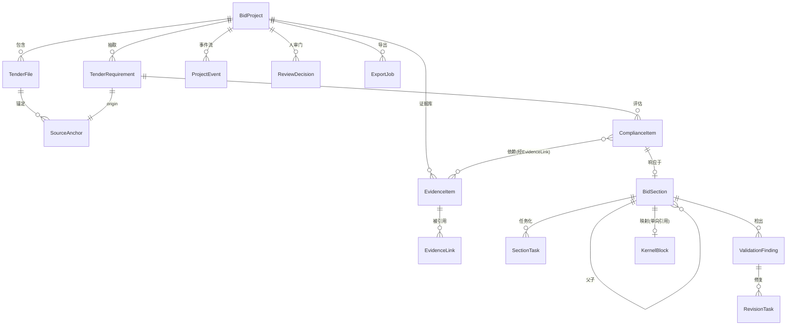
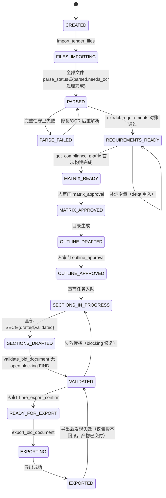

# 标书领域模型（bid-domain-model）

> 定位：AI 标书业务系统的领域数据模型、状态机与文档内核集成边界。本阶段只做设计，不实现。
> 设计依据：15 份开源仓库审计结论（`research/workflow-audit.md` §2 十问、`research/risk-register.md` §2 共性失败模式）。每条关键设计均标注其审计证据来源。
> 命名说明：用户建议的 TenderRequirement / EvidenceReference / ComplianceItem / BidSection / ValidationFinding / RevisionTask 全部保留；EvidenceReference 拆分为 EvidenceItem（证据实体）与 EvidenceLink（引用关系）以同时支持"证据库"与"逐条挂接"。

## 0. 设计原则（每条对应审计教训）

| # | 原则 | 审计证据 |
|---|------|---------|
| D1 | **服务端权威状态**：一切门禁/阻断由后端状态机裁决，前端只读 | 7/15 仓库门禁可绕过（risk-register S-2） |
| D2 | **稳定 ID + 内容哈希**：条款 ID = hash(规范化文本+原文锚点)，跨重跑可对齐 | 15/15 无稳定条款 ID（十问 Q2） |
| D3 | **ID 命名空间隔离**：REQ-/EV-/CMP-/SEC-/FIND-/REV- 与文档内核块 ID（KERNEL-BLK-）永不混用 | 十问 Q3：四向关联无一家完整 |
| D4 | **事件溯源 + 默认可恢复**：状态变更全部落 append-only 事件流，resume 默认开启 | 假恢复/默认关闭（risk-register S-4） |
| D5 | **失效传播显式建模**：上游变更 → 受影响下游清单 → 选择性重执行 | 仅 BidPilot 有此设计（十问 Q8） |
| D6 | **确定性优先**：能写规则的绝不依赖模型；模型判断必须留痕 | 十问 Q7：无一家做全六类确定性检查 |
| D7 | **补遗是一等公民**：addendum 增量抽取 + 与既有清单内容对齐，不整库重跑 | 15/15 无补遗处理（十问 Q8） |

## 1. 领域对象总览

| 实体 | ID 前缀 | 一句话职责 | 审计参照 |
|------|---------|-----------|---------|
| BidProject | PRJ- | 项目聚合根 + 状态机宿主 | BidPilot 11 节点状态机（仅借鉴） |
| TenderFile | TF- | 招标文件/附件/补遗，含解析状态 | OpenBidKit inputSignature、power_grid 断点续传 |
| SourceAnchor | （内嵌） | 原文位置：文件+页+块路径+字符跨度+原文摘录 | LingYan 引用键+页码机器校验 |
| TenderRequirement | REQ- | 六类结构化条款 | ark 双轨、96syh 40+ 模型 |
| EvidenceItem | EV- | 企业证据（证照/业绩/财报/人员/产品） | ai_bidding 混合检索、ark 过期过滤 |
| EvidenceLink | EVL- | 证据↔(要求|章节) 引用关系，含引文摘录 | ai_bidding CIT 登记（输入侧）扩展为双侧 |
| ComplianceItem | CMP- | 要求×证据×章节 的合规判定 | ark response_matrix |
| BidSection | SEC- | 目录节点 + 正文状态 + 内核块映射 | ai_bidding v2 单章任务/版本/restore |
| SectionTask | TASK- | 单章生成/修订的可重试任务 | OpenBidKit 单章重试+级联失效 |
| ValidationFinding | FIND- | 校验发现（规则/模型产出） | OpenBidKit 64 规则、RudyJunyu 34 正则 |
| RevisionTask | REV- | 发现→章节的修复任务 | kcaaaa 断点续写设计 |
| ReviewDecision | RD- | 人审门/waiver 决策记录 | BidPilot 人审门 + 本项目 waiver 语义 |
| ExportJob | EXP- | 导出任务 + 门禁快照 | OpenBidKit 暗标导出、power_grid 公文导出 |
| ProjectEvent | EVT- | append-only 事件流（恢复与审计） | ai_bidding 事件回放、LingYan checkpoint |

## 2. 核心实体定义

### 2.1 BidProject（项目）
| 字段 | 类型 | 说明 |
|------|------|------|
| project_id | PRJ-{ ULID } | 聚合根 ID |
| name / external_ref | str | external_ref 为幂等键（同 ref 重复创建返回已有项目） |
| status | enum | 见 §6 状态机 |
| model_policy_version | int | 当前模型策略版本（换模型即失效传播输入，见 §5） |
| meta | json | 招标人、标段、截止时间、开标方式（明标/暗标）等 |
不变量：`external_ref` 唯一；`status` 只能沿 §6 合法转换移动；一切状态变更必须伴随 ProjectEvent。

### 2.2 TenderFile（招标文件）
| 字段 | 类型 | 说明 |
|------|------|------|
| file_id | TF-{ULID} | |
| role | enum | `main`(主文件) / `attachment`(附件) / `addendum`(补遗) / `clarification`(澄清) |
| sha256 / mime / filename | | sha256 用于幂等去重（重复导入直接返回既有结果） |
| parse_status | enum | pending / parsing / parsed / needs_ocr / failed |
| parse_engine / page_count / chunk_count | | chunk_count 必须与抽取清单对账（防 S-1 截断丢失） |
| supersedes | TF-ID? | 补遗替换关系（增量导入依据） |
解析产出的中间结构（chunk 清单）持久化：`chunks[] = {chunk_id, page_range, block_path, text_hash, char_count}`。**完整性守卫**：`Σ char_count ≥ 输入文本量 × 0.98` 且 `chunk_count > 0`，否则 parse_status=failed（审计教训：R-01~R-08 全部源于无对账）。

### 2.3 SourceAnchor（原文锚点，内嵌值对象）
`{file_id, page, block_path("toc/3/2/§4.1"), char_span(start,end), quote(≤200 字原文摘录), quote_hash}`
不变量：`quote` 必须能在 `file_id@page` 的解析产物中按 `char_span` 校验命中（LingYan 机器校验思路，扩展为硬约束）；校验失败 → 生成 FIND(major)。

### 2.4 TenderRequirement（六类条款）
| 字段 | 类型 | 说明 |
|------|------|------|
| requirement_id | REQ-{内容哈希前 12 位}-{序号} | **ID = hash(normalized_text + file_id + anchor)**，重跑同文件得同 ID（D2） |
| category | enum | `qualification` 资格 / `rejection` 否决(废标) / `scoring` 评分 / `technical` 技术 / `commercial` 商务 / `format` 格式 |
| normalized_text | str | 规范化条文（去格式噪音、保留数值） |
| normalized_fields | json | {amount?, quantity?, duration?, deadline?, cert_type?, threshold?} 数值/日期必须机读（供确定性规则） |
| origin | SourceAnchor | 单一原文锚点（多出处用 `alt_anchors[]`） |
| mandatory | bool + scoring_ref | 评分项挂 scoring_ref（分值/权重） |
| status | enum | active / superseded / waived |
| content_hash | | 与 normalized_text 一致，篡改检测 |
不变量：`category=rejection` 的条款缺失时项目**不得**进入 EXPORTED（十问 Q5 硬门）；`normalized_fields.amount` 存在时必须是可解析数值。

### 2.5 EvidenceItem / EvidenceLink（证据与引用）
EvidenceItem：`evidence_id(EV-), kind{certificate,case,financial,person,product,commitment,other}, title, file_ref{path,sha256}, fields{cert_no?, amount?, date_from?, date_to?, valid_until?, model_no?}, status{fresh,expiring,expired,conflict}, conflict_group[]`
- `valid_until` 由后台时间扫描器维护（过期自动置 expired——ark 过期 SQL 硬过滤的唯一完整实现，吸收为领域规则）。
- `conflict`：同 `conflict_group` 内两条证据字段矛盾（金额/日期不一致）→ 状态置 conflict，其引用一律不满足（十问 Q5 证据冲突）。
EvidenceLink：`link_id(EVL-), evidence_id, target(REQ-|SEC-), quote(引文摘录≤100字), created_by{model_run_id|human}, created_at`
不变量：一切出现在正文中的证据断言必须存在对应 EVL（生成后引用回查的基础数据，审计教训 P-2）。

### 2.6 ComplianceItem（合规判定）
| 字段 | 类型 | 说明 |
|------|------|------|
| compliance_id | CMP- | |
| requirement_id | REQ- | |
| response_status | enum | `compliant` / `partial` / `non_compliant` / `unaddressed` / `pending` |
| decided_by | enum | `deterministic_rule`(rule_id) / `model_assisted`(model_run_id) / `human`(operator) |
| section_id | SEC-? | 响应章节 |
| blocked | bool | 是否构成阻断 |
| waiver_id | RD-? | 人工豁免记录（含理由+有效期） |
不变量：`category∈{rejection,qualification}` 且 `response_status∈{non_compliant, unaddressed}` 且无有效 waiver ⇒ `blocked=true` ⇒ 所属 SEC 不得进入 final（D1 硬门）。

### 2.7 BidSection / SectionTask（章节与任务）
BidSection：`section_id(SEC-), parent_id, title, level, order_index, requirement_ids[], kernel_block_id?(KERNEL-BLK-*), status, version(CAS), word_target, outline_note`
- 子状态机：`outline_only → queued → drafting → drafted → {validated | blocked} →(revision)→ drafting → ... → final`
- `kernel_block_id` 为**单向引用**（领域层保存映射，内核不回写领域语义，D3）。
SectionTask：`task_id(TASK-), section_id, kind{draft,revise,refine}, attempts, max_attempts, last_error{code,message}, context_bundle_ref, model_run_id, status{pending,running,done,failed,blocked}`
不变量：`attempts > max_attempts` ⇒ 任务失败且生成 FIND(blocking)（熔断落库，kcaaaa 设计的代码化）；drafting 中断 ⇒ 任务回 pending，可从事件流恢复（D4）。

### 2.8 ValidationFinding / RevisionTask / ReviewDecision / ExportJob
- ValidationFinding：`finding_id(FIND-), scope{project|section}, rule_id?(确定性规则注册表 ID) | checker{llm_review}, severity{blocking, major, minor}, message, evidence{anchor|EVL|REQ}, status{open,resolved,waived}`
- RevisionTask：`rev_id(REV-), finding_ids[], section_id, instruction, status{pending,running,done,failed,skipped}, attempts`
- ReviewDecision（人审门与豁免）：`rd_id(RD-), gate_id{matrix_approval, outline_approval, pre_export_confirm}, decision{approve,reject,waive}, reason, operator, expires_at`；waiver 过期自动失效（重新触发 blocked）。
- ExportJob：`exp_id(EXP-), format{docx,pdf}, template_id, blind_mode(bool), precheck_snapshot(门禁通过时全量状态快照 hash), status, artifact_ref, checksum`
不变量：创建 ExportJob 必须 `status(project)=READY_FOR_EXPORT` 且记录 precheck 快照；导出产物 checksum 与快照绑定，事后可追溯。

## 3. ID 与版本规范

| 命名空间 | 格式 | 稳定性 |
|---------|------|--------|
| REQ- | hash(norm_text+file_id+anchor)[12] + seq | 内容不变则 ID 不变；补遗修改文本 → 旧 REQ 置 superseded、新 REQ 新 ID，关联表保留血缘 |
| EV- / CMP- / SEC- / FIND- / REV- / RD- / TASK- / EXP- | 前缀 + ULID | 全局唯一、单调有序 |
| KERNEL-DOC- / KERNEL-BLK- | 由文档内核分配 | **领域层只引用不解析、不复用其语义**；映射存于 BidSection.kernel_block_id |

版本规则：BidSection 正文用 CAS 版本号（BidPilot CAS 思路）；ProjectEvent 单调 seq；ExportJob.precheck_snapshot 绑定当时的全部 CAS 版本（导出后章节再变 ⇒ 快照失配 ⇒ 需重新门禁）。

## 4. 枚举汇总

- RequirementCategory：`qualification | rejection | scoring | technical | commercial | format`（六类为封闭枚举，禁止"其他"——分类不确定 ⇒ 抽取任务重试，不得静默丢弃）
- EvidenceKind：`certificate | case | financial | person | product | commitment | other`
- EvidenceStatus：`fresh | expiring(30 天内) | expired | conflict`
- ComplianceStatus：`compliant | partial | non_compliant | unaddressed | pending`
- SectionStatus：`outline_only | queued | drafting | drafted | validated | blocked | revision | final`
- FindingSeverity：`blocking | major | minor`（blocking 定义 = 不修复即不得导出）
- ProjectStatus：见 §6

## 5. 关联关系与失效传播矩阵（D5）

| 触发事件 | 传播路径 | 动作 |
|---------|---------|------|
| 新增/修改 TenderFile(role=addendum) | TF → 增量抽取 → REQ(新增/superseded) → CMP(重判) → SEC(requirement_ids 命中) | 受影响 SEC → `revision` 并生成 SectionTask(kind=revise)；未受影响章节不动 |
| REQ.normalized_text 修改 | 同上（经 §3 血缘表定位） | 同上，且旧 CMP 置 pending |
| EvidenceItem 过期（时间触发） | EV.status=expired → 所有引用它的 EVL 失效 → CMP 重判 | 若新判定 blocked 且 SEC 已 drafted → SEC → `revision`；若项目已 EXPORTED → 生成 FIND(major) 通知 |
| EvidenceItem 冲突（conflict_group） | 同上 | 同上 |
| ComplianceItem.waiver 过期 | RD.expires_at 到期 → blocked 复活 | 同上 |
| model_policy_version 变更 | **不自动失效**已 drafted 章节；记录于事件流 | 新任务用新策略；建议人工触发 `validate_bid_document` 全量复检（换模型只影响未定稿内容，十问 Q8） |
| ExportJob precheck 快照失配 | EXP 创建被拒绝 | 返回 `SNAPSHOT_STALE`，需重新过门禁 |

失效传播实现要求：以 ProjectEvent 驱动，事件处理器幂等（事件重放不产生重复 invalidation）。

## 6. 项目状态机

| 转换 | 触发工具/事件 | 守卫条件 | 执行者 |
|------|--------------|---------|--------|
| →MATRIX_APPROVED | record_review_decision(matrix_approval) | 全部 rejection/qualification CMP 有判定或 waiver | 人 |
| →OUTLINE_APPROVED | record_review_decision(outline_approval) | 目录覆盖全部 requirement（或明确未响应清单） | 人 |
| →VALIDATED | validate_bid_document 完成 | 无 open blocking FIND；全部 SEC∈validated/final | 系统确定性 |
| →READY_FOR_EXPORT | record_review_decision(pre_export_confirm) | 快照一致（CAS 版本无漂移） | 人 |
| →EXPORTING | export_bid_document | §6 守卫 + blind_mode 参数合法 | 系统 |

非法调用处理：任何工具在状态不满足前置条件时返回 `INVALID_STATE`（含当前状态与允许操作清单）——**低能力模型也能据此自我纠正**（audit 教训：tender-cli/Get00 的断链都是缺少这种前置校验）。

## 7. 文档内核适配器最小契约（v0）

原则（对应任务约束"不修改内核、不让内核承担标书领域逻辑"）：
1. 内核是**黑盒文档服务**：只知道"文档-块-版本-导出"，不知道条款/证据/合规。
2. 领域层**不解析** docx/pdf 内部结构，只经适配器操作块。
3. 暗标语义在领域层完成（识别并改写含标识的块 → 调 `update_block`），内核只提供通用导出选项（去页眉页脚、去作者元数据）。

| # | 操作 | 参数 | 返回 | 幂等 |
|---|------|------|------|------|
| 1 | create_document | project_ref, meta{title}, schema_version | doc_id(KERNEL-DOC-) | project_ref 去重 |
| 2 | insert_block | doc_id, parent(KERNEL-BLK-\|root), index, content(md), kind{heading,para,table,list,image}, meta | block_id(KERNEL-BLK-), version | 幂等键去重 |
| 3 | update_block | doc_id, block_id, content, expected_version | new_version | CAS，失配返回 VERSION_CONFLICT |
| 4 | delete_block | doc_id, block_id, expected_version | ok | CAS |
| 5 | get_document_tree | doc_id, depth? | 块树(id,kind,version,children) | 纯读 |
| 6 | create_version_snapshot | doc_id, label | version_id | label 去重 |
| 7 | export | doc_id, format{docx,pdf}, template_id, options{blind_strip_meta, strip_headers} | job_id → artifact_ref, checksum | 幂等键去重 |
| 8 | health_check | — | {kernel_version, capabilities[], schema_version} | 纯读 |

版本协商：适配器启动时调 health_check，`schema_version` 不在支持区间 ⇒ 上报 `KERNEL_INCOMPATIBLE` 并拒绝启动标书流程（禁止半兼容运行——tender-cli 依赖陷阱教训 R-38）。
契约测试：以 stub 内核（内存实现 8 个操作）先行，M0 即可全量跑契约测试（见 `test-plan.md` T8）。

## 8. 持久化要求

- **事件存储**：ProjectEvent 表 append-only（seq 单调），每条 = {event_type, payload, actor, causation_id(触发它的工具调用), occurred_at}；禁止 UPDATE/DELETE。
- **快照**：每次阶段转换写一次全量快照（含全部 CAS 版本）；恢复 = 快照 + 重放其后事件。
- **幂等键表**：所有变更工具接受 `idempotency_key`，24h 内重复提交返回首次结果（含原响应体）。
- **审计**：waiver、门禁决策、模型运行（model_run_id → prompt 摘要 + token 用量）、导出快照全部不可变保存；导出产物 checksum 入库。
- **恢复默认开启**：服务重启后自动进入恢复流程（对比 bidcraft 默认关闭的反例 R-20）。
