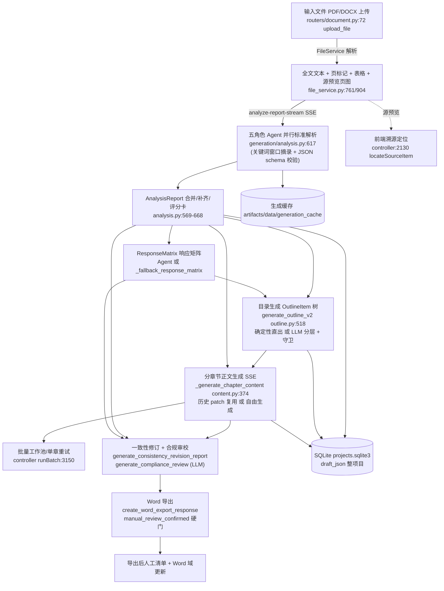

# 96syh/biaoshu 源码审计报告

> 审计对象：本地全量克隆 `/home/z/my-project/repos/96syh__biaoshu/`（github.com/96syh/biaoshu，README 自称"华正 ai 标书系统"，内部代号 yibiao/huazheng-ai）
> 审计方式：只读静态审计（git log/rg/读文件/python3 仅做 ast 文本解析），未安装依赖、未运行代码、未调用 LLM。
> 审计日期：2026-06（基于 HEAD f3a0ac4，2026-05-19）

## 1. 基本信息

### LICENSE
- **MIT License**，文件路径 `LICENSE`，版权行 `Copyright (c) 2025 yibiaoai`。仓库自身代码可自由复用（保留版权声明即可）。
- **重要许可风险**：`backend/requirements.txt:15` 固定 `pymupdf==1.26.4`，**PyMuPDF 为 AGPL-3.0**（内嵌 MuPDF）。`backend/app/services/file_service.py:34` `import fitz  # PyMuPDF`（有 try/except 软依赖守卫，`HAS_ADVANCED_LIBS`）。若主项目闭源商用，必须从依赖中移除 pymupdf（仓库在无高级库时会降级 PyPDF2，`file_service.py:761-767`），否则触发 AGPL 传染义务。其余依赖（fastapi/openai/python-docx/pdfplumber/docx2python/PyPDF2 等）均为 MIT/Apache-2.0/BSD，无风险。

### 主要语言/框架/规模
- Python 后端（FastAPI）33,237 行（117 个 .py）+ TypeScript/React 前端 12,385 行（22 tsx + 15 ts），合计约 45.6k 行；git ls-files 共 282 个文件。
- 技术栈：FastAPI + Pydantic v2 + openai SDK（AsyncOpenAI，LiteLLM Proxy OpenAI 兼容流式）；React 18 + CRA + Tailwind；SQLite（项目库/历史案例库，WAL 模式）；SSE 流式；python-docx 导出。
- 顶层目录结构（每目录一句话）：
  - `backend/`：FastAPI 后端主体（`app/routers` 6 组 API、`app/services` 解析/网关/生成/导出、`app/models/schema_defs` Pydantic 业务结构、`app/utils/prompts` 提示词、`tests` 62 个契约测试、`optional` 可选搜索/MCP、`scripts` 历史案例库构建脚本）。
  - `frontend/`：React 工作台（`features/app/useBidWorkspaceController.tsx` 4099 行主编排器、`services/api.ts` REST+SSE 客户端、`utils/draftStorage.ts` 草稿存储）。
  - `cloudflare-demo/`、`cloudflare-fullstack/`：Cloudflare Worker 演示 stub（src/index.ts 各仅 23-24 行，玩具级，非主链路）。
  - `docs/`：3 篇文档（architecture.md 架构与边界、litellm-proxy.md、local-model-api.md）。
  - `screenshots/`：6 张产品截图 PNG。
  - `.agents/skills/`、`.codex/`、`.trellis/`：Trellis AI 开发流程 harness（开发用 SKILL.md/规范/工作流，非标书业务技能）。
  - 根目录：README、LICENSE、Dockerfile（多阶段 node18+python3.11）、build.py、start-dev.sh/一键启动脚本、AGENTS.md。

### 提交历史
- 全量克隆 `git log` 共 **62 条提交**，HEAD `f3a0ac4` 日期 2026-05-17/19（"0519"），含 2026-04-26 "真实测试0426"、2026-05-11/12、05-19 连续演进；提交信息多为简短 chore（0519/0505/0429），但代码演进痕迹真实（正文、录屏、页眉、备份合并、架构优化等）。远端另有 biao/master 分支。GitHub 元数据称最近推送 2026-06-19（主分支 HEAD 为 5 月中；以本地克隆为准）。

### 测试
- 有。`backend/tests/test_contract_imports.py`（1846 行，**62 个测试**）：覆盖 schema 兼容导出、facade 公共方法、默认路由排除可选模块、SQLite artifacts 路径、生成缓存、方案纲要守卫、并行 Agent 局部失败不阻塞目录、评分卡恢复字段统计、JSON 归一化、废标证据检索词、双 pipeline（技术标/完整标）策略、DOCX 预览、历史案例匹配去重、Word 模板继承/页眉页脚/表格边框/占位过滤/编号去重、patch 操作应用等。
- `frontend/src/App.test.tsx`（224 行，10 个测试）：工作台外壳渲染、生成 markdown 表格解析/规范化/语义表头/空表清理/连续编号。
- 无 CI（无 `.github/`），测试靠手动命令（README 提供 tsc/test/build 验证步骤，start-dev.sh 亦可 AUTO_INSTALL=0）。

### 第三方依赖清单
- `backend/requirements.txt`：fastapi 0.116.1、uvicorn、openai 1.106.1、python-docx 1.2.0、PyPDF2 3.0.1、pydantic 2.11.7、pdfplumber 0.11.7、**pymupdf 1.26.4（AGPL-3.0，注意）**、docx2python、aiohttp、Pillow。无 pyproject.toml（纯 requirements 管理方式，无锁定 hash）。
- `backend/requirements-optional.txt`：duckduckgo-search、beautifulsoup4、playwright、seleniumbase、undetected-chromedriver、**mcp==1.13.1**（仅启用可选搜索路由或手动跑 optional/mcp 时安装）。
- `requirements-cloudflare.txt`/`requirements.docker.txt`：同主依赖子集。

## 2. 能力清单（核心）

标签：IMPLEMENTED / PARTIAL / SPEC_ONLY / ROADMAP / UNVERIFIED / MISSING

**a. 招标文件解析 — IMPLEMENTED**
- 入口：`backend/app/routers/document.py:72` `upload_file` → `FileService.process_uploaded_file_with_metadata`（`file_service.py:1262`）；另有 `/upload-text` 异步预览变体（document.py:111）。
- 支持格式：PDF/DOCX（`.doc` 明确拒绝，提示转存 docx，`file_service.py:158` `SUPPORTED_UPLOAD_MESSAGE`），单文件上限 500MB（config.py settings）。
- 解析器链：pdfplumber 主路径（含逐页 `--- 第 N 页 ---` 标记 + `extract_tables` 表格行 `|` 拼接 + 图片标记替换，`file_service.py:770-853`）→ 失败降级 PyMuPDF（855-890，含 `find_tables`）→ 无高级库时 PyPDF2（891-902）；DOCX 走 docx2python（1102）→ 降级 python-docx 增强（1181）。
- MinerU 可选模式（legacy/auto/mineru/mineru_strict + 超时/设备/语言环境变量，`_extract_with_mineru` file_service.py:993）。
- 中间数据结构：`FileUploadResponse`（models/schema_defs/files.py）——`file_content` 全文文本 + `parser_info`（解析器/降级信息）+ `source_preview_pages`（Office/PDF 渲染页图与文本块坐标，供溯源定位）。

**b. 条款/要求提取（六类分类抽取）— IMPLEMENTED**
- 入口：`/api/document/analyze-report-stream`（document.py:290）→ `OpenAIService.generate_analysis_report_parallel`（generation/analysis.py:617）。**5 个角色化解析 Agent 并行**：招标结构（tender_structure）、评分策略（scoring_strategy）、合规废标（compliance_rejection）、响应矩阵（response_matrix_agent）、生成策略（generation_strategy），每个带 mission/keywords/fields/output_contract/quality_checks（`_analysis_section_specs` analysis.py:27-126）。
- 六类落点（统一结构 `AnalysisReport`，models/schema_defs/analysis.py:470-515）：资格条件 `qualification_requirements`(Q-) + `qualification_review_items`(E-)；否决/废标 `rejection_risks`(R-) + `mandatory_clauses`(C-)；评分项 `technical_scoring_items`(T-)/`business_scoring_items`(B-)/`price_scoring_items`(P-)；技术参数无独立类，散于评分项 `standard` 与方案纲要 `scheme_or_technical_outline_requirements`(BD-SP-)；商务要求 B- + `price_rules` + `volume_rules`；格式要求 `fixed_format_forms`(FF-)/`formal_response_requirements`(F-)/`formatting_and_submission_rules`/`signature_requirements`(SIG-)/`anonymity_rules`。
- 每个 Agent 输入为关键词窗口摘录（`_analysis_section_excerpt` analysis.py:127-173，≤12 窗口 × ±1800/2600 字符），输出经 Pydantic `AnalysisReport` 校验 + `_normalize_analysis_report_payload` 归一化 + `_merge_parallel_analysis_sections` 合并（analysis.py:569-608）+ `_supplement_analysis_report_from_source`/`_repair_bid_document_requirements` 确定性补齐 + `_build_analysis_scorecard` 质量评分（completeness_score/rejection_risk_level/ready_for_outline 等，analysis.py:470-566）。

**c. 原文位置溯源 — PARTIAL**
- 结构化出处：`SourceRef`（id SRC-/location 自由文本"章节、页码、表格或条款位置"/excerpt ≤120 字/related_ids），各条目 `source` 字段自由文本；PDF 解析注入页码标记。
- 前端溯源定位：`useBidWorkspaceController.tsx:2130-2240` `locateSourceItem`/`selectParseSection` —— 把解析条目文本分词后对源文件预览（DOCX HTML 节点或渲染页图文本块）做加权打分匹配，滚动高亮命中块并显示 found/not-found。是运行时匹配定位，**非持久化锚点存储**（条目→页码不落库）。

**d. 企业资料检索/证据（语义召回+精确匹配）— PARTIAL**
- 无向量/语义检索（全仓 grep embedding/vector/faiss/chroma/cosine 零命中）。
- 历史案例库检索：`history_case_service.py`（2602 行）——SQLite PageIndex 节点上的**确定性词元加权打分**（`_pageindex_node_score`:495-547：整串包含 18/12/5 分 + 词元衰减权重 × 标题/正文/元数据 2.2/1/0.55 + 中标/技术标加分），`find_chapter_reference_drafts`:1076 供正文生成复用历史相似章节；`check_requirements`:1241 + `extract_requirement_check_items`:1263 按资格/业绩/人员/信誉等 12 组关键词规则检索历史证据。
- 企业资料画像：`enterprise_material_service.py` `build_profile`（EM-R/EM-P ID、material_type 关键词推断、blocking 缺失推断、verification_tasks 人工复核口径）；资料"已提供"与否仍由用户/分析 Agent 标注，`verification_status` 默认 unverified。**编号/型号/金额/日期的精确匹配核验无代码实现**，依赖提示词约束 + 人工复核。

**e. 响应矩阵/合规矩阵 — IMPLEMENTED**
- `ResponseMatrixItem`（analysis.py:458-470）：id RM-、source_item_id、source_type 8 类（scoring/review/mandatory/risk/material/format/signature/evidence/price）、response_strategy、target_chapter_ids、required_material_ids、risk_ids、source_refs、priority、status（pending/covered/missing）、blocking。
- 生成：独立响应矩阵 Agent（analysis.py:71-82 契约要求 source_item_id 必须引用可追溯 ID）+ 确定性兜底 `_fallback_response_matrix`（fallback_generation.py:928）；独立接口 `generate_response_matrix`（generation/content.py:164，`/api/outline` 内部调用）。审校阶段按矩阵覆盖率检查（ReviewCoverageItem）。

**f. 目录生成与分章节生成 — IMPLEMENTED**
- 目录：`/api/outline/generate-stream`（outline.py:85）→ `generate_outline_v2`（generation/outline.py:518-842）。三条路径：① **确定性直出**——招标文件已列方案纲要（`_collect_scheme_outline_items`）时 L1 直接取原文标题、L2 由标题拆分/评分项确定性生成，不调一级目录模型（outline.py:583-600，进度消息明示"未调用一级目录模型"）；② LLM 分层生成（L1 prompt → L23 prompt，带 schema 示例 + 质量守卫 `_apply_scheme_outline_guard`——L1 不含招标规定方案章节时按确定性节点重建，outline.py:374-386 + bid_generation.py）；③ 模式化兜底（技术标/完整标各自 fallback_outline，technical_outline.py / full_outline.py）。
- 模式体系：`BidMode` 11 值（完整标/技术标/服务方案/施工组织/供货方案/商务卷/资格卷/报价卷），`bid_pipeline_for_mode` 分派 TechnicalBidPipeline / FullBidPipeline 两组任务类（outline/content/review/export 四件套，bid_generation.py:191-251）。
- 单章重生成/编辑：前端 `runCurrentChapter`（controller:3100）、目录节点增删（handleAddOutlineChild:2315/handleDeleteOutlineItem:2345）、批量 `runBatch`（3150）工作池并发 + 失败跳过可单独重试 + 完成后自动一致性收口。
- `OutlineItem`（outline.py:11-37）节点字段：volume_id、chapter_type、scoring_item_ids/requirement_ids/risk_ids/material_ids/response_matrix_ids 映射、expected_blocks（paragraph/table/image/org_chart/...）、anonymity_sensitive/price_sensitive/fixed_format_sensitive。

**g. 审校/校验 — PARTIAL**
- LLM 审校（主体）：`generate_compliance_review`（generation/content.py:203，`/api/document/review-compliance-stream` document.py:721），prompt 见 utils/prompts/review.py:13-60——固定 8 项检查（项目信息一致性/范围正确性/组成覆盖/矩阵覆盖/格式签章暗标/材料占位/图表素材/页码）+ 阻塞判定规则（blocking=true 未处理 → ready_to_export=false；历史残留/工期不一致/资料虚构 ≥blocking/high）。输出 `ReviewReport`（12 类问题清单 + RevisionPlan 修订动作 RP- + ReviewSummary）。
- 一致性修订：`generate_consistency_revision_report`（content.py:116，`/consistency-revision-stream` document.py:685），同样模型判定。
- 确定性代码检查有限：导出占位符正则清除（word_export_service.py:34 `EXPORT_PLACEHOLDER_RE` 待补充/待插入/placeholder/todo 等 + 740/829/1311 表格/段落过滤）；兜底审校 `_fallback_compliance_review`（fallback_generation.py:1669）永远 blocking=1 强制人工；解析评分卡确定性计数。**报价/工期/签章/暗标等内容级检查全部依赖模型 + 人工复核，无正则/规则库硬校验**。

**h. 导出 — IMPLEMENTED**
- `/api/document/export-word`（document.py:777）→ `create_word_export_response`（word_export_service.py:517，1578 行）。python-docx：宋体/黑体 EastAsia 字体设置、TOC 域（`TOC \o "1-3" \h \z \u`）+ PAGE/NUMPAGES 域 + 打开时自动更新域、继承历史样例 docx 作模板（页眉页脚/样式保留 + 项目名替换，482-504/356-373）、markdown 段落/表格/图片解析渲染、`add_export_checklist`（604-661）把签章/固定格式/缺料/阻塞数写入"导出后 Word 处理清单"。
- **硬性人工门**：`if not request.manual_review_confirmed: raise HTTPException(400, "导出前必须完成人工复核确认…")`（word_export_service.py:522）。但 `ready_to_export=false` 本身不硬阻断导出（review_report 仅用于清单文字），无暗标专用排版导出模式（anonymity 规则进入提示词与清单项）。无 PDF 导出。

**i. 状态持久化与恢复 — IMPLEMENTED（有限制）**
- 项目库：`ProjectService`（project_service.py）SQLite WAL，`artifacts/data/projects.sqlite3`（`YIBIAO_PROJECT_DB_PATH` 可覆盖）；projects 表 draft_json **整项目 JSON 一列存储**（含原文、解析报告、目录、正文），app_meta 存 active_project_id；completed/total/word_count 由目录树遍历统计（_stats:90-111）。API：`/api/projects` CRUD + activate（projects.py）。
- 前端：`draftStorage.ts` 主存储已迁移后端 SQLite，防抖 3s/最长 15s 合并写库（DRAFT_SAVE_DEBOUNCE_MS），启动清理旧 localStorage/IndexedDB 遗留。
- 生成缓存：`GenerationCacheService`（generation_cache_service.py）JSON 文件缓存，key=task+model+prompt_version+payload sha256（PROMPT_VERSION="2026-05-10-outline-contract-v2"），换模型自动失效。
- 模型配置：`~/.ai_write_helper/user_config.json`（config_manager.py）。
- 恢复：重新打开项目即续（批量生成按"content 为空"挑 pending 章节）；**解析任务的 pause/resume/stop 仅内存 dict（ANALYSIS_TASKS，document.py:44），进程重启丢失**；无服务端持久任务队列。

**j. 失败处理 — IMPLEMENTED**
- 默认 fail-fast：`YIBIAO_ENABLE_GENERATION_FALLBACKS=0`（generation_policy + core.py:18-30），模型失败/JSON 不完整直接抛可操作错误。
- JSON 防线：`_generate_with_json_check`/`_generate_pydantic_json`（generation/core.py:115-244）——schema 校验失败带校验错误回炉重试（≤3 次 + 0.5s 退避 + "压缩输出/数组收敛"纠正指令）；未转义引号修复器（core.py:53-91）；Claude/网关对象化输出归一化（analysis.py:694+）。
- 并行解析分片失败：单 Agent 失败降为 W-PARALLEL 警告并保留其他 Agent + 本地抽取结果（analysis.py:584-598），旧兜底报告被 `_analysis_report_has_blocking_generation_warning` 拦截、禁止进入目录阶段（outline.py:531-536）。
- 超时：解析整体 1800s（可调），矩阵/审校/一致性 90-120s；流空内容/网关错误显式识别（model_gateway_service.py:340-344 "空流式内容"提示）。
- 前端：章节重试上限（chapterGenerationRetryLimit + waitBeforeChapterRetry 指数等待），批量失败跳过继续 + 结尾列出待重试章节；SSE AbortController 停止；本地安全验证模式（YIBIAO_FORCE_LOCAL_FALLBACK=1 仅在显式开兜底后生效，纯 smoke test 用）。

**k. 日志与可观测性 — PARTIAL**
- `ModelRuntimeMonitor`（model_runtime_monitor.py）：线程锁内存表跟踪连接/流式/失败事件，`/health` 暴露快照，前端"模型运行时"面板轮询（getModelRuntime API）。
- 结构化链路日志：`_log_content_flow`（routers/content.py:22）以"A=…→B=…"字母步骤记录单章生成分支（历史 patch/自主生成/兜底），`_log_content_generation_branch` 同类。
- 其余为 print（无日志文件/级别/持久化/trace_id）；无 metrics/tracing；小瑕疵：`model_runtime_monitor.py:38` `print(f"odel-runtime] …")` 缺 "M" 前缀。

**l. 测试 — IMPLEMENTED**
- 62 后端契约测试 + 10 前端测试（详见 §1）。覆盖数据结构兼容、解析归一化、双 pipeline 策略、历史检索去重、Word 模板继承与占位过滤、patch 操作等回归点。无 CI。

**m. Skill 文件 — PARTIAL（存在但非标书业务技能）**
- 14 个真实 SKILL.md：`.agents/skills/{before-dev,brainstorm,break-loop,check-cross-layer,check,create-command,finish-work,improve-ut,integrate-skill,onboard,record-session,start,update-spec}/SKILL.md` + `.codex/skills/parallel/SKILL.md`。均带 YAML frontmatter（name/description）与阶段规则/停止条件（如 finish-work 的 pnpm lint/type-check/test 门禁清单）。
- **性质**：全部是 Trellis 开发流程技能（代码前读规范、提交前质量门等），配合 `.trellis/spec|tasks|workspace` 与 `.codex/agents/*.toml`。**没有任何标书业务执行型 Skill**。

**n. Dify DSL / 工作流编排文件 — MISSING**
- 全仓无 Dify YAML（仅 .trellis/config.yaml、worktree.yaml 为开发工具配置）。编排为自研：后端 Mixin facade + 模式 pipeline 类 + 前端 controller 状态机。

**o. MCP Server — PARTIAL（第三方示例，非业务能力）**
- `backend/optional/mcp/server/duckduckgo/main.py`：真实 MCP stdio 协议实现（`from mcp.server import Server`、`stdio_server`、Tool 列表、速率限制、参数校验），但内容为 **zhsama/duckduckgo-mcp-server 0.1.2 的拷贝**（Config.server_name 自证），是联网搜索示例而非标书业务工具；不被后端默认导入（README §可选能力明示"手动运行"）；跑起来需 `pip install -r backend/requirements-optional.txt`（mcp==1.13.1、duckduckgo-search 等）。
- 另有 `backend/optional/mcp/client/test.py` 客户端示例、`backend/app/optional/search.py` 可选搜索路由（默认不注册，`ENABLE_SEARCH_ROUTER=1`）。

**p. LLM 调用方式 — IMPLEMENTED**
- 统一经 **LiteLLM Proxy** 的 OpenAI Chat Completions 兼容流式：`ModelGatewayService.stream_chat_completion`（model_gateway_service.py:287-366）——openai SDK AsyncOpenAI、流式、`json_schema` response_format + JSON 守卫消息增强（_augment_messages_for_json_output）、多 base_url 候选轮试、每秒并发信号量（YIBIAO_MODEL_CONCURRENCY=2）、模型选择错误专门提示。
- 模型配置：前端"模型配置"页保存 Base URL/模型名/Key → `/api/config/save` → `~/.ai_write_helper/user_config.json`；`/api/config` 支持端点验证与模型列表同步（routers/config.py + provider_registry）。每次业务请求可用 request.config 运行时覆盖。
- 提示词位置：`backend/app/utils/prompts/{analysis,outline,content,review,document_blocks,core,schemas,outline_templates}.py`（经 prompt_manager re-export），全部内嵌 schema 契约与输出规则。

## 3. README 声明核对

| README 声称 | 判定 | 证据 |
|---|---|---|
| 上传 PDF/DOCX，500MB 上限，不支持 .doc | 已验证 | file_service.py:158（SUPPORTING message）、config.py（max upload）、routers/document.py:72 |
| 默认 pdfplumber/docx2python/PyPDF2，可选 MinerU 四模式 | 已验证 | file_service.py:82-133（get_parser_mode/_mineru_command）、993-1062（_extract_with_mineru） |
| 标准解析报告提取 14 类信息（项目信息/组成/评分/资格审查/形式/响应性/实质性/废标/材料/固定格式/签章/报价/卷册/暗标） | 已验证 | AnalysisReport 字段全对应（schema_defs/analysis.py:470-515）；五 Agent 契约 analysis.py:27-126 |
| 响应矩阵映射到目录/正文/审校 | 已验证 | ResponseMatrix schema + generate_response_matrix + 审校 coverage 检查 + OutlineItem.response_matrix_ids |
| 目录生成支持 8 种模式 | 已验证 | BidMode 11 值（schema_defs/analysis.py:13-53）+ Technical/Full 双 pipeline（bid_generation.py:224-251） |
| 正文按叶子节点逐章生成，SSE 流式、暂停/继续/停止、章节重生成 | 已验证 | /api/content/generate-chapter-stream（content.py:134）；controller runCurrentChapter/runBatch + generationAbortRef/generationPausedRef/waitIfGenerationPaused |
| 样例风格剖面（上传成熟标书反向建模） | 已验证 | /api/document/reference-style-upload（document.py:599）→ generate_reference_bid_style_profile（reference_profile.py:19-60，42k 字符压缩"模板证据包"） |
| 图表与素材规划 | 已验证 | document-blocks-plan-stream（document.py:648）+ generate_visual_asset（aiohttp 调图像模型，visual_asset_service.py:41-80） |
| 合规审校 11 项检查 + 修订计划 | 已验证 | ReviewReport 12 类问题清单 + RevisionPlan；prompts/review.py 必检 8 项 |
| Word 导出 python-docx | 已验证 | word_export_service.py 全文 1578 行实现 |
| 草稿与历史：SQLite 项目库 + 前端延迟合并写库 | 已验证 | project_service.py、draftStorage.ts 防抖 3s/15s |
| "文档解析报告 docs/prompt-workflow.md、docs/biaoshu_prompt_replacement_target_section.md" | **未验证（链接失效）** | docs/ 实际仅 architecture.md、litellm-proxy.md、local-model-api.md，两篇被引文档不存在 |
| MCP DuckDuckGo 示例手动运行、不被默认导入 | 已验证（且为第三方拷贝） | main.py:24 server_name="zhsama/duckduckgo-mcp-server" |
| 输出边界声明（生成草稿，签章/报价/暗标须人工复核） | 已验证 | 导出 400 硬门 + AI 生成声明段 + 导出后清单 |

结论：README 无夸大，功能声称与代码一一对应，且自带"当前限制"自我披露（企业资料非独立模块已改为 enterprise_material_profile——实际已有独立画像，README 此处略滞后）。

## 4. 真实执行链路重建

节点明细（入口/数据结构/模型工具/持久化/失败处理/状态）：

| # | 节点 | 入口(文件+函数) | 数据结构(关键字段) | 模型/工具 | 持久化 | 失败处理 | 状态 |
|---|---|---|---|---|---|---|---|
| 1 | 上传解析 | routers/document.py:72 upload_file → file_service.process_uploaded_file_with_metadata | FileUploadResponse{file_content, parser_info, source_preview_pages} | pdfplumber/PyMuPDF/PyPDF2/docx2python/MinerU(可选) | 临时文件（解析后清理 _safe_file_cleanup） | 解析器链降级 + fallback_used 标记 | IMPLEMENTED |
| 2 | 标准解析 | document.py:290 analyze_report_stream → generation/analysis.py:617 generate_analysis_report_parallel | AnalysisReport{project, source_refs, bid_document_requirements, *_scoring_items, qualification_*, rejection_risks, price_rules, volume_rules, anonymity_rules, analysis_scorecard} | LLM×5 角色 Agent 并行（关键词窗口 12k 输入，json_schema 输出） | GenerationCacheService 文件缓存 | 分片失败降警告保留本地抽取；超时 1800s；重试+归一化修复 | IMPLEMENTED |
| 3 | 响应矩阵 | generation/content.py:164 generate_response_matrix + analysis Agent | ResponseMatrix{items[RM-]{source_item_id,source_type,target_chapter_ids,status,blocking}} | LLM / 确定性兜底 | 随 AnalysisReport 入项目库 | 90s 超时 → 兜底矩阵（仅显式开兜底时） | IMPLEMENTED |
| 4 | 目录 | routers/outline.py:85 → generation/outline.py:518 generate_outline_v2 | OutlineItem{id,title,volume_id,scoring_item_ids,requirement_ids,risk_ids,material_ids,children} | 确定性直出优先，否则 LLM L1/L23 + 守卫重建 | 项目库 draft_json + 缓存 | 旧兜底报告硬拦截；模式化兜底目录（仅显式开关） | IMPLEMENTED |
| 5 | 章节正文 | routers/content.py:134 → generation/content.py:374 _generate_chapter_content | ChapterContentRequest{chapter, parent/sibling, analysis_report, response_matrix, generated_summaries, enterprise_materials, history_reference_drafts} | LLM 流式（temp 0.35）或 历史 Word patch 复用 | 项目库（前端防抖合并） | 单章重试×N、批量跳过续跑、AbortController 停止 | IMPLEMENTED |
| 6 | 历史检索（旁路） | history_case_service.find_chapter_reference_drafts:1076 | PageIndex 节点行{node_title,node_text,project_title,result} + 打分 | 无模型，词元加权 | artifacts/data/history_cases.sqlite3（本地构建脚本生成） | 失败→空候选回退自主生成 | IMPLEMENTED（无语义向量） |
| 7 | 审校 | document.py:721/685 → content.py:203/116 | ReviewReport{coverage, missing_materials, rejection_risks, 12 类 issues, revision_plan, summary.ready_to_export} | LLM（ReviewReport pydantic 约束） | 前端态 + 随导出请求传入 | 120s 超时→兜底审校（永远 blocking=1 强制人工） | IMPLEMENTED（内容级检查靠模型） |
| 8 | 导出 | document.py:777 → word_export_service.py:517 create_word_export_response | WordExportRequest{outline 含正文, analysis_report, review_report, manual_review_confirmed} | python-docx（无模型） | 返回文件流/可选 export_dir | manual_review_confirmed=False → HTTP 400 硬拒 | IMPLEMENTED |

全链判定：**完整链路存在且可运行**（8/8 节点均有真实代码），其中 5/8 节点由 LLM 驱动、3/8 有确定性路径（解析、直出目录、导出）。

## 5. 重点审计问题

**Q1 超长招标文件/附件/表格/扫描件如何处理？如何防截断/遗漏？**
- 长文：`_prepare_analysis_input`（fallback_generation.py:20-70）>45k 字符时按"文档头 12k + 关键词命中行±2 行窗口 + 文档尾 8k"压缩，并明示"请只依据这些片段解析；未出现的信息保持空值，不得编造"；每个角色 Agent 再按自身 keywords 取 ≤12 个 1800/2600 字符窗口（analysis.py:127-173，上限 12k）。
- 表格：pdfplumber/PyMuPDF `extract_tables`/`find_tables`，行内 `|` 拼接并加 `[表格 N]…[表格结束]` 标记；docx2python 保留表格结构。
- 截断防护：解析报告 max_tokens 9000、分片失败保留其他 Agent、JSON 未闭合触发压缩重试指令；`_analysis_report_has_blocking_generation_warning` 拦截"模型输出未完整/超时"报告进入下游（outline.py:531）。
- **遗漏风险确实存在**：45k 上限 + 12 窗口是启发式裁剪，超长文件未命中关键词窗口的条款会系统性丢失；扫描件 PDF 无 OCR 路径（pdfplumber 提取为空），除非启用 MinerU。附件不单独解析（单文件上传模型）。这些属 PARTIAL 缓解而非全量保证。

**Q2 六类要求如何统一成结构化条款清单？数据结构定义是什么？**
- 统一为 `AnalysisReport`（backend/app/models/schema_defs/analysis.py:470-515，40+ 子模型），六类各有专属模型与 ID 前缀（Q-/E-/R-/C-/T-/B-/P-/FF-/F-/SIG-/M-/X-/EV-），合并入口 `_merge_parallel_analysis_sections`（analysis.py:569）按白名单字段合并 + 归一化 + 确定性补齐，最后 `AnalysisReport.model_validate` 强校验。技术参数无独立类（并入评分项 standard/方案纲要），是唯一的"类目弱项"。

**Q3 每条要求如何关联原文位置、证据、响应章节、审校结果？有无 ID 体系？**
- 有 ID 体系（前缀约定见 Q2 + ResponseMatrix RM-、矩阵项 source_item_id 回链）。原文位置：条目 `source`/`source_ref` 自由文本 + `SourceRef{location,excerpt,related_ids}` 全局索引；前端点击条目 → token 打分匹配源预览文本块高亮（controller:2130-2240）。证据：材料 M-/EV- + 企业资料 EM-*，`used_by` 反向引用。响应章节：`ResponseMatrixItem.target_chapter_ids` + `OutlineItem.scoring_item_ids/requirement_ids/...` 双向映射。审校：`ReviewCoverageItem{item_id,chapter_ids,covered,evidence}`。**但锚点不持久化**（location 是文本非页码坐标存储），溯源靠运行时重匹配。

**Q4 企业资料检索是否同时支持语义召回与精确匹配？**
- 不支持向量语义召回（零 embedding 代码）；"召回"= 历史案例库词元加权打分（title/text/metadata 三档权重）+ 12 组业务关键词规则（REJECTION_EVIDENCE_RULES）。精确匹配仅限整串包含（`compact_query in compact_text`），**无编号/型号/金额/日期的结构化精确比对器**；资料真伪靠 `verification_status` 字段 + 人工复核任务 + 提示词"不编造资质"约束。d 项判 PARTIAL。

**Q5 无证据/证据过期/资格不满足时如何阻止错误内容进入定稿？有无硬阻断？**
- 三层：① 提示词层——材料缺失必须保留 `〖待补充：xxx〗` 占位、禁止把缺失资料写成已具备（prompts/review.py 必检第 6 条、content 提示词）；② 审校层——废标风险/实质性条款/固定格式/签章/报价隔离/暗标泄露/资料虚构未处理 → `ready_to_export=false` + blocking issues + RevisionPlan(blocking=true)；③ 导出层——**唯一代码级硬阻断是 `manual_review_confirmed=False → HTTPException 400`**（word_export_service.py:522），导出文档自动附加"AI 生成/人工复核"声明与处理清单；占位符在导出时被正则清空防误交。注意：`ready_to_export=false` 不会在代码层阻止导出请求（仅写入清单提示），完全依赖前端确认勾选——硬阻断依赖人工而非机器校验。
- 兜底审校（模型不可用时）永远返回 blocking=1 + ready_to_export=false（fallback_generation.py:1727-1744），设计上"宁阻勿漏"。

**Q6 章节能否拆成可单独执行/重试/修改/验证的任务？**
- 能。目录树叶子即任务单元：单章 `runCurrentChapter`、批量工作池按 content 空挑 pending、失败章节收集后可单独重试（failedEntries 摘要提示）、AbortController 停止保留已生成内容、目录节点可增删改（handleAddOutlineChild/DeleteOutlineItem）、正文可在文档视图中继续编辑、每章携带 parent/sibling/generated_summaries 上下文隔离生成。

**Q7 报价/工期/数量/资质有效期/签章/暗标等检查，哪些是确定性代码、哪些依赖模型？**
- 确定性代码：导出占位符清除（EXPORT_PLACEHOLDER_RE）、AI 声明与导出清单生成、解析评分卡计数、资质缺失 blocking 推断（enterprise_material_service.py:72，material_type∈{资质,报价} 且 missing）、报价/暗标敏感标志沿卷册规则传播（volume_rules.price_allowed/anonymity_required → OutlineItem.price_sensitive/anonymity_sensitive → 提示词范围规则）、解析任务 pause/stop。
- 依赖模型：全部内容级检查——报价泄漏/工期一致/历史残留/资料虚构/覆盖率/重复内容/固定格式破坏/签章遗漏/暗标身份泄露（ReviewReport + ConsistencyRevisionReport），以及六类条款抽取本身。仓库未实现报价数字算术校验、日期有效期比较等任何确定性业务规则引擎。

**Q8 项目中断、更换模型、补充招标文件后如何恢复状态、识别受影响章节并重新执行？**
- 恢复：项目库整草稿持久化 + active_project_id，重启后前端载入继续；批量续跑按"content 为空"自动挑章节；正文流式中断由前端重试机制接续。
- 换模型：缓存 key 含 model_name + prompt_version → 自动绕过旧缓存重算；模型配置热切换无需迁移。
- 补充文件/重解析：需手动重新执行解析与目录（无自动 diff/影响面分析——不会自动识别"哪些章节受影响需重跑"）；旧兜底报告会被硬拦截提示重新解析。**无任务级依赖图**，影响识别靠人工判断。i 项判 IMPLEMENTED（项目级）/受影响章节识别缺失。

**Q9 是否存在可导入 Dify DSL / 可运行 MCP Server / 独立 Skill？**
- Dify DSL：无（0 个）。
- MCP Server：`backend/optional/mcp/server/duckduckgo/main.py` 是真实 MCP stdio 实现（import 完整：mcp.server/models/Server/stdio_server/types，参数校验、速率限制），但为第三方 zhsama/duckduckgo-mcp-server 0.1.2 拷贝，属搜索示例；跑起来缺 `pip install -r backend/requirements-optional.txt`（mcp/duckduckgo-search），且与标书业务无耦合，后端默认不 import。
- 独立 Skill：14 个 Trellis 开发流程 SKILL.md（带 frontmatter、checklist、停止条件），真实但非业务技能；**无可复用的标书执行 Skill**。
- 结论：三项均不能直接为主项目的 Agent/MCP/Skill 架构提供现成资产，需以本仓库代码为素材自建。

**Q10 哪些代码/提示词/数据结构可合法复用？哪些仅可借鉴？**
- MIT 许可（LICENSE），仓库自有代码可合法复用（保留版权声明）；**唯一法律雷区是 PyMuPDF AGPL 依赖**（requirements.txt:15 + file_service.py:34），闭源复用必须剔除该依赖或走 pdfplumber-only 路径。第三方 vendored MCP 示例（zhsama/duckduckgo-mcp-server）需遵守其上游许可。详见 §6。

## 6. 复用价值与许可

**可直接复用（MIT，给出具体文件）**
- 数据结构（最高价值，可直接抄）：`backend/app/models/schema_defs/analysis.py`（AnalysisReport 全家 40+ 模型 + ResponseMatrix + AnalysisScorecard）、`outline.py`（OutlineItem 映射字段设计）、`review.py`（ReviewReport/RevisionPlan 阻塞语义）、`content.py`（ChapterContentRequest 上下文组装设计）、`files.py`。
- 提示词（业务密度高）：`backend/app/utils/prompts/analysis.py`（ReferenceBidStyleProfile 反向建模契约、五 Agent output_contract/quality_checks 文案）、`review.py`（审校必检 8 项 + 阻塞判定）、`content.py`（章节生成/patch 契约）、`schemas.py`（393 行 JSON schema 示例库）、`core.py`（get_full_bid_rulebook）。
- 确定性抽取与兜底启发式：`backend/app/services/fallback_generation.py`（投标文件组成"应包括下列内容"（1）（2）解析、资格 3.1.x 正则、方案纲要收集 `_collect_scheme_outline_items`:1150、报价/资格 blocking 推断）——作为"模型失败时的本地抽取"思路与代码均可复用。
- 工程机制：`generation/core.py`（JSON 校验重试 + 未转义引号修复）、`generation_cache_service.py`（prompt_version+model 缓存键）、`model_gateway_service.py`（LiteLLM 网关 + 并发信号量 + 空流检测）、`routers/document.py` 的 AnalysisTaskState pause/resume/stop 模式、`project_service.py` SQLite 项目库、`utils/sse.py`。
- 测试范式：`backend/tests/test_contract_imports.py`（62 个契约测试作为"数据结构防漂移"范本）。

**需改造后复用**
- `word_export_service.py`（1578 行）：可作 python-docx 导出底座，但需按主项目"独立文档内核 + 稳定接口"重构，且要剥离对 request 全量对象的耦合；TOC/域/页眉继承/占位清除逻辑值得保留。
- `file_service.py`：解析链可参考，建议**移除 PyMuPDF**（AGPL）只留 pdfplumber/PyPDF2，扫描件需另接 OCR。
- `history_case_service.py`：词元打分检索可作轻量替代方案，但主项目要求语义召回 + 精确匹配（编号/金额/日期），需补向量层与结构化字段比对。
- 前端 `useBidWorkspaceController.tsx`（4099 行单文件）：批量工作池/重试/暂停/草稿防抖机制可借鉴实现，但结构过重，应拆分为状态机+子 hooks。

**仅可借鉴思路**
- 五角色并行解析 + 关键词窗口摘录 + 分片失败降级保留 + 解析评分卡 ready_for_outline 门。
- 确定性"招标直出目录"路径（招标文件已列方案纲要时不调 LLM 直接建目录）。
- 历史 Word patch 复用（模型只出最小补丁、保留历史表格/图片块、暗标敏感块剥离 `_prepare_history_blocks_for_reuse`:731）。
- 双模式 pipeline（技术标/完整标）四件套（outline/content/review/export）任务类分派。
- manual_review_confirmed 硬门 + 导出后清单 + AI 生成声明。

**不建议采用**
- 45k 字符硬裁剪的长文输入策略（改用全量分块+逐块抽取+合并去重更稳）。
- 整项目 draft_json 单列存储（大项目体积/写放大；建议条款/章节/证据分表）。
- cloudflare-demo / cloudflare-fullstack（玩具 stub）。
- `optional/mcp` 第三方搜索示例与 `optional/expand` 旧扩写路由（与主项目架构无关）。

**许可证结论**：仓库 MIT（LICENSE），自有代码复用合法且义务仅为保留版权与许可声明；**但 requirements.txt 携带 AGPL-3.0 的 PyMuPDF，若主项目闭源分发或以服务形式复用该解析路径，必须删除该依赖**（代码已具备无 PyMuPDF 的 PyPDF2 降级路径，替换成本极低）。上游 README"MIT"表述对依赖传染未披露，复用时需自行处理。

## 7. 可靠性风险清单

| # | 风险描述 | 严重程度 | 证据（文件+位置） | 复现/验证方式 |
|---|---|---|---|---|
| 1 | 长招标文件截断丢条款：>45k 字符时输入被"头 12k+尾 8k+关键词窗口"裁剪，每个 Agent 仅 ≤12 窗口×12k；未命中关键词的资格/否决条款会系统性缺失，且无任何"遗漏检测"告警 | 高 | fallback_generation.py:20-70（_prepare_analysis_input）；analysis.py:127-173（_analysis_section_excerpt，windows≥12 即 break） | 构造 >45k 字符含窗口外"否则废标"条款的文本，静态走查 `_analysis_section_excerpt` 窗口覆盖；对照 source_refs 是否含该条款 |
| 2 | AGPL 依赖污染：pymupdf==1.26.4（AGPL-3.0）在默认 requirements 中，作为 PDF 备用解析器与预览文本块提取被真实调用 | 高（法律） | backend/requirements.txt:15；file_service.py:34、197-214（图片提取）、528（页文本块） | `rg -n "fitz" backend/app` 确认调用点；商用复用时移除依赖并验证 PyPDF2 降级路径 |
| 3 | 审校阻断不强制：ready_to_export=false 与 blocking issues 不在代码层拦截导出，仅写入文档清单文字；唯一硬门是前端勾选 manual_review_confirmed，可被直接 API 调用绕过语义 | 高 | word_export_service.py:522（唯一 400 分支）、604-641（blocking_count 仅拼清单行）；export 全函数无 ready_to_export 分支 | 读 create_word_export_response 全函数确认无 ready_to_export 判断；curl 带 manual_review_confirmed=true 即可导出 |
| 4 | 条款溯源锚点不持久：source/location 为自由文本，前端定位靠运行时 token 打分匹配源预览，重排/多文件场景下可能 not-found 或错位；无页码级存储 | 中 | schema_defs/analysis.py:86-90（SourceRef.location 自由文本）；controller:2130-2240（scoreSourceNodeMatch 运行时匹配） | 在 UI 点击解析条目观察定位状态；检查 draft_json 无页码锚点字段 |
| 5 | 扫描件/图片型 PDF 无 OCR 兜底：legacy 模式下 pdfplumber/PyPDF2 提取为空文本，仅"解析完成"且 file_content 近空，无显式"疑似扫描件"告警 | 中 | file_service.py:761-902（纯文本层提取，无 OCR 分支）；MinerU 需手动启用（.env.example YIBIAO_DOCUMENT_PARSER=legacy 默认） | 上传纯图 PDF，静态检查 upload 返回 file_content 与提示文案 |
| 6 | 项目库整草稿单列存储：draft_json 序列化全文+报告+正文，每次保存全量重写该行；大项目（多章 × 数万字）下 SQLite 写放大与体积增长，README 亦自认"需关注体积" | 中 | project_service.py:170-211（upsert 全量 draft_json）；前端 3s/15s 防抖仅缓解（draftStorage.ts） | 检查 schema（单列 TEXT）与 _stats 全树遍历；估算 30 章×8k 字草稿 JSON 体积 |
| 7 | 解析任务控制态内存化：ANALYSIS_TASKS dict 保存 pause/stop 状态，进程重启后 task_id 失效（404），SSE 长任务中途重启无法断点续跑（需整档重解析，虽有缓存部分缓解） | 中 | routers/document.py:32-44（AnalysisTaskState + ANALYSIS_TASKS）；574-599（控制端点） | 重启后端后调用 /api/document/analysis-task/{id}/control 观察 404 |
| 8 | 无语义检索与精确证据比对：历史案例库仅词元加权打分；企业资料编号/型号/金额/日期无结构化校验器，"verification_status" 全靠人工 | 中 | history_case_service.py:495-547（打分）；enterprise_material_service.py:99-111（verification_status 默认 unverified） | grep 全仓无 embedding/向量组件；检查 profile 无字段级比对函数 |
| 9 | 内容级合规检查全依赖模型：报价泄漏/暗标身份/工期一致/虚构检测无任何确定性规则引擎；模型质量直接决定审校有效性；兜底审校则一律 blocking（宁可误杀） | 中 | generation/content.py:203-247（generate_compliance_review 全 LLM）；prompts/review.py 阻塞规则为提示词约束 | 审读 ReviewReport 生成路径确认无本地校验代码分支 |
| 10 | 日志可观测性薄弱：print 直出无级别/持久化/trace_id；ModelRuntimeMonitor 仅内存快照；小 typo（"odel-runtime]"） | 低 | model_runtime_monitor.py:38；全仓 logger 零使用 | grep logging/logger 导入 |
| 11 | 无 CI 与依赖锁定：62 测试仅手动跑，无 .github；requirements 无 hash 锁定 | 低 | 仓库根无 .github；requirements.txt 无 hashes | git ls-files 检查 |
| 12 | README 两处文档链接失效（prompt-workflow.md、biaoshu_prompt_replacement_target_section.md 不存在） | 低 | README.md"相关文档"节 vs docs/ 实际文件 | ls docs/ |

## 总体结论

该仓库是**真实可运行的全流程标书工作台**，远超课程作业/演示级：62 次提交的连续演进、45.6k 行前后端代码、72 个测试、MIT 许可、Trellis 开发 harness、Docker 与一键启动、完整的"解析→五 Agent 结构化抽取→响应矩阵→（确定性/LLM 双路径）目录→单章/批量正文（历史 patch 复用）→双审校→带人工硬门的 Word 导出"闭环，数据结构设计（AnalysisReport/ResponseMatrix/OutlineItem/ReviewReport 的 ID 体系与映射字段）和提示词工程（输出契约/质量门/阻塞判定）是同批审计仓库中完成度最高的之一。短板集中在：长文截断策略、无向量检索与精确证据比对、内容级检查全靠模型、溯源锚点不持久、整草稿单列存储，以及 PyMuPDF AGPL 依赖这一复用前必须处理的许可问题。对主项目的价值排序：数据结构与提示词可直接搬用（去 pymupdf）；工程机制次之；检索与审校需自建增强。
