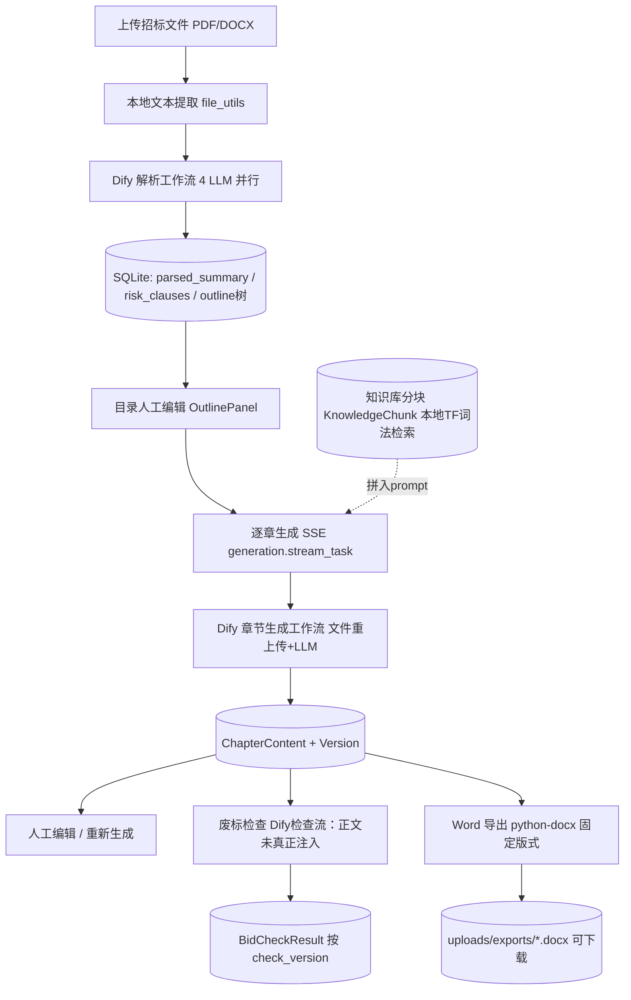

# Chengyihaowen/llm_bidwriting 源码审计报告

> 审计子代理 Task ID: 4-4 · 静态只读审计（未安装依赖/未运行代码/未调用 LLM）
> 审计对象: /home/z/my-project/repos/Chengyihaowen__llm_bidwriting/（全量克隆，80 个 git 文件）

## 0. 总体定性（主代理重点问题的直接回答）

**这不是"仅前端项目"，更不是空壳，定性为：Dify 外挂式轻全栈（前端 demo 之上、产品级之下）。**

- 有真实且完整的前端（Vue3 + ElementPlus，6 模块向导式工作台）；
- 有真实且完整的后端（Flask3 + SQLAlchemy + SQLite，18 个 py 文件约 2100 行，7 个路由蓝图全部有对应实现）；
- 有 **3 份真实可解析的 Dify Workflow DSL**（kind: app, version 0.5.0，含 nodes/edges/插件依赖）——LLM 能力全部外置于 Dify，后端只做编排与持久化，仓库内零直接 LLM SDK 调用；
- 有提示词（在 Dify YAML + docs/spec 镜像文档中）和工作流定义（三流拆分：解析/生成/检查）；
- **git 历史中误提交了 1MB 真实业务 SQLite 库与真实招标文件/已导出标书 docx**（后续 commit 仅从 HEAD 移除，历史仍可检出），证明系统在本地真实运行过——不是演示空壳。
- 但深度不足：无结构化条款、无响应矩阵、无溯源、无确定性校验、无测试、无日志框架、无 MCP、无 SKILL.md；6 个 commit 全部集中在 2026-04-06 同一天，属"个人 AI 辅助（Cursor/AGENTS.md 协作）一次性初始化"项目。

## 1. 基本信息

- **LICENSE：无**。`git ls-files` 无 LICENSE 文件。法律含义：默认版权保留（All Rights Reserved），任何人复用代码/提示词均有侵权风险，本项目不可直接复用其代码，仅可阅读借鉴思路。
- **主要语言/规模**：GitHub 主语言标注 Vue。实际构成（git ls-files 80 文件）：
  - 后端 Python 18 文件 / 2,141 行（`backend/`：app.py 入口、config.py、models.py(336 行 9 模型)、extensions.py、routes/ 7 蓝图、utils/ 5 工具）
  - 前端 Vue+TS 26 文件 / 约 2,700 行（`frontend/`：Vue3+Vite+ElementPlus+Pinia+axios+marked；views 3、workspace 组件 6、TreeNode、api 封装）
  - Dify DSL 3 份 YAML / 1,072 行（`docs/dify_constronstor/`）
  - 设计文档 16 份 md / 4,625 行（`docs/spec/`）
  - 锁文件：frontend/package-lock.json 3,800 行、backend/uv.lock 989 行
- **顶层目录**：
  - `backend/` — Flask 后端（解析编排/流式生成/废标检查/知识库/docx 导出，SQLite 持久化）
  - `frontend/` — Vue3 工作台前端（6 模块向导 UI）
  - `docs/spec/` — 先于代码编写的完整规格文档（01-10 + 提示词镜像，含 Dify 节点↔后端字段映射表）
  - `docs/dify_constronstor/` — 3 份 Dify 工作流 YAML（README 称可直接导入）
  - `AGENTS.md` — AI 编码协作约定（非 SKILL.md）；`README.md`
- **提交历史**：6 个 commit，全部在 2026-04-06（18:26–18:47 +0800）一天内完成；作者 chengyihaowen@gmail.com；非浅克隆、非 fork。历史上 `af3f6ed`/`7232fc3` 误提交 `backend/instance/bid_system.db`(1MB) 与 `backend/uploads/`（真实招标 docx×10、.doc×1、已导出投标文件 docx×5），`8f9d257` 起从 HEAD 移除。
- **测试**：**无**。仓库内 0 个测试文件；仅 docs/spec/08-test-and-milestones.md 为验收清单文档（纯 SPEC）。
- **第三方依赖**：
  - 后端 pyproject.toml：flask>=3.0、flask-cors、flask-sqlalchemy、sqlalchemy>=2.0、python-dotenv、requests、python-docx、pypdf2、pdfplumber、python-magic(-bin)、markdown、beautifulsoup4、lxml；dev=pytest（未用）。**无 AGPL 组件**。
  - 前端 package.json：vue3.5、element-plus、axios、marked、pinia、vue-router（engines node≥20.19）。
  - Dify 依赖：marketplace 插件 `langgenius/openai:0.3.4`（模型写死 `gpt-5.1`，provider `langgenius/openai/openai`）。

## 2. 能力清单（标签 + 证据）

**a. 招标文件解析 — PARTIAL**
- 入口：`backend/routes/files.py:58 parse_tender_file`；上传 `files.py:26 upload_tender_file`（uuid 重命名存 `uploads/tender/`）。
- 支持格式：PDF（pdfplumber 主、PyPDF2 兜底，`backend/utils/file_utils.py:24-43`）、DOCX（python-docx 段落+表格拍平为 ` | ` 行，`file_utils.py:45-58`）；`.doc` 白名单放行但走同一 `_extract_docx` 必解析失败（`file_utils.py:18`）。
- 中间结构：`TenderFile.parsed_text` 全文 TEXT；解析调用 Dify 后把 `parsed_summary/risk_clauses/format_template` 存为三个 TEXT markdown 段（`models.py:78-84`），无结构化条款存储。
- 长文档：**无分块**，整段文本作为 `big_text` 单变量送 Dify（`utils/dify_client.py:51-78`），Dify start 变量上限 500,000 字符；表格（PDF）不做表格还原；扫描件无 OCR——空文本直接 raise（`files.py:75`）。
- 解析为**同步阻塞**调用（Dify blocking 模式，timeout 300s），失败置 `parse_status=FAILED` + `parse_error_message`。

**b. 条款/要求提取（六类分类抽取）— PARTIAL（仅提示词层分类，无结构化落地）**
- 分类由 Dify 解析工作流 ParseBid 节点提示词承担，输出 A-G 七段 markdown：A 项目基本信息（编号/限价/工期/保证金…）、B 资格要求逐条、C 评标办法与分值分配、D 技术要求、E 商务条款、F 偏差规定、G 其他强制要求（`docs/dify_constronstor/招标文件解析工作流.yml` ParseBid user prompt，另有 `docs/spec/10-*.md:134-189` 镜像）。
- 否决项/废标项由 ExtractRiskClauses 节点输出"星号条款/否决性条款/实质性响应/风险提示"四段；格式要求由 ExtractFormatTemplate 输出"组成/模板/签章/装订"五段。
- **落地仅为 3 个 TEXT 列**（`models.py:80-81` risk_clauses/format_template），无 clause 表、无分类字段、无枚举，六类不可程序化消费。

**c. 原文位置溯源 — MISSING**
- 全仓无页码/段落锚点/offset 字段；ParseBid 提示词仅要求风险条款注明"所在章节"文字。UNVERIFIED 不适用——确凿缺失。

**d. 企业资料检索/证据 — PARTIAL**
- `backend/routes/knowledge.py`（上传/解析/启停/删除/检索 API）+ `backend/utils/knowledge_client.py`。
- 本地实现 `LocalKnowledgeClient`：`_split_text`（800 字/120 重叠段落感知分块，:157-185）、`_tokenize`（中文二元 gram + 英数 token，:188-200）、`_score_text`（TF 打分 1+log(tf+1) 归一 √len，:203-217）→ 仅**词法匹配**，无向量/语义召回。
- 精确匹配能力有限：编号/型号/金额/日期只能作为字面 token 命中，无字段感知、无别名/同义词表。
- Aliyun 向量知识库为占位：`AliyunKnowledgeClient` 全部方法 raise RuntimeError（:105-115），配置存在时回落本地。
- 检索结果在生成时经 `build_generation_knowledge_context` 拼为 `[KB n] 文件名|片段#n` 文本注入 prompt（:134-154）。

**e. 响应矩阵/合规矩阵 — MISSING（ROADMAP）**
- `docs/spec/04-architecture.md:291-292` 将"评分项检查、招标响应矩阵"列为"可演进点"，代码零实现。

**f. 目录生成与分章节生成 — IMPLEMENTED**
- 目录：Dify ExtractOutline 节点输出纯 JSON 数组 `[{title, promptRequirement, children}]`（YAML + spec/10:204-273），后端 `_save_outline_nodes` 递归落库 OutlineNode（`files.py:125-141`），支持 markdown 代码块包裹容错（`files.py:96-101` 正则提取）；前端 `OutlinePanel.vue` 树编辑（增删/上下移/启停/promptRequirement 编辑）整体保存（`backend/routes/outline.py:24 save_outline`）。
- 分章生成：`generation.py:90 generate_chapter` 先建 GenerationTask 返回 streamUrl，`generation.py:121 stream_task` 以 SSE（start/retrieval/delta/complete/error）透传 Dify streaming；单章可重复生成/停止/人工编辑（版本表区分 ai_generated/manual_edit）。

**g. 审校/校验 — PARTIAL（纯 LLM，且检查工作流存在严重输入缺陷）**
- `backend/routes/review.py:76 run_bid_check`：汇总全部章节文本 → Dify 检查工作流（单 LLM 节点）→ `results[{riskLevel,title,description,suggestion,relatedOutlineNodeId}]` + summary{high,medium,low}，按 check_version 落库 BidCheckResult。
- **关键缺陷**：检查工作流 user prompt 中"【当前标书正文】"段绑定的是 `parsed_bid`（变量引用 `{{{{#1774853804066.parsed_bid#}}}}`）而非 `chapters_content`（start 节点已声明该必填变量且后端已传入，`dify_client.py:139-143`）——**废标检查实际从未读到生成的标书正文**。
- 确定性代码检查：**无**（报价/工期/签章/暗标 0 规则代码；`_parse_markdown_results` 仅是对 markdown 表格的容错解析 :55-73）。

**h. 导出 — IMPLEMENTED（docx 单模板）**
- `backend/routes/export.py:290 create_export` → `_build_docx`（:195）：python-docx 固定版式（A4、页边距、黑体标题/宋体正文、封面字段、章间分页、markdown 表格→Word 表格、有序/无序列表、粗斜体），ExportTask 记录 + `send_file` 下载。
- 无 PDF、无暗标格式、无目录(TOC)/页码（与 spec/07 声明的差距）；模板名 `standard-bid-v1` 仅存库无模板引擎。

**i. 状态持久化与恢复 — PARTIAL**
- 持久化：SQLite（SQLAlchemy），9 张表覆盖项目/文件/目录/章节(+版本)/生成任务/检查结果/导出任务/知识文件/分块；`app.py:35-62` 启动时 db.create_all + 手写 ALTER TABLE 增量迁移。
- 恢复：状态数据可持久（前端刷新重拉），但 **RUNNING 任务重启后永久滞留无对账**；无断点续跑编排；版本内容不可回滚（`ChapterContentVersion.to_dict` 不含 content，无恢复端点）。
- 数据完整性缺陷：见 R2（目录重建孤儿化章节内容）。

**j. 失败处理 — PARTIAL**
- 有：解析/生成/导出均有 FAILED 状态 + error_message 落库并回传前端；SSE error 事件；生成失败可整章重试；知识检索失败降级为空上下文继续生成（`generation.py:175-176`）。
- 无：重试退避/任务队列/超时熔断（废标检查 HTTP 调用无 timeout，`dify_client.py:148` 未传 timeout）；前端"停止生成"仅关 EventSource，后端生成器仍跑完并保存。

**k. 日志与可观测性 — MISSING**
- 无 logging 配置/无 logger（全后端 rg 仅 16 处 `print(`，如 `review.py:102 print(outputs)`、`generation.py:240 print(e)`）；spec/04:283-289"记录关键日志"要求未实现。

**l. 测试 — MISSING**
- 0 个测试文件；仅 docs/spec/08 验收清单（纯文档）。pyproject 声明 pytest dev 依赖未使用。

**m. Skill 文件 — MISSING**
- 无 SKILL.md；`AGENTS.md` 是 AI 编码协作偏好约定（中文回复/不自动 commit），非技能文件。

**n. Dify DSL — IMPLEMENTED（真实 DSL，含 2 处内容缺陷）**
- 3 份均为真实 Dify app DSL：`kind: app, version: 0.5.0, mode: workflow`，nodes/edges/变量齐全，插件依赖 `langgenius/openai:0.3.4`；python3 yaml.safe_load **3/3 解析通过**。
- 招标文件解析工作流：start→(ParseBid/ExtractOutline/ExtractRiskClauses/ExtractFormatTemplate 4 LLM 并行)→end，输出 4 变量与后端 `files.py:81-84` 字段一一对应。
- 章节生成工作流：start→document-extractor(文件变量 file)→GenerateChapter LLM→end；system prompt 约 2600 字（模板锁定、反 AI 味句式、插图占位、禁止虚构金额/资质）。
- 废标检查工作流：start→LLM→end（含上述 R1 变量绑定缺陷）。
- **花括号异常**：8 处变量引用使用 3~4 层花括号（如 `{{{#…#}}}`、`{{{{#…#}}}}`），与 Dify 标准 `{{#…#}}` 不符，系手工编辑痕迹，导入后提示词渲染存在字面花括号污染风险（`rg -o '\{\{\{\{?#[0-9]+[a-zA-Z_.]*#\}\}\}\}?'` 计 8 处）。

**o. MCP Server — MISSING**（全仓 rg 无 mcp/fastmcp；无任何协议实现）

**p. LLM 调用方式 — IMPLEMENTED（Dify HTTP API 外挂式）**
- 唯一调用通道：`utils/dify_client.py` 经 requests 调 Dify `/workflows/run`（3 个 App Key：PARSE/GENERATE/CHECK，`config.py:27-31`），生成走 streaming SSE 逐行 yield；文件经 `/files/upload` 上传（**每章生成重复上传招标文件**，`TenderFile.dify_file_id` 列存在但从未写入——死字段）。
- 提示词位置：Dify YAML 内嵌 + `docs/spec/10-dify-node-config-prompts-backend-mapping.md`（1573 行逐节点配置镜像）。
- 仓库含 `utils/ThinkStreamFilter.py`（流式剥离模型 `` 推理标签，63 行完整实现），但 `routes/generation.py:11` **只 import 未使用**——若 Dify 模型输出推理标签将直接混入章节正文。

## 3. README 声明核对

| README 声称 | 判定 | 证据 |
|---|---|---|
| 招标文件上传与解析（PDF/Word） | 已验证（.doc 除外） | routes/files.py + file_utils.py：pdfplumber/PyPDF2/python-docx 真实实现；.doc 虽放行但 python-docx 解析必失败（uploads 历史里有用户上传过 1.3MB .doc 的痕迹） |
| 自动生成投标文件目录结构 | 已验证 | Dify 解析流 ExtractOutline 输出 outline_json → OutlineNode 树（files.py:91-106），前端可编辑 |
| AI 逐章节生成投标内容（流式输出） | 已验证 | generation.py SSE 五类事件 + Dify streaming；前端 EventSource 逐字渲染（GenerationPanel.vue:108-173） |
| 废标风险检查 | 部分验证（存在关键缺陷） | review.py + 废标检查工作流.yml 真实存在；但工作流 prompt 将"当前标书正文"误注入 parsed_bid，实际检查的并非标书内容（静态证据，未运行验证渲染后果） |
| 一键导出标准格式 Word 投标文件 | 已验证（部分） | export.py python-docx 固定版式导出真实可用（git 历史含 5 份真实导出 docx）；"标准格式"仅一套版式，无模板可选 |
| 依赖三个 Dify 工作流、YAML 可直接导入 | 未验证（有疑点） | 3 个 YAML 全部可解析、结构为真 Dify DSL；但 8 处非标准花括号变量引用 + 检查流变量注入 bug + 模型名写死 gpt-5.1，导入后能否正确运行无法在只读约束下验证 |
| docs/spec 完整项目设计文档 | 已验证 | 11 份文档与代码高度一致（文档先行、代码按文档实现），含 API/数据模型/逐节点提示词映射 |

README 未声称但存在的：知识库模块（前端+后端完整，README 项目结构里仅一句带过）。README 未声称响应矩阵/评分项检查等，spec 中也明确列为演进点——**无夸大宣传**，声明与实现基本诚实。

## 4. 真实执行链路重建

| 节点 | 入口(文件+函数) | 输入输出数据结构 | 调用模型/服务 | 持久化 | 失败处理 | 状态 |
|---|---|---|---|---|---|---|
| 上传 | routes/files.py:26 upload_tender_file | multipart → TenderFile(file_name/storage_path/parse_status) | - | tender_files 表 | 白名单+50MB 上限；400 校验 | IMPLEMENTED |
| 文本提取 | utils/file_utils.py:12 extract_text_from_file | 文件 → 纯文本 str | pdfplumber/PyPDF2/python-docx | 无（内存） | 异常→FAILED+error_message；.doc 必败 | PARTIAL |
| 解析 | routes/files.py:58 → utils/dify_client.py:51 | big_text(str≤500K) → {parsed_bid, outline_json, risk_clauses, format_template} | Dify 解析流（4×LLM 并行各吃全文） | TenderFile 4 TEXT 列 + OutlineNode 树 | 状态机 FAILED；markdown 包裹 JSON 正则兜底(files.py:97-101) | PARTIAL（无结构化条款） |
| 目录编辑 | routes/outline.py:24 save_outline | nodes[]{title,nodeType,promptRequirement,isEnabled,children} | - | 全删重建 outline_nodes | 空目录拒绝 | IMPLEMENTED |
| 知识检索 | utils/knowledge_client.py:69 search | query → items[{content,score,source{fileName,chunkNo}}] | 本地 TF 词法（无模型） | knowledge_files/chunks 表 | 异常→空上下文降级 | PARTIAL（无语义，Aliyun 占位） |
| 分章生成 | routes/generation.py:90/121 → dify_client.py:81 | {file(重上传Dify), parsed_bid, chapter_title, chapter_structure, prompt_requirement} → SSE text_chunk 流 | Dify 生成流（document-extractor 提取原文 + LLM） | GenerationTask + ChapterContent + Version | SSE error 事件 + FAILED；无取消传播 | IMPLEMENTED |
| 人工编辑 | routes/generation.py:48 save_chapter | content str → 版本号+1 | - | chapter_content_versions(manual_edit) | - | IMPLEMENTED |
| 废标检查 | routes/review.py:76 → dify_client.py:129 | {parsed_bid, risk_clauses, chapters_content[:80000]} → results[]+summary | Dify 检查流（1×LLM） | BidCheckResult(check_version 递增) | **无 timeout**；JSON/markdown 双解析兜底 | PARTIAL（正文注入 bug） |
| 导出 | routes/export.py:290 → _build_docx:195 | 树+contents_map+封面字段 → .docx | python-docx（无模型） | ExportTask + uploads/exports/ | 异常→FAILED+message | IMPLEMENTED（单模板） |

**缺失节点**：条款结构化清单、原文位置溯源、证据↔条款↔章节关联、响应矩阵、确定性校验、断点续跑调度、TOC/页码/PDF/暗标导出、登录鉴权。

## 5. 重点审计问题

**Q1 超长招标文件/附件/表格/扫描件如何处理？如何防止截断、解析失败或分块遗漏导致条款丢失？**
无实质机制。全文一次性提取为单个字符串（pdfplumber 逐页 join），整段塞给 Dify（start 变量 `big_text` max_length=500000 字符，超限会被 Dify 拒绝→解析失败）；4 个 LLM 节点各自全文处理，无分块、无摘要层级、无遗漏检测。PDF 表格仅取 `page.extract_text()` 文本（`file_utils.py:29-33`），结构丢失；DOCX 表格拍平成 ` | ` 行（`file_utils.py:52-57`）；扫描件 0 处理（无 OCR，抽不出文本即 FAILED）。唯一截断防护是废标检查侧 `chapters_content[:80000]`（`dify_client.py:142`）——静默截断，无提示。防条款丢失策略：源码未体现。

**Q2 六类要求如何统一成结构化条款清单？数据结构定义是什么？**
未统一。六类只存在于 ParseBid 提示词的输出段落标题里（A 项目基本信息/B 资格/C 评标/D 技术/E 商务/F 偏差/G 其他），落地即 `TenderFile.parsed_summary` 一个 TEXT 列的 Markdown 文本（`models.py:79`）。**无 clause/requirement 数据表、无分类字段、无 JSON schema**。数据结构定义不存在——这是该仓库与"标书 Agent 后端状态模型"目标差距最大的一环。

**Q3 每条要求如何关联原文位置、证据、响应章节、审校结果？有无 ID 体系？**
部分 ID 体系：OutlineNode.id ↔ ChapterContent.outline_node_id ↔ ChapterContentVersion ↔ GenerationTask.outline_node_id ↔ BidCheckResult.related_outline_node_id（字段存在）。但：①废标检查工作流 system prompt 第 9 条强制"relatedOutlineNodeId 当前阶段统一输出 null"，检查结果与章节**实际无关联**，ReviewPanel 也无跳转章节交互；②条款本身无 ID、无原文锚点；③证据（知识块）与章节无外键关联，只在生成时一次性拼接进 prompt 文本，不留证据引用记录。即：章节↔内容↔版本的 ID 链成立，条款/证据/审校三侧断链。

**Q4 企业资料检索是否同时支持语义召回与精确匹配？**
都没有真正的实现。仅有本地 TF 词法打分（`knowledge_client.py:188 _tokenize`：中文连续字→二元 bigram+全串、英文数字连续串为单 token；`:203 _score_text`：1+log(tf+1) 除以 √doc_len），无 embedding/向量库/语义；编号、型号、金额、日期只能靠字面 token 命中（大小写不敏感），无字段级精确匹配器、无别名词典、无日期归一化。阿里云语义检索为占位实现（直接 raise）。

**Q5 无证据/证据过期/证据冲突/资格不满足时，如何阻止错误内容进入定稿？**
无硬阻断。知识检索失败时静默降级为"无知识上下文继续生成"（`generation.py:175-176` SSE 通知 fallback）。废标检查不设门禁：ExportPanel 导出按钮不检查 bid-check 结果、不检查章节完成度，空章节直接写"（本节内容待填写）"照常导出（`export.py:269-270`）。唯一的"软约束"是生成提示词要求"不得虚构金额/日期/资质"——纯提示词级。确定性资格校验代码 = 0。源码未体现任何阻断机制。

**Q6 章节能否拆成可单独执行/重试/修改/验证的任务？**
可以——这是本仓库设计最完整的部分。粒度=一级章（含其二级节结构），`GenerationTask` 表独立记录每次生成（task_id → streamUrl → SSE），前端每章可"生成/重新生成/停止/编辑"，编辑走版本表（source_type 区分 ai_generated/manual_edit）。但"验证"环节缺失：无单章级检查（废标检查只有全文档级别）；版本表不可回滚（versions 列表不含 content 字段，无恢复 API——`models.py:182-188` to_dict 仅返回元信息）。

**Q7 报价/工期/数量/资质有效期/签章/暗标等检查，哪些是确定性代码、哪些依赖模型？**
**全部依赖模型**（废标检查工作流 LLM 单点）。确定性代码检查为 0：无正则规则库、无金额/日期比对、无签章检测、无暗标格式检查。且由于 §2g 的变量注入 bug，当前这条 LLM 检查链看到的正文输入还是错的。

**Q8 项目中断、更换模型、补充招标文件后，如何恢复状态、识别受影响章节并重新执行？**
数据可恢复（全量 SQLite 落库），链路不可恢复：RUNNING 任务重启后永久滞留（无对账清理）；无批量重生成；更换模型只需在 Dify 侧改（代码不感知，这点因 LLM 外置反而好）；补充招标文件=重新上传+重新解析 → `OutlineNode.query.filter_by(project_id).delete()`（`files.py:105`）**删除全部旧目录节点**，而该 delete 是 SQL 级批量删除、不触发 ORM 级联且 SQLite 默认不强制外键，旧 ChapterContent 成为孤儿行——已生成章节内容与目录脱钩、静默作废（目录编辑保存 outline.py:33 同样问题）。

**Q9 是否存在可导入 Dify DSL / 可运行 MCP Server / 独立 Skill？**
- **Dify DSL：3 个均真实存在且 YAML 全部解析通过**（kind: app / version 0.5.0 / nodes+edges / marketplace 插件依赖 langgenius/openai:0.3.4 / 模型 gpt-5.1）。要跑起来还需：①修废标检查工作流 user prompt 的 chapters_content 引用 bug；②核对 8 处非标准花括号变量引用（`{{{#`/`{{{{#`）；③Dify 环境装对应插件且存在 gpt-5.1 模型；④后端 .env 配 3 个 App Key。缺这四步无法保证正确运行（导入后运行时行为 UNVERIFIED，静态审计未执行导入）。
- **MCP Server：不存在**。**Skill：不存在**（AGENTS.md 非技能文件）。

**Q10 哪些代码/提示词/数据结构可合法复用？哪些仅可借鉴思路？**
无许可证 → **代码层面均不可合法复用**（默认版权保留，复用有法律风险）。仅可"学习借鉴"层面：① Dify YAML 中的提示词工程（解析 A-G 分类法、目录→promptRequirement 约束生成、生成章节约 2600 字 system prompt 的"模板锁定/反 AI 味/插图占位/禁写句式"体系、废标三分类 JSON schema）是本仓库最有价值的资产，但提示词文本同样受版权保留约束；② Flask 侧 SSE 透传 Dify 流式（generation.py 事件转发模式）、章节版本表设计、GenerationTask 任务化模式；③ export.py 的 markdown→docx 固定版式转换（表格/列表/字体控制）是成熟写法。第三方依赖无 AGPL 风险。

## 6. 复用价值与许可

- **可直接复用**：无（无 LICENSE，硬性法律障碍）。
- **需改造后复用（若取得作者授权/其后补证）**：`utils/knowledge_client.py`（零依赖中文 2-gram TF 检索，可作降级层）；`utils/ThinkStreamFilter.py`（流式过滤模型思考标签，逻辑完整可直接接线）；`routes/export.py` 的 markdown→docx 渲染（表格/列表/粗斜体/版式控制）；`routes/generation.py` 的"GenerationTask+SSE streamUrl"任务模式；TenderFile/OutlineNode/ChapterContent(+Version)/BidCheckResult/KnowledgeChunk 表结构。
- **仅可借鉴思路**：Dify 三工作流拆分（理解招标/按章生成/风险检查）+ 后端字段映射设计（docs/spec/09、10，含"节点配置↔后端字段"映射方法论）；"目录节点携带 promptRequirement 驱动逐章生成"机制；生成 prompt 的模板锁定与反幻觉约束写法；BaseKnowledgeClient→Local/Aliyun/Fallback 的 provider 抽象。
- **不建议采用**：条款/风险/模板存 Markdown TEXT blob 的无结构数据模型（与目标"结构化条款+ID 体系"背道而驰）；无 timeout 的外部调用；.doc 放行但必败的校验；无日志/无测试/无鉴权的工程基线。
- **许可证结论**：无 LICENSE = 默认全版权保留。对本项目：**只读学习、禁止代码与提示词原文复制**，如需采用其思路须重写实现并自行承担原创性。建议主项目将其标记为"Dify 编排 + 轻后端"架构参照样本（思路参考级），不纳入可复用代码清单。

## 7. 可靠性风险清单

| # | 风险 | 严重度 | 证据(文件+位置) | 复现/验证 |
|---|---|---|---|---|
| R1 | **废标检查从未见过标书正文**：检查工作流 user prompt 第三段【当前标书正文】绑定 `parsed_bid`（应为 `chapters_content`，start 节点已声明该 required 变量且后端已传入），检查模型实际对照"招标摘要 vs 招标摘要+风险条款"，废标检查形同虚设 | 高 | docs/dify_constronstor/废标检查工作流.yml LLM 节点 user prompt（`{{{{#1774853804066.parsed_bid#}}}}` 出现两次）；dify_client.py:138-143 payload 确含 chapters_content | python3 解析 YAML 打印 prompt 可复核；导入 Dify 后跑一次检查可实证 |
| R2 | **目录重建孤儿化已生成内容**：`OutlineNode…delete()`（files.py:105、outline.py:33）为 SQL 级批量删除，不触发 ORM cascade；SQLite 默认不启用外键约束，ChapterContent(outline_node_id 非空 FK) 残留为孤儿行，生成后再编辑保存目录会使已生成内容静默失联 | 高 | routes/files.py:105、routes/outline.py:33-34、models.py:120（cascade 仅 ORM 层） | 生成 1 章→目录面板任意改动并保存→导出：该章正文消失（DB 中 orphan 行仍在） |
| R3 | **废标检查可无限挂起**：`run_check_workflow` 最后一个 `requests.post` 未传 timeout（同文件其余 3 处均有 300s），同步路由可能永久阻塞占死 worker | 高 | utils/dify_client.py:136-152（读取 timeout 变量但未传入） | 静态对照 39/73/114 行与第 148 行；Dify 慢响应时 POST /bid-check 挂起 |
| R4 | `.doc` 上传允许但解析必败（python-docx 无法读 OLE2 二进制 doc）；git 历史中存在用户真实上传的 1.3MB .doc 佐证 | 中 | utils/file_utils.py:4（allowed 含 doc）+ :18（doc 也走 _extract_docx） | 上传任一 .doc 触发解析→FAILED |
| R5 | **超长文件无防护**：50MB 文件可产出 >50 万字符文本，被 Dify start 变量拒绝→解析失败；无分块方案；`chapters_content[:80000]` 静默截断超长标书尾部章节 | 中 | dify_client.py:142；招标文件解析工作流.yml start 变量 max_length=500000 | 上传大 PDF→parse→Dify 校验失败 |
| R6 | 前端"停止生成"不能真正停止：仅关 EventSource，后端生成器继续消费 Dify 流并 commit 入库（SSE 生成器无取消检查） | 中 | frontend GenerationPanel.vue:192-197 stopGenerate；routes/generation.py:244-283 | 点停止后查 chapter_contents 内容仍被写入 |
| R7 | ThinkStreamFilter 死代码：导入未接线，模型推理标签 ` …` 会原样流式展示并保存进章节正文 | 中 | routes/generation.py:11 import 后 0 使用（rg 全后端仅 2 处命中）；ThinkStreamFilter.py 完整实现 63 行 | 换推理型模型生成一章观察输出 |
| R8 | 无认证 + CORS 全开（`CORS(app, resources={r"/api/*": {"origins": "*"}})`）+ 用户上传文本直进 prompt → 提示注入与数据暴露面 | 中 | backend/app.py:11、全部 routes 无鉴权 | 静态（spec 明示首期不做，属已知取舍） |
| R9 | 死字段/占位实现堆积：`dify_file_id`（每章生成重复上传招标文件）、`relatedOutlineNodeId`（提示词强制恒 null）、`template_name`（仅一个硬编码模板）、Aliyun provider（raise 占位）、`_parse_check_results` 注解 `-> list` 实返 tuple | 低 | models.py:84/228、knowledge_client.py:105-116、review.py:13/52、export.py:295 | 代码阅读 + rg |
| R10 | 无日志（仅 16 处 print）、无测试、手写 ALTER TABLE 迁移：线上排障与升级能力弱 | 中 | 全后端 rg 'import logging' 0 命中；app.py:40-60 | 代码阅读 |
| R11 | **敏感数据留存 git 历史**：初始提交误含 1MB 真实业务 SQLite 库（含 ai_generated 版本、outline_confirmed 等真实数据）与真实招标文件/已导出标书 docx，后续仅从 HEAD 移除，任何 clone 可从历史检出 | 中 | `git show af3f6ed --stat`；`git show af3f6ed:backend/instance/bid_system.db \| strings` 可见表结构/状态值 | git log --all 检出该 commit |

## 8. 附：前端 UI 流程与状态管理（主代理重点深挖项）

**页面流**：`ProjectList.vue`（创建对话框：项目名/投标单位/招标名称/编号 → 跳工作台；列表带 status tag；删除需确认）→ `/projects/:id` 进入 `WorkspacePage.vue`：左侧 6 模块导航，顺序即业务流程——①招标文件（TenderFilePanel：上传→点"开始解析"→成功 emit `parsed` **自动跳目录**）→②目录编辑（OutlinePanel：TreeNode 树组件，增删/上移下移/每节 promptRequirement 编辑，保存后 emit `saved` **自动跳知识库**）→③知识库（KnowledgePanel：上传/解析/启停开关/删除/手动检索测试框 topK）→④正文生成（GenerationPanel：两级章节树，选中章节→生成本章/重新生成/停止/编辑/保存；SSE 流式 markdown 渲染；retrieval 事件展示命中的知识片段）→⑤废标检查（ReviewPanel：执行检查→高/中/低风险汇总卡+筛选+建议列表）→⑥导出（ExportPanel：封面四字段表单→生成并下载→历史记录）。模块可自由切换、无强制门禁（无"未解析不能生成"的 UI 阻断，仅后端报错兜底）。

**状态管理**：**无业务级全局 store**——Pinia 已安装但只剩未使用的脚手架 `stores/counter.ts`；HelloWorld/TheWelcome/WelcomeItem/icons/HomeView/AboutView 等 Vue 默认脚手架残留仍在仓库（约 400 行）。所有业务状态为组件本地 `ref` + props/emit + 每次进面板向后端重新 GET——**单一事实源是后端 SQLite**（刷新不丢状态），跨面板无共享内存状态。接口层集中封装在 `src/api/index.ts`（axios 实例 + 7 组 API，与后端 7 蓝图一一对应）。流式状态机（generating/streamText/taskId/retrievalItems/streamCompleted）全部封装在 GenerationPanel 组件内。

## 9. 审计方法备注

- 证据采集：git log/ls-tree/show（含历史提交的 stat 与 DB strings 检查）、python3 yaml.safe_load 解析 3 份 Dify DSL 并程序化提取 nodes/edges/start 变量/end 输出/LLM prompt 全文、逐文件精读 backend 全部 18 个 py 与 frontend 关键 12 个组件、rg 检索（ThinkStreamFilter/dify_file_id/timeout/logging/mcp/skill 等交叉验证）。
- 依硬性约束未做：npm/pip install、启动 Flask/Vite、Dify 导入运行、任何 LLM 调用。Dify DSL"导入可用性"结论限于静态结构验证+缺陷定位，运行时渲染行为标 UNVERIFIED。
