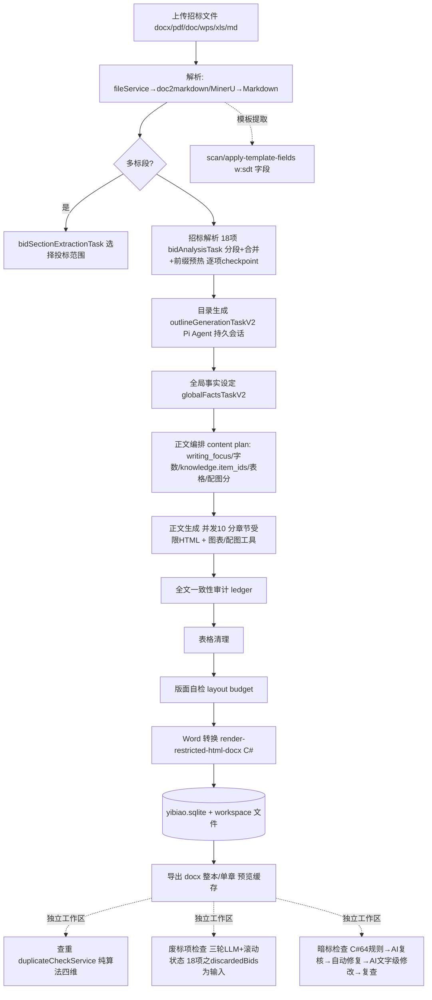

# FB208/OpenBidKit_Yibiao 源码审计报告

> 审计方式：纯静态（git ls-files / rg / 只读源码精读），未安装依赖、未运行仓库代码、未调用任何 LLM。
> 浅克隆限制：仅含最近 21 条提交（2026-10-21 最新），提交总数不可考。
> 许可证警示：**AGPL-3.0**——本报告所有发现**仅可借鉴设计思路，不可复制任何代码**（含提示词文本亦属仓库内容）。

---

## 1. 基本信息

### LICENSE
- **AGPL-3.0 only**（根目录 `LICENSE`，GNU AFFERO GENERAL PUBLIC LICENSE V3 全文）；`NOTICE` 文件含 §7(b) 作者归属声明（作者 mark/yibiaoai，版权 2025-2026）。
- 法律含义：复制/修改/分发乃至**网络提供服务**（AGPL §13 网络条款）都触发 AGPL 义务，要求衍生系统整体开源。对本项目：**零代码复用**，只允许借鉴架构与算法思路（思路不受版权保护）。

### 语言/框架/规模
- 文件数 727（git ls-files）；代码总量约 **14.6 万行**（.cjs 68,549 + .tsx 30,365 + .js 11,486 + .cs 16,081 + .ts 10,298 + .mjs 7,968 + .sql 1,521，另有大量图片/文档资源）。
- 技术栈：Electron 41（Main/Preload 用 CommonJS `.cjs`，Renderer 用 React 19 + TS + Vite 7，经 `window.yibiao` 桥接）＋ **独立 .NET 10 控制台 openxmlhelper（C# 文档内核）** ＋ Pi Agent SDK（`@earendil-works/pi-coding-agent`）＋ Cloudflare Worker（analytics/在线服务）＋ SQLite（better-sqlite3）。

### 顶层目录
| 目录 | 一句话 |
|---|---|
| `client/`（410 文件） | Electron 桌面主应用：`electron/`（Main+IPC+服务）、`src/`（Renderer）、`scripts/`（验证脚本）、`vendor/agent-tools`（Pi 二进制） |
| `openxmlhelper/`（64 文件） | 独立 C# .NET 10 Word/OpenXML 文档内核（BlindCheck 规则引擎 + 修复 + 模板字段 + HTML→docx 渲染） |
| `analytics/`（97 文件） | Cloudflare Worker + 管理面板：埋点、公告、资源、插件、许可证、Agent 错误上报 |
| `使用说明/`（61 文件） | 带截图的完整用户手册 |
| `文章/`（10 篇） | 作者的设计文章（含"知识库之你不需要RAG"、"弱模型稳定输出复杂json"等，是理解设计意图的一手材料） |
| `sql/workspace_schema.sql` | 工作区 SQLite 目标结构（50+ 表，运行时以 `electron/services/sqliteDatabase.cjs` 迁移为准） |
| `.agents/skills/yibiao-user-manual/` | 仓库维护用 Skill（用户手册更新流程，非标书业务技能） |
| `.github/workflows/` | release（Win/Mac 打包）、镜像同步、star-history——**无自动测试 CI** |

### 提交历史
- 浅克隆 21 条，最近提交 2026-10-21（一天多 commit：暗标合规检查、存储清理、月活统计等）→ **极活跃**。

### 测试
- `client/scripts/check-*.cjs` 约 3,043 行**真实可执行验证**（`node --test`）：`check-blind-check.cjs`(686 行, 端到端调用真实 C# 助手断言 64 规则命中/不命中)、`check-blind-check-{fix,review,store,images,extraction}.cjs`、`check-restricted-html-completeness.cjs`；另有 package.json 里 `check:docx`/`check:chrome`/`smoke:electron-native`、`check-technical-plan-export.cjs --ipc`（真实转换+Electron 窗口链路）。
- **缺口**：废标/查重/知识库等 JS 核心服务无单测；CI 不跑任何测试（workflows 仅打包发布）。

### 第三方依赖清单（client/package.json + openxmlhelper.csproj）
- 文档解析：`mammoth`(BSD-2)、`pdf-parse`、`pdfjs-dist`(Apache-2.0)、`xlsx`(Apache-2.0)、`cfb`(Apache-2.0, OLE)、`turndown`(MIT)、`chardet`、`iconv-lite`。
- 导出/渲染：`docx`(MIT)、`@docx-editor.dev/core+react 2.15.0`（**商业组件，且经 `patches/` patch-package 打补丁**，许可证需单独核实）、`mermaid`(MIT)、`cheerio`(MIT)。
- 存储/协议：`better-sqlite3`(MIT)、`ajv`(MIT)、`typebox`、`undici`。
- Agent：`@earendil-works/pi-coding-agent`/`pi-ai 0.80.10`（**上游许可证未随仓库标注**，node_modules 未提交无法本地核验；`@modelcontextprotocol/sdk` 仅作为其传递依赖出现——本仓库并未自研 MCP）。
- C#：`DocumentFormat.OpenXml 3.5.1`(MIT)、`HtmlToOpenXml.dll 3.5.0`。
- 注意点：依赖本身许可证独立于仓库 AGPL（直接使用这些 npm/nuget 包不受 AGPL 约束）；风险集中在 pi-coding-agent 与 @docx-editor.dev 两个非标准组件。

---

## 2. 能力清单（a–p）

**a. 招标文件解析 — IMPLEMENTED**
入口 `client/electron/services/fileService.cjs`：`resolveFileParser` 按配置路由 `local | mineru-accurate-api | mineru-agent-api`；本地支持 `.txt/.md/.docx/.pdf/.doc/.wps/.xls/.xlsx`（`.doc/.wps` 先转 `.docx`，`persistTenderSourceDocx`）；MinerU 两个 API 走 https://mineru.net 上传+轮询（`parseWithMineruAccurate/Agent`）。本地转换内核 `doc2markdown/convert.mjs`(1,633 行)：docx→mammoth→HTML→turndown(GFM)；PDF 三通道（`pdf-parse getText/getTable` + `pdfjs-dist` operator-list 矩形重建表格 `extractPdfJsTables`，文本去重容差）；表格→xlsx 库含表头识别/合并单元格回填；**扫描件显式报错** `ConversionError('pdf_text_layer_missing')`→UI 引导 MinerU。长文分块 `utils/userTextSplitter.cjs`：`context_length_limit`(默认 400k)×0.8，边界优先级 标题→空行→句号→分号→逗号，规避代理对截断、跳过代码块；多标段 `bidSectionExtractionTask.cjs`。

**b. 条款/要求提取 — PARTIAL（分项提取真实存在，但无统一结构化条款清单）**
`bidAnalysisTask.cjs` 定义 **18 个解析项**（与 README "18个解析项"吻合）：projectOverview、techRequirements（区分"技术评分项/技术评分要求"，要求输出【评分项名称】【权重/分值】【评分标准】【数据来源】四元组）、projectInfo/partAInfo/deliveryAndServiceRequirements/agentInfo/keyInfo/marginInfo/openBid/evaluationBid/signingProcess/terminationCondition（JSON，固定 key，缺省"没有提及"）、procurementList/responseFileRequirements/qualificationReview/complianceCheck/businessScoring/discardedBids（Markdown）。`buildInvalidBidAndRejectionItemsPrompt` 明确"无效投标 vs 废标项"概念边界与同义表达归类。三种模式 key(7必填)/full/custom，单项可重跑。**但**：各项结果是 Markdown/扁平 JSON 文本，无统一条款 schema、无条款 ID、六类要求未统一成一张结构化清单。

**c. 原文位置溯源 — PARTIAL**
- techRequirements/评分项要求 LLM 输出【数据来源：章节、条款、页码或表格位置】（提示词级约定，无锚点校验）。
- 暗标链路有**严格段落编号体系**：C# `DocumentModel.Locators`——正文 `p{序号}`、表格 `t{表}.r{行}.c{列}`、页眉页脚 `hdr{n}.{k}`/`ftr{n}.{k}`、脚注尾注 `fn/en`、文本框 `tb{k}`；检查结果、结构导出（dump）、AI 编辑、复查全链路共用（`blindCheckAgent.cjs`、开发说明.md）。
- 废标 findings 的 `bidEvidence` 是文本摘录 + `bidDocumentId`；错别字 findings 有 `position` 偏移量与"原文第 N 行附近"（`findVerifiedTypoPosition`，**程序级位置校验**）。
- 缺：条款→招标原文页码的确定性锚点；解析项无 ID。

**d. 企业资料检索/证据 — PARTIAL**
- 企业凭证库 `credentialLibraryService.cjs`（701 行）：SQLite 单例 profile + certificates/employees/projects/other_materials/images（`sql/workspace_schema.sql` 839–952 行），支持测试数据导入；暗标检查把凭证库企业信息转成敏感词喂给 C# 规则引擎。
- 知识库 `knowledgeBaseService.cjs`(2,304 行)：见深挖⑤——**LLM 条目化，非向量 RAG**；检索 `knowledgeBaseStore.search` 为 SQLite `instr` 关键词匹配（title/resume/content/file_name，按命中字段排序分页，第 256–293 行）。
- 缺：无语义召回 + 精确匹配双通道；无按编号/型号/金额/日期的结构化证据查询。

**e. 响应矩阵/合规矩阵 — MISSING**
全仓库无 requirement×response 覆盖矩阵。最接近的替代物：techRequirements 评分项 → Pi Agent 编排目录/正文（软映射）；废标检查（检查项→findings）；暗标 AI 复核的 `clauses`（每条暗标要求 pass/fail/unknown + 关联问题 id）。均非矩阵形态。

**f. 目录生成与分章节生成 — IMPLEMENTED**
- 目录：`outlineGenerationTaskV2.cjs`(1,601 行) Pi Agent 持久会话生成；目录编辑协议 `saveOutline(reason)`（`replace/edit/delete/add-*/sort`）精确级联失效受影响节点（AGENTS.md 明示为持久化协议）；`outlineAdjustmentTask`。
- 正文：`contentGenerationTask.cjs`(2,804 行) 多阶段——编排（每叶子节 `content_plan`: `writing_focus/target_words/knowledge.item_ids/table.needed/image_suitability_score`，JSON schema `CONTENT_PLAN_SCHEMA` 校验、item_ids 白名单校验防编造）→ 可选原方案还原扩写 → 并发生成（默认并发 10）→ 全文一致性审计 → 表格清理 → 版面自检 → Word 转换；单章重试 `targetItemId`、失败章重试 `retryFailedSections`、续跑 `resume`、`retryContentCorrection`；字数控制 `allocateContentWordTargets` + `layoutBudget/`（sectionSkeleton/pageMetrics/generationBatches 版面预算系统支撑"字数无上限"）。

**g. 审校/校验 — IMPLEMENTED（确定性+LLM 双轨，详见深挖①②③）**
- 确定性：查重四维（元数据/目录/正文/图片，纯算法无 LLM）；暗标 64 条 C# 规则；错别字位置程序校验；JSON 结构校验（Ajv/piJsonValidation）+ Agent 摘录逐字核对；Open XML SDK 前后对比校验；正文提交检查（`inspectSectionArtifact`/`collectTableSubmissionIssues`）。
- LLM：废标三轮+滚动状态流、错别字、逻辑谬误、全文一致性（`contentGenerationConsistencyTools` 台账 ledger）、暗标 AI 复核/修复。
- 缺：报价/工期/数量/资质有效期**无确定性数值校验器**，全靠 LLM 提示词（逻辑检查列出"工期、金额、数量、服务期限"等一致性要求）；签章为线下事项，提示词明确排除。

**h. 导出 — IMPLEMENTED**
- 主通道：C# `render-restricted-html-docx`（整本 `whole_document:true`，页眉页脚 SVG 资产、8 种图片格式按文件头识别、章节页框融合表格、双栏、兼容模式 15；Main 侧 `openXmlHelperService.createRestrictedHtmlDocx` 组装 chrome_assets，30 分钟超时）。
- 模板：`scan-template-fields`/`apply-template-fields`（候选 → `w:sdt` 内容控件，`w:tag=yibiao:field:<id>`，AI/人工字段区分）；模板预览走独立 previewRunner + 5 项 LRU 缓存。
- 暗标格式：BlindCheck fix 输出修复副本（导出暗标合规版本）。
- 遗留 JS 导出器 `exportService.cjs`(3,085 行, docx 库)仍在；检查结果 Excel 导出 `checkResultExportService.cjs`（xlsx 库，废标/查重/暗标结果均支持）。

**i. 状态持久化与恢复 — IMPLEMENTED**
SQLite `userData/workspace/yibiao.sqlite`（`sql/workspace_schema.sql` 50+ 表：technical_plan_*、duplicate_check_*、rejection_check_*、knowledge_*、credential_library_*、blind_check_*、export_templates、feasibility_report_* 等）；任务级 checkpoint（`taskService.cjs` 的 `checkpointTask` 持久 vs `updateTask` 推送）；正文生成 8 个 phase 存 `contentGenerationRuntime.phase`，重启后 `recoverInterruptedContentGenerationTask` 把 running 项归一为 pending 并置 paused 等待用户继续；知识库按 step 落盘断点续跑（`saveDocumentStep`/`clearDocumentProcessingFromStep`/`recoverInterruptedDocuments`）；Pi Agent 持久会话（`piPersistentTaskStore`）。配置在 `userData/user_config.json`。

**j. 失败处理 — IMPLEMENTED（多层）**
- 请求层：`aiRetry.cjs`、请求队列并发 `aiRequestQueue.cjs`、`aiBatchGuard`、SSE 流错误归一。
- JSON 层：`aiService.cjs` 三级抽取（fenced blocks → 平衡括号候选 → 非法转义修复）+ **LLM JSON 修复**（`jsonRepairPrompts.ts`），`collectJsonResponse(normalizer/validator/failureMessage)`。
- 任务层：Markdown 整项"未提取到"自动重跑一次；必填项失败阻塞任务（`getMissingRequiredTasks`）。
- Agent 层：`max_retries` + 校验意见回喂（`piRetryErrorNormalizer`、json-validation 失败→report-failure→原会话修复）；暗标 AI 修复后程序复查，新增问题作为 blocking issue 退回 Agent。
- 内核层：helper 忙→写失败 result 回 done；崩溃→当前 job 失败、下次重新拉起；超时/取消→杀进程（`terminateHelper` 2s SIGKILL 兜底）。

**k. 日志与可观测性 — IMPLEMENTED**
`developerLog.cjs`（developer_mode JSONL 落盘）、`aiLog`、`taskLogStore`、`aiRequestActivity`、`silentFileLog`、token 统计 `textTokenStatsStore`；遥测上报 Cloudflare Worker（`analytics/worker`：track/agentErrors/overview 等，dashboard 可视化）。注意：遥测为内置默认行为（`analytics_client_id`）。

**l. 测试 — PARTIAL**
真实验证脚本存在且针对暗标链路较完整（约 3,000 行 node --test，实际拉起 C# 助手做端到端断言，含中文临时目录、校验位合法的信用代码样本等工程细节）；但无统一测试框架覆盖 JS 业务核心，CI 不执行任何测试。

**m. Skill 文件 — PARTIAL**
`.agents/skills/yibiao-user-manual/SKILL.md`：frontmatter（name/description）完整、流程固定（确定范围→生成→服务器比较→确认发布）、停止条件明确（"出现与预期不同的错误时立即停止…不得自动重试"）——**真实性高，但仅用于仓库用户手册维护，非标书生成技能**。另有 `skills-lock.json`（引用 ibelick/ui-skills）。

**n. Dify DSL — MISSING**
全仓库无 app/graph/nodes/edges 特征 YAML。

**o. MCP Server — MISSING**
无 MCP 协议实现（`@modelcontextprotocol/sdk` 仅为 pi-coding-agent 传递依赖）。Agent 能力以 Pi SDK 私有协议实现（原生 read/write/edit/bash/grep/find/ls + json-validation/report-failure/ask-user/openxml + 业务工具），**思想与 MCP 同构**（工具 schema 用 TypeBox、顺序执行模式、结果 content+details 结构），但不可当作 MCP Server 复用。

**p. LLM 调用 — IMPLEMENTED**
见深挖⑥。提示词文件位置：`client/src/shared/prompts/{analysisPrompts,rejectionPrompts,jsonRepairPrompts,index}.ts`（Renderer 可复用），Main 侧专用提示词与对应 service 同目录（feasibilityReportPrompts.cjs、blindCheckPresetExtraction.cjs、contentGenerationAgent.cjs 等），AGENTS.md 明文禁止在组件内硬编码大段提示词。

---

## 3. README 声明核对

| README 声称 | 判定 | 证据 |
|---|---|---|
| 招标文件解析(18个解析项) | **已验证** | `bidAnalysisTask.cjs` tasks 数组恰 18 项 |
| AI生成技术方案、图文生成、商务标 | 已验证(技术方案+图文)／商务标仅评分要求解析 | technical-plan 全链 + aiImageStyles/mermaid/html 绘图；`businessScoring` 解析存在但无商务标生成链 |
| 标书查重 / 废标项检查 / 错别字 / 逻辑谬误 | **已验证** | duplicateCheckService.cjs / rejectionCheckTask.cjs 四类检查 |
| 暗标检查（含图片颜色合规与自动修复） | **已验证** | blindCheck* + C# BlindCheck（image_facts 由 Main 解码像素传入；BlindCheckFixer 自动修复+复查） |
| 全文一致性检查 | 已验证 | contentGenerationConsistencyTools.cjs（台账+审计阶段） |
| 本地知识库 | 已验证（但**非 RAG**） | knowledgeBaseService.cjs：LLM 条目化 + keyword 检索；作者文章《知识库之你不需要RAG》自证设计取向 |
| 已有方案扩写 | 已验证 | originalPlanRestoration*.cjs、contentGenerationAgent restoration 指令 |
| 多标段/多阶段投标支持 | 已验证(标段)/基本验证 | bidSectionExtractionTask、`technical_plan_generation_bid_tasks` 表 |
| 导出格式设置(预设模板) | 已验证 | exportFormatPresets.ts、templateStore、export_templates 表 |
| 字数无上限 | 部分验证（机制在，未见 11 万字压测证据） | layoutBudget 分批 + generationBatches + wordCount 工具 |
| 全局事实设定 | 已验证 | globalFactsTaskV2.cjs + globalFactsAdjustmentTask |
| 插件系统 | 已验证 | pluginService/pluginContext/analytics pluginStore |
| 开放API | **未验证** | 仓库内无对外 HTTP API 实现（analytics Worker 是自用在线服务） |
| 投标资源下载 | 已验证 | resources 页面 + analytics worker resourceStore |
| 支持 OpenAI like 所有 API、ollama、lm studio | 已验证(机制) | `TextModelProvider='custom'` 任意 base_url；无 ollama 专属代码，靠 OpenAI 兼容端点成立 |
| "完全开源免费" | **夸大（需注意）** | 核心代码 AGPL 开源属实；但内置官方账号充值（OfficialRechargeDialog/发票/订单）、许可证校验（licenseService/LicenseStatusPrompt/离线激活）、必需在线服务提示（RequiredOnlineServicesPrompt）、赞助商与爱发电通道——开源+商业通道并存 |
| "gpt-5.6-terra 11万字 2,187,250 token 仅 1.03 元" | 不可验证 | 营销性声称，无对应代码/测试 |

---

## 4. 真实执行链路重建

技术方案（技术标）主链——该仓库唯一完整闭环：

| 节点 | 入口(文件+函数) | 输入/输出结构 | 模型/工具 | 持久化 | 失败处理 | 状态 |
|---|---|---|---|---|---|---|
| 解析 | fileService.cjs `resolveFileParser`/convert.mjs `convertPathToMarkdown` | 文件→Markdown（mammoth/pdfjs/xlsx/MinerU） | 可选 MinerU API | workspace/technical-plan/tender-originals | pdf_text_layer_missing→引导 MinerU；docx 表格/图片保真 | IMPLEMENTED |
| 多标段 | bidSectionExtractionTask.cjs | Markdown→bidSections[]（id/title） | LLM | technicalPlanStore | 失效校验"投标范围已失效" | IMPLEMENTED |
| 条款提取 | bidAnalysisTask.cjs `runBidAnalysisTask` | 分段 Markdown→18 项 Markdown/JSON（`{id,label,status,content}`） | 文本 LLM（分段并行+LLM 合并 mergeSegmentedAiResults） | technical_plan_* 表 + checkpoint | 缺失项单跑一次重试；必填项缺失→任务 error | IMPLEMENTED(分项) |
| 目录 | outlineGenerationTaskV2.cjs `runOutlineGenerationTaskV2` | bidAnalysis 结果+知识库轻条目→outline 树（UUID id、content_mode） | Pi Agent 会话 | technical_plan_outline_nodes + Pi 持久任务 | 会话续接；中断恢复 paused | IMPLEMENTED |
| 全局事实 | globalFactsTaskV2.cjs | →globalFacts[]（分组） | LLM | technical_plan_global_fact_groups | 可调整任务 | IMPLEMENTED |
| 正文编排 | contentGenerationTask.cjs `createContentPlanningPrompt` | outline 叶子→`正文编排结果.json` content_plan[] | LLM(JSON schema 校验) | content_plans 表 | 计划可复用/裁剪 | IMPLEMENTED |
| 正文生成 | contentGenerationTask.cjs `runContentGenerationTask` + contentGenerationAgent.cjs | content_plan→每节受限 HTML（正文/{id}.html） | Pi Agent+word/edit/table/layout 工具 | content_sections 表+workspace 文件 | 单章/批量重试、resume、submission-fix | IMPLEMENTED |
| 一致性/表格/版面 | contentGenerationConsistencyTools/TableTools/LayoutTools | ledger 台账→issues→修复循环 | LLM+确定性版面测量(C#) | stats.phase | 阶段续跑 | IMPLEMENTED |
| 导出 | openXmlHelperService.cjs `createRestrictedHtmlDocx`→C# `RenderRestrictedHtmlDocxAction` | 受限HTML+exportFormat→docx bytes | 无（C# 确定性） | 临时 job 目录 | imageWarnings 降级；导出修复 Agent 会话 | IMPLEMENTED |
| 查重 | duplicateCheckService.cjs `createDuplicateCheckService` | 文件集→四维分析(元数据/目录/正文/图片) | **无 LLM** | duplicate_check_* 表+signature | 单文件失败不中断 | IMPLEMENTED |
| 废标检查 | rejectionCheckTask.cjs `runRejectionCheckTask` | tender 废标项文本+bid Markdown→findings[]（type/severity/bidEvidence…） | LLM 三轮/滚动补丁 | rejection_check_* 表+inputSignature | 分检查独立成败；签名缓存 | IMPLEMENTED |
| 暗标检查 | blindCheckTask.cjs `runBlindCheckTask` | docx 副本+profile+敏感词+image_facts→64 规则 groups→AI 复核 clauses/candidates/issues→fix | C# 规则+Pi Agent | blind_check_* 表 | 复核失败不阻塞程序结果 | IMPLEMENTED |
| 响应矩阵 | — | — | — | — | — | **缺失** |
| 条款ID/证据关联/硬阻断 | — | — | — | — | — | **缺失** |

---

## 5. 重点审计问题（Q1–Q10）

### Q1 超长文件/表格/扫描件如何处理？如何防截断/分块遗漏？
- **分段**：`userTextSplitter.splitUserTextByContextLimit`（默认 400k×0.8=320k token 窗口；边界：标题→空行→句→分号→逗号；规避代理对与代码块内切割）。招标解析对每段并行执行同一任务再 `mergeSegmentedAiResults`（LLM 合并）。
- **滚动状态流**（废标/逻辑检查超长时自动切换，`shouldUseSegmentedRejectionFlow`）：逐段产出 `RollingRejectionCheckPatch`（新增证据≤60/新增风险≤40/确认风险≤60 有界状态），段间把状态摘要注入下一段提示词，末尾按 20 条/批定稿+全局去重合并——**上下文不丢状态**。
- **表格**：xlsx→Markdown 表；PDF 用 pdf-parse 表 API + pdfjs 操作符矩形重建双通道并去重（`removePdfTableDuplicateText`）；docx→mammoth HTML 保表。
- **扫描件**：本地解析器显式抛 `pdf_text_layer_missing`，`documentParseErrors` + `DocumentParseNoticeProvider` 引导切 MinerU API（支持图片/ppt）。
- **防遗漏手段**：解析项整项"未提取到"标记触发整项重跑一次；必填 7 项未成→任务失败；知识库补充提取轮（带首轮结果再扫一遍找遗漏）+ `findOmissions`（暗标预设提取的关键词查漏）。
- **残余风险**：LLM 分段合并与滚动摘要仍可能丢条款——**没有对原文的覆盖率校验**（无条款 ID 可核对），只能靠"补充轮/查漏"缓解。

### Q2 六类要求如何统一成结构化条款清单？
**不统一**。18 解析项各自为 Markdown/固定-key JSON（如 deliveryAndServiceRequirements 的 9 字段 JSON）；评分项是提示词约定的四元组 Markdown；无效投标/废标项是两分类 Markdown 列表（"招标文件中明确提到的"/"此类标书还可能涉及的"）。唯一强 schema 的条款提取是**暗标格式预设**（`blindCheckPresetExtraction.cjs`）：本地关键词定位格式条款片段→仅片段交 LLM→按字段路径+类型+范围+枚举校验→`verifyEvidence` 逐字校验原文依据→人工核对条款（manual）与漏提检测。该模式是六类条款结构化抽取的最佳内部参照。

### Q3 每条要求如何关联原文位置/证据/响应章节/审校结果？有无 ID 体系？
- **有局部 ID 体系，无全局统一 ID**：
  - 知识库：document_id→block_id→item_id（`knowledge_item_blocks` 关联表），正文编排引用 item_ids（白名单校验防编造）。
  - 暗标：段落定位器 p/t/hdr/ftr/fn/tb 编号贯穿检查/导出/编辑/复查；findings 组 g{序号}、AI 补充 a{序号}、条款 c{序号}，clauses.issues 引用 g/a 编号。
  - 废标：finding id（`rejection_finding_*`）+bidDocumentId+bidEvidence 摘录；检查输入有 `inputSignature`（文档签名+检查项前后 800 字指纹）缓存。
  - 目录/正文：节点 UUID，`saveOutline(reason)` 协议级联失效。
- **缺**：招标条款无 ID → 无法做 评分项↔正文章节↔审校 finding 的自动对账；评分项【数据来源】是自由文本。

### Q4 企业资料检索是否语义召回+精确匹配双支持？
**否**。语义="LLM 全局判断"（正文编排 Agent 从全部轻量条目中选 item_ids，属 LLM 软检索）；检索 API 是 SQLite `instr` 关键词匹配。无向量库、无 embedding、无编号/型号/金额/日期精确查询引擎。作者明示"你不需要 RAG"（文章/知识库之你不需要RAG.md）。**规模上限**：轻量条目全量注入编排提示词，库大会挤占上下文。

### Q5 无证据/证据过期/冲突/资格不满足时如何阻止错误内容进入定稿？
**无硬阻断**。废标/暗标/查重/一致性产出 severity 分级 findings，全部依赖人工在 UI 处理；**导出动作不检查任何 findings 门禁**。可借鉴的"软阻断"机制：
- Agent 输出被程序逐字校验（废标无此校验，暗标有：`validateReviewOutput` 核对摘录→对不上标 unverified→回喂 Agent 修改）；
- 暗标 AI 修复后强制程序复查，"修改后新出现的问题"作为 blocking issue 退回 Agent 修正（`runBlindCheckFixAgent.validateOutput`）；
- 正文 Agent 提交检查（图片保护/表格结构/字数）不过→`submission-fix` 工具强制修复；
- 单条规则异常不中断整体（`RuleEngine` try/catch per rule）。
结论：审校"发现"能力真实且分层，但"阻断定稿"能力缺失（设计取向：辅助人工，非流水线门禁）。

### Q6 章节能否拆成可单独执行/重试/修改/验证的任务？
**能，是本仓库工程亮点**。目录叶子节点即任务单元（content_mode=ai-generate）；`payload.targetItemId` 单章重生成、`retryFailedSections` 批量重试、`resume` 断点续跑、`retryContentCorrection` 内容矫正；每章受检（HTML 结构检查、字数、配图引用、表格规范）；目录编辑 6 种 reason 精确失效下游；正文/导出修复复用同一 Pi Agent 会话；暗标修复副本上 Agent 以 apply-edits 工具做受控文字级修改（find 必须逐字唯一、禁删特殊段落、整批校验失败则撤销）。

### Q7 报价/工期/数量/资质有效期/签章/暗标，哪些确定性、哪些靠模型？
- **确定性代码**：暗标全部 64 规则（字体/字号经 docDefaults→样式链→直接格式求值、行距、页码模式、目录/封面识别、页眉页脚、隐藏文字、超链接、批注/修订、表格底纹、图片元数据 EXIF/EMF/WMF/SVG 文字、信用代码/身份证**校验位算法**、USCC 强后缀企业名+第三方机构白名单、占位符）；查重四维（Dice bigram、LCS、骨架键、sha256）；错别字位置存在性校验；Open XML SDK 校验；JSON schema 校验。
- **依赖模型**：废标条款提取与三轮判定、错别字候选、逻辑谬误（工期/金额/数量一致性在此提示词中）、全文一致性、暗标 AI 复核（候选判定+补漏+逐条条款 pass/fail）、暗标文字级修复、知识条目、目录/正文编排生成。
- **签章**：明确排除（提示词反复强调"不得检查签字、盖章、密封、纸质正副本"——电子文件可判定口径）。
- **报价**：tenderFieldDenyPattern 在查重里**排除**报价字段（防止招标方报价表导致误判重复），但无报价数值校验器。

### Q8 中断/换模型/补充招标文件后如何恢复状态、识别受影响章节？
- 中断：任务 checkpoint 落 SQLite；重启 `recoverInterruptedContentGenerationTask/OutlineGenerationTask` 把执行中项归一 pending、任务置 paused，UI"点击继续恢复"；Pi 会话持久化可续接；知识库按 6 个 step 恢复；结果缓存用 inputSignature（文档签名+检查项首尾 800 字），输入变化自动失效旧结果。
- 换模型：**无受影响章节识别**——已生成章节不重跑（正文质量不与模型版本绑定）；模型配置只影响后续请求。
- 补充/重传招标文件：`force_rerun` 显式清空下游（outlineData、globalFacts、contentGenerationSections/Plans/Runtime 全部重置，technicalPlanPatch 清空 projectOverview/techRequirements）——**级联失效是显式实现**，但需用户主动触发，非自动 diff。

### Q9 可导入 Dify DSL / 可运行 MCP Server / 独立 Skill？
- Dify DSL：**无**。
- MCP Server：**无**（pi-coding-agent 的传递依赖中含 @modelcontextprotocol/sdk，仓库自身无任何 MCP 协议实现）。
- Skill：`.agents/skills/yibiao-user-manual/SKILL.md` 真实存在（frontmatter/阶段/停止条件完整），但只服务仓库手册维护；**无标书业务 Skill**。
- 若要"跑起来"需要：Node 22 + npm ci + .NET 10 SDK（或 vendor 二进制）+ 自配 OpenAI 兼容 API key；纯研究用途无需运行。

### Q10 哪些可合法复用？哪些仅可借鉴思路？
- **可直接复用**：第三方依赖库本身（mammoth/pdfjs-dist/xlsx/better-sqlite3/cheerio/docx/DocumentFormat.OpenXml/HtmlToOpenXml 等，许可证独立于仓库 AGPL）；`文章/` 中的公开方法论陈述作为知识参考。
- **不可复制（AGPL）**：全部 client/ 与 openxmlhelper/ 源码、rejectionPrompts.ts 等提示词文本、64 规则的规则代码与阈值、sqlite schema DDL（属表达性内容，重写时须独立实现）。
- **仅可借鉴思路（高价值清单）**：单行 JSON 信号协议+任务目录的进程边界设计；Inspect/Fix/Review 三分离的暗标引擎与 candidate（初筛）概念；三轮"分析→检查→定稿"废标提示词骨架与"结构性文本线索防误报缺失"规则；滚动状态补丁流（长文分段审查不丢全局状态）；查重四维算法（Dice 系数+骨架键抽象日期/金额/编号、招标句白名单五级匹配 exact/strict/field/skeleton/near、目录相似度 0.45/0.35/0.2 加权）；错别字"LLM 候选+程序定位校验"分工；知识库"条目化而非向量"路线与统一分段表字节级前缀缓存；promptPrefixCache 预热（output_token_limit:1 写缓存）；inputSignature 结果缓存；saveOutline reason 协议；暗标预设提取的"关键词定位→片段抽取→逐字证据校验→漏提检测"闭环。

---

## 6. 复用价值与许可

- **可直接复用**（许可证兼容、与本仓库无关）：mammoth、pdfjs-dist、xlsx、pdf-parse、better-sqlite3、ajv、docx、cheerio、turndown(+gfm)、DocumentFormat.OpenXml 3.5.1、HtmlToOpenXml——均为 MIT/Apache/BSD，目标系统可放心引入同款依赖。⚠️ 两个待核实项：`@earendil-works/pi-coding-agent`（许可证未在仓库内标注）、`@docx-editor.dev/core`（商业组件且被 patch）。
- **需改造后复用**：无（代码层面因 AGPL 一律不取）。
- **仅可借鉴思路**（重点）：
  1. **文档内核独立架构**（最高价值）：C# openxmlhelper 是"文档内核独立、经稳定接口提供文档能力"的现成同构样本——单行 JSON 信号（v/type/job/ok）、任务目录交换（request.json/result.json/progress.json）、懒启动常驻、单任务串行+忙拒绝、超时/取消=杀进程、双端 job id 白名单校验防路径穿越、开发态 dotnet build 拉起/发布态 self-contained 单文件、双实例隔离（preview/main/blind-check 三 runner）。目标架构可直接采纳该协议形态（语言换 Python/Rust 均可）。
  2. 废标项检查链：18 项解析中的"无效投标/废标项"专项目录→三轮提示词→滚动分段→JSON findings（type/severity/requirement/bidEvidence/riskReason/suggestion 字段设计值得抄作业到提示词层面——但须自行撰写文本）。
  3. 暗标规则引擎的规则分类（privacy/structure/image/page/paragraph/font/text/table/consistency 9 类 64 条）、candidate 交 AI 复核的分工、64 规则单条容错、修复后复查闭环。
  4. 查重算法族（本报告 Q7/深挖②细节）。
  5. 知识库"无 RAG"条目化 + 统一分段表 + step 断点。
  6. 长文一致性：全局事实+台账+版面预算。
- **不建议采用**：Electron 单机全埋主进程的形态（与目标 Agent+MCP+后端架构不同构，无法平移）；@docx-editor.dev 补丁依赖；把检查做成"旁站工作区"而非流程门禁的做法（目标系统需要硬阻断）。
- **许可证结论**：AGPL-3.0 only。任何代码复制（含改编）都会把 AGPL 传染到整个系统（含 SaaS 网络服务条款 §13）；提示词/DDL/规则文本同样在仓库版权内。**本仓库对目标项目的价值=设计蓝本，不是代码来源**。借鉴时建议：读设计→独立实现→以本报告记录的"思路要点"而非源码为依据。

---

## 7. 可靠性风险清单

| # | 风险 | 严重度 | 证据（文件+位置） | 复现/验证 |
|---|---|---|---|---|
| 1 | **AGPL 传染**：任何代码/提示词/DDL 复用将强制整个衍生系统 AGPL 开源（含网络服务） | 高 | LICENSE（AGPL V3 全文）、NOTICE §7(b) | 法务审查任何"参考后实现"；对照本报告 Q10 |
| 2 | **通用代码中硬编码特定客户/项目数据**：查重的招标字段尾部校验 allowlist 写死"天津港保税区消防救援支队/消防装备管理系统项目/天津众信招标咨询有限公司"，其他项目可能误放行/误拦截 | 中-高 | duplicateCheckService.cjs:1893 `isSafeTenderFieldTail`（`tail.length <= 36 && /(天津港保税区消防救援支队...)/`） | 构造含其他招标人名称的页码字段跑查重流程观察 field 匹配分支 |
| 3 | **无定稿硬阻断**：废标 high、暗标 high、查重高风险均不阻止导出/定稿，依赖人工 | 高（对目标系统）/中（对本产品） | rejectionCheckTask.cjs（只产 findings）；exportIpc/exportService 无 findings 门禁；blindCheckTask 只落库 | 生成含已知违规的 docx→跑暗标→不处理→直接导出成功 |
| 4 | LLM 分段合并/滚动摘要可能丢条款，无对原文覆盖率校验 | 中 | bidAnalysisTask.cjs `mergeSegmentedAiResults`；rejectionCheckTask.cjs 滚动状态有界截断（60/40/60） | 长招标文件按段抽取后人工比对条款清单（无自动手段） |
| 5 | 知识库检索仅关键词 instr，且轻量条目全量注入编排提示词——知识库大后上下文挤占/漏选 | 中 | knowledgeBaseStore.cjs:256-293 search；contentGenerationTask.cjs `renderKnowledgeItemsForPrompt` 全量 items | 导入大量文档后观察正文编排提示词长度 |
| 6 | pi-coding-agent 0.80.10 上游许可证与可持续性未核验；vendor/agent-tools 二进制随安装包分发 | 中 | client/package.json:160-161；scripts/prepare-agent-tools.cjs；client/vendor/agent-tools | npm view @earendil-works/pi-coding-agent license（审计环境禁装，留待后核） |
| 7 | 遥测默认启用（analytics_client_id、agent 错误上报 CF Worker），隐私合规需评估；"开源免费"宣传与官方充值/许可门禁并存 | 低-中 | client/src/shared/analytics/analytics.ts；analytics/worker/src/routes/{track,agentErrors}.js；OfficialRechargeDialog/licenseService | 检查 user_config.json 与网络请求 |
| 8 | C# 助手单任务串行+忙即拒，超时靠杀进程；无 shutdown 信号（设计取舍，非缺陷）——借鉴该协议时需注意大任务超时（暗标 10/15 分钟）与排队公平性 | 低 | StdioLoop.cs；JobRunner.cs `Interlocked.CompareExchange`；openXmlHelperService.cjs BLIND_CHECK_TIMEOUT_MS | 读 openxmlhelper/开发说明.md"不要做"节 |

---

## 附：深挖专题证据摘要（按任务要求）

### ① 废标项检查（验证初筛线索，属实且比初筛更深）
- 提示词结构（`client/src/shared/prompts/rejectionPrompts.ts`）：v1 三轮——第一轮分析（梳理可电子判定项、排除纸质线下事项）、第二轮检查（逐项查证、区分 invalidBid/rejectionItem、防"材料缺失"误报的结构性线索规则）、第三轮定稿（去重合并、仅保留有证据项、输出严格 JSON：type/severity/title≤28字/summary/requirement/bidEvidence/riskReason/suggestion）。另含错别字、逻辑谬误两套独立提示词。
- 执行（`rejectionCheckTask.cjs` 1,745 行）：`runRejectionCheckTask` 并行跑 rejection/typo/logic 三检查各自独立成败；短文走三轮文本流（分析、检查为纯文本，定稿 JSON），超长自动切**滚动补丁流**（`runRollingRejectionItemCheck`：分段→每段返回状态补丁→定稿批→全局合稿）；错别字分段跑后 `findVerifiedTypoPosition` 在原文定位校验（找不到即丢弃该 finding，防 LLM 幻觉错字）——**确定性校验亮点**。
- 检查项来源：`bidAnalysisTask.cjs` 的 discardedBids 解析项（`runRejectionItemsExtractionTask`），先从招标文件提取"明确提到/可能涉及"两档清单存 `rejection_check_extraction` 表，签名 `tenderSignature` 绑定招标文件版本。
- 调用方式：经 `aiService.chat/collectJsonResponse`（OpenAI 兼容），多份投标文件（bidDocuments）与多招标文件支持；Excel 导出（checkResultExportService.exportRejectionExcel）。

### ② 标书查重（相似度算法，纯确定性、零 LLM）
`duplicateCheckService.cjs`（2,870 行）四维分析：
- **元数据**：自实现 docx(zip rsid/docProps)、.doc(CFB 属性集流解析/CodePage 解码)、PDF(XMP/Info/trailer ID/附件名/表单签名)、WPS 字段提取→行级 repeated 标记。
- **目录**：路径完全一致→duplicate(1.0)；标题一致→duplicate(0.95)；标题 bigram Dice≥0.86→similar；文件对综合 = pathOverlap×0.45 + titleOverlap×0.35 + LCS 顺序×0.2；风险档 0.75/0.55/0.35。招标句白名单（from_tender 排除，防招标文件结构误判）。
- **正文**：句子级五级匹配——exact（规范化）/strict（去标点空白）/field（表单字段名白名单+安全尾缀）/skeleton（日期/编号/金额/百分比/页码/数字抽象成占位符）/near（字符 bigram 倒排索引候选+Dice，阈值按长度分档 containment≥0.9&dice≥0.82 或 0.95/0.88）；招标源句子匹配后排除，跨投标文件相同句子聚合（file_ids+occurrences）。
- **图片**：markdown 内图片（data-url/yibiao-asset/file://）读取→sha256→跨文件 hash 聚合，含目录上下文与前句。
- 招标字段防御：denyPattern 排除供应商名称/报价/银行等字段名（防模板性重复误报）——但见风险#2 的硬编码问题。

### ③ 暗标（BlindBid）处理链
数据流：预设提取（从招标文件 LLM 抽格式要求→profile）→ 用户选 docx→拷入 workspace/blind-check/source→Main `collectImageColorFacts` 抽样解码图片颜色（C# 无图像库，facts 随请求传入）→ C# `blind-check-inspect`（64 规则）→（可选）AI 复核（Pi Agent：grep 招标文件找暗标要求→逐条条款 pass/fail/unknown+候选判定+补漏 issues，摘录逐字校验，多模态 inspect-image 看图）→ 自动修复 `blind-check-fix`（勾选 fix_rules；修复器逐段重执行检查函数、PropertyWriter 按 schema 序插属性、显式关闭值、TOC 删除与接缝整理、标题序号重排、手动换行拆段；Open XML SDK 前后对比校验，新增错误则失败；复查副本再检查一次并带 heading_fallback 语义）→（可选）AI 修复续同一会话（apply-edits 文字级修改≤30条/批、recheck 工具复查、新问题 blocking 退回）→ 落库 blind_check_* 五表。Inspect/Fix/Review（dump+edit）四动作共用 `BlindCheckSession` 文档模型与定位器体系。

### ④ C# OpenXML 文档内核（完整协议提取）
- **进程形态**：独立 .NET 10 控制台（self-contained 单文件），`openxmlhelper --workspace <userData/workspace>`；懒启动、常驻、一次一任务（忙→立即失败回 done）；不进 PATH；Renderer 永不直连。
- **信号协议**（stdin/stdout 各一行 UTF-8 JSON，无 BOM，换行只用 `\n`，Windows 亦然）：
  - Main→助手：`{"v":1,"type":"run","job":"20260819153000-ab12"}`
  - 助手→Main：`{"v":1,"type":"done","job":"...","ok":true}`
  - job id 双端校验 `^[A-Za-z0-9._-]+$`（防路径穿越）；解析失败写 stderr 不退出；无 shutdown 信号（退出=Main 杀进程）。
- **任务目录**：`workspace/openxml-jobs/<job>/`——Main 写 `request.json`（至少 action），助手写 `result.json`（至少 ok，失败附 error）；约定"先写齐输入再发 run；先写完 result 再发 done"；**文档正文永不进管道**。进度走任务目录 `progress.json`（{frac,label}，临时文件原子替换），Main 每 300ms 轮询。
- **11 个 action**：ping、list-blocks、extract-chapters（+`.chapters.json` 边车）、scan-template-fields、apply-template-fields（w:sdt + w:tag=yibiao:field:<id>）、insert-body-html（受限 HTML→Open XML，替换 w:tag=yibiao:body:<id> 块级内容控件）、render-restricted-html-docx（整本导出/样张）、blind-check-inspect、blind-check-fix、blind-check-dump、blind-check-edit。
- **Main 侧管理**（openXmlHelperService.cjs 740 行）：三个独立 runner（main/preview/blind-check——超时取消互不牵连）；jobId=时间戳+2字节随机；超时 ping 15s/预览 2min/整本 30min/暗标 10min/修复 15min；取消=SIGTERM→2s SIGKILL→15s 放弃兜底；退出清理 job 目录（activeJobCount 防删除竞态）；开发态 `dotnet build` 后拉起 Debug exe（禁 dotnet run 防日志污染 stdout）。
- **明确架构红线**（开发说明.md"不要做"）：不改 HTTP/gRPC/命名管道、不在信号夹文档内容、安装包必须自带 .NET 运行时、不解析 .doc/.wps。→ 与目标"文档内核独立+稳定接口"**完全同构，协议可平移**。

### ⑤ 知识库/RAG
无向量库、无 embedding。路线=**文档→Markdown→语义块（过滤页码/目录/封面/签章块）→统一分段表（提取/补充/匹配三阶段共用字节级同前缀，配合 warmPromptPrefix 预热命中服务商前缀缓存）→LLM 首轮提条目(title+summary)→LLM 补充轮（带首轮结果查漏）→合并候选→LLM 分批匹配 item↔block（失败块 recovery 轮）→最终 items 落 SQLite（knowledge_items/knowledge_item_blocks）**；正文编排时全量轻量条目（id/标题/简介）给 Agent 选 item_ids（白名单校验），生成阶段取全文。6 个 step 全部落盘可断点恢复。作者方法论见 文章/《新系列一：关于AI知识库的一点拙见，非RAG》《标书智能体（七）——知识库之你不需要RAG》。

### ⑥ LLM 调用
- 文本：`aiService.cjs`（2,741 行）自实现 OpenAI 兼容客户端（fetch→`{base_url}/chat/completions`，非流式/SSE 流式、JSON mode、多模态 local_image 压缩 data-url、reasoning_effort、temperature、并发队列、批守卫、三级 JSON 抽取+LLM 修复、上游错误结构化 AiHttpError 弹窗）。Provider 预设 official/jinlong/volcengine/deepseek/agnes/custom（任意 OpenAI 兼容端点=支持 ollama/lm studio）；配置存 `userData/user_config.json`，模型能力缓存来自 analytics Worker 的 modelInfo 接口。
- 生图：OpenAI 兼容/Google AI Studio/ComfyUI workflow 三通道。
- Agent：Pi coding-agent SDK（ESM 动态 import 进 CommonJS Main），注册自定义 provider `yibiao`→`agentOpenAiProxy`（Main 内本地 HTTP 代理，把用户配置的文本模型包装成 OpenAI API 给 Pi），InMemory credential/models store、TypeBox 工具 schema、原生 bash/read/write/edit/grep/find/ls + json-validation/ask-user/report-failure/openxml + 各业务自定义工具；持久会话跨任务续接；`enableAnalytics:false` 关闭 Pi 遥测。
- 解析：local/MinerU 两族（见 Q1）。
- 前缀缓存工程：`promptPrefixCache.warmPromptPrefix`（以 output_token_limit:1 的短请求预写缓存+1.5s 等待），招标解析/知识库/废标检查在多任务共享同一前缀时先预热（作者文章《提示词顺序优化，让缓存命中，输入成本直降10倍》对应实现）。
