# Get00/BiaoShu-SKILL 源码审计报告

审计对象：本地仓库 `/home/z/my-project/repos/Get00__BiaoShu-SKILL/`（github.com/Get00/BiaoShu-SKILL，186★）
审计方式：只读静态审计（git log / rg / 读文件 / python3 纯文本解析校验 JSON 与符号表；未安装依赖、未运行仓库代码、未调用 LLM API）
Task ID: 4-8

---

## 1. 基本信息

- **LICENSE**：Apache-2.0，文件路径 `/LICENSE`（202 行完整文本，已读前 30 行确认）。⚠️ 但仓库 `README.md` 第 7 行徽章与第 269 行正文均声称 "MIT 许可证"，与 LICENSE 文件矛盾——引用时以 LICENSE 文件（Apache-2.0）为准。Apache-2.0 允许复用但要求保留版权声明/NOTICE。
- **主要语言/框架/规模**：纯 Python 3.8+（无 Web 框架、无服务端、无数据库）。56 个文件：23 个 .py（约 6,972 行代码）、29 个 .md（27 个模板 + README + SKILL.md，模板共约 463KB）、2 个 .json、1 个 requirements.txt、1 个 LICENSE。
- **顶层目录结构**：
  - `README.md` / `LICENSE`：仓库级说明与许可证（README 徽章错误标 MIT）
  - `BiaoShu-writer-pro/`：唯一技能包目录（Trae/Claude Skill 形态）
    - `SKILL.md`（805 行）：技能主文档，YAML frontmatter `name: bid-writer-pro` + `description`（触发条件式描述），主体含功能概述、行业判断流程、任务决策树、占位符规范、格式标准、字数公式
    - `_meta.json`：Trae 技能元数据（author "TreaSkill"，v2.2.0，依赖、脚本索引、输入输出格式）
    - `scripts/`（22 个 py）：解析/转换/提取/生成/检查/去痕/导出全流程脚本
    - `templates/`（27 个 md）：行业指南 + 标书范本 + 招投标知识库
    - `references/industry_configs.json`：8 行业关键词/章节结构配置
    - `install.py` / `requirements.txt` / `check_environment.py`：安装与环境检查
- **提交历史**：浅克隆含 9 条提交：8 条集中在 2026-05-22（Initial commit → 3 次 "Add files via upload" → 4 次 "Update README.md"），最后 1 条 2026-09-24（README 加 Star History）。SKILL.md 版本历史自称 v1.0→v2.2 全部在 2026-05-21/22 两天内完成——典型"AI 辅助（Trae）一次性生成 + 事后仅改 README"的仓库；核心代码自首发后零迭代。
- **测试**：无。全仓库 0 个测试文件（rg `*test*` 无命中），无 CI 配置。
- **第三方依赖**（requirements.txt + _meta.json，均为宽松许可证，无 AGPL 组件）：python-docx≥0.8.11（MIT）、pdfplumber≥0.7.0（MIT）、openpyxl≥3.0.0（MIT）、PyPDF2≥3.0.0（BSD-3）、jieba≥0.42.1（MIT）、pandas≥1.3.0（BSD-3）、pywin32≥306（仅 Windows，PSF）。⚠️ README 声称 OCR 需 pytesseract，但 requirements 与代码中均无 pytesseract（虚假声称，见 §3）。

---

## 2. 能力清单（a–p）

**总体定性**：这是一个"纯 Skill 形态"仓库——**没有任何 LLM/API 调用**（rg `openai|anthropic|api_key|requests|urllib|llm|gpt` 全仓库 0 命中），所有 Python 脚本均为确定性规则代码；所谓"智能"预期由宿主 AI Agent（Trae/Claude Code）阅读 SKILL.md 后自行执行。且**主流水线 `bid_writer_pipeline.py` 因接口不匹配在步骤 3 必然崩溃**（见下），属"从未跑通过集成测试"的代码。

| 能力 | 标签 | 证据 |
|---|---|---|
| a. 招标文件解析 | **PARTIAL** | `scripts/parse_bid_file.py::parse_file()` 按扩展名分发 `.txt/.doc/.docx/.pdf/.xlsx/.xls`；PDF 用 pdfplumber 全页循环（`parse_pdf`），扫描版检测 `check_pdf_is_scanned()`（前 3 页文字 <50 字判扫描版→PyPDF2 兜底→返回错误提示外部 OCR）；DOCX 段落+表格（表格压平为 `[表格] a\|b\|c` 文本行，`parse_docx`）；.doc 仅 Windows pywin32 COM（`parse_doc`）；`fix_encoding()` 乱码启发式修复（GBK/latin-1 双向）。无 OCR 集成、无分块处理 |
| b. 条款/要求提取 | **PARTIAL** | `extract_requirements.py::RequirementsExtractor`（关键词+章节开关式）：qualification(企业/证书/人员/业绩 4 类)、technical(functions/performance 2 类，声明的 parameters 键从未填充)、commercial(工期/质保/付款 regex)、disqualification_clauses(废标条款，仅抓含"未提供/超过/不符合/未响应"的行)——6 类中缺"评分项"归 `extract_scoring.py`、缺"格式要求"独立分类；全部规则式，未用 LLM。评分提取 `extract_scoring.py::ScoringExtractor.extract()`：定位评分章节（11 个关键词）→ 3 组正则抽评分项（id/name/score/scoring_method/criteria/keywords，jieba 分词取 5 词） |
| c. 原文位置溯源 | **MISSING** | 全仓库无页码/段落锚点结构。仅 `convert_to_md.py::convert_pdf_to_md` 在 md 中插入 `<!-- 第N页 -->` 分页注释，但提取器（scoring/requirements）不消费任何位置信息，条款无 anchor 字段 |
| d. 企业资料检索/证据 | **MISSING** | 无任何检索/RAG/证据库。`BidWriterPipeline.__init__` 接收 `company_profile` 参数仅存 `self.company_profile`，全流程从未使用（bid_writer_pipeline.py:54-60，rg 确认无第二处消费）。输出中资质位置一律用 `[资质占位符]` 标记 |
| e. 响应矩阵/合规矩阵 | **MISSING** | 无 requirement × response 结构。最接近的仅 `generate_outline.py::_generate_from_scoring` 把评分大类映射为章节（技术→"技术方案"章、商务→"项目实施与管理"章、价格→"报价方案"章），无逐条覆盖关系 |
| f. 目录生成与分章节生成 | **PARTIAL** | `generate_outline.py::OutlineGenerator.generate()`：按评分 categories→章节、评分 items→小节（带 score/keywords），无 categories 时用 DEFAULT_CHAPTERS 6 章兜底，追加附件章；输出 outline.json。`generate_content.py::ContentGenerator.generate_all_chapters()`：**按章节标题关键词匹配 6 个硬编码 Markdown 模板**（项目概述/技术方案/项目实施/项目业绩/售后服务/附件），内容为 885 行固定样板文案；无单章重试、无"确认大纲"交互 |
| g. 审校/校验 | **PARTIAL** | 唯一确定性检查 `check_word_count.py::check_chapter_words`：目标字数=分值×(总页数÷总分)×780，合格区间 0.75~1.25 倍，只统计中文字符（排除标题标记/表格分隔线/占位符）。"AI去痕" `humanizer.py::Humanizer.humanize()` 是**纯词表替换**（赋能→支持、闭环→流程等 10 组替换+9 组填充短语删除+长句拆分+近义词轮换），非 LLM。无报价/工期/签章/暗标检查 |
| h. 导出 | **PARTIAL** | `convert_to_docx.py::convert_md_to_word(input_md_path, output_docx_path, fmt)`：md→docx（#~#### 标题+大纲级别、md 表格、代码块、占位符红字黑体、`<!-- doc-format ... -->` 内嵌排版指令块解析）；`format_docx.py::format_docx`：3 套格式标准（government 仿宋_GB2312 四号 28 磅行距 / enterprise / highway），用 python-docx 设置 eastAsia 字体、页边距、行距（FORMAT_STANDARDS dict，format_docx.py:33-97）；`generate_cover.py::generate_cover()` 封面 Document（返回 docx 对象）；`generate_toc.py::generate_toc()` 真实 Word TOC 域（w:fldChar + instrText `TOC \o "1-3"`）+ 静态目录。仅 docx，无 PDF、无暗标格式 |
| i. 状态持久化与恢复 | **PARTIAL** | 中间产物全部落盘：`output/{时间戳}_{文件名}/debug/` 下 template_knowledge.md、raw_bid_content.txt、industry_detection.json、scoring_criteria.json、key_requirements.json、outline.json、word_count_check.json、chapters/*.md、humanized_*.md（`_step0~_step8` 各写一处）；最终 docx 写到招标文件同目录。**无断点续跑**：任何一步失败只能整跑重来，无状态机、无变更影响分析 |
| j. 失败处理 | **PARTIAL** | `run()` 整体 try/except 打印 traceback 返回 None（bid_writer_pipeline.py:160-164）；解析失败返回 `[错误]...` 字符串向上传递；评分缺失→默认 60/20/20 三大类（_step2）；标书名提取失败→用文件名兜底（_step4）；扫描 PDF→返回 OCR 工具建议文案。无重试、无降级策略分级、无人工兜底门 |
| k. 日志与可观测性 | **PARTIAL** | 仅 print（[INFO]/[WARNING]/✅/❌/步骤序号），无 logging 模块、无日志文件、无结构化输出。`check_environment.py` 逐项检查 Python 版本/平台/7 个依赖/脚本文件/模板知识完整性，算一个亮点小工具 |
| l. 测试 | **MISSING** | 0 个测试文件；唯一"自检"是 check_environment.py 的依赖存在性检查 |
| m. Skill 文件 | **IMPLEMENTED**（质量存疑） | `BiaoShu-writer-pro/SKILL.md` 真实存在、805 行：frontmatter 仅 `name`+`description`（description 写明触发场景，符合 Claude/Trae 技能格式）；主体=功能概述→环境安装→执行流程（0~9 阶段）→**行业判断流程图（必须首先执行）**→任务决策树（18 种场景→对应脚本命令）→占位符规范→3 套格式标准表→内容规则（禁"我方"、禁金额、字数公式、章节结构样例）→版本历史。**但 SKILL.md 记录的 CLI 用法大量与脚本 argparse 不符**（见 §5 Q9 与 §7），且无停止条件/验收标准的硬定义 |
| n. Dify DSL / 工作流编排 | **MISSING** | 无任何 DSL；编排仅 SKILL.md 文字流程 + 一条（坏的）Python 流水线 |
| o. MCP Server | **MISSING** | 无 MCP 协议代码（rg `fastmcp|mcp|jsonrpc|stdio` 无协议命中）。工具调用方式=宿主 Agent 用 shell 跑 `python scripts/xxx.py` |
| p. LLM 调用方式 | **MISSING**（架构上刻意为零） | 无 SDK/API/model 配置；提示词即 SKILL.md 正文指令 + templates/ 知识库（27 个 md，含"通读模板知识"步骤 0 把全部模板拼成 template_knowledge.md 供 Agent 阅读） |

---

## 3. README 声明核对

README 289 行，逐条核对（README 声明一律不算实现证据，以下为对照源码结果）：

| # | README 声称 | 判定 | 证据 |
|---|---|---|---|
| 1 | "全自动流程：从解析到标书 14 个步骤全自动执行" | **夸大（实际不可运行）** | `bid_writer_pipeline.py:473` 调 `extractor.extract()`，但 `extract_requirements.py::RequirementsExtractor` 仅有 `extract_all()`（无 `extract` 方法，python3 符号表解析确认）→ 任何一次运行在步骤 3 抛 AttributeError 中止。步骤 6/7/8/9/10/11/12/13 还有 8 处以上接口不匹配（§4、§7） |
| 2 | "8 大行业支持" | **已验证（数据层）** | `references/industry_configs.json` 8 个行业（it_information/construction/medical/education/manufacturing/logistics/consulting/general），各含 keywords/chapter_structure/key_sections/format_standards；templates/ 有 6 份 industry_*.md 指南 + 00_标书制作指南.md |
| 3 | "智能行业检测：自动识别行业" | **已验证（但"智能"=关键词命中率）** | `industry_detector.py::IndustryDetector.detect_industry`：每行业关键词命中率≥0.3 即选，否则 fallback general（industry_configs.json:173-178 method:"keyword_matching"）；`_step1_5_detect_industry` 可被 `--industry` 覆盖 |
| 4 | "自我进化：遇到新行业自动创建行业指南" | **部分验证（创建的是固定样板）** | `_step1_5_detect_industry`→`_create_industry_guide`→`_generate_industry_guide_content`（bid_writer_pipeline.py:319-440）：生成的指南是**固定模板文案**（仅填行业名/关键词/章节），并非 SKILL.md 声称的"AI 进行互联网检索收集行业知识"——后者是写给宿主 Agent 的指令，脚本未实现 |
| 5 | "多格式支持 PDF/DOCX/DOC/TXT/XLSX" | **已验证** | parse_bid_file.py::parse_file 的 parsers dict（含 .xls） |
| 6 | "Markdown 转换，方便 AI 阅读" | **已验证** | convert_to_md.py：DOCX 按 Heading 样式映射 #、表格→md 表格、PDF 加分页注释；质量尚可 |
| 7 | "智能占位符" | **部分验证** | generate_placeholder.py：固定占位符词典（技术架构图/进度表/营业执照等 10 余种）按内容关键词匹配插入；另 generate_content 模板内自带占位符 |
| 8 | "独立输出：时间戳文件夹避免混乱" | **已验证** | `__init__`：`{YYYYMMDD}_{HHMMSS}_{文件名}` 目录 + debug/ 子目录 |
| 9 | FAQ："支持扫描版 PDF，需 pip install pytesseract" | **夸大（虚假）** | 全仓库 rg `pytesseract|tesseract` 仅 README 命中；requirements.txt 无；parse_pdf 对扫描版只返回"[错误] + 建议用 ABBYY/Acrobat/ilovepdf OCR"文案 |
| 10 | "字数不够系统自动检查并提示" | **已验证（检查）** | check_word_count.py 公式检查；但 SKILL.md "不达标则打回重写"无代码循环，重写依赖 Agent 人工决策 |
| 11 | 徽章/正文："MIT 许可证" | **错误声明** | LICENSE 文件实为 Apache-2.0（初筛报告已发现，本次复核确认） |
| 12 | 版本历史 v1.0→v2.2（2026-05-21/22） | **已验证（与 git 历史一致）** | 9 条提交中核心代码全部在 2026-05-22，之后仅 README 更新 |

另注意：`_step3_extract_requirements` 打印用 `self.requirements.get('qualifications', [])`，而提取器返回键名是 `qualification_requirements`——即使修掉 crash，日志统计也恒为 0，暴露两套代码从未联调。

---

## 4. 真实执行链路重建（关键）

**结论先行：按 README/SKILL.md 宣称的"14 步全自动"链路在提交态代码上不存在——流水线在步骤 3 必然崩溃；即使修复步骤 3，步骤 6 起仍有 ≥7 处接口断裂。可独立运行的只有各单脚本 CLI（部分），以及"宿主 Agent 读 SKILL.md 手工编排"的半自动链路。**

### mermaid 链路（红色=断裂点，灰色=缺失节点）

```mermaid
flowchart TD
    A[输入: pdf/docx/doc/xlsx/txt] --> B[parse_bid_file.parse_file<br/>确定性/可用]
    A --> B2[convert_to_md.convert_to_markdown<br/>确定性/可用]
    B2 --> C0[步骤0 拼接 templates 27个md<br/>template_knowledge.md 可用]
    B --> C1[步骤1.5 行业检测<br/>关键词命中≥0.3 可用]
    C1 --> C2[步骤2 评分提取 ScoringExtractor<br/>regex/jieba 可用]
    C2 --> X1{{步骤3 RequirementsExtractor<br/>pipeline调extract&#40;&#41;方法不存在<br/>❌AttributeError 崩溃}}
    X1 -.修复后才有.-> D[步骤5 OutlineGenerator<br/>评分→章节 可用]
    D --> X2{{步骤6 ContentGenerator<br/>❌构造器只收3参pipeline传4参<br/>❌pipeline调generate&#40;&#41;实为generate_all_chapters&#40;&#41;<br/>❌返回dict被当list用}}
    X2 -.-> E[内容=6套硬编码样板文案<br/>含虚构业绩'5000万元']
    X2 -.-> X3{{步骤7 check_all_chapters<br/>❌传内存dict实参应为目录/文件路径}}
    X3 -.-> X4{{步骤8 Humanizer<br/>❌无参构造实需text<br/>❌调process&#40;&#41;实为humanize&#40;&#41;}}
    X4 -.-> X5{{步骤9 process_chapters<br/>❌传list+dict实参应为目录}}
    X5 -.-> X6{{步骤10/11 cover/toc<br/>❌返回Document对象被写入.md}}
    X6 -.-> X7{{步骤12 convert_md_to_word<br/>❌传内容字符串实参应为md文件路径}}
    X7 -.-> X8[步骤13 format_docx<br/>❌第2参误传为output_path]
    X8 -.-> Z[最终docx]
    G1[企业资料检索/证据]:::missing
    G2[响应/合规矩阵]:::missing
    G3[报价/工期/签章/暗标审校]:::missing
    G4[断点续跑/状态恢复]:::missing
    G5[LLM内容生成]:::missing
    classDef missing fill:#eee,stroke:#999,stroke-dasharray: 5 5
```

### 节点表

| 节点 | 入口(文件+函数) | 输入→输出 | 调用模型/工具 | 持久化 | 失败处理 | 状态 |
|---|---|---|---|---|---|---|
| 解析 | parse_bid_file.py `parse_file` | 文件路径→纯文本 str（错误以`[错误]`前缀返回） | pdfplumber/PyPDF2/python-docx/openpyxl/pywin32 | debug/raw_bid_content.txt | 扫描PDF→PyPDF2兜底→错误文案+OCR建议 | PARTIAL |
| 转Markdown | convert_to_md.py `convert_to_markdown` | 文件→md 文本（标题层级/表格/分页注释） | 同上 | debug/bid_document.md | `[错误]`字符串，pipeline回退parse_file | PARTIAL |
| 模板通读 | bid_writer_pipeline `_step0_read_templates` | templates/*.md → 拼接 str | 无 | debug/template_knowledge.md | 单文件读失败仅告警 | PARTIAL |
| 行业检测 | industry_detector.py `detect_industry_from_text` | 文本→(code,confidence,config) | 无（关键词） | debug/industry_detection.json | 阈值0.3/fallback general | PARTIAL |
| 评分提取 | extract_scoring.py `ScoringExtractor.extract` | 文本→{document_info,scoring_structure{categories[{name,score,weight,items[{id,name,scoring_method,criteria,keywords}]}]},extraction_metadata} | jieba 分词 | debug/scoring_criteria.json | 找不到→pipeline 用默认60/20/20 | PARTIAL |
| 要求提取 | extract_requirements.py `RequirementsExtractor.extract_all` | 文本→{qualification_requirements{enterprise,certifications,personnel,performance},technical_requirements{functions,performance},commercial_requirements{delivery,payment,warranty},disqualification_clauses[]} | 无 | debug/key_requirements.json | 章节开关式匹配，缺章节即空 | PARTIAL |
| **主流水线** | bid_writer_pipeline.py `BidWriterPipeline.run` | — | — | — | **步骤3 AttributeError 必崩** | **SPEC_ONLY 级** |
| 大纲 | generate_outline.py `OutlineGenerator.generate` | scoring+requirements→{outline[{id,title,score,sections[{id,title,score,keywords}]}],metadata} | 无 | debug/outline.json | 无categories→DEFAULT 6章 | PARTIAL |
| 内容生成 | generate_content.py `ContentGenerator.generate_all_chapters` | outline+scoring→dict{章节名:样板文案} | **无 LLM**（6 套硬编码模板） | debug/chapters/*.md | 标题无匹配→通用模板 | PARTIAL(伪AI) |
| 字数检查 | check_word_count.py `check_all_chapters` | **目录+scoring.json 路径**→{all_pass,total_pages,chapters{}} | 无 | debug/word_count_check.json（pipeline键名不符仍拿不到'details'） | 分值匹配不上→均分默认 | PARTIAL |
| 去痕 | humanizer.py `Humanizer.humanize` | text→替换后text+changes | 无（词表替换） | humanized_*.md | 无 | PARTIAL |
| 占位符 | generate_placeholder.py `process_chapters` | **章节目录**→插入占位符 | 无 | 原目录覆写 | 无 | PARTIAL |
| 封面/目录 | generate_cover.py / generate_toc.py `generate_cover/generate_toc` | 名称/chapters→python-docx Document | 无 | 各自 main 存 .docx | 无 | PARTIAL |
| 导出 | convert_to_docx.py `convert_md_to_word` | **md 文件路径**→docx；doc-format 注释块控制排版 | python-docx | 招标文件同目录 | 文件不存在→False | PARTIAL |
| 格式化 | format_docx.py `format_docx` | docx 路径→3 套标准排版 | python-docx | 原地/指定输出 | 标准不存在→False | PARTIAL |
| 证据检索 | — | — | — | — | — | **MISSING** |
| 响应矩阵 | — | — | — | — | — | **MISSING** |
| 硬阻断审校 | — | — | — | — | — | **MISSING** |
| 断点恢复 | — | — | — | — | — | **MISSING** |

**流水线断裂证据汇总**（bid_writer_pipeline.py 调用 vs 被调模块实际签名）：
1. 步骤3 `extractor.extract()` ← RequirementsExtractor 只有 `extract_all()`（**首崩点**）
2. 步骤6 `ContentGenerator(outline, scoring, requirements, bid_content)` 4 实参 ← 构造器 `(outline, scoring, bid_content="")` 最多 3 参 → TypeError
3. 步骤6 `generator.generate()` ← 只有 `generate_all_chapters()`；返回 dict 被当 list of dict 用（`chapter['title']`）
4. 步骤7 `check_all_chapters(self.chapters, self.scoring, total_pages)` ← 形参是 `(chapters_dir: str, scoring_file: str)`，函数内 `open(scoring_file)`/`os.listdir(chapters_dir)` 全错
5. 步骤8 `Humanizer()` 无参 + `.process()` ← 实际 `(text)` 必填 + `.humanize()`
6. 步骤9 `process_chapters(self.chapters, self.requirements)` ← 实参应为目录路径 str
7. 步骤10/11 `generate_cover(self.bid_name, self.requirements)` 返回 Document 对象被 `f.write()` 写入 .md
8. 步骤12 `convert_md_to_word('拼接内容', path, standard)` ← 首参实为 md 文件路径，`os.path.exists(长文本)` False → 静默 return False
9. 步骤13 `format_docx(docx_path, self.format_standard)` ← 第 2 位置形参是 output_path，'government' 被当输出文件名
（以上全部经 rg/读源码逐条核对；python3 纯文本符号解析亦确认方法名不存在）

---

## 5. 重点审计问题 Q1–Q10

**Q1 超长文件/表格/扫描件？**
源码：无分块机制——pdfplumber 全页循环拼整篇文本进内存（parse_pdf），无截断防护、无长度告警；下游提取器对全文逐行扫描，理论上不因长度丢条款，但会因**规则匹配失败**丢条款。表格：DOCX 表格被 `parse_docx` 压平成 `[表格] a | b | c` 行（丢失合并单元格结构）；PDF 表格由 convert_to_md 转 md 表格但 parse_bid_file 不做。扫描件：`check_pdf_is_scanned`（前 3 页文本<50 字）→PyPDF2 再试→错误文案（建议 ABBYY/ilovepdf），**无 OCR 代码**（README 声称 pytesseract 是虚假的）。唯一"防丢"手段：convert_to_md 的 `<!-- 第N页 -->` 分页注释（但提取器不消费）。

**Q2 六类要求的统一结构化清单？**
不存在统一清单。三套独立结构：①`key_requirements.json`：qualification_requirements{enterprise/certifications/personnel/performance}+technical_requirements{functions/performance（parameters 定义了但从未填充）}+commercial_requirements{delivery/payment/warranty（training 定义未填充）}+disqualification_clauses[{type,clause,consequence}]；②`scoring_criteria.json`：categories[].items[]{id,name,score,scoring_method,criteria,keywords}；③无"格式要求"分类。两套结构之间无外键/ID 关联。提取全靠关键词命中+章节标题开关（如必须出现"资质要求/投标人资格"字样才进入采集态），漏检率高。

**Q3 条款→原文位置/证据/响应章节/审校结果的关联与 ID 体系？**
无 ID 体系：评分项 id 只是行内编号（"1"/"一"），无全局唯一 ID、无原文锚点、无证据引用、无响应章节映射；唯一弱关联是 outline 章节继承评分项 name/score/keywords。审校结果 word_count_check.json 按文件名回查分值（`name in chapter_name` 模糊匹配，匹配不上用总分/文件数均分兜底）——错配概率高。

**Q4 企业资料语义召回+精确匹配？**
完全缺失（能力 d=MISSING）。company_profile 参数是死参数。生成的"项目业绩"内容全部为硬编码样板（见 Q5）。

**Q5 无证据/资格不满足时的硬阻断？**
**无任何硬阻断机制**，且更糟：`generate_content.py::_generate_experience_content()`（651-668 行）会自动产出**虚构业绩**："完成类似项目10余个，合同金额累计超过5000万元，客户满意度达到95%以上"、"_generate_company_intro_content" 产出"国家高新技术企业/信息系统集成资质/ISO9001/ISO27001"等资质声明模板、"XX市智慧城市平台建设"等虚构案例。若用户未充分改写即提交，等于在投标文件中编造业绩与资质——**严重合规/法律风险**。占位符机制（[资质占位符]）仅覆盖附件章节，正文声明无拦截。

**Q6 章节可拆分/单章重试/修改/验证？**
部分：章节以独立 md 文件落盘（debug/chapters/）；单脚本 CLI 理论上可对单文件重跑（humanizer/convert_to_docx/word_count 均文件粒度）。但 ContentGenerator 只能整体 generate_all_chapters，无单章重试接口；SKILL.md 的"确认大纲→并发编写"流程是给宿主 Agent 的指令，脚本端无"确认"暂停点、无并发实现。

**Q7 确定性代码 vs 模型检查的划分？**
全部确定性：解析/评分 regex/要求关键词/行业命中率/字数公式（780 字/页）/去痕词表替换/三套 docx 排版标准。**模型检查为零**——因为代码零 LLM；SKILL.md 把"行业判断/内容撰写/大纲确认/AI 去痕"描述为 AI 任务，实际由宿主 Agent 承担（去痕脚本只是词表替换，若 Agent 不介入则"AI 去痕"名不副实）。报价/工期/数量/资质有效期/签章/暗标：**六项检查全部没有**（工期/质保仅有 regex 提取，无与产出内容的核对）。

**Q8 中断恢复/换模型/补充招标文件后的状态管理？**
无。时间戳目录避免覆盖但无恢复语义：每次运行新建目录从头执行；失败在步骤 N 只能整跑；补充招标文件无差异识别与受影响章节定位；无 checkpoint、无项目状态库。换模型概念不存在（代码不依赖模型）。

**Q9 可导入 Dify DSL / MCP Server / 独立 Skill？**
- **Dify DSL：无**（0 个 DSL 文件）。
- **MCP Server：无**（无协议实现）。
- **独立 Skill：形式上是**：SKILL.md（frontmatter name+description，YAML 可解析，805 行）+ _meta.json（Trae 格式，JSON 解析 OK）+ scripts/ + templates/，符合 Claude Code / Trae 技能包物理结构；Claude Code 可按 SKILL.md 发现并让 Agent 执行 `python scripts/xxx.py`。**但可执行性双失**：①主入口 `bid_writer_pipeline.py` 步骤 3 必崩（前述）；②SKILL.md 决策树里的 CLI 用法与脚本 argparse 大面积不符——`generate_cover.py --name --requirements`（实际是 `--project/-p` 必填）、`generate_toc.py --chapters`（实际 `--outline/-i`）、`check_word_count.py --chapters --scoring`（实际两个位置参数）、`humanizer.py --input`（实际位置参数）、`generate_content.py --outline --scoring`（实际两个位置参数）、`generate_outline.py --scoring`（实际位置参数）、`generate_placeholder.py --chapters --requirements`（实际位置参数+`--output-dir`）、`convert_to_docx.py --input --output --standard`（实际两个位置参数、无 --standard）、`format_docx.py --input`（实际位置参数）。宿主 Agent 照文档执行会连续 argparse 报错，须靠 Agent 自行读脚本纠偏（Claude Code 类 Agent 有此能力，但"14 步全自动"变成"Agent 现场调试"）。

**Q10 可合法复用什么？**
LICENSE=Apache-2.0（以 LICENSE 文件为准，README 的 MIT 徽章是错的）：允许复制/修改/商用/再分发，条件是保留 LICENSE、在分发物中附带 Apache-2.0 声明与原版权/NOTICE；7 个第三方依赖全部宽松许可证（MIT/BSD/PSF），无传染性风险。**但 templates/ 的 27 个 md 需警惕**：bid_doc_*.md、bid_knowledge_*.md（如"如何制作投标书(19).md"、"投标书模版 (完整版).md"）明显是从第三方（百度文库类来源）转换来的标书范本/文章，原作者非 Get00，Apache-2.0 授权并不覆盖这些**第三方内容**——整包复制 templates 有版权瑕疵，复用应限于行业指南结构思路或自行重写。详见 §6。

---

## 6. 复用价值与许可

**许可证结论**：Apache-2.0，可合法复用代码与 SKILL.md 文本（保留 NOTICE/版权声明）；templates/ 内第三方范本除外（见 Q10）。对目标系统（Agent+MCP+后端+文档内核）无 AGPL/传染性障碍。

- **可直接复用（Apache-2.0 兼容，抄代码级）**：
  - `parse_bid_file.py`（多格式解析+扫描版检测+乱码修复，独立完整）
  - `convert_to_md.py`（docx/pdf→md，标题/表格/分页注释，质量尚可）
  - `format_docx.py` 的 `FORMAT_STANDARDS` 三套标准与 eastAsia 字体设置函数（对文档内核的 docx 排版层直接有用）
  - `convert_to_docx.py`：md→docx 转换器 + `<!-- doc-format -->` 内嵌排版指令块设计 + 占位符红字渲染
  - `generate_toc.py` 的 Word TOC 域（fldChar/instrText）写法、`generate_cover.py` 封面排版
  - `check_word_count.py` 的"分值×页数×780 字"公式与中文计数规则（作为我们审校器的确定性检查项）
  - `references/industry_configs.json`（8 行业关键词/章节结构，纯数据，结构良好）
  - `humanizer.py` 的 AI 特征词表（赋能/闭环/抓手…）——可并入我方"去 AI 味"检查器词库
  - `extract_scoring.py` 的评分章节定位关键词（11 个）与评分项 3 组正则（作为解析层启发式的起点）
- **需改造后复用**：
  - `SKILL.md` 的**文档骨架**：frontmatter 触发描述、阶段编号、"必须先判断行业"流程框图、任务决策树（18 场景→命令）、占位符规范、格式标准表——结构值得借鉴，但所有 CLI 示例必须重写成与我方工具真实签名一致（本仓库正是死在这）；并补停止条件/验收标准
  - `bid_writer_pipeline.py` 的步骤划分与 debug/ 中间产物命名约定（template_knowledge/industry_detection/scoring_criteria/key_requirements/outline/word_count_check/chapters）——作为我方流水线中间数据 schema 的参考，代码本身不可用
  - `generate_placeholder.py` 占位符三分类（图片/表格/资质）+字段模板
  - `_create_industry_guide` 的"行业指南不存在→自动生成入库"思想（需换成 RAG/LLM 真实现）
- **仅可借鉴思路**：
  - "评分分值→章节→字数配额"的量化映射（将评分权重变成可验证的生成约束——这个思想比本仓库实现有价值得多）
  - "步骤 0 通读模板知识库再动笔"（templates 知识注入位置）
  - 时间戳独立输出目录 + debug 中间物全落盘（可观测性兜底）
  - check_environment.py 安装前自检
- **不建议采用**：
  - `generate_content.py` 全部硬编码正文模板（产出千篇一律且含**虚构业绩/资质**，合规风险，见 Q5）
  - `bid_writer_pipeline.py` 现状代码（接口断裂，且流水线把"本应由 Agent/LLM 做的事"伪造成确定性模板拼接）
  - `templates/bid_doc_*.md`、`bid_knowledge_*.md` 内容本身（第三方范本，版权+质量双重问题）
  - README 的能力宣传口径（多个虚假声称）

---

## 7. 可靠性风险清单

| # | 风险 | 严重度 | 证据（文件+位置） | 复现/验证方式 |
|---|---|---|---|---|
| 1 | **主流水线必然崩溃**：步骤 3 调用不存在的 `RequirementsExtractor.extract()` | 高 | bid_writer_pipeline.py:473；extract_requirements.py 方法表仅 `extract_all`（静态符号解析确认） | 不运行即证：python3 文本解析两文件方法名对照；即使运行也是首步内 AttributeError，run() 整体 except 捕获后返回 None |
| 2 | **流水线 8 处以上接口断裂**（步骤 6/7/8/9/10/11/12/13：构造器参数数、方法名、目录 vs 内存对象、Document 对象写 md、内容字符串当文件路径） | 高 | bid_writer_pipeline.py:515-631 对照各模块函数签名（§4 节点表逐条列出） | 逐对读取调用点与被调函数签名（本次已全部静态核对） |
| 3 | **SKILL.md CLI 用法与脚本 argparse 不符（≥10 处）**：宿主 Agent 按文档执行必遇 argparse error | 高 | SKILL.md:332/336/312/316/320/308/328 决策树命令 vs generate_cover.py:141 `--project`、generate_toc.py:155 `--outline`、check_word_count.py:225-228、humanizer.py:201、generate_content.py:844-847、generate_outline.py:252-254、generate_placeholder.py:264-266、convert_to_docx.py:368、format_docx.py:219-224 | 对照 SKILL.md 命令行与各脚本 main() argparse 定义（已逐条核对） |
| 4 | **自动产出虚构业绩/资质**（"完成类似项目10余个，合同金额累计超过5000万元""国家高新技术企业/ISO9001/ISO27001"等直接写入标书正文）且无任何阻断 | 高 | generate_content.py:651-668 `_generate_experience_content`、:670-693 `_generate_company_intro_content` | 读模板文本即可证；一旦用户未改写即提交即构成投标虚假材料风险 |
| 5 | 零测试 + 核心代码两天生成后再无迭代：接口从未联调 | 高 | git log 9 条（8 条在 2026-05-22）；rg test 零命中 | git log --oneline；风险 1/2 为直接后果 |
| 6 | README 虚假/错误声称：OCR 支持（pytesseract 不存在）、"14 步全自动"、"MIT 许可证"（实为 Apache-2.0） | 中 | README.md:7/242-245/15/269 vs LICENSE、requirements.txt、rg pytesseract 零命中 | 对照 LICENSE 与 requirements |
| 7 | 条款提取漏检：章节开关式匹配（必须先出现"资质要求/技术要求/废标条款"字样）+ 关键词命中才收录；technical.parameters/commercial.training 定义未填充；管道日志键名 'qualifications' 与实际 'qualification_requirements' 不一致 | 中 | extract_requirements.py:107/160/228、bid_writer_pipeline.py:481-483 | 读提取分支逻辑；构造仅含"投标人须具备ISO9001"但无章节标题的文本可验证漏检 |
| 8 | 要求/评分/大纲三套结构无 ID 关联，字数检查按文件名模糊匹配分值，错配时用均分兜底 | 中 | check_word_count.py:166-174 | 读匹配算法 |
| 9 | 无状态恢复：中断后只能整跑；最终 docx 写到"招标文件同目录"而非输出目录（覆盖风险、路径不可控） | 中 | bid_writer_pipeline.py:608-616；无任何 checkpoint 代码 | grep resume/checkpoint 零命中 |
| 10 | templates/ 27 个 md 为第三方范本/文章转换物，Apache-2.0 不覆盖其内容版权 | 中 | templates/bid_doc_*、bid_knowledge_*（文件名如"如何制作投标书(19).md"具文库下载特征） | 复用前须逐份溯源 |
| 11 | .doc 解析仅 Windows（pywin32 COM 依赖本机 Word/WPS），Linux/macOS 直接不可用 | 低 | parse_bid_file.py:92-128 | 读 import 分支 |
| 12 | 版本号混乱：SKILL.md 自称 v2.2、pipeline 头注释 v1.2、运行时打印 v1.9、__init__.py __version__=1.1.0 | 低 | SKILL.md:6、bid_writer_pipeline.py:6/97、scripts/__init__.py:23 | 文本对照 |

---

## 8. 对本项目的定向结论（主代理深挖问题回应）

1. **SKILL.md 设计模式提炼**（对我们设计 SKILL.md 的直接输入）：frontmatter 仅 `name`+`description`，description 含"触发场景"关键词（投标文件编写/标书自动生成/格式规范化）——这是其可被宿主 Agent 匹配调用的关键；正文模式=①一句话定位 ②核心能力编号列表 ③环境安装 ④"重要"警示块（行业判断必须首先执行+通读模板）⑤流程文本图 ⑥**任务决策树**（用户需求→具体命令，18 场景）⑦占位符规范 ⑧格式标准表 ⑨内容规则（禁词/字数公式/章节骨架）⑩版本历史。**教训**：其致命伤是"文档宣称的命令/接口"与"代码真实签名"脱节——我们的 SKILL.md 必须由真实工具 schema 生成或经执行验证，并写明停止条件与验收标准（该仓库两者皆无）。
2. **14 步流水线验证结果**：步骤 0/1/1.5/2/4/5 接口吻合可用；步骤 3 必崩；步骤 6-13 逐处断裂（详表见 §4）。"14 步全自动"在提交态不成立，需重写为"宿主 Agent 逐步调用单脚本"或修复 ≥9 处接口。
3. **parse_bid_file.py 解析方式**：扩展名分发 + pdfplumber/PyPDF2/python-docx/openpyxl/pywin32；扫描版检测（前 3 页 <50 字）→错误文案；DOCX 表格压平为 `[表格]` 行文本；fix_encoding 乱码启发式（latin-1/GBK→UTF-8 回转，乱码字符占比 >10% 触发）。无 OCR、无分块、无锚点。
4. **Claude Code/Codex 可用性**：物理上可被识别为 Skill（SKILL.md+scripts），Claude Code 可 shell 调脚本；实际体验=按 SKILL.md 执行即遇 argparse 报错与 pipeline 崩溃，需 Agent 自行读源码纠偏——可用性"依赖宿主 Agent 的纠错能力"而非工程正确性。模型假设：宿主需具备长上下文阅读（通读 27 模板 463KB）与网络检索（新行业指南）能力。
5. **可直接复用清单**：见 §6（解析/转换/格式化/字数公式/TOC 域/行业配置/去痕词表等，均 Apache-2.0）。
6. **缺什么**：无服务端/无状态库（每跑一次一个孤儿目录）、无 RAG/证据检索（company_profile 死参数）、无测试（接口断裂未被发现的上游原因）、无 LLM 层（内容=样板拼接）、无审校硬阻断（虚构业绩直出）。这些缺失叠加接口断裂，使其只能作为"Skill 文档范式 + 若干确定性工具函数"的素材库，不能作为可运行系统。
