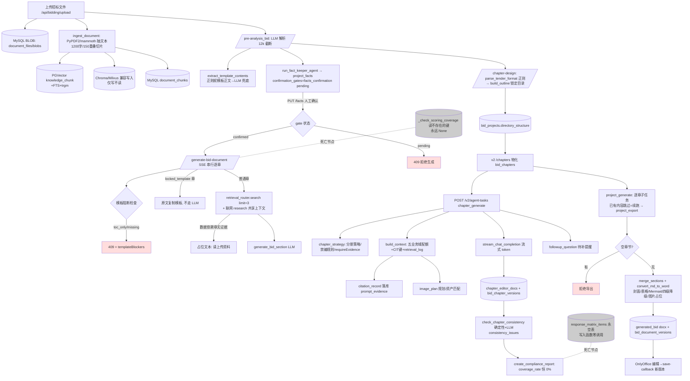

# NewbieCoderLab/ai_bidding 源码审计报告

> 审计方式：纯静态（git log / 全量源码阅读 / rg 检索 / python3 仅做 py_compile 语法校验，未 import 仓库代码、未安装依赖、未启动服务、未调用 LLM）。
> 审计范围：仓库 HEAD 70822cd（2026-06-24），119 文件，后端 Python 14,342 行（含 2,287 行测试），前端 Vue/JS 4,298 行。
> 审计人注：初筛（screening-a.md §5）将其列为"5/5 本组最高优先"。本报告逐项验证初筛结论，**其中"响应矩阵覆盖率"一项初筛结论被证伪**，详见 §2e 与 §5e。

---

## 1. 基本信息

- **LICENSE**：MIT（根目录 `LICENSE`，"Copyright (c) 2026 n0thing"）。README 徽章与 LICENSE 一致，无许可证风险，可合法复用代码（需保留版权声明）。
- **主要语言/框架/规模**：Python（Flask 3 + PyMySQL）后端 + Vue 3/Vite/Element Plus/Tiptap 前端。git ls-files 119 文件；Python 82 文件 14,342 行；测试 21 文件 2,287 行；前端 4,298 行。全部 .py 文件 `py_compile` 通过（0 语法错误）。
- **顶层目录**：
  - `api/` Flask 蓝图（v1：bidding/generation/knowledge/files/settings/users/research；v2：agent-tasks/chapters/streams/rag/images/health）
  - `services/` 业务服务（31 个 py；`services/v2/` 12 个新架构服务；`services/rag/` 混合检索；`agent_orchestrator.py` Agent 编排）
  - `core/` db.py（MySQL 43 表自动建表）、pg.py（PG 连接）、llm_providers.py（6 家模型商）、celery_app.py（可选异步）
  - `storage/` storage_service.py（MySQL BLOB 文件版本存储）、vector_store.py（Chroma/Milvus 适配）
  - `export/` md_to_word.py（Markdown→docx）、flowchart_renderer.py（流程图 SVG）
  - `migrations/postgres/` 001_rag_pgvector.sql（PGVector+FTS+trgm 表结构）
  - `front/` Vue 前端（TiptapWorkbench.vue 1,782 行为最大文件）
  - `tests/` 21 个 unittest 文件
  - `docs/` PRD/架构/改造计划 + superpowers 开发 spec/plan（AI 编程流程文档，非业务技能）
  - `tasks/` celery research 任务；`scripts/` check_milvus.py
- **提交历史**：浅克隆 20 条。2026-03-10 初始上传（"init:上传完整代码"）→ 2026-05-26/06-09~06-24 密集开发 v2 工作台 → **2026-06-24 后停更**。约 3.5 个月生命周期，v2 链路（6 月）为最后状态。
- **测试**：21 个 pytest 可发现文件（unittest.TestCase 风格），共 57 个 test 函数。**全部通过 sys.modules 注入假 pymysql/psycopg + FakeCursor/FakeConn/FakeResponse 运行，不需要 MySQL/PG/LLM/网络**（test_wan_image_service、test_model_stream_encoding 中出现的 requests/OpenAI 字样均为 Fake 层）。覆盖点详见 §2l。
- **第三方依赖**（requirements.txt，18 项）：Flask、flask-cors、python-dotenv、requests、PyJWT、Werkzeug、mammoth、Unidecode、PyPDF2、python-docx、markdown、chromadb、openai、PyMySQL、psycopg[binary]、pymilvus、celery、redis。**全部为 MIT/Apache/BSD 系宽松许可，无 AGPL 传染组件**。注意 chromadb 运行时依赖较重（onnx 等），但许可兼容。
- **与 sunShineLoveMe/ai_bidding_power_grid 的关系**：`docs/AI_BIDDING_V2_REFACTOR_PLAN.md:4` 自述"吸收 ai_bidding_power_grid 的成熟模块思想"——两仓库同源参考关系，主代理可交叉比对。

---

## 2. 能力清单（a–p）

### a. 招标文件解析 — **PARTIAL**
- 入口：`api/bidding.py /upload`（upload_bidding:665）→ `storage_service.create_file`（MySQL BLOB）→ `services/ingestion_service.py ingest_document:91`。
- 格式：`.pdf`（PyPDF2 逐页 extract_text）、`.doc/.docx`（mammoth extract_raw_text）、`.txt/.md`（utf-8/gb18030/gbk 多编码探测）。**无扫描件 OCR、无表格结构识别、无 HTML**。storage_service.py:15 `ALLOWED_EXTENSIONS = {".pdf",".doc",".docx",".txt",".md"}`。
- 确定性解析器 `services/tender_format_parser.py parse_tender_format:129`：正则识别"响应文件格式/投标文件格式/…"格式章节（FORMAT_HEADING_RE:6），按 `一、/1、` 章节标题或目录行拆章（CHAPTER_HEADING_RE:10、TOC_CHAPTER_RE:13），`_classify:61` 将章节分为 `locked_template`（投标函/报价表/授权委托书/偏离表等 12 个关键词）与 `locked_outline`；`template_validation.py is_valid_template_text:35` 用正文标记（致：/我方/签字/盖章/____）区分"有效模板正文"vs"仅目录项"（toc_only）。中间数据结构（返回值）：`{detected, source, confidence, formatSections[{heading,startOffset,endOffset,sourceText,score}], chapters[{title,orderLabel,type,lockTitle,lockOrder,sourceText,sourcePreview,sourceHeading,templateStatus,confidence}], formatNotes, questions}`。**带 startOffset/endOffset 字节偏移**——是全仓库唯一的原文锚点。注意：confidence 0.86/0.92 为硬编码；参数 `analysis_data` 声明了但函数体从未使用（预留未做）。
- LLM 解析 `agent_orchestrator.py run_tender_parser_agent:154`：head 6000 字 + 格式关键词窗口 4000 字拼 prompt，**截断至 12000 字**（:176,:226）；要求输出 project_name/purchaser_name/agency_name/procurement_method/budget_amount/bid_deadline/service_period/service_location/qualification_requirements/scoring_method/invalid_bid_conditions/key_requirements/bid_document_format{required_chapters,format_notes,document_composition,cover_page{cover_lines+placeholder}}。response_format=json_object。

### b. 条款/要求提取（六类） — **PARTIAL**
- 仅在 `run_tender_parser_agent` 的单次 LLM JSON 输出中：资格条件=qualification_requirements、否决项=invalid_bid_conditions、格式要求=bid_document_format——三者有结构化字段；**评分项仅一个概述字段 scoring_method（无逐项分值/权重）、技术参数与商务要求混在 key_requirements 列表、无分类标签**。
- **无统一条款清单数据结构**：解析结果整体存 `bid_projects.analysis_data`（JSON 列），无 per-clause 表、无条款 ID。
- 响应矩阵表 `response_matrix_items`（core/db.py:609）本应是条款载体，但写入函数从未被调用（见 e）。

### c. 原文位置溯源 — **PARTIAL（仅格式章节）/ 对招标条款 MISSING**
- 格式章节：formatSections 有 startOffset/endOffset + sourceText + sourceHeading（tender_format_parser.py:118-123）；章节级 sourceText 保留至 20KB/6KB。可回跳原文。
- 招标条款：LLM 输出无页码/段落锚点；PG `knowledge_chunk` 表有 `section_path/page_start/page_end` 列（001_rag_pgvector.sql:15-17），但 `ingestion_service.py` 写入 metadata 只有 tenant/project/kb/file/doc_type/chunk_index（:107-115），**page/section 字段永远为空**——溯源列是"预留未实现"。

### d. 企业资料检索/证据 — **IMPLEMENTED**
- `services/rag/hybrid_search.py HybridSearchEngine.search:119`：双通道并行——关键词通道（PG FTS `ts_rank_cd(search_vector, websearch_to_tsquery('simple',…))` **OR `chunk_text ILIKE '%整句%'****，:215-226）+ 向量通道（`embedding <=> query::vector` 余弦距离，:241-247）；`_merge:260` 合并打分 `hybridScore = 0.45*log1p(ts_rank)/2 + 0.45*vectorScore + 0.08 双通道命中奖励`；`rag/reranker.py rerank:54` 外部重排（DashScope gte-rerank-v2，HTTP /rerank）失败或未配置时降级词面重排（hybridScore + token 重叠*0.2）；任何 PG 异常 → `_mysql_text_search:282` MySQL LIKE 兜底（degraded 标记）。每次检索写 `rag_retrieval_log`（backend/keyword_count/vector_count/source_mix/score_trace 全链路分数留痕，:411-464）。
- `migrations/postgres/001_rag_pgvector.sql`：vector(1024) + ivfflat(cosine,lists=100) + tsvector 生成列（title A/section B/text C 权重）+ pg_trgm GIN 索引——schema 设计完整可复用。
- `services/v2/context_builder.py build_context:178`：业务域配额检索——project(2)/company_profile(2)/product_library(2)/history_bid(2)/image_asset(2) 五域各检索后按 similarity 全局排序截断 limit，去重、赋 `CIT-001…` 引用键，拼 `[CIT-001] 来源｜标题\n正文[:900]` 上下文，写 `retrieval_log`。
- **精确匹配短板**：中文 FTS 用 'simple' 分词器（中文整句成单 token，命中间隔几乎全靠 ILIKE 整句子串）；无编号/型号/金额/日期字段级抽取与专用精确检索。MySQL 兜底按空白分词 LIKE。

### e. 响应矩阵/合规矩阵 — **SPEC_ONLY（表与函数存在，但链路死亡）**
- 初筛线索"agent_orchestrator.py:796 输出响应矩阵覆盖率"验证结果：`:796` 位于 `create_compliance_report:740`，`coverage_rate = covered_count/total_requirements*100`（:782-783），分子分母来自 `response_matrix_items.response_status` 计数。
- **但 `create_response_matrix_from_analysis:980` 与 `mark_response_matrix_coverage:1024`（唯一两个写入该表的函数）在全部源码中无任何调用点**——仅被 `api/bidding.py:23-24` import（未用）和 `tests/test_template_merge.py:45-46` stub。`response_matrix_items` 永远为空 → 合规报告中 total_requirements=0、coverage_rate=0.0%。
- 即使接通，其覆盖判定也是"requirement_text 按空白分词取前 8 个 token，任一 token 在全文出现即 covered"（:1048-1049）的朴素子串匹配；且写入源读取的键 `bidding_requirements/bidding_meta/bidding_summary`（:990-992）在全仓库**没有任何代码生产**（生产端 run_tender_parser_agent 输出的是 key_requirements 等键）——键名错配进一步证明这是遗留死码。`api/bidding.py _check_scoring_coverage:424`（生成流里的评分点覆盖检查）同样读 `bidding_meta/bidding_requirements`（:439），永远返回 None → SSE 'scoring' 事件从不发出。
- 结论：**该仓库没有可运行的 requirement×response 矩阵，只有表结构+两个未接线函数+一个永远为 0 的覆盖率展示**。仓库自己的 PRD 也承认"这些表尚未形成稳定业务闭环"（docs/AI_BIDDING_V2_ENTERPRISE_PRD.md:41-43）。

### f. 目录生成与分章节生成 — **IMPLEMENTED**
- 目录：v1 `/chapter-design`（api/bidding.py:875）→ `parse_tender_format`（正则）→ `outline_builder.build_outline:154`（确定性骨架：locked_template 章不展开、locked_outline 章固定 3×3 小节结构+每小节 min_words=1500+target_words 13500/15000）；三态降级（tender_format_first / user_confirmed_format / manual_review_required）。`chapter_title.dedupe_by_chapter_title` 按标题归一去重，含内容的章节优先保留。
- v1 全文生成 `/generate-bid-document:915`：SSE 串行，逐章建 `bid_chapters` + `create_chapter_version`。
- v2 工作台：`api/v2/chapters.py _materialize_project_chapters` 把 directory_structure 物化为 bid_documents/bid_chapters（有内容/引用/图片计划/追问的章节受保护不重建，:72-94 `_can_supersede_chapter_document`）；`services/v2/chapter_generation_service.run_chapter_generation:108` 单章流水线（策略→检索→citation→图片计划→流式生成→保存 editor doc→追问），事件逐条持久化 `agent_task_event`；`project_generation_service.stream_project_generation:316` 项目级顺序编排（每章一个子 agent_task，**已生成章节默认跳过 = 断点续跑**，:363-376），完成后自动触发 export 任务。
- 单章重试/修改：`api/generation.py /chapters/<id>/generate|regenerate:150`（重建证据包+生成+一致性检查）；`/chapters/<id>/versions/<vid>/restore:183`；选区改写 rewrite-tasks（apply/reject）；v2 `PUT /chapters/<id>/editor-doc` 保存 Tiptap 内容并同步章节版本。

### g. 审校/校验 — **PARTIAL**
- 确定性：`agent_orchestrator.check_chapter_consistency:594` —— 已确认事实未在正文出现（entity_mismatch/date_conflict/number_conflict，按 fact_key 分类，budget_amount 提取数字子串检查）、`project_terms` 禁用术语违规（terminology_violation）、字数下限（word_count_low），结果落 `consistency_issues` 表。`template_validation` 正则判定模板有效性。
- LLM（可降级）：一致性矛盾检查（:675-705，异常仅 warning 降级）、`create_compliance_report:740` 汇总 open issues+章节清单+（恒为 0 的）覆盖率给 LLM 出报告，落 `compliance_reports`。
- **硬阻断（真实存在）**：① `confirmation_gates`——预分析后插 facts_confirmation pending 门，`/generate-bid-document` 见 pending 即 409 拒绝（api/bidding.py:949-954）；② 模板阻断 `_template_generation_blockers:340`——locked_template 章 templateStatus 为 toc_only/missing 或无有效模板正文 → 409（:965-971）；③ v2 导出门——有空章节即 raise 拒绝导出（project_generation_service.py:236-238）；④ 数据依赖章节无 RAG 证据时输出"待补充"占位而非让 LLM 编（api/bidding.py:1096-1102）。
- **缺口**：无报价数值校验、无工期与 bid_deadline 交叉核对、无资质有效期检查、无签章/暗标检查；severity=warning 的 issues 不阻断任何流程（PRD:43 自认"不是 Agent 状态机中的强制节点"）。

### h. 导出 — **IMPLEMENTED**
- `export/md_to_word.py convert_md_to_word:562`：python-docx 全自建样式（宋体/黑体/方正小标宋、页边距、页眉"XX投标文件"、页脚 PAGE/NUMPAGES 域码）；封面（LLM 提取 cover_lines + facts 按 placeholder project_name/bidder_name/tender_no/bid_date 替换，无则默认封面+落款"此封面需加盖投标人公章"）；Markdown 表格、列表、标题降级；`<!-- locked_template -->` 块内按模板段落排版（居中/首行缩进）；Mermaid → 结构化 flowchart SVG（cairosvg）→ 表格降级 → mmdc 外部命令 → 文本框兜底（process_mermaid:210 四级降级）；`` 占位 → "图 x-y caption（图片待补充）"编号插入（add_image_placeholder:499）。原子保存（临时文件+os.replace）。
- **无 .docx 模板文件机制**（样式硬编码，不能挂企业模板）；无目录 TOC 域；无暗标。
- OnlyOffice：`/projects/<id>/editor-config`（JWT HS256 签名 payload，api/bidding.py:1299）+ `/save-callback`（status 2/6 拉回 docx 存新版本，:739-769）。
- 导出路径 v1：generate 流内直接转 docx 存 `generated_bid`；v2：project_export 任务（markdown+docx 双 artifact、`bid_document_versions` 版本、bidding.generated_file_id 更新）。

### i. 状态持久化与恢复 — **IMPLEMENTED（v2 真实可用，v1 弱）**
- MySQL 43 张表（core/db.py SCHEMA_STATEMENTS，`init_mysql()` 启动时建表+种子数据）：bid_projects(analysis_data/directory_structure JSON)、project_facts（unique(project_id,fact_key)，status extracted/confirmed）、confirmation_gates、bid_documents/bid_document_versions、bid_chapters/bid_chapter_versions（版本链+current_version_id）、chapter_editor_docs（Tiptap markdown+tiiptap_json 版本）、agent_task/agent_task_event（事件溯源，event_index 递增）、generation_tasks、agent_runs、rewrite_tasks、rag_evidence_packs/items、citation_record、retrieval_log、image_plan/image_asset、followup_question、research_tasks/reports/sources、model_call_logs、model_settings、document_files/versions/blobs/chunks、knowledge_bases/documents、tenants/companies/users/roles、bidding、project_terms、response_matrix_items、consistency_issues、compliance_reports。
- 恢复能力：① v2 project_generate 重跑默认跳过已有正文章节（includeExisting 可强制重生成）——**真实断点续跑**；② 任务流 `stream_chapter_generation:206`/`stream_project_generation:316`：对已 finished 的任务直接回放持久化事件（断线重连体验）；③ 项目中心"恢复上次生成状态"= `list_projects` + `_latest_task_output`（读最近成功任务 output_json 的 fileUrl/bidDocumentId）；④ 章节版本 restore。
- 弱点：v1 SSE 中途挂掉 → generation_tasks 永远停留 running（无超时回收）；换模型只影响后续调用（route 按次解析，这是优点）；**补充/更换招标文件后无"受影响章节识别"**——只能整重跑。

### j. 失败处理 — **PARTIAL**
- 模型层：model_router.chat 多 route×重试（MODEL_ROUTES_JSON 按 task_type 路由 + fallback_providers + MODEL_ROUTER_RETRIES），失败写 model_call_logs 并把 running 任务标 failed（model_router.py:203,:272）。
- 检索层：PG 失败→MySQL LIKE（degraded+reason 透传 SSE）；重排失败→词面重排；无证据→contextText 提示 LLM 输出"待补充"。
- 生成层：v1 单章失败 → **把"（本章生成失败：…）"写进正文并继续导出**（api/bidding.py:1115-1117，风险见 §7）；v2 单章失败 → chapter_error 事件 + 整任务 failed（更严格）。
- 导出层：v1 docx 转换失败 → 仅提供 markdown 下载；v2 project_export docx 失败 → 任务 failed 并保留 markdown 草稿（project_generation_service.py:270-272）。
- 人工兜底：followup_question（缺资料/缺图片提醒，workbench pendingActions 汇总）、needsReview/questions 贯穿目录与模板。

### k. 日志与可观测性 — **IMPLEMENTED（后端最亮点之一）**
- agent_runs（每个 agent 的 input/output/status/error 落库）+ agent_task_event（生成过程 token/citation/image_plan/followup 全事件流）；
- rag_retrieval_log（score_trace_json 含每条的 keywordScore/vectorScore/hybridScore/rerankScore/rerankModel）+ retrieval_log；
- model_call_logs（provider/model/latency/status/fallback_used）；degraded/degraded_reason 一路透传到 SSE 事件与 API 响应；错误信息脱敏（_safe_error 替换 API key，model_router.py:73-85）。无集中 metrics/tracing，但结构化留痕完整。

### l. 测试 — **IMPLEMENTED（同规模仓库中最成体系）**
- 21 文件 / 57 test 函数，unittest 风格（pytest 可直接收集）；全部通过 `sys.modules.setdefault` 注入假 pymysql/psycopg/flask + FakeCursor/FakeConn/FakeResponse 运行——**不依赖 MySQL/PG/LLM/网络，CI 零成本**。
- 实测内容：tender_format_parser 9 例（格式章节识别/拆章/toc_only 判定）；outline_builder 8 例；template_merge 5 例（locked_template 合并保护、企业信息替换跳过锁定块、**模板阻断 409 逻辑**）；rag_hybrid_search 2 例（双通道合分、可解释 score）；p1_context_builder 2 例（五业务域配额检索+CIT 键分配+图片资产库 LIKE 检索）；workbench/v2 chapters 物化/项目合并/图片与追问/选区改写占位；wan_image 3 例（**禁词清单不生成证照类图片**）；word 图片占位 3 例；onlyoffice 配置 3 例；settings/knowledge/project_center/默认种子/模型路由/SSE 解码各 1-2 例。
- **未测**：citation 溯源性校验、check_chapter_consistency、create_compliance_report、deep_research、ingestion、md_to_word 端到端。测试普遍只测 happy path + 少量阻断路径，无失败注入。

### m. Skill 文件 — **MISSING**
无 SKILL.md。`docs/superpowers/`（specs/plans）是面向 AI 编程代理的开发流程文档（"For agentic workers: REQUIRED SUB-SKILL…"），非标书业务技能。

### n. Dify DSL — **MISSING**
无任何 Dify 特征 YAML（app/graph/nodes/edges）。编排为 Flask 蓝图 + SSE 生成器 + 可选 Celery（仅 research 异步，celery_app None 时同步执行，core/celery_app.py:36-41）。

### o. MCP Server — **MISSING**
无 fastmcp/mcp SDK import。对 Agent 暴露能力的唯一接口是 REST（/api/v2/*）+ SSE 流。若要接入 MCP 需自行包一层（所有服务层函数签名干净，适合包装）。

### p. LLM 调用方式 — **IMPLEMENTED**
- 路由中枢 `services/model_router.py`：`route_for_task`（MODEL_ROUTES_JSON per-task 覆盖 → model_settings 表 → 环境变量 API key，`_safe_error` 脱敏）+ fallback providers + 重试 + model_call_logs；`core/llm_providers.py` 6 家（deepseek/dashscope/volcengine/xiaomi_mimo/openai/moonshot，均 OpenAI-compatible chat/completions，requests 直调）。
- 流式 `services/model_center/stream.py stream_chat_completion:47`：requests SSE 解析（_iter_openai_sse）失败自动降级非流式整段。
- Embedding：openai SDK 兼容接口（DashScope text-embedding-v3，1024 维，storage/vector_store.py:19）；重排：DashScope HTTP /rerank；生图：DashScope Wan 异步任务 API（wan_image_service.py）。
- **提示词全部内联在 Python 代码中**（agent_orchestrator/qwen_client/v2 services/api 路由），无独立 prompt 文件、无版本管理。

---

## 3. README 声明核对

| README 声称 | 判定 | 证据 |
| --- | --- | --- |
| 项目中心：创建项目、上传、查看进度、**恢复上次生成状态** | 已验证（部分） | list_projects 返回最近任务/章节统计；_latest_task_output 读 output_json；但 v1 中断任务不可续跑 |
| 招标解析：Word/PDF/文本，提取项目信息、评分点、章节结构、关键要求 | 已验证（**评分点夸大**） | ingestion mammoth/PyPDF2 + run_tender_parser_agent + parse_tender_format；评分点仅 scoring_method 概述字段，无逐项分值 |
| 生成流程：上传→解析→章节规划→生成，已完成步骤可回看和修改 | 已验证 | /pre-analysis_bid→/chapter-design→/generate-bid-document；事实确认门+版本回滚 |
| AI 工作台：三栏式章节编辑、导航、总览、待办、章节级重写 | 已验证 | front/src/user/views/TiptapWorkbench.vue(1,782 行)、workbench_service、selection-rewrite |
| 选区改写（不重写整章） | 已验证 | generate_rewrite_patch:870（含 context_hash 冲突检测、PatchConflictError 多次出现拒绝替换） |
| 企业知识库 RAG：PGVector+FTS+Rerank，ChromaDB/Milvus 开发降级 | 已验证（注意） | hybrid_search + 001_rag_pgvector.sql + reranker；**但 Chroma/Milvus 只用于写入兼容，检索永不走它们；Milvus query 返回空 content**（PRD:101 自认需 hydrate） |
| 多模型配置（DeepSeek/通义/方舟/Kimi/OpenAI/MiMo） | 已验证 | llm_providers.py PROVIDERS + settings API 连接测试 |
| Word 导出 + OnlyOffice 在线预览编辑 | 已验证 | convert_md_to_word + editor-config/save-callback（JWT） |
| "后端启动时会执行 core/db.py 表结构初始化" | 已验证 | main.py:16 init_mysql()（生产风险见 §7） |
| 技术栈 Flask+MySQL+Vue3，MIT | 已验证 | 与实际一致 |
| （隐含）"响应矩阵/合规闭环" | **夸大/未接线** | 见 §2e：表+函数存在但零调用，覆盖率恒 0 |

---

## 4. 真实执行链路重建

### 节点表

| # | 节点 | 入口(文件:函数) | 输入→输出数据结构 | 模型/服务 | 持久化 | 失败处理 | 状态 |
|---|------|----------------|------------------|----------|--------|----------|------|
| 1 | 上传 | api/bidding.py:upload_bidding | bytes→document_files+bidding | - | MySQL BLOB | 415/400/500 分类 | IMPLEMENTED |
| 2 | 解析入库 | services/ingestion_service.py:ingest_document | bytes→chunks[{id,text,metadata}] | Embedding(text-embedding-v3) | PG+Chroma/Milvus+MySQL chunks | upload 处 try/except 标 vector_status=failed | IMPLEMENTED |
| 3 | 预分析 | services/agent_orchestrator.py:run_tender_parser_agent | tender_text(12k截断)→analysis JSON | LLM(json_object) | generation_tasks+bid_projects.analysis_data+project_facts+confirmation_gates | task failed + 500 | PARTIAL(截断) |
| 4 | 模板抽取 | agent_orchestrator.py:extract_template_contents | required_chapters→{title:template_text,placeholders} | 正则优先+LLM 兜底 | analysis_data.template_contents | LLM 失败仅 warning | IMPLEMENTED |
| 5 | 事实确认门 | api/bidding.py:confirm_project_facts / generate 门禁:941 | facts[]→project_facts.status=confirmed, gate 关闭 | - | project_facts/confirmation_gates | - | IMPLEMENTED |
| 6 | 格式优先目录 | tender_format_parser.py:parse_tender_format + outline_builder.build_outline | tender_text→format_plan→outline chapters[] | 纯正则（无 LLM） | bid_projects.directory_structure | 未检出→manual_review_required | IMPLEMENTED |
| 7 | v1 逐章生成 | api/bidding.py:generate_stream:975 | chapters[]→markdown 全文 | LLM(generate_bid_section)+retrieval_router+deep_research | bid_documents/chapters/versions+bidding.generated_file_id | 单章失败占位文本继续（风险） | IMPLEMENTED |
| 8 | v2 单章任务 | services/v2/chapter_generation_service.py:run_chapter_generation | chapter→editor doc+versions+citations+image_plans+followups | 流式 LLM+五域 RAG | agent_task(+events)/citation_record/chapter_editor_docs | error 事件+task failed | IMPLEMENTED |
| 9 | 项目编排/续跑 | services/v2/project_generation_service.py:stream_project_generation | chapters[]→子任务序列→export | 同上 | agent_task/agent_task_event | chapter_error 即中止 | IMPLEMENTED |
| 10 | 审校 | agent_orchestrator.py:check_chapter_consistency/create_compliance_report | content+facts→issues[]→report | 确定性+LLM(可降级) | consistency_issues/compliance_reports | LLM 失败降级 | PARTIAL |
| 11 | 响应矩阵 | agent_orchestrator.py:980/1024（无调用点） | analysis→response_matrix_items | - | response_matrix_items(永空) | - | **SPEC_ONLY/死码** |
| 12 | 导出 | export/md_to_word.py:convert_md_to_word | md 文件→docx（封面/表格/流程图） | mmdc/cairosvg 可选 | generated_bid + bid_document_versions | 转换失败保留 md | IMPLEMENTED |
| 13 | 在线编辑 | api/bidding.py:editor-config/save-callback | docx→OnlyOffice→新 blob 版本 | OnlyOffice DS | document_versions | StorageError 400 | IMPLEMENTED |

**判定：部分链**。v2 链路（物化→单章任务→编排续跑→导出→编辑）完整可运行；v1 链路可用但串行低劣。**响应矩阵节点死亡**、招标条款级溯源缺失、审校不阻断。

---

## 5. 重点审计问题

**Q1 超长文件/表格/扫描件如何防丢条款？**
无法防。`run_tender_parser_agent` 显式截断：head 6000 字 + 格式窗口 4000 字，prompt 限 `combined_content[:12000]`（agent_orchestrator.py:165-176,226）；`extract_template_contents` 正则窗口 5000 字/LLM 窗口 10000 字；PyPDF2/mammoth 纯文本抽取**丢失全部表格结构**；无 OCR（扫描件 PDF 抽出空文本）；切片仅用于 RAG 不用于解析。`/chapter-analysis_bid` 虽传全文但 timeout=25s 长文必超。**超长招标文件的条款丢失是系统性风险**。格式章节因走正则全量扫描（FORMAT_HEADING_RE 扫全文）相对安全，但 sourceText 截断 30KB/20KB。

**Q2 六类要求统一结构化清单？数据结构？**
不存在。最接近的结构是 run_tender_parser_agent 的输出 JSON（qualification_requirements[]、invalid_bid_conditions[]、scoring_method（字符串）、key_requirements[]、bid_document_format.required_chapters[{title,description,is_mandatory}]）整体塞进 `bid_projects.analysis_data` 一个 JSON 列。六类中仅资格/否决/格式有专属字段，评分无逐项、技术/商务无分类。`response_matrix_items(requirement_type,requirement_text,response_status,evidence_text)` 是设计中的统一条款表，未接线。

**Q3 条款↔原文/证据/章节/审校关联与 ID 体系？**
半套 ID：facts 有 fact_key（业务键）；章节链 bid_chapters.id→bid_chapter_versions(id,version_no,evidence_pack_id,agent_run_id)→rag_evidence_packs/items(evidence_pack_id,chunk_uid)；v2 加 chapter_editor_docs、citation_record(citation_key=CIT-xxx,chunk_uid,quote_text)、image_plan、followup_question、agent_task/事件，全部以 chapter_id 外键贯通（workbench_service 一条 130 行 SQL 全 LEFT JOIN 汇总）。**招标条款本身无 ID、无原文锚点**（PG chunk 的 page_start/page_end 从未写入）。citation 是"喂给 prompt 的证据"登记（usage_type='prompt_evidence'），非"正文引用了什么"的核验——**无生成后 [CIT-xxx] 回查**。

**Q4 语义+精确双检索？**
语义：pgvector 余弦全量 ANN（ivfflat lists=100）。精确：tsvector FTS('simple')+ILIKE 整句子串+pg_trgm GIN。对"编号/型号/金额/日期"四类**无字段级精确检索**；中文 'simple' 分词使 FTS 通道基本失效，实际精确匹配靠 ILIKE 整句与 MySQL LIKE 空白分词，短编号类查询（如"XG-2000"）可经 ILIKE/trgm 命中但不可靠。RAG 证据检索对这四类的可用性：中低。

**Q5 无证据/过期/冲突/资格不满足时如何阻止错误进入定稿？**
已有硬阻断 4 处（事实确认门 409、模板缺失 409、空章节禁导出、数据依赖章无证据→占位文本）；v2 提示词强令"资料不足写待补充，不得编造"+策略表 forbiddenRules（如"不得编造金额、单价、税率、工程量"）+缺资料自动生成 followup_question。**但**：chapter_strategy.rag_policy.requireEvidence 仅存库**无代码消费**（chapter_generation_service 从不检查 items 长度）；无证据过期检测（知识库无时效字段消费）；一致性 issue=warning 不阻断；v1 单章失败文本会进定稿。防编造主要靠**提示词纪律+占位**，代码级验证链不存在。

**Q6 章节可否独立执行/重试/修改/验证？**
可以，且是 v2 的核心设计：每章一个 agent_task（status queued/running/succeeded/failed/cancelled + 全事件流），可单章重跑（新任务）、章节版本链+restore、editor-doc 人工保存版本、选区改写 patch（context_hash 防冲突+apply/reject）。项目级编排按章顺序跑并跳过已完成——中断后重跑只补未完成章。

**Q7 报价/工期/数量/资质有效期/签章/暗标：确定性 vs 模型？**
确定性：模板有效性正则（致：/签字/盖章/____）、事实数值子串出现检查（budget_amount 数字 in content，severity=info）、禁用术语、字数、评分覆盖子串（死码）、封面签章提示语（"此封面需加盖投标人公章"文字常量）、生图禁词清单（wan_image_service.py FORBIDDEN_IMAGE_KEYWORDS：营业执照/资质证书/公章…拒绝生成证照类图片——不错的细节）。模型：矛盾检查、合规报告、摘要。**工期/资质有效期/暗标：完全没有**；报价仅"预算数字未出现"信息级提示。

**Q8 中断/换模型/补充招标文件后的恢复？**
中断恢复：v2 真实（跳过已生成章+事件回放+版本恢复）；v1 假（任务卡 running，需整重跑）。换模型：model_settings 热改，下次调用生效，已生成内容不受影响，无"换模型需重生成哪些章"的分析。补充招标文件：重跑 pre-analysis 会覆盖 analysis_data（facts ON DUPLICATE 保留人工 confirmed 值——细节正确），**但无影响面分析**（哪些章依赖了旧条款无从得知），目录需重新确认，已生成章节不自动失效。

**Q9 可导入 Dify DSL / MCP Server / Skill？**
三者皆无（rg 全库验证，无 fastmcp/mcp import、无 Dify YAML、无 SKILL.md）。仓库要跑起来需要：pip install requirements → MySQL 8（init_mysql 自动建 43 表）→ .env（模型 key 至少 1 家 + 可选 POSTGRES_DSN 跑 001_rag_pgvector.sql + Embedding key）→ python main.py；PG 缺失时检索降级 MySQL LIKE 仍可全流程演示；**无任何 key 时预分析直接抛 ModelRouterError（无 Mock 模式）**。若我们要用其服务层，函数签名干净（纯参数+get_db），适合包 MCP 工具。

**Q10 可合法复用什么？**
MIT → 全部代码可复用（保留 LICENSE 声明）。第三方依赖全宽松许可，无 AGPL。可直接复用与需改造清单见 §6。

---

## 6. 复用价值与许可

**许可证结论**：MIT，与本项目（含闭源/商业形态）兼容；仅需在复用代码处保留版权与许可声明。无 AGPL 组件。

### 可直接复用（MIT，拿来即用，均自带测试或有自包含依赖）
1. `services/tender_format_parser.py` + `services/template_validation.py` + `services/outline_builder.py` + `services/chapter_title.py`（+ tests 4 件）：**"招标格式优先"确定性目录链**——正则识别格式章节/拆章/模板有效性判定/锁定目录骨架/标题归一去重，零 LLM、零 DB 依赖，9+8+3 个测试。是我们"条款→目录"前置层的最现成实现。
2. `services/rag/hybrid_search.py` + `services/rag/reranker.py` + `migrations/postgres/001_rag_pgvector.sql`（+ test_rag_hybrid_search）：**双通道混合检索+可解释分数留痕+全链路降级**，SQL 含 vector/tsvector/trgm 三索引设计，可整体移植（注意换中文分词配置 zhparser/pg_jieba 或补 ngram）。
3. `export/md_to_word.py` + `export/flowchart_renderer.py`（+ tests）：中文字体/页眉页脚域码/封面占位替换/表格/流程图四级降级/图片待补占位——**对我们"文档内核经稳定接口"的直接素材**（需去掉 locked_template 业务标记、补 .docx 模板机制与 TOC 域）。
4. `services/model_router.py` + `core/llm_providers.py` + `services/model_center/stream.py`（+ tests）：多供应商路由/fallback/重试/调用日志/脱敏/SSE 流降级，通用性好，可作我们模型中枢底座。
5. `services/v2/agent_task_service.py`（事件溯源任务表）+ `citation_service.py`（CIT 键证据登记）+ `followup_service.py`（待补提醒）+ `context_builder.py`（业务域配额）+ `chapter_strategy_service.py`（分册策略/禁编规则库）：**v2 分层整套可作我们的服务层蓝本**，且都有对应测试。
6. `core/db.py` SCHEMA_STATEMENTS（43 表 DDL）+ `docs/AI_BIDDING_V2_ENTERPRISE_PRD.md`（对自身缺陷的诚实盘点）：作为我们后端状态模型设计参照。
7. `tests/` 的 **sys.modules 桩替换测试范式**：零基础设施跑 DB 型代码的单元测试，方法论可直接抄。

### 需改造后复用
- `services/ingestion_service.py`：换更强的解析内核（表格/OCR），补 page_start/section_path 写入。
- `services/v2/project_generation_service.py` + `api/bidding.py` 生成流：从 Flask-SSE 长请求改为队列化任务（它自己的 PRD 也这么规划）。
- `export` 的封面 cover_lines 机制：依赖 LLM 一次性抽取，需加人工修正界面数据结构。

### 仅可借鉴思路（不建议抄实现）
- `response_matrix_items` 表结构 + coverage 状态机（其实现是死的，键名错配是反面教材——**接矩阵必须从条款抽取层打通，别走它这条"事后子串匹配"路线**）。
- confirmation_gates 确认门 + 模板 409 阻断 + requireEvidence 策略字段（**设计好、未闭环**：把 requireEvidence 真正接到生成前置检查是我们能超越它的点）。
- deep_research 反思打分（reflect_sources 的 credibility+query_match 加分选源）与政府域名白名单。

### 不建议采用
- MySQL BLOB 存文件正文（PRD 自认会被 max_allowed_packet/备份拖死）；v1 单请求 SSE 串行全文生成；"（本章生成失败）"文本进定稿；`'simple'` 中文 FTS；Milvus 空内容 query 与静默回退；`_fill_enterprise_info` 的"本公司"字符串替换（PRD 自认破坏语义）。

---

## 7. 可靠性风险清单

| # | 风险 | 严重度 | 证据 | 复现/验证 |
|---|------|--------|------|-----------|
| 1 | **响应矩阵为空壳**：写入函数零调用、分析键名错配、覆盖率恒 0% | 高 | agent_orchestrator.py:980,1024（无调用点）；:990-992 vs :190-193 键名；api/bidding.py:439 `bidding_meta/bidding_requirements` 无生产者 | rg `create_response_matrix_from_analysis\(` 仅 import 与 test stub |
| 2 | **超长招标文件条款静默丢失**：预分析 12k 截断、模板抽取 10k 窗口、无 OCR/表格解析 | 高 | agent_orchestrator.py:176,226,345; ingestion_service.py:22-59 | 用 >50 页带表格 PDF 走 /pre-analysis_bid 比对原文 |
| 3 | **requireEvidence 策略不生效**：资格/报价章无证据仍调 LLM，防编造仅靠提示词 | 高 | chapter_strategy_service.py:34-58 存库；chapter_generation_service.py:108-172 无 items 检查 | 置空知识库跑 chapter_generate，仍会产出正文 |
| 4 | FactKeeper 只写 9 个事实键，而占位填充需要 tender_no/bidder_name/legal_representative → 投标函封面关键占位无法自动填充 | 中 | agent_orchestrator.py:381-391 vs api/bidding.py:388-401 | 上传招标文件后看 project_facts 键集合 |
| 5 | v1 单章失败把错误文本写进正文并照常导出定稿 | 中 | api/bidding.py:1115-1117 | 模拟 LLM 超时跑 /generate-bid-document |
| 6 | Flask 同步请求承载 SSE 长生成；中断后 generation_tasks 永停 running；Celery 仅用于 research | 中 | api/bidding.py:975-1222; core/celery_app.py:36; 无超时回收代码 | 生成中途 kill 进程查任务表 |
| 7 | 中文精确检索弱：FTS 'simple' 分词失效、ILIKE 整句、无编号/型号字段检索 | 中 | hybrid_search.py:215-221; 001_rag_pgvector.sql:24 | 用中文长句与短编号分别查询对比命中 |
| 8 | Milvus 查询返回空 content、连接失败静默回退 Chroma；Chroma/Milvus 只写不读（检索永不使用） | 中 | storage/vector_store.py:157,174-178; hybrid_search 检索仅 PG/MySQL | 读 query() 源码 |
| 9 | tenant_id 全库硬编码 1、userId 由前端表单直传（无鉴权）；OnlyOffice JWT secret 有仓库默认值 | 中（安全） | 各 INSERT VALUES (1,…); api/bidding.py:670-684; :39 默认 secret | rg `VALUES (1` / 读 main.py 路由 |
| 10 | `init_mysql()` 启动自动建 43 表 + 文件正文入 MySQL BLOB | 低（工程） | main.py:16; storage_service.py:80+ | PRD:101 自认技术债 |
| 11 | citation 只登记"喂入 prompt 的证据"，无生成后引用核验；claim 级溯源缺失 | 中 | citation_service.py:35-86 (usage_type='prompt_evidence'); 全库无 [CIT- 回查代码 | rg `CIT-` |
| 12 | 置信度硬编码（0.86/0.92/0.85），LLM 事实直接以 confidence=0.85 落库 | 低 | tender_format_parser.py:163,177; agent_orchestrator.py:407 | 读源码 |
| 13 | `create_mermaid_config` 死代码但会向 CWD 写 config.json | 低 | md_to_word.py:184-208 | rg 调用点（无） |
| 14 | 2026-06-24 后停更，v2 为最后状态（无后续修复） | 低 | git log | - |

---

## 附：给主代理的三点补充判断

1. **初筛 5/5 分需下调一项**：RAG/测试/导出/模型路由/确定性格式目录五项确属高质量 MIT 素材；但"响应矩阵覆盖率 IMPLEMENTED"不成立（死码），审校闭环弱于 Router0824 的状态机设计。
2. **本仓库最大的可移植资产是"确定性格式优先目录链 + PGVector 混合检索 + md→docx 导出 + 事件溯源任务"四件套**，全部零 LLM 依赖、全部有测试，可整体并入我们服务层再包 MCP。
3. 它与 sunShineLoveMe/ai_bidding_power_grid 存在明确思想继承（REFATOR_PLAN:4 自述），两仓库宜合并评估：power_grid 的行业定制 vs 本仓库的工程化骨架。
