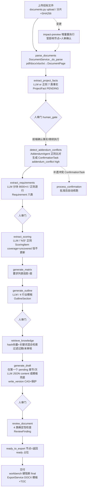

# Router0824/BidPilot-AI 源码审计报告

审计日期：2026-10（浅克隆 depth 20，只读静态审计，未运行任何仓库代码）

## 1. 基本信息

- **LICENSE**：AGPL-3.0（`/LICENSE`，完整 GNU Affero GPL v3 文本，全文核对确认）。**注意：README 徽章、frontmatter（`license: Apache License 2.0`）和文末 License 章节均声称 Apache-2.0，与 LICENSE 文件实际内容不符**。以 LICENSE 文件为准 → AGPL-3.0，网络服务化使用也须开源衍生作品，对本项目"代码复用"基本不可行，仅可学习设计。
- **语言/框架/规模**：Python 10,030 行（60 个 .py）+ Vue 5,171 行（20 个 .vue）+ JS 10 文件，git 追踪 131 文件约 2.5 万行。后端 FastAPI + SQLAlchemy async + SQLite(aiosqlite)；前端 Vue3 + Vite + Pinia + Axios。
- **顶层目录**：
  - `app/` FastAPI 后端（agents/api/application/core/domain/workflows/observability/realtime）
  - `frontend/` Vue3 前端（13 个页面：Dashboard/FactsConfirm/Requirements/EvidenceMatrix/Outline/Reviews/Workflow/Knowledge/Consultation/Enterprise/Settings/Information/Login）
  - `tests/` 后端 unittest（2 文件 38 个 test 方法）
  - `scripts/` seed_demo_data.py（Mock 演示数据）、dev_start.py
  - `docs/` DEMO_GUIDE.md + 7 张截图；`modelscope_release/` 单容器部署辅助
  - `deploy/helm/` K8s Helm chart（backend/frontend/configmap/secret/ingress）
  - `Dockerfile`（前后端一体镜像，ModelScope 7860）、`docker-compose.yml`（前后端分离）、`.github/workflows/verify.yml`（CI）
- **提交历史**：可见 21 条（浅克隆）。2026-08-07 "Initial release of BidPilot AI"（首个提交即约 2.5 万行完整系统），2026-08-07~08-09 密集提交（ModelScope 适配/登录流/LLM 配置入口），间隔后 2026-10-03 v1.1.0（编制工作台/章节版本/交付模板）。**历史短、初始即成型**，无法追溯演进过程。
- **测试**：有。后端 `tests/test_productivity.py`（22 个：人工保存保护、CAS 版本冲突 409、过期材料拒引 422、高风险须 reviewer、Fixer 2 次上限、工作台导出硬阻断 409、DOCX 模板字段/表格/页眉页脚插入、并发保存单赢家、SSE 会话释放等）+ `tests/test_llm_connection.py`（16 个：DeepSeek thinking 探测、JSON 截断重试与计费、空输出不算成功、真实失败不冒充 Mock 草稿、旧 Key 不得跨服务商、密钥文件 0600、错误不回显凭据等）。前端 2 个 Playwright e2e（productivity、model-settings）。CI `.github/workflows/verify.yml` 全量跑。**覆盖集中在 v1.1.0 编辑/交付与 LLM 网关；工作流引擎/Planner/证据服务无直接测试。**
- **第三方依赖**（requirements.txt）：fastapi/uvicorn/sqlalchemy[asyncio]/aiosqlite/pydantic/python-jose/httpx/aiofiles/pdfplumber/python-docx/openpyxl/markdown/sse-starlette 等。**声明但从未 import 的死依赖**：`celery[redis]`+`redis`（仅 config.py 一行注释）、`asyncpg`、`pandoc`（PyPI 上并非真 pandoc）、`structlog`、`passlib[bcrypt]`（密码实际用 `hashlib.sha256("bidpilot:"+pwd)`，app/core/auth.py:19）、`pypdf`（解析只用 pdfplumber）。`app/workers/__init__.py` 为空文件（0 字节）——Celery/Redis 是"占位未实现"。许可证均兼容（MIT/BSD/Apache 系），**法律约束来自仓库自身 AGPL-3.0**。

## 2. 能力清单

| # | 能力 | 标签 | 证据 |
|---|---|---|---|
| a | 招标文件解析 | **PARTIAL** | 入口 `DocumentService.parse_document/_do_parse`（app/application/document_service.py:144-231），按扩展名分发：pdf=pdfplumber 逐页 `extract_text()`（表仅计数 `table_count=len(tables)`，**表格内容不进文本**）；docx=python-docx 段落拼接成单"页"（表同样只计数）；xlsx=openpyxl 行拼 ` \| ` 文本；txt/md 原文。中间结构 `DocumentPage`（page_number/text/parse_method/table_count/quality_score/bounding_boxes，app/domain/models.py:166）。分片上传+SHA-256 校验（document_service.py:48-131）。**无 OCR**：`ParseStatus.OCR_PENDING` 枚举存在但全库无赋值点，扫描件 PDF 静默产出空文本页；解析异常被吞（`except Exception: doc.parse_status=FAILED`，无错误信息留存） |
| b | 条款/要求提取（六类） | **PARTIAL** | `RequirementAgent._extract_requirements_from_text`（app/agents/__init__.py:374-424）：真实 LLM 时按 9000 字符分块、**max_chunks=4（约 3.6 万字符，超出部分静默丢弃）**，逐块抽 JSON，`_looks_like_pure_fact` 过滤纯事实，前 120 字符去重；类型枚举六类 `REQUIREMENT_TYPES={qualification,technical,commercial,scoring,delivery,format}`（__init__.py:13），**无独立"否决项/废标项"类型**，以 mandatory 标志 + 高风险关键词近似（`_rule_extract_requirements_from_text`:426-466 的 triggers "必须/不得/否决/废标"）。`Requirement` 模型含 subject/action/condition/deadline/penalty 结构化字段（models.py:202-228）。兜底为逐行规则抽取，`source_page=i//30+1` **伪造页码** |
| c | 原文位置溯源 | **PARTIAL** | Requirement/ProjectFact 携 source_document_id+source_page；LLM 路径信任模型自报页码（写入时不回验，事后由 `ConfidenceService._text_hit_score` 用页文本命中度打分，confidence_service.py:166-177）；`EvidenceGraphService._quote_for_requirement/_infer_section`（evidence_service.py:249-271）从页文本回找原文引文（前 30 字定位，找不到就取页首 300 字）。规则兜底路径页码为估算值，溯源在 Mock 模式下不可信 |
| d | 企业资料检索/证据 | **PARTIAL** | `KnowledgeIndexService`（knowledge_service.py）：`embed_text`=**blake2b 哈希投影 768 维**（非语义 embedding）+ CJK bigram 分词；`retrieve` 混合打分 `vector*0.75 + keyword*0.25`，**每次全表加载 chunks 内存计算（无向量索引）**；硬过滤 `is_expired==False`、`valid_until>now`、可选 `is_audited`（knowledge_service.py:107-115）。精确匹配（编号/型号/金额/日期）无专用通道，仅靠 token 重合——**"语义召回"实为词袋**。`MaterialMetadata` 有 source_reference/applicable_scope |
| e | 响应矩阵/合规矩阵 | **PARTIAL** | 核心实现 `EvidenceGraphService`（evidence_service.py:20-328）：`RequirementEvidenceLink` 每要求一行（source_doc/page/section/quote、type、score_weight、mandatory、risk、confidence、target_section、knowledge_evidence_ids、generated_content_id、review_issue_ids、coverage_status 5 态、human_confirmed，models.py:231-254）。更新时机：要求 PATCH 后 `rebuild_project_links`（api/v1/bid.py:82）、编辑器保存后（productivity.py:88）、手动 rebuild 端点、list 时惰性 `_ensure_links`。**覆盖判定为启发式**：要求前 20 字符在草稿正文出现=covered（evidence_service.py:233）；目标章节按类型关键词匹配章节标题、兜底第一节（:161-183）。**评分项覆盖是死功能**：`ScoringItem.coverage_status` 写死 "uncovered"（agents/__init__.py:508），全库无更新点 → `/scoring/coverage` 恒 0（bid_services.py:92-108）。工作流 `generate_matrix` 节点只是要求列表投影（agents/__init__.py:468-476） |
| f | 目录生成与分章节生成 | **IMPLEMENTED** | `DraftingAgent.generate_outline`（agents/__init__.py:605-689）：已有章节则保留；LLM 生成或 4 套行业模板（software/construction/medical/education，enterprise_service.py:18-39）。单章生成 `generate_draft`（:691-751）：取项目事实+要求(限30)+知识检索(5 条)，生成后 `write_version` CAS 写入（editing_service.py:8-32：乐观锁 current_version_id 比对 + SectionProtection 保护检查，失败 409 不覆盖人工内容）。单章重试：`POST /outline/sections/{id}/draft` 可反复调用；但**工作流 generate_draft 节点每次只生成第一个 pending 章节**（workflow_service.py:617），全量成稿需多次运行或逐章手动触发 |
| g | 审校/校验 | **PARTIAL**（纯确定性，无 LLM 审校） | `ReviewService.run_review`（review_export_service.py:22-157）4 类检查全部为确定性代码：coverage（要求未 responded）、consistency（事实 key 在正文而 value 缺失）、citation（无引用/引用未验证）、overcommit（关键词表 "准确率/99/100%/零故障/绝对安全/万无一失/保证中标"）。model_routing 里有 `review_document_semantic` 路由键（agents/__init__.py:909）但**无任何调用点**。Fixer：仅 `citation_missing`+low risk+未保护+open 可自动修，且只追加"引用补充待确认"说明段（:337-347），每章上限 2 次（:191,230-243），高风险/承诺类一律 `manual_required`；前后内容与 diff 存 `FixAttempt`。**报价/工期/数量/资质有效期/签章/暗标检查：除工期等以"事实一致性"间接覆盖外，无专项检查，签章/暗标完全缺失** |
| h | 导出 | **IMPLEMENTED**（docx 实，xlsx 假） | `ExportService`（review_export_service.py:391-665）：docx 用 python-docx，支持企业模板 `{{project_name}}/{{company_name}}/{{content}}` 三字面量（word_template.py 白名单校验、跨 run/表格/页眉页脚替换、{{content}} 独占段落且最多 1 个、无宏/5MB/zip 30MB 防护，productivity.py:116-150）、TOC 域+updateFields、页脚 PAGE 域、【..】占位符黄色高亮、正文 Markdown 表格转换。交付下载 `POST /delivery/download`：**mode=final 被 workbench 待办硬阻断（409）**，draft 带水印（productivity.py:198-225）。requirements/outline/full_document/risk_list 可导 docx/md/txt；**"xlsx"实为 TSV 文本写 .xlsx 后缀**（review_export_service.py:429-431,512-515），Excel 打不开 |
| i | 状态持久化与恢复 | **IMPLEMENTED** | SQLite 30 张表（models.py）。WorkflowRun/NodeRun/WorkflowPlan/WorkflowImpactPreview/ConfirmationTask/ReviewRun/ReviewFinding/FixAttempt/DraftVersion/SectionProtection/AuditLog 全落库；NodeRun 存 output_snapshot+error_code+retry_count+token_usage+latency_ms。中断恢复：`get_workflow_run` 允许对 FAILED/WAITING 重入，`resume_workflow(from_node)` 支持断点续跑（workflow_service.py:632-656），节点幂等（同 run 内 succeeded 的 NodeRun 直接复用，:385-403）；进程内 SSE 进度历史（80 条/项目）**重启即失**（observability/progress.py:13）。模型配置存 `bidpilot_runtime_config.json`（0600，原子写，runtime_config.py） |
| j | 失败处理 | **IMPLEMENTED** | 节点级：`_execute_node` 重试 max_retries=2、退避 [5,30]s、指数扩展（workflow_service.py:364-369）、`asyncio.wait_for` 超时（300-600s）、`_classify_error` 分类（timeout 可重试 / cost_limit、manual_required 不可重试）、成本上限 `NodeCostLimitExceeded`（:426-432）、并发去重 `_running_node_keys`。LLM 级：LLMGateway 空内容/JSON 截断时 max_tokens 翻倍重试至多 3 次或达 1024 上限、每次响应计费计入成本（agents/__init__.py:127-163）；`_generate_section_content` 真实失败抛 LLMResponseError **不落盘假草稿**（:789-792，有测试锁定）。Planner 非法输出→固定工作流兜底（planner_agent.py:112-118,323-347）。各 Agent 均有规则/模板兜底文本（含【待确认】标记）。Fixer 2 次后转 manual_required。**人工兜底**：高风险确认门 + ConfirmationTask + 审核角色权限 |
| k | 日志与可观测性 | **PARTIAL** | SSE 事件流（node.start/retry/done/failed/waiting_confirmation、llm.request/response/error、planner.done、impact.confirmed）+ 进度快照端点 + `X-Process-Time-Ms` 中间件（main.py:34-39）+ `audit_logs` 表（操作者/前后值/理由）+ NodeRun 执行元数据（attempts/delays/tokens/cost）。**structlog 声明未用、无文件日志、无 request_id（全局异常 handler 里 request_id 恒空串，main.py:55-60）、SSE 历史不落库** |
| l | 测试 | **IMPLEMENTED** | 见第 1 节：38 个后端测试方法 + 2 个 Playwright spec + CI。测试质量高（覆盖并发、保护、阻断、模板注入等关键行为），但范围窄 |
| m | Skill 文件 | **MISSING** | 全库无 SKILL.md/skill 类文件（rg "SKILL" 仅误命中 "modify" 子串） |
| n | Dify DSL | **MISSING** | 无任何 Dify 特征文件；编排为自研 Python 状态机 |
| o | MCP Server | **MISSING** | 无 fastmcp/modelcontextprotocol/jsonrpc 任何痕迹；能力仅经 FastAPI REST/SSE/WebSocket 暴露 |
| p | LLM 调用方式 | **IMPLEMENTED** | 自研 `LLMGateway`（httpx POST `{base_url}/chat/completions`，OpenAI 兼容；无 openai SDK 依赖），强制 JSON 输出 + `_extract_json_object` 容错提取；按 task_type 路由 fast/quality 模型（agents/__init__.py:888-925）；Mock 默认（`build_llm_gateway`: provider∈(mock,none,disabled) 或无 key → MockLLMGateway，README "Mock Ready" 徽章属实）；`_has_real_llm()` 判定决定 LLM 路径 vs 规则兜底；提示词全部内联于各 Agent 方法（无独立提示词文件）；连接测试端点不落盘不切换（api/v1/system.py:37-66）；DeepSeek 探测禁用 thinking（agents/__init__.py:121-123）。**默认/演示路径大量产出为模板化兜底文本，非模型生成** |

## 3. README 声明核对

| README 声称 | 判定 | 证据 |
|---|---|---|
| License 徽章 & 文末 "Apache License 2.0" | **不实（夸大/错误）** | `/LICENSE` 实为 AGPL-3.0 全文；README frontmatter 也写 Apache |
| "Mock LLM Ready"、默认 Mock 模式 | 已验证 | .env.example `BIDPILOT_LLM_PROVIDER=mock`；build_llm_gateway 兜底 Mock；README 明示演示用 Mock |
| 编制工作台：待办/截标倒计时/缺失材料/交付阻塞 | 已验证 | workbench_service.py:9-99（补件/失效引用/占位/审查过期检测）；ProjectWorkbench.vue |
| 章节版本：人工编辑/内容保护/版本对比/并发冲突 | 已验证 | editing_service.py write_version CAS+保护；test_concurrent_saves_have_only_one_winner；OutlinePage.vue |
| 交付模板：字段校验/正文插入位置/范本下载/恢复默认 | 已验证 | word_template.py + productivity.py:116-179 + 3 个模板测试 |
| "真实生成失败不冒充成功草稿" | 已验证 | agents/__init__.py:789-792 抛 LLMResponseError；test_real_drafting_failure_does_not_become_mock_content |
| Planner 输出 Pydantic 校验、非法回退固定工作流 | 已验证 | planner_agent.py:34-39 白名单 validator；:112-118 fallback |
| 增量重执行：计算受影响节点、执行前预览、只重跑必要下游 | 已验证（能力真实，但重跑会重复插入事实/要求，见风险 R3） | dependency_graph.py:54-114 invalidation 信号传播；WorkflowImpactService.preview；前端 impact-preview/incremental-rerun |
| 响应证据图谱：原文→要求→章节→材料→内容→审查链路 | 已验证 | evidence_service.py evidence_chain():54-111；前端 evidence-chain 调用 |
| "覆盖状态和置信度" | 部分验证 | coverage_status 为启发式（前 20 字符匹配）；confidence 为加权公式（confidence_service.py），非模型置信度 |
| Reviewer 输出"内部冲突、补遗冲突、资质风险" | **夸大** | 实际 finding_type 只有 missing_requirement/internal_conflict/numeric_inconsistency/citation_missing/unsupported_claim；"补遗冲突"在 ConfirmationTask 体系而非 ReviewFinding；无资质专项检查 |
| Fixer 仅自动处理低风险；每章最大次数；保存前后内容 | 已验证 | review_export_service.py:185-284（MAX_ATTEMPTS_PER_SECTION=2；auto_fix 仅 citation_missing+low） |
| "RAG：Hash Embedding、关键词检索、混合召回" | 已验证（如实自述非语义向量） | knowledge_service.py blake2b 哈希投影 |
| 文档解析 "pdfplumber, pypdf, python-docx, openpyxl" | 部分夸大 | pypdf 声明未用；表格内容不进文本；无 OCR |
| SQLite 自动建表升级（三张新表） | 已验证 | init_db create_all + test_new_tables_initialization_preserves_existing_data |
| 90 秒 Demo/演示账号/ModelScope 单容器 | 已验证 | DemoGuide.vue、seed_demo_data.py（工期 120→90 补遗、故意缺项目经理证书）、modelscope_release/server.py（挂前端 SPA） |
| "AI Agent 工作台……招标文件解析"（总体） | 部分验证 | 链路真实存在但解析/抽取质量依赖真实 LLM；Mock 下为模板兜底 |

## 4. 真实执行链路重建

| 节点 | 入口(文件+函数) | 输入/输出结构 | 模型/工具 | 持久化 | 失败处理 | 状态 |
|---|---|---|---|---|---|---|
| 上传 | documents.py:23/41/59/79；document_service.py:26/48/89 | bytes→Document(file_hash,parse_status) | - | SQLite+uploads/ | 大小限制 200MB、哈希校验失败删文件 | IMPLEMENTED |
| 解析 | document_agent.parse→DocumentService.parse_document(document_service.py:144) | Document→DocumentPage[] | pdfplumber/python-docx/openpyxl | document_pages | FAILED 状态（异常吞掉，无错误详情） | PARTIAL（无 OCR/表格内容/扫描件） |
| 事实抽取 | requirement_agent.extract_facts(agents/__init__.py:242) | 全文拼接→ProjectFact(7 键) | LLM or 正则兜底 | project_facts | LLM 异常→正则兜底 | PARTIAL |
| 人审门① | workflow_service._execute_node human_gate(:534-544)；facts 确认 bid.py:328 | ProjectFact.confirmation_status | - | - | 停链等 resume | IMPLEMENTED |
| 补遗冲突 | addendum_agent.detect_conflicts(addendum_agent.py:18) | 补遗页文本-ProjectFact 正则比对→ConfirmationTask(high) | 无 LLM（纯正则） | confirmation_tasks | 无补遗→0 冲突 | IMPLEMENTED |
| 要求抽取 | requirement_agent.extract_requirements(:338) | 全文→Requirement(六类/结构化字段) | LLM 分块（≤36k 字符）或逐行正则 | requirements | 单块失败 continue；整体兜底 | PARTIAL |
| 评分抽取 | scoring_agent.extract_scoring(:485) | 文本→ScoringItem | LLM 或 "N分" 正则 | scoring_items | 兜底正则 | PARTIAL（coverage 死字段） |
| 矩阵 | requirement_agent.generate_matrix(:468) / EvidenceGraphService.list_matrix | Requirement→RequirementEvidenceLink 行 | 无（启发式） | requirement_evidence_links | 惰性构建+手动 rebuild | PARTIAL |
| 大纲 | drafting_agent.generate_outline(:605) | 要求+facts→OutlineSection | LLM or 行业模板 | outline_sections | LLM 失败→模板 | IMPLEMENTED |
| 检索 | retrieval_agent.retrieve(:574)/KnowledgeIndexService.retrieve | facts+要求+标题→chunks | hash 向量+关键词（无外部 embedding） | knowledge_chunks.embedding(JSON) | 过滤过期/未审核 | PARTIAL |
| 章节草稿 | drafting_agent.generate_draft(:691) | 单章→DraftVersion(content,citations) | quality 模型 JSON 或模板兜底 | draft_versions+版本 CAS | 保护跳过/LLM 失败不落盘 | PARTIAL（每 run 仅 1 章） |
| 审校 | review_agent.review→ReviewService.run_review(review_export_service.py:22) | drafts+reqs+facts→ReviewFinding | **无 LLM**（确定性 4 检查） | review_runs/findings | - | PARTIAL（无语义审校） |
| 修复 | FixerService.fix_issue(:202) | finding→FixAttempt(before/after/diff) | 无 LLM（追加说明段） | fix_attempts | 2 次上限→manual_required | IMPLEMENTED |
| 导出 | ExportService.export/_write_full_docx(:395/601)；productivity.py:198 | sections→DOCX（模板/TOC/PAGE） | 无 LLM | uploads/{pid}/exports | final 被 workbench 409 硬阻断 | IMPLEMENTED |

**链路判定：部分链**——主干 11 节点全部有真实代码与 DB 支撑、可端到端运行（Mock 亦可），但存在多个弱节点：解析（无 OCR/表格内容）、矩阵（启发式）、审校（无 LLM 语义检查）、评分覆盖（死字段）、草稿（单章/次）。无 MCP/Dify/Skill 外化接口。

## 5. 重点审计问题

**Q1 超长文件/表格/扫描件如何处理？防截断？**
pdfplumber 逐页入库不整体截断，但下游抽取时 `RequirementAgent` 把所有页拼成一个字符串再 `_chunk_text(text, chunk_size=9000, max_chunks=4)`（agents/__init__.py:40-49）——**超过约 36000 字符的部分被静默丢弃**，无任何"未处理余量"告警。`_truncate_text`（facts/scoring 用，12000/14000 字符）保留首尾、中间标记截断，同样丢失中段。表格：PDF/DOCX 表格内容**完全不进入文本**（仅 table_count 计数），评分表/参数表里的条款必然丢。扫描件：无 OCR，`extract_text()` 返回空 → 空 fact/空要求，OCR_PENDING 枚举从未赋值。**结论：长文与表格防丢失机制不存在，属高风险缺陷。**

**Q2 六类要求统一结构？**
`Requirement`（models.py:202）：requirement_text、requirement_type（六值枚举 RequirementType）、mandatory、risk_level、evidence_required、source_document_id/page、confidence、response_section_id、owner、status(pending/confirmed/responded/missing)、review_status、subject/action/condition/deadline/penalty（抽取提示词要求填，LLM 路径写入）。六类与模板节 a 的目标六类相比：**无"否决项/废标项"独立类型**——用 mandatory=True + risk_level=high + 关键词（必须/不得/否决/废标，agents/__init__.py:428-429）近似；"评分项"独立成 ScoringItem 表。

**Q3 要求↔原文/证据/章节/审校的关联与 ID 体系？**
UUID 主键贯穿（`new_id`=uuid4）。关联由 `RequirementEvidenceLink` 物化（每要求一行）：source_doc/page/section/quote（原文侧）、target_section_id/title（章节侧）、knowledge_evidence_ids（材料侧，来自 DraftVersion.citations 的 chunk_id 反推）、generated_content_id（内容侧=current_version 草稿）、review_issue_ids（审校侧，location 格式 `requirement:{id}`/`section:{id}` 反查）、coverage_status、human_confirmed。`evidence_chain` 端点一次返回全链（evidence_service.py:54-111）。**ID 体系完整且可追溯，是本仓库最有参考价值的设计之一**；但覆盖状态判定是前 20 字符包含匹配的启发式。

**Q4 语义召回+精确匹配（编号/型号/金额/日期）？**
否。检索为 blake2b 哈希投影向量（词袋等价物）+ bigram 关键词重叠（knowledge_service.py:40-58,107-141），无真 embedding、无编号/型号/金额/日期的精确字段匹配或规整匹配通道；检索全表内存扫描。咨询服务的文档引用是 tokenize 词集命中（consultation_service.py:168-196），同样非精确。

**Q5 无证据/过期/冲突/资格不满足的硬阻断？**
**有，且是亮点**：①引用侧——编辑器保存时逐个校验 chunk 存在、is_audited、未过期，否则 422 拒绝（productivity.py:76-82）；检索层过滤过期（knowledge_service.py:110-113）。②资格侧——workbench 对 qualification/evidence_required 类要求逐条检查当前章节引用是否"已审核+未过期"，否则生成高优"补件"待办（workbench_service.py:43-57）。③定稿侧——`delivery/download mode=final` 在 workbench 存在任何待办（含未响应要求、未确认事实、失效引用、占位符【待确认/待补充/TODO】、open 审查问题、审查过期）时 **409 硬阻断**（productivity.py:200-202）；高风险审查问题仅 reviewer/project_admin 可关闭（bid.py:451-452）；高风险要求 responded 需 reviewer 确认（bid.py:75-76）。④内容侧——生成提示词强制对缺证据信息标【待确认】、不得编造资质（agents/__init__.py:780-784），导出 DOCX 将【..】高亮。⑤章节内容保护（SectionProtection）阻止 Agent/Fixer 覆盖人工内容（editing_service.py:17-20）。**注意**：阻断锚点是"要求已确认 responded"这一人工动作，不校验响应内容真实性。

**Q6 章节可否拆为独立任务（执行/重试/修改/验证）？**
部分。章节是独立持久对象，支持：手动单章生成（POST /outline/sections/{id}/draft）、编辑保存（CAS 版本）、解除/恢复保护、逐章审批（SectionApproval submit/resolve，enterprise_service.py:163-195）、逐章锁（SectionLock 5 分钟）、单章修复（Fixer 按章计数上限）。但**工作流图里"generate_draft"是单节点，每次执行只取第一个 pending 章节**（workflow_service.py:616-617），没有"每章一节点"的任务图拆分，无按章并行/调度，重试粒度是节点而非章节。

**Q7 报价/工期/数量/资质有效期/签章/暗标：确定性 vs 模型？**
确定性：工期/预算等"事实一致性"（章节含 fact key 却缺 value → finding，review_export_service.py:67-97）、材料有效期（valid_until 过滤+引用校验，全为代码）、过度承诺关键词（:131-157）、覆盖缺失、引用缺失。模型侧：要求/事实抽取置信度（但 confidence 最终被 ConfidenceService 的确定性公式重算覆盖）。**纯模型判定**：仅各抽取 prompt 的自报 confidence 字段。**完全缺失**：报价计算、数量核对、签章/盖章检查、暗标格式检查（全库无"暗标/签章/盖章"相关逻辑——"盖章"仅作为 format 类关键词之一出现在抽取兜底）。

**Q8 中断/换模型/补招标文件后的恢复与影响识别？**
较完整。状态：WorkflowRun.current_node + NodeRun 幂等（同 run 复用 succeeded）→ `resume_workflow(from_node)` 断点续跑；重跑用 `retry_node`。变更影响：`WorkflowDependencyGraph.signals_for_change`（documents_changed/addendum_uploaded/manual_confirmation_changed/reviewer_issues_changed 四类变更→失效信号集）→ `calculate_impact` 沿 invalidated_by+dependencies 传播出受影响/不受影响节点、高风险标志、人审要求（dependency_graph.py:33-114），落 `WorkflowImpactPreview`，`start_incremental_workflow` 仅重跑受影响节点且要求 `confirm_high_risk` 显式确认（workflow_service.py:212-302）。换模型：runtime config 保存后 `reload_llm_gateway` 全局替换（agents/__init__.py:937-968），**但不触发任何节点失效**（"更换模型"不在 change_type 里）。**缺陷**：extract_facts/extract_requirements 重跑时对新 ProjectFact/Requirement 直接 add，**不按键/文本去重**（agents/__init__.py:256-268,352-371）→ 增量重跑造成重复行、重复待办。

**Q9 可导入 Dify DSL / 可运行 MCP Server / 独立 Skill？**
三者皆无。Dify DSL：0 个（无 app/graph/nodes/edges YAML）；MCP Server：0 个（无 fastmcp/stdio/jsonrpc，能力只经自研 REST/SSE/WS）；Skill：0 个（无 SKILL.md）。可复用的只有其自研编排形态：`TENDER_WORKFLOW_DEFINITION` 节点注册表 + `NodeDefinition`（executor/inputs/outputs/dependencies/invalidated_by/timeout/retry/risk/human_gate/idempotency_key）+ 依赖图失效传播 + SSE 协议事件（agent.progress 事件结构）。若要移植到本项目的 Agent/Skill/MCP 架构，需全部重写为 MCP 工具与 Skill 流程文本——**不可直接运行，设计可借鉴**。

**Q10 哪些可复用？哪些仅借鉴？**
许可证 AGPL-3.0：**任何代码复制/改写进本项目（即便内部使用、网络服务）都触发 AGPL 传染义务**（衍生作品整体以 AGPL 开源并提供源码）。因此：代码不可复用（除非愿意整体开源）；README 徽章错误进一步增加误用风险。可借鉴（只学设计、零抄码）：①NodeDefinition 元数据 + invalidation 信号传播 + 增量重执行预览（app/workflows/）；②人审门（human_gate→WAITING_CONFIRMATION→resume/ConfirmationTask 高风险审批）；③RequirementEvidenceLink 证据链物化模式与 coverage 五态；④workbench 待办聚合并作为导出硬阻断（"export_ready = not tasks"）；⑤write_version CAS+SectionProtection"人工内容不可被慢生成覆盖"；⑥ConfidenceService 加权置信度（来源完整性/原文命中/具体性/冲突/人审）；⑦LLM Gateway JSON 强约束 + 截断重试 + 成本上限 + "真实失败不冒充成功"。第三方依赖本身（fastapi/pdfplumber 等）许可均宽松，不受仓库 AGPL 影响。

## 6. 复用价值与许可

- **可直接复用**：无（AGPL-3.0 下对闭源/专有项目零可复制文件）。例外：与仓库无关的通用做法（如 python-docx TOC 域写法属公开 API 知识）。
- **需改造后复用**：不适用（改造仍属衍生，AGPL 依旧传染）。
- **仅可借鉴思路（强烈推荐逐项研究）**：见 Q10 七项设计；另外其 README/DEMO 诚实度工程（Mock 徽章、"真实失败不冒充成功"写入测试）也是好的工程文化样本。
- **不建议采用**：其解析策略（表格内容丢弃、无 OCR）、hash 伪向量检索、逐行规则兜底（伪页码）、"xlsx"=TSV、死依赖声明——这些是反面样本。
- **许可证结论**：AGPL-3.0（LICENSE 文件为准；README Apache 声明无效且误导）。对目标系统：**代码级零复用**，设计级（状态机/证据链/人审门/导出阻断）可自由学习——思想不受版权保护，但需确保实现从零独立撰写，不逐行翻译。

## 7. 可靠性风险清单

| # | 风险 | 严重度 | 证据 | 复现/验证 |
|---|---|---|---|---|
| R1 | **README 许可证误导**：徽章+frontmatter+文末均写 Apache-2.0，LICENSE 实为 AGPL-3.0；不知情者按 Apache 引用代码将违反 AGPL | 高 | README.md:11,24,447 vs /LICENSE 首部 | head LICENSE；grep "Apache" README.md |
| R2 | **长文本静默截断**：要求/事实/评分抽取仅处理前 4×9000（facts/scoring 12-14k）字符，超长标书后半部分条款全丢，无告警 | 高 | agents/__init__.py:31-49（_truncate_text/_chunk_text），:283,:525 | 读 `_chunk_text` max_chunks=4；任何 >36k 字符标书 |
| R3 | **表格内容不抽取**：PDF/DOCX 表格仅计数不取文，评分表/技术参数表条款必然缺失；扫描件无 OCR 产出空页 | 高 | document_service.py:184,199-204（table_count 不入 text）；OCR_PENDING 全库无赋值 | 上传含表格评分表的 PDF 后查 document_pages.text |
| R4 | **增量重跑数据重复**：extract_facts/extract_requirements 重跑无去重，重复 ProjectFact/Requirement 行污染矩阵与待办 | 中高 | agents/__init__.py:256-268,352-371（直接 db_session.add）；workflow_service.py:212-302 增量重跑路径 | 上传补遗→incremental-rerun 两次→select project_facts |
| R5 | **Mock 模式产出"伪溯源"**：规则兜底逐行造 Requirement、`source_page=i//30+1` 伪造页码，演示数据看似可溯源实则虚构 | 中高 | agents/__init__.py:426-466（:463 伪页码） | Mock 模式跑 extract_requirements 后查 requirements.source_page |
| R6 | **评分覆盖死指标**：ScoringItem.coverage_status 恒 "uncovered"，/scoring/coverage 恒 0；suggested_section_id 从未赋值 | 中 | agents/__init__.py:508；bid_services.py:92-108；rg "coverage_status" 全库仅一处写入 | 任意项目调 GET /scoring/coverage |
| R7 | **"xlsx"导出实为 TSV**：.xlsx 后缀文本文件，Excel 无法直接打开 | 中 | review_export_service.py:429-431,512-515（"\t".join 写入） | export requirements format=xlsx |
| R8 | **merge_requirements 破坏引用完整性**：把 response_section_id 设为另一个 Requirement 的 id（应为章节 id） | 中 | bid_services.py:61-65（`s.response_section_id = target.id`） | 调 POST /requirements/merge 后查 response_section_id 指向 requirements 表 |
| R9 | **检索无语义且全表扫描**：blake2b 词袋投影冒充 embedding；retrieve 加载全部 chunks 内存计算，知识库大时性能塌陷 | 中 | knowledge_service.py:40-58,107-127 | 读 embed_text/retrieve；构造 1 万 chunks 观察延迟 |
| R10 | **进度/可观测不落盘**：SSE 事件与 80 条历史仅进程内，重启丢失；无文件日志、无 request_id；structlog 声明未用 | 中低 | observability/progress.py:12-13；main.py:55-60（request_id 空串） | 重启进程后 SSE 历史为空 |
| R11 | **死依赖/空模块**：celery[redis]/redis/asyncpg/pandoc/structlog/passlib[bcrypt]/pypdf 声明未用；app/workers/ 空；密码用无盐 sha256（演示自认） | 低 | requirements.txt vs rg import；auth.py:19 | rg 各包名 |
| R12 | **工作流草稿生成每次仅一章**：全量成稿需 N 次运行/手动逐章触发，"自动成稿"预期落空 | 中 | workflow_service.py:616-617；agents/__init__.py:701-704（limit 1 pending） | 跑完工作流查 outline_sections 状态分布 |
| R13 | 商机监控抓取任意 source_url（SSRF 面），失败时静默回退 3 条硬编码 SAMPLE_NOTICES，演示数据可能被误当真实商机 | 低中 | opportunity_service.py:133-141,151-157 | 设不可达 URL 后调 run_monitor |
| R14 | 交付 final 阻断依赖 responded 人工标记，不校验响应内容与要求语义一致（前 20 字符匹配仅用于展示态） | 中（业务语义） | productivity.py:200-202；workbench_service.py:41-42 | 将无关章节标 responded 后 workbench 即认为该要求已覆盖 |

**总评**：这是 14 个候选中工程完成度最高的"服务端工作流状态机 + 人审门 + 证据链 + 导出硬阻断"完整参考实现（10k 行后端 + 5k 行前端 + 38 测试 + CI），代码真实、测试可信、README 大体诚实；但解析/检索/审校三大核心质量环节是浅实现，且 AGPL-3.0 + 许可徽章错误使它对本项目**只可作为设计蓝本，绝不可作为代码来源**。
