# aigc-open/tender-cli 源码审计报告

> 审计方式：纯静态（git log / rg / 全文精读 / python3 AST 文本解析），未安装任何依赖、未运行仓库代码、未调用任何 LLM API。
> 浅克隆 depth=20 但仓库总共仅 2 次提交，历史完整可见。

---

## 1. 基本信息

### 1.1 LICENSE 与法律状态
- **实际许可证：Apache-2.0**（`LICENSE` 文件为完整 Apache License 2.0 全文，第 189 行版权占位符 `[yyyy] [name of copyright owner]` 未填写）。GitHub 元数据（Apache-2.0）与 LICENSE 文件一致。
- **元数据冲突**：`pyproject.toml:13` `license = {text = "MIT"}`、`:19` MIT classifier；`README.md:452` "MIT License"。三处 MIT 声明与 LICENSE 文件不符，属上游元数据错误。
- **法律结论**：以 LICENSE 文件为准，本项目按 **Apache-2.0** 授权：可复用、可修改、可商用，需保留原声明、标注修改、遵守 NOTICE（本仓库无 NOTICE 文件）。MIT 声明不构成"更宽松"的额外授权（无版权人签署，不构成有效双重许可），复用时按 Apache-2.0 合规即可。不存在无许可证风险，但许可证混乱本身说明项目元数据管理粗糙。

### 1.2 规模与结构
- 32 个 git 跟踪文件，约 6,768 行（其中 Python 25 个文件约 5,675 行）。
- 顶层结构（每个一句话）：
  - `src/tender_cli/core/` — CLI 对话核心：Config（yaml+.env 配置）、ConversationManager（对话历史，死代码）、ProjectManager（项目落盘）、TenderAI（消息分流/意图识别/降级链）
  - `src/tender_cli/mcp_tools/` — 工具层：base.py（真 FastMCP 封装+OpenAI Agents SDK，仅示例工具）、mcp_server.py（**名为 MCPServer 实为进程内 facade 类，无 MCP 协议**）、mcp_agent.py（pydantic-ai Agent+文本 TOOL_CALL 降级）、file_tools/tender_tools/content_tools/document_tools（四个纯 Python 工具类）
  - `src/tender_cli/prompts/` — 9 条中文提示词（仅 1 条被使用）
  - `src/tender_cli/utils/` — ai_client.py（OpenAI SDK+function calling+mock）、logger.py
  - `examples/` — 4 个 MCP 示例脚本 + MCP_BASE_USAGE.md（math server/client、custom tools、basic_usage）
  - `tests/` — test_basic.py 单文件
  - `design.MD` — 665 行设计稿，含大量**虚构的对话演示脚本**（24 线程并行生成、进度百分比等，代码中无对应实现）
  - README 声称的 `docs/`、`assets/templates/`、`assets/logos/` 目录**不存在**（git ls-files 无此文件）

### 1.3 提交历史
- **2 次提交**：`5a91885` 2025-09-12 "Initial commit"（littleRiceZhou）→ `41e6d06` 2025-09-13 "Update README.md..."（jack.li）。
- 一次性代码 dump，无迭代史，最后推送 2025-09-13，**停滞约一年**。48 stars。

### 1.4 测试
- `tests/test_basic.py`：3 个测试类、4 个用例 — Config 默认值（test_config_creation）、ProjectManager 创建/列表（test_project_creation / test_project_listing）、FileTools 读写/建目录（test_file_operations）。
- **零覆盖**：MCP server/agent、PDF 解析、条款抽取、大纲/内容生成、docx 导出、AIClient、降级链。
- 陷阱：测试虽只 import file_tools，但会触发 `mcp_tools/__init__.py` 拉起 mcp_server→content_tools→`from mcp.server.fastmcp import FastMCP` 及 mcp_agent→`from pydantic_ai import ...`，**跑这 4 个基础用例需要全套重依赖安装**。

### 1.5 第三方依赖（pyproject.toml:27-44）与许可证注意点
| 依赖 | 状态 | 说明 |
|---|---|---|
| click/rich/openai/pyyaml/python-docx/markdown/PyPDF2/pydantic-ai/mcp | 被 import | PyPDF2 已归档（后继为 pypdf，仍可安装） |
| **pydantic / asyncio-mqtt / aiofiles / jinja2 / requests / beautifulsoup4 / python-multipart** | **7 个声明但从未 import**（AST 全量核验） | 虚假依赖，拉慢安装、放大攻击面 |
| `markdown` | import 但从未调用 | document_tools.py:11，转换是手写逐行解析 |
| **`agents`（OpenAI Agents SDK）** | **被 base.py import 但未声明** | 正确包名是 `openai-agents`；MCP_BASE_USAGE.md:103 写 `pip install agents` 会装到 PyPI 上另一个无关包 |
| 无版本上限 | 所有约束只有 `>=` | 与 1.5 年生态漂移叠加，见 §7 风险 |

第三方许可证均为宽松类（openai/pydantic-ai/mcp SDK/python-docx=MIT 系，PyPDF2=BSD），**无 AGPL 传染源**。

---

## 2. 能力清单（a–p 标签）

**a. 招标文件解析 — PARTIAL（浅层、且不可达）**
- 入口：`TenderTools.extract_pdf_content`（mcp_tools/tender_tools.py:17-30），PyPDF2 逐页 `extract_text()` 字符串拼接，异常时返回 `""`。
- 仅支持 PDF；README 声称的 DOC/DOCX/TXT 无实现（read_file 工具按 utf-8 读文本，docx 会读成乱码）。
- 中间数据结构：裸 `str`，无页码、无分块、无表格结构、无 OCR。
- **可达性缺陷**：该方法仅被 `tender_ai.py:310` 的 `_handle_analyze_tender` 调用，而该 handler 在 `process_message` 的意图分发表（tender_ai.py:114-127）中**没有对应分支**，意图函数会返回 `analyze_tender`（tender_ai.py:207）却落入 `_handle_general_chat`；同时两条 Agent 工具通道（pydantic-ai 11 工具、AIClient 7 工具）**均未注册 PDF 工具** → 全部路径不可达。

**b. 条款/要求提取 — PARTIAL（正则浅抽 + 硬截断）**
- `parse_tender_requirements`（tender_tools.py:32-43）返回 `{project_name, tender_unit, budget, duration, requirements, scoring}`；`extract_key_info`（:45-52）返回 `{deadline, contact_info, technical_specs, qualification_requirements}`。
- 六类覆盖度：资格条件=部分（_extract_qualification_requirements:229）；**否决项/废标项=缺失**；评分项=部分（analyze_scoring_criteria:54-73 固定 6 个正则模式）；技术参数=部分；商务=仅预算/工期；**格式要求=缺失**。
- **硬截断**：`requirements[:10]`（:171）、`specs[:15]`（:227）、`qualifications[:10]`（:246）→ 超出条目必然丢失。无条款 ID、无结构化清单。
- 全部为正则，**无任何 LLM 参与抽取**（提示词库中 analyze_tender 提示词从未被使用）。

**c. 原文位置溯源 — MISSING**（全仓无页码/锚点/offset 概念；抽取结果均为脱位字符串）。

**d. 企业资料检索/证据 — MISSING**（无任何检索实现；ProjectManager 创建的 assets/ 目录从未被写入或读取）。

**e. 响应矩阵/合规矩阵 — MISSING**。

**f. 目录生成与分章节生成 — PARTIAL（模板级，非 AI）**
- `ContentTools.generate_outline`（content_tools.py:15-85）返回**硬编码 7 章固定大纲**，`requirements` 参数被完全忽略；`validate_outline`/`suggest_improvements`（:87-134）为确定性启发式但从未被任何流程调用。
- `ProjectManager.save_outline`（project_manager.py:175-201）真实落盘：`sections/NN-标题/` 目录 + `N.M-小节.md` 占位文件（`<!-- 内容待生成 -->` 哨兵约定，可用作状态探测）。
- `generate_subsection_content`（content_tools.py:173-210）返回**固定 markdown 模板文案**，代码注释自证："这里应该调用AI生成具体内容 目前返回模板内容"。
- `parallel_generate_subsections`（mcp_server.py:123-128）有 ThreadPoolExecutor(24) 实现骨架（:194-243 含超时/成功率统计），但**全仓无调用方**（死代码）；tender_ai.py:703 `_generate_section_parallel` 只返回"已启动 24 个并行任务"的**假进度话术**，不执行任何任务。

**g. 审校/校验 — PARTIAL（规则有、闭环无）**
- 唯一确定性检查：validate_outline（必含章节+数量启发式+扣分制 score）与 suggest_improvements（创新关键词启发式），content_tools.py:87-134。
- **未接入任何执行链/工具/Agent**；报价、工期、数量、资质有效期、签章、暗标检查全部缺失。

**h. 导出 — PARTIAL（有实现但被接线缺陷废掉）**
- `DocumentTools.one_click_docx_export`（document_tools.py:75-140）：真实 python-docx 组装（封面→目录→遍历 sections/ 合并），有样式设置。
- 三处硬编码：封面项目名"智慧城市建设项目"（:274）、投标日期"2024年12月"（:287）、目录页为写死的 7 行文字（:300-308）。
- **致命接线缺陷**：`current_project_dir` 只能经 `set_project_dir` 设置，**全仓生产代码零调用**（仅 tests/test_basic.py:64）→ 运行导出必抛 `ValueError("No project directory set")` → 返回 `{"success": False, "error": ...}`。两条 Agent 工具通道（export_docx / one_click_docx_export）最终都走到这里 → **一键导出在所有路径均不可用**。
- `export_pdf`（:222-227）为**假实现**：只做 `.docx→.pdf` 字符串改名，注释自证需要 python-docx2pdf；`insert_charts` 返回 ```chart 占位块；页数为 `len(doc.paragraphs)//20` 估算。

**i. 状态持久化与恢复 — PARTIAL**
- 真实：project.json（name/id/created_at/updated_at/version/tender_info/outline/settings，project_manager.py:57-74）+ sections/*.md 明文 + backup copytree（:297-319，仅手动触发）。
- 缺失：任务级断点、中断恢复、受影响章节识别；ConversationManager 的 save_to_file/load_from_file（conversation.py:62-86）**无任何调用方** → 对话不落盘。

**j. 失败处理 — PARTIAL（降级链真实、重试缺失）**
- 三层降级：pydantic-ai MCPAgent（tender_ai.py:69-80）→ AIClient（function calling→TOOL_CALL 文本协议→mock 模式，ai_client.py:203-328）→ 关键词意图识别+预设话术（tender_ai.py:111-127）。每层 try/except 收口，不崩溃。
- 无 LLM 重试/退避；AIClient 工具调用**仅支持单轮**（收到 tool_calls 执行后第二次请求不再带 tools，ai_client.py:290-295）；无人工兜底门。

**k. 日志与可观测性 — IMPLEMENTED（就其范围）**
- utils/logger.py:11-40：控制台 + `~/.tender/logs/tender.log` 双 handler；关键路径（工具调用、降级、任务完成计数）有 info/error 埋点。无 trace/指标。

**l. 测试 — PARTIAL**（见 §1.4）。

**m. Skill 文件 — MISSING**（无 SKILL.md / 无 frontmatter / 无任何技能打包物）。

**n. Dify DSL / 工作流编排 — MISSING**（无 YAML 工作流；编排=代码内 if/else 意图分发）。

**o. MCP Server — PARTIAL（协议真、业务假——本仓核心深挖，详见 §8）**
- 真：`base.py:8` `from mcp.server.fastmcp import FastMCP`；`create_mcp_server()`（:59-63）+ `register_tool`（:70-77）经 FastMCP `@tool()` 装饰器注册、stdio transport（`run_mcp_server`，:139-144）。
- 假的部分：(1) 挂载的工具全部是**示例级**（数学四则 + 6 个字符串小函数），标书业务 35+ 方法从未经 FastMCP 注册；(2) `mcp_tools/mcp_server.py:19` 的 `MCPServer` 类**不继承 BaseMCPTools、不 import FastMCP**，是纯进程内 facade；(3) base.py 有**导入缺陷**（见 §7 R2）。

**p. LLM 调用 — IMPLEMENTED（双通道）**
- 通道一：pydantic-ai `Agent`（mcp_agent.py:9-91）：`OpenAIChatModel(model_name=..., provider=OpenAIProvider(api_key, base_url))` 支持自定义端点；`@self.agent.tool` 注册 11 工具（AST 提取：create_project/list_projects/switch_project/get_project_structure/generate_outline/read_file/write_file/list_files/create_directory/export_docx/generate_section_content）；`agent.run()` 原生多轮工具循环。
- 通道二：原生 OpenAI SDK（ai_client.py）：tools 数组 + tool_calls + TOOL_CALL 文本降级协议（无 function calling 的模型用 `TOOL_CALL: name(k=v)` 正则触发本地执行）+ 无密钥 mock 模式（返回预设意图 JSON/功能清单）。
- 提示词位置：`prompts/prompt_library.py` 9 条中文提示词，**仅 general_chat 一条被使用**（tender_ai.py:522），其余 8 条含 `{content}` 等占位符且无 format 填充逻辑，全部死代码。

---

## 3. README 声明核对

| # | README 声明 | 判定 | 证据 |
|---|---|---|---|
| 1 | "一个命令，智能对话，完成所有标书工作" | **夸大** | 对话能触达的实际功能仅：建项目/固定大纲/模板内容/文件读写；分析不可达、导出必败（§2a/§2h） |
| 2 | 自然语言理解/多轮对话/上下文记忆 | **夸大** | ConversationManager.add_message 记录历史但 `get_context_for_ai` 全仓无调用——**历史从未喂给模型**，多轮无记忆（conversation.py:38 vs grep） |
| 3 | 智能任务规划："自动分解 4 阶段 20+ 子任务"、时间预估、动态调整 | **夸大（仅话术）** | `_handle_complex_task`（tender_ai.py:496-515）返回固定建议文本；design.MD 列的 analyze_user_intent 等 8 个规划函数不存在于代码 |
| 4 | "24 个线程并行生成" + 进度展示 | **夸大（假进度）** | `_generate_section_parallel`（tender_ai.py:703-719）只打印"已启动 24 个并行任务"不执行任何任务；真实的 parallel_generate_subsections 无调用方 |
| 5 | 提取 PDF 文本内容、解析招标要求、评分标准分析、识别招标类型 | **未验证→不可达** | 函数存在（tender_tools.py）但任何 Agent/CLI 路径都无法调用（§2a） |
| 6 | 生成标书大纲 | **已验证（但为模板）** | generate_outline 忽略 requirements 返回硬编码 7 章（content_tools.py:15-85） |
| 7 | 优化三级标题内容/技术方案/项目时间表/预算分解 | **夸大（stub）** | content_tools.py:216-248 全部返回占位文本/固定 60/20/15/5 比例 |
| 8 | 一键导出 Word、合并章节、应用模板 | **已验证代码存在，但运行必败** | docx 实现真实；set_project_dir 零调用 → 永远 "No project directory set"（§2h） |
| 9 | 导出 PDF 文档 | **未实现** | export_pdf 只改文件名后缀（document_tools.py:222-227） |
| 10 | 格式化表格和图表 | **夸大** | format_tables 仅生成 markdown 文本表格；insert_charts 返回占位块 |
| 11 | 项目管理（创建/切换/列出/备份） | **已验证** | project_manager.py 全部真实 |
| 12 | 三级标题精细化文件管理、可单独编辑 | **已验证（设计合理）** | file_tools.py + save_outline 占位文件机制 |
| 13 | 支持 PDF/DOC/DOCX/TXT 分析 | **夸大** | 仅 PDF 有解析代码；DOC/DOCX/TXT 无实现 |
| 14 | 配置方式：环境变量/.env/config.yaml/交互式 | **已验证** | config.py:29-74, 176-230 优先级实现完整 |
| 15 | 自定义模型端点（本地模型） | **已验证（AIClient 通道）/ 部分（pydantic-ai 通道有 1.x 断裂风险）** | ai_client.py:41-59；mcp_agent.py:41-52 |
| 16 | "运行测试 pytest" | **部分** | 4 用例可跑（装齐依赖后），只覆盖基础功能 |
| 17 | 扩展指南"在 mcp_server.py 中注册新工具" | **与实际不符** | README:429-439 的示例代码（`self.new_tool.new_function`）与 MCPServer facade 真实结构不匹配 |
| 18 | MIT License | **与 LICENSE 文件冲突** | LICENSE 文件为 Apache-2.0（§1.1） |
| 19 | 项目结构含 docs/、assets/templates/、assets/logos/ | **虚构** | git ls-files 无这些文件 |

---

## 4. 真实执行链路重建

**结论：部分链（骨架贯通、三处断裂、内容非 AI）。** 链条在纸面上覆盖"解析→大纲→生成→导出"，但 (1) 解析节点不可达、(2) 生成节点是固定模板而非模型产出、(3) 导出节点因接线缺陷必然失败；证据检索/响应矩阵/审校三个环节完全缺失。

```mermaid
flowchart TD
    U[用户对话输入] --> PM[process_message 分流<br/>tender_ai.py:62]
    PM --> A1{MCPAgent 可用?<br/>pydantic-ai}
    A1 -->|是| T1[11 个 pydantic-ai 工具<br/>mcp_agent.py:101-293]
    A1 -->|失败| A2{AIClient 可用?<br/>OpenAI SDK}
    A2 -->|是| T2[7 个 function calling 工具<br/>ai_client.py:69-168]
    A2 -->|无密钥| MOCK[mock 模式预设回复<br/>ai_client.py:370-438]
    A2 -->|异常| KW[关键词意图识别+预设话术<br/>tender_ai.py:138-232]
    T1 --> OUT1[create_project → project.json 落盘]
    T1 --> OUT2[generate_outline → 固定7章模板 → save_outline<br/>→ sections/ 目录+占位.md]
    T1 --> OUT3[generate_section_content → 固定模板文案<br/>→ save_subsection 模糊匹配落盘]
    T1 --> OUT4[export_docx → one_click_docx_export]
    T2 --> OUT2 & OUT3 & OUT4
    OUT4 --> FAIL[❌ 必败: No project directory set<br/>set_project_dir 全仓零调用]
    PDF[招标文件 PDF] -.->|extract_pdf_content<br/>代码存在但无路径可达| X1[✗ 断点: 未挂到任何 Agent 工具/意图分支]
    X1 -.->|不可达| REGEX[parse_tender_requirements 正则六字段<br/>含 :10/:15 硬截断]
    REGEX -.->|无消费者| X2[✗ 断点: 分析结果无下游]
    EVID[企业证据检索] --> MISS1[缺失]
    MATRIX[响应矩阵] --> MISS2[缺失]
    REVIEW[审校] --> MISS3[缺失]
    OUT3 -.->|占位哨兵检查 has_content 仅用于导出过滤| OUT4
```



**节点表：**

| 链条节点 | 入口（文件+函数） | 输入/输出数据结构 | 模型/工具/服务 | 持久化 | 失败处理 | 状态 |
|---|---|---|---|---|---|---|
| 输入 | main.py:50 main → start_conversation | str | — | — | try/except 全局收口 | IMPLEMENTED |
| 意图分流 | tender_ai.py:62 process_message / :138 _analyze_intent_simple | →{intent,confidence,entities,task_type,requires_planning} | 关键词匹配（无模型） | — | 三层降级 | PARTIAL |
| 解析（PDF） | tender_tools.py:17 extract_pdf_content | 裸 str | PyPDF2 | 无 | 异常返回 "" | PARTIAL+**不可达** |
| 条款抽取 | tender_tools.py:32 parse_tender_requirements / :45 extract_key_info | →六字段 dict（requirements:List[str] 截 10 条） | 纯正则 | 无 | "未识别" 填充 | PARTIAL+**不可达** |
| 证据检索 | — | — | — | — | — | **MISSING** |
| 响应矩阵 | — | — | — | — | — | **MISSING** |
| 目录生成 | content_tools.py:15 generate_outline → project_manager.py:175 save_outline | →{title,sections:[{title,subsections:[]}]}（硬编码） | 无模型 | project.json.outline + sections/*.md 占位 | try/except 文案 | PARTIAL |
| 分章节生成 | content_tools.py:173 generate_subsection_content；并行骨架 mcp_server.py:123 | →固定 markdown str | **无模型**（模板拼接） | sections/N.M-x.md | 异常文案 | PARTIAL（非 AI） |
| 审校 | content_tools.py:87 validate_outline（从未被调用） | →{valid,issues,suggestions,score} | 无 | 无 | — | PARTIAL+**断链** |
| 导出 docx | document_tools.py:75 one_click_docx_export | →{file_path,file_size,pages,sections,charts,success} | python-docx | output/标书_v1.0.docx | **必败**：set_project_dir 未接线；封面/目录硬编码 | PARTIAL+**必败** |
| 导出 pdf | document_tools.py:222 export_pdf | 改名字符串 | 无转换库 | 无 | — | **SPEC/stub** |
| 对话恢复 | conversation.py:73 load_from_file | — | — | 无调用方 | — | MISSING（代码在、链路断） |

---

## 5. 重点审计问题（Q1–Q10）

**Q1 超长招标文件/表格/扫描件如何处理？**
源码未体现任何长文档策略。`extract_pdf_content` 全文单字符串拼接无分块（tender_tools.py:24-26）；抽取靠单遍正则且**硬截断**（`[:10]`/`[:15]`，:171/:227/:246），超出条目静默丢失；无表格解析（PyPDF2 extract_text 会把表格拍平成行）；无 OCR/扫描件处理（扫描 PDF 提取结果为空串 → 下游全部"未识别"）。防截断机制=无。max_tokens=4000 只限制输出。

**Q2 六类要求如何统一成结构化条款清单？**
无统一数据结构。仅两个扁平 dict：`parse_tender_requirements` → {project_name, tender_unit, budget, duration, requirements:List[str], scoring:Dict[str,int]}；`extract_key_info` → {deadline, contact_info, technical_specs, qualification_requirements}。六类中否决项/废标项、格式要求完全缺失，评分项仅命中预置 6 个正则模式。条款无 ID、无类别标签、无必答属性。

**Q3 条款关联原文位置/证据/响应章节/审校结果？有无 ID 体系？**
无。抽取结果为脱锚字符串（无页码/段落）；章节定位靠 `_find_section_dir` 的**双向子串模糊匹配**（file_tools.py:203-216，`section in name or name in section`——"技术方案"会命中"03-总体技术方案设计"也会误命中"04-系统架构与技术选型"前的第一个匹配）；project.json.outline 保存大纲但与条款/审校无任何外键式关联。无 ID 体系。

**Q4 企业资料检索是否支持语义召回与精确匹配？**
完全缺失。无向量库、无全文索引、无编号/型号/金额/日期检索。assets/ 目录建而未用。

**Q5 无证据/证据过期/资格不满足时如何阻断错误内容进入定稿？**
无任何硬阻断机制。唯一防线是导出时按 `<!-- 内容待生成 -->` 哨兵过滤未完成小节（document_tools.py:339 has_content），与证据/资格无关。`generate_subsection_content` 的固定模板文案会原样落盘并进入导出。资格条件抽取后没有任何消费方。

**Q6 章节能否拆成可单独执行/重试/修改/验证的任务？**
文件粒度拆分真实且设计不错（每三级标题一个 .md + has_content 哨兵），但执行编排缺失：`parallel_generate_subsections` 有 ThreadPoolExecutor(24)+超时+成功率统计的骨架（mcp_server.py:194-243）却**无任何调用方**；单章"生成"经 mcp_agent.generate_section_content 工具可触发；`refine_subsection_content` 为 stub；无重试；validate 类函数未接入。即：**拆分形态有了，任务化执行没有**。

**Q7 报价/工期/数量/资质有效期/签章/暗标检查，哪些是确定性代码、哪些依赖模型？**
确定性代码仅 validate_outline（必含章节启发式）与 suggest_improvements（创新关键词启发式），且均未接入链路（content_tools.py:87-134）。报价/工期/数量/资质有效期/签章/暗标六项**零实现**——既无确定性规则也无模型检查。抽取阶段的"预算/工期"是正则字段（属确定性），但只做展示不做校验。

**Q8 中断/换模型/补充招标文件后如何恢复状态、识别受影响章节并重新执行？**
源码未体现。恢复手段仅有 `switch_project` 重挂 project.json + sections/ 明文（天然具备"文件即状态"的恢复潜力，但无变更检测/脏标记/受影响章节计算）；backup_current_project 是手动 copytree；换模型只需改配置但无迁移钩子；补充招标文件后没有任何"哪些章节需要重做"的逻辑。对话历史不落盘（save_to_file 无调用方）→ 会话级中断不可恢复。

**Q9 可导入 Dify DSL / 可运行 MCP Server / 独立 Skill 的实际验证？**
- Dify DSL：**无**。
- 独立 Skill：**无**（无 SKILL.md）。
- MCP Server：**基础设施真实但不可直接跑**。FastMCP stdio server 代码完整（base.py:59-77,139-144；examples/math_server_example.py:20-24），静态验证：① `mcp>=1.0.0` 已声明 ✓；② 但 base.py:81 `mcp_servers: Optional[List[MCPServer]]` 注解在 `agents` 未安装时（pyproject **未声明 openai-agens**）触发 **NameError: name 'MCPServer' is not defined**（已用最小复现脚本验证该 Python 语义：注解在 def 执行期求值，try/except ImportError 不豁免）→ base.py 及全部示例脚本开箱即崩；③ 需补：`pip install openai-agents`（注意 MCP_BASE_USAGE.md:103 写的 `pip install agents` 是**错误包名**）+ `mcp`；④ 跑通后 server 本身可用（math 四则工具），client 示例还需 OPENAI_API_KEY。标书业务工具从未经 MCP 暴露（见 §8）。

**Q10 哪些可合法复用？哪些仅可借鉴？**
Apache-2.0（LICENSE 文件）+ 宽松第三方依赖 → **代码级复用合法**（保留声明+标注修改）。可复用清单见 §6。唯一限制：复用时须按 Apache-2.0 附带原 LICENSE 并声明改动；PyPDF2（BSD）随代码复用无碍但建议换 pypdf。仅可借鉴：全链路"意图→业务工具"的分层形态、三级标题文件即状态、TOOL_CALL 文本降级协议。不建议采用：正则条款抽取（截断+低召回）、模糊子串章节定位、假导出/假并行。

---

## 6. 复用价值与许可

**可直接复用（Apache-2.0，给出文件清单）**
- `src/tender_cli/mcp_tools/base.py`（59-165 行的 BaseMCPTools）：FastMCP server 创建/注册/stdio 运行 + OpenAI Agents SDK 的 Agent/Runner/trace 集成 + `run_with_mcp_stdio`（以 `python3 <script>` 子进程方式挂 MCP server）——这是 14 个候选仓库中唯一的"官方 MCP SDK + OpenAI Agents SDK"真实现，**模式级参考价值最高**；复用时须修复注解 NameError 缺陷（见 §7 R2，加 `from __future__ import annotations` 即可）。
- `src/tender_cli/core/config.py`：.env（cwd/home/config 目录三处探测）→ yaml → 环境变量覆盖的三级配置加载 + 交互式向导，268 行独立无耦合。
- `src/tender_cli/core/project_manager.py`：工作区/项目目录约定（sections/assets/output/backup/temp）+ project.json schema + 占位文件 + 备份，约 300 行可直接改造。
- `src/tender_cli/mcp_tools/file_tools.py`：三级标题文件的读写/列举/结构扫描 + `_sanitize_name`（中文名→安全文件名），可改造复用。
- `examples/math_server_example.py` / `examples/math_client_example.py` / `examples/custom_tools_example.py`：FastMCP 工具注册的最小可运行范式（类型注解自动生成 schema）。
- `src/tender_cli/utils/ai_client.py` 的 TOOL_CALL 文本协议 + mock 模式设计（适配无 function calling 端点）——可借鉴后自实现。

**需改造后复用**
- `document_tools.py` 的 one_click_docx_export 骨架（修 set_project_dir 接线 + 去硬编码封面/目录 + 真 PDF 库）。
- `mcp_server.py` 的 `_run_parallel_tasks`（ThreadPoolExecutor+超时+成功率）——骨架可用，需接真实生成器。
- `tender_tools.py` 的正则模板——仅可当六类抽取的兜底/预筛层，需补分块与不截断。

**仅可借鉴思路**
- design.MD 的"文件即状态、三级标题粒度、哨兵占位"设计理念；意图三级降级链（pydantic-ai → 原生 function calling → 关键词兜底）。

**不建议采用**
- 假实现模式（export_pdf 改名、_generate_section_parallel 假进度、batch_update_subsections 假成功）——本仓库最大教训：**工具返回"成功文案"但底层未执行**，对 Agent 系统是致命反模式。
- 双向子串模糊匹配定位章节（应改稳定 ID）。

**许可证结论**：Apache-2.0 宽松，可代码级复用；须随分发的衍生作品携带原 LICENSE、对修改文件加显著变更声明；无 NOTICE 义务负担；不存在 AGPL/传染性组件。上游 README/pyproject 的 MIT 标注为元数据错误，不影响以 LICENSE 文件为准的合规判断。

---

## 7. 可靠性风险清单

| # | 风险 | 严重度 | 证据 | 复现/验证 |
|---|---|---|---|---|
| R1 | **一键导出永远失败**：FileTools/DocumentTools 的 `current_project_dir` 全仓生产代码从未被 `set_project_dir` 设置，export_docx/one_click_docx_export/read_subsection 等全部失效 | **高** | file_tools.py:21、document_tools.py:24 定义；grep 全仓仅 tests/test_basic.py:64 调用；tender_ai.py:36 创建 MCPServer 后无任何桥接 | 走任一 Agent 路径说"导出Word"→ 必返回 "No project directory set" |
| R2 | **base.py 不可导入缺陷**：`agents`（openai-agents）未声明于 pyproject，且 base.py:81/96 注解引用条件导入的 MCPServer/Agent——未装该包时 `import tender_cli.mcp_tools.base` 直接 NameError，"优雅降级"注释为假 | **高** | base.py:10-19（try/except）+ :81（`Optional[List[MCPServer]]`）+ :96（`-> Optional[Agent]`），无 `from __future__ import annotations`（AST 核验）；pyproject 无 openai-agents | 已用最小脚本复现 NameError 语义；装 `openai-agents` 后消失 |
| R3 | **PDF 解析/条款抽取全路径不可达**：意图分发缺 analyze_tender/complex_task 分支；两条 Agent 工具通道均未注册 PDF/解析工具 | **高** | tender_ai.py:114-127 分发表 vs :207/:217 意图返回值；ai_client.py:69-168 工具清单；mcp_agent.py:101-293 工具清单 | 说"分析这个招标文件: /path/x.pdf"→ 落入 general_chat 预设话术 |
| R4 | **生成内容为固定模板非模型产出**：generate_outline 忽略 requirements；generate_subsection_content 返回写死的 markdown | **高** | content_tools.py:15-85（requirements 参数无消费）、:173-210（注释自证） | 调 generate_outline 两次不同需求 → 输出逐字相同 |
| R5 | **依赖漂移+当时不可安装**：`pydantic-ai>=1.0.0` 声明于 2025-09-13，而 pydantic-ai 1.0 正式版发布晚于该日期（pip 默认排除预发布）→ 发布当时该约束在 PyPI 无可满足版本；今天安装会解析到 pydantic-ai 1.x，`OpenAIChatModel(model_name=...)`（mcp_agent.py:47-50）按 pydantic-ai 1.x API 变更大概率 TypeError，被 try/except 吞掉后静默降级（MCPAgent 形同虚设） | **高** | pyproject.toml:42；mcp_agent.py:37-52、:97-99 全异常吞掉 | 需运行验证（本审计不安装）；静态证据=无 lock 文件+无版本上限+最后提交早于 1.0 发布 |
| R6 | **虚假进度/虚假成功**：_generate_section_parallel 假装"已启动 24 个并行任务"；batch_update_subsections 循环内无实际写文件仍返回 success；refine/export_pdf 皆 stub | 高 | tender_ai.py:703-719；content_tools.py:250-261；document_tools.py:222-227 | 直读代码 |
| R7 | **条款硬截断**：requirements[:10]/specs[:15]/qualifications[:10]，长标书条款必然丢失 | 高 | tender_tools.py:171/227/246 | 构造 20 条技术要求的文本走 parse |
| R8 | **对话历史从未喂给模型**：多轮无记忆；save/load_from_file 无调用方，会话中断即失忆 | 中 | conversation.py:38/62/73 全仓无调用；ai_client.py:210-236 messages 仅 system+user | 代码直读 |
| R9 | **无 LLM 重试 + 单轮工具调用**：AIClient 收到 tool_calls 后第二次请求不再带 tools，每条消息至多一轮工具循环 | 中 | ai_client.py:290-295（重发时不带 tools） | 直读 |
| R10 | **许可证元数据冲突**：LICENSE=Apache-2.0 vs pyproject/README=MIT | 中 | LICENSE 全文 vs pyproject.toml:13,19 vs README.md:452 | 直读 |
| R11 | **Python 版本约束矛盾**：requires-python>=3.8，但 `mcp` 官方 SDK 要求 Python≥3.10 → 3.8/3.9 下依赖解析失败 | 中 | pyproject.toml:14 vs mcp SDK 要求 | pip 解析即现 |
| R12 | **7 个虚假依赖 + 1 个错误安装指引**：asyncio-mqtt/aiofiles/jinja2/requests/beautifulsoup4/python-multipart/pydantic 声明未用；文档教 `pip install agents`（错误包名） | 低 | AST 全量 import 核验；MCP_BASE_USAGE.md:103 | 直读 |
| R13 | **章节定位模糊匹配**：双向子串匹配，"技术方案"类泛称易误命中首个目录 | 中 | file_tools.py:203-216 | 构造两个含相同子串的章节名 |
| R14 | 封面项目名/投标日期/目录页硬编码 | 高（若能跑通导出） | document_tools.py:274/287/300-308 | 直读 |
| R15 | ThreadPoolExecutor 在 `__del__` 中 `shutdown(wait=True)`，异常退出可能挂起 | 低 | mcp_server.py:253-256 | 直读 |

---

## 8. MCP 契约深挖（主代理重点交办，对标 docs/bid-mcp-contract.md）

### 8.1 两个"MCP"的真实身份（关键结论）
| 组件 | 真实身份 | 证据 |
|---|---|---|
| `mcp_tools/base.py` BaseMCPTools + MCPMathTools | **真 MCP**：官方 SDK `mcp.server.fastmcp.FastMCP`，装饰器注册、stdio transport、可被外部 MCP client 消费 | base.py:8,59-77,139-144 |
| `mcp_tools/mcp_server.py` MCPServer | **假 MCP**：纯进程内工具 facade（组合四工具类的方法委托），无协议、无注册、无 transport；README/design.MD 所称"内置 MCP 工具集"全部指它 | mcp_server.py:19-38（无任何 mcp/agents import） |
| `mcp_tools/mcp_agent.py` MCPAgent | **pydantic-ai Agent**：`@agent.tool` 进程内函数注册，非 MCP 协议；文件头注释"使用真正的MCP协议集成工具"不属实 | mcp_agent.py:1-16,101-293 |

### 8.2 真 FastMCP 工具全量清单（schema 逐工具）
FastMCP 用函数**类型注解+docstring**自动生成 JSON schema（无手写 schema 文件）。本仓库注册过的全部工具：

| 工具 | 来源 | 参数 schema | 返回 | 错误处理 |
|---|---|---|---|---|
| add(a:int, b:int)->int | base.py:177-179 MCPMathTools | 两 int 必填 | int | 无（不可能失败） |
| multiply(a:int, b:int)->int | base.py:182-184 | 两 int 必填 | int | 无 |
| subtract(a:int, b:int)->int | base.py:187-189 | 两 int 必填 | int | 无 |
| divide(a:float, b:float)->float | base.py:192-196 | 两 float 必填 | float | **raise ValueError("Cannot divide by zero")**——靠异常上抛给 MCP 框架转为协议错误 |
| get_current_time()->str | examples/custom_tools_example.py:26-28 | 无参 | ISO 字符串 | 无 |
| format_json(data:str)->str | :31-37 | str 必填 | 缩进 JSON | **返回错误字符串** "Invalid JSON: ..."（不抛异常） |
| count_words(text:str)->int | :40-42 | str 必填 | int | 无 |
| reverse_text(text:str)->str | :44-47 | str 必填 | str | 无 |
| calculate_age(birth_year:int)->int | :50-53 | int 必填 | int | 无 |
| generate_password(length:int=12)->str | :55-67 | int 默认 12，钳位 4~50 | str | 无 |

**契约要点**：10 个工具全部为细粒度原子操作、**零标书业务**；错误处理两种风格并存（上抛异常 vs 返回错误文本）——FastMCP 前者转为协议级 error，后者会被 Agent 当正常文本消费，**设计合约为"错误应上抛"**；无统一返回 envelope（无 {success,data,error} 包裹）；`self._tools_registry` 只是本地反射目录，非协议层。

### 8.3 OpenAI Agents SDK + MCPServerStdio 集成方式（可直接抄的模式）
base.py:100-129 `run_with_mcp_stdio` 是完整范式：
1. `init_async_llm()`（base.py:44-57）：AsyncOpenAI 客户端 + `set_default_openai_client(client, use_for_tracing=False)` + `set_default_openai_api("chat_completions")` + `set_tracing_disabled(True)` —— 用 **chat_completions API 而非 Responses API** 跑 Agents SDK，并关闭其 OpenAI 平台 tracing（对接第三方端点的必要三件套）。
2. 子进程挂载：`async with MCPServerStdio(name=..., params={"command":"python3","args":[server_script]+server_args}) as server`（base.py:114-120）——以脚本路径方式拉起 stdio server。
3. `agent = await create_agent(instructions=..., mcp_servers=[server], model=...)`（base.py:79-98）：`agents.Agent(name, instructions, mcp_servers, model)`，**工具发现完全自动**（Agent 在 run 时向 server 请求 tools/list）。
4. 执行：`trace(workflow_name, trace_id=gen_trace_id())` 包裹 `result = await Runner.run(starting_agent=agent, input=message)` → `result.final_output`（base.py:123-129）。
5. 多 server：`create_agent(mcp_servers=[s1,s2,s3])`（MCP_BASE_USAGE.md:143-151）。
**对本项目的映射**：这就是"Agent 经 MCP 调业务能力"的最小闭环参照；但其局限也要看到——无 server 生命周期管理/重连、无工具白名单（client 无法筛选 server 工具）、无超时控制、错误仅依赖框架默认。

### 8.4 工具粒度设计评估（对 bid-mcp-contract 的正反参照）
- **业务级工具**（pydantic-ai 11 工具 / AIClient 7 工具）：create_project、generate_outline、generate_section_content、export_docx/one_click_docx_export——动词+领域对象，粒度合适；**这正是我们契约该有的层**。
- **细粒度工具**：read_file/write_file/list_files/create_directory——与业务工具混在同一平面暴露给 Agent，Agent 可绕过业务约束直接改文件 → **契约反面教材：文件原子操作不该与业务级工具同层暴露**。
- **致命反模式 1——全局单例状态**：所有工具隐式依赖 ProjectManager.current_project 全局态，工具签名**无 project_id 参数** → 无法多项目并发，MCP 化后（每会话一进程）状态无法共享。我们的契约必须把 project/section ID 作为显式参数。
- **致命反模式 2——无稳定 ID**：section/subsection 用模糊字符串定位（§7 R13）；响应值靠 ✅/❌ emoji 文案传递成功与否 → 机器不可判定。
- **正参照**：FastMCP"类型注解即 schema"+ docstring 即 description 的工具声明方式；BaseMCPTools 的 `_tools_registry` 自省目录；`has_content` 哨兵做轻量状态探测。

### 8.5 静态可运行性判定（不安装前提下的 import 链结论）
- **主 CLI 链**（main→tender_ai→mcp_server/mcp_agent→四工具类→ai_client/logger）：import 链**完整**，但比表面重得多——即使完全不用 MCP 协议，`content_tools.py:7` 顶层 `from mcp.server.fastmcp import FastMCP`（未使用）+ `mcp_agent.py:9` 顶层 `from pydantic_ai import ...`（无条件）→ **CLI 跑起来需要 mcp 与 pydantic_ai 必装**。
- **运行前置**：`pip install -e .`（会带入 7 个无用依赖）；配置 OPENAI_API_KEY 或 OPENAI_BASE_URL（否则 mock 模式，功能退化为预设话术）；`~/.tender/` 与 `TENDER_WORKSPACE` 自动创建。
- **缺口**：openai-agents 未声明（base.py 及 examples 崩，见 R2）；Python 3.8/3.9 与 mcp SDK 要求冲突（R11）；发布当时 pydantic-ai>=1.0.0 不可满足（R5）；导出链运行即败（R1）。
- **可跑通的子集**：`tender` 进入对话 → 建项目/列项目/切换（真）；"生成大纲"（固定模板+落盘，真）；"生成 X 章"（模板文案落盘，真）；"导出"（必败）；无密钥时 mock 模式可完整演示（但 README 承诺的分析/导出仍不可用）。

### 8.6 停滞一年的依赖坑（浓缩）
pydantic-ai 1.x kwarg 漂移（R5，主 Agent 通道静默失效）｜openai-agens 全程未声明（R2）｜mcp SDK Python≥3.10 vs 声明 3.8（R11）｜PyPDF2 归档（建议 pypdf）｜全依赖无上限且无 lock 文件｜无 AGPL 类传染。**结论：此仓库不可作为运行时依赖引入，只可作模式参考与代码片段复用（修复后）。**

---

## 9. 审计员总评

tender-cli 是一个**"MCP 外壳 + 演示级内核"的一次性作品**：它在 14 个候选仓库中唯一真实使用了官方 MCP SDK 与 OpenAI Agents SDK（且集成范式正确、值得逐行学习），但标书业务本身停留在话术与模板层面——README/demo 对话与实际能力严重脱节（不可达的分析、假并行、必败的导出）。对我们的价值排序：① base.py 的 FastMCP+Agents SDK 双端范式（修一个注解缺陷即可代码级复用，Apache-2.0）；② "三级标题文件即状态 + 哨兵占位"的项目组织；③ config 三级加载与意图三级降级链；④ 一份详尽的"工具契约反模式清单"（全局单例状态、无 ID、emoji 错误文案、假成功返回、业务与文件工具同层暴露）。**不构成业务功能复用来源。**
