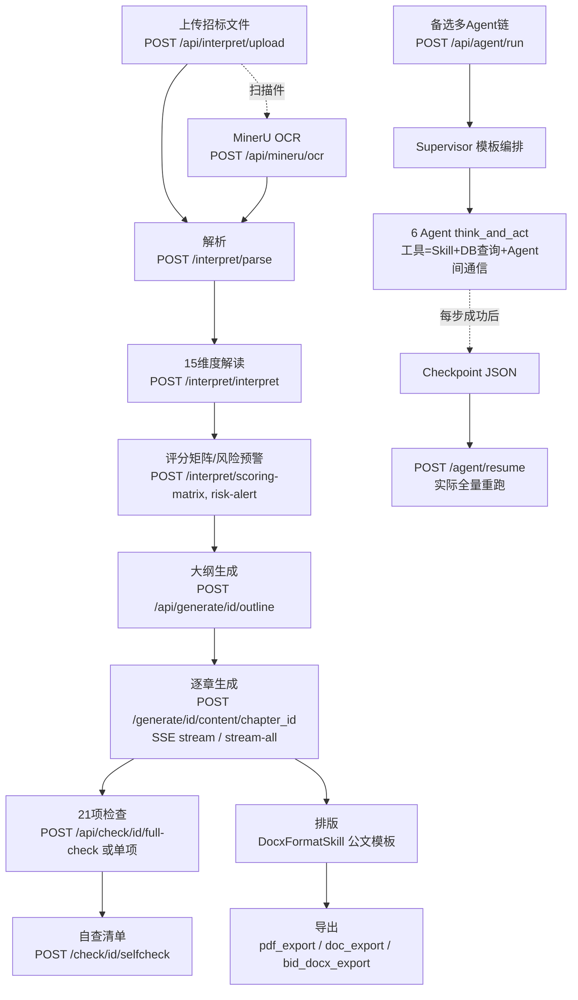

# guangshu100/BidMaster-Pro 源码审计报告

> 审计方式：全量克隆只读静态审计（未 install、未运行、未调用 LLM）。Task ID: 4-5
> GitHub 元数据：stars=406，size=4024KB，主语言 Python，最近推送 2026-09-03

## 1. 基本信息

### 1.1 LICENSE（重点：README 与实际许可证矛盾）
- **实际许可证：AGPL-3.0**（文件 `LICENSE`，662 行完整 AGPL-3.0 全文）。
- **README 徽章与正文声称 MIT**：`README.md:7` 徽章 `license-MIT-orange.svg`；`README.md:375` "本项目采用 MIT 许可证 - 详见 LICENSE 文件"。
- git 演变：`681027e Create LICENSE`（2026-05-25，仅 1 行空文件）→ `85401e3 Update LICENSE`（同日 +660 行，写入 AGPL-3.0 全文）。
- `skills/*/SKILL.md` frontmatter 也写 `license: MIT`（4 处），与仓库 LICENSE 再次矛盾。
- **法律含义**：以 LICENSE 文件为准，本仓库为 AGPL-3.0。README 的 MIT 声明构成许可证误导（对复用者而言，若按 MIT 理解并闭源使用，将违反 AGPL §13 网络服务源码披露义务，存在法律风险）。复用前必须按 AGPL 对待。

### 1.2 语言/框架/规模
- 文件总数 201（git ls-files）；Python 139 个 ≈ 23,869 行；TS/TSX 19 个 ≈ 12,651 行；另有 package-lock.json、SQL、YAML、PNG 截图等。
- 技术栈：FastAPI + SQLAlchemy(asyncio) + PostgreSQL16/MySQL8（双支持）+ Redis + ChromaDB + LangGraph + Electron/React 19 桌面端。
- 顶层目录：
  - `core/`（42 文件）：六大引擎——agent_framework（多Agent框架）、agent_engine（LangGraph 编排+闸门）、skill_engine（技能注册/加载/归一化）、doc_engine（解析器+ONNX分类器+章节检测）、rag_engine（向量库/嵌入/混合检索）、llm_gateway（OpenAI 直连网关+JSON修复）、ocr（MinerU 客户端）、task_manager、settings。
  - `services/`（98 文件）：FastAPI 15 个路由 + interpret/generate/check/format/news 四阶段 Skill + agents（6 个业务 Agent + 工具适配）+ mcp（MCP Server）+ models/database/middleware/rbac。
  - `skills/`（4 个 SKILL.md）：面向展示的技能文档（无 skill.py）。
  - `packages/desktop/`：Electron+React 桌面客户端（8 页面）。
  - `docker/`、`db/`（init_pg.sql/init_mysql.sql）、`templates/default.yaml`（公文排版模板）、`start.py`。

### 1.3 提交历史
- 32 条提交（全量克隆，非浅克隆）：2026-05-15 首提交 → 2026-09-03 最近（README 更新）。主体开发集中在 2026-05~08，含一次 "多Agent架构改造" 大 PR（341f607）。维护活跃。

### 1.4 测试
- **零测试**。`pyproject.toml` 声明 `testpaths=["tests"]` 并配 pytest-asyncio，但仓库无 tests 目录、无任何 test_*.py、无 CI 配置。能力标签：**MISSING**。

### 1.5 第三方依赖（pyproject.toml 34 项）与问题
- 声明：fastapi、sqlalchemy[asyncio]、asyncpg、aiomysql、alembic、pydantic-settings、**litellm>=1.0**、openai、langgraph、langchain-core、chromadb、onnxruntime、python-docx、pdfplumber、pymupdf、mammoth、chardet、bs4、celery[redis]、redis、**minio**、pyyaml、httpx、tenacity、loguru、jieba、openpyxl、jinja2、**weasyprint**、**fastmcp>=2.0**、apprise、sentence-transformers 等。
- **声明但实际未用（死依赖）**：`litellm`（网关 docstring 明言"绕过 litellm"，代码无 import）、`weasyprint`（全仓库无 import）、`minio`（无任何 .py import；仅 docker-compose 拉起容器+settings 留键）。
- **用了但未声明**：`bcrypt`（services/routers/auth.py、rbac.py）、`feedparser`/`requests`（services/news/fetchers.py）、`numpy`（rag_engine/retriever.py、onnx_classifier.py）、`psycopg2`（start.py）、`docx2pdf`/`reportlab`（pdf/doc 导出 fallback import）。
- **依赖错配（影响 MCP 可运行性）**：`services/mcp/server.py:10` `from mcp.server.fastmcp import FastMCP` 需要**官方 `mcp` 包**，而 pyproject 声明的是第三方 `fastmcp`（提供 `fastmcp` 模块，不提供 `mcp.server.fastmcp`）。按声明安装后 FastMCP=None，MCP Server 静默降级为 Stub（`server.py:17-28`），`mcp.run()` 仅打 warning。要真正跑 MCP 需补装 `mcp`。
- 许可证注意点：第三方依赖本身均为 MIT/Apache 类宽松协议；**本仓库自身的 AGPL-3.0 才是复用的约束核心**。

## 2. 能力清单（a–p）

| # | 能力 | 标签 | 证据 |
|---|------|------|------|
| a | 招标文件解析 | **IMPLEMENTED**（有硬伤） | `core/doc_engine/parsers/`：`pdf_parser.py:7` pdfplumber 逐页文本+表格（保留页码，`:19-23`）、扫描件启发式 `is_scanned=len(text)<page*50`（`:26`）；`docx_parser.py` python-docx；`txt_parser.py` GBK/GB18030/chardet 编码回退。MinerU OCR：`core/ocr/mineru_client.py`（351 行，云端 SaaS /file-urls/batch→extract/task 轮询 + self_hosted 两实现）+ `POST /api/mineru/ocr`。硬伤：`interpret.py:134-137` 解析后仅持久化 `parsed.text`，**表格数据被丢弃**（只返回计数）；`.doc/.wps` 映射 docx_parser、`.xlsx/.pptx` 映射 txt_parser（`parsers/base.py:22-33`）实际无法解析二进制旧格式；`/parse` 只解析 `tender_doc_id` 首个文件，多附件不进解读 |
| b | 条款/要求提取 | **PARTIAL** | `tender_interpret_skill.py`：15 维度（project_info/qualification/technical/scoring/disqualification/deposit/timeline…`DIMENSIONS` :8-184），按维度关键词行过滤±3 行、12k 截断（`:431-466`），LLM collect_json + camelCase/中文键归一化（`:186-308`）；`mandatory_req_extract_skill.py`：LLM 提取 ★▲强制参数/废标条款/硬资质，ID 形如 MP-001/DQ-001/HQ-001（**:30-43，由 LLM 生成、无持久化绑定**，文本截 8000 字符）。**六类要求没有统一结构化清单**，结果散在 `Analysis.dimensions` JSON |
| c | 原文位置溯源 | **MISSING** | 提取出的条款不含页码/段落锚点；`Analysis.dimensions` 无 source 字段；解析时页信息未入 `parsed_content`（`pdf_parser.py:25` 各页直接 "\n\n" 拼接）；表格页码在解析响应里但被丢弃。仅 LLM 自报 `clause_number`（`tender_interpret_skill.py:78`），不可信 |
| d | 企业资料检索/证据 | **PARTIAL** | `core/rag_engine/retriever.py:14` HybridRetriever：向量(Chroma)+TF-IDF 关键词→RRF 融合（`:153-178`）；`knowledge.py:62` _smart_chunk(1000, overlap200)；`embedder.py` api(text-embedding-v3/dashscope)/local(BAAI/bge-m3)。缺陷：①TF-IDF 词表 `self._documents` 不分 collection，**跨知识库泄漏**（`retriever.py:120-151,189-195`）且每次 add 全量重建；②`knowledge_assist_skill.py:89` `retriever.retrieve(query, top_k=top_k)` 缺 `collection_name` 位置参数→TypeError 被 except 吞掉→**全局兜底检索恒返回空**；③**无编号/型号/金额/日期精确匹配**，无 metadata 过滤 |
| e | 响应矩阵/合规矩阵 | **PARTIAL** | 评分项→章节映射：`outline_gen_skill.py:465-494` 2-4 字 n-gram 词级匹配 + 整名包含加分，置信度 ≥0.3 才建 `score_mapping`（评分项名→章节id）；`structure_template_skill.py` ScoreCoverageSkill 识别未覆盖评分项；`scoring_matrix_skill.py:20-32` 评分矩阵行含 `response_section` 建议。**缺**：requirement×response 双向矩阵、响应状态跟踪、投标侧逐条应答 ID 关联 |
| f | 目录生成与分章节生成 | **IMPLEMENTED** | `outline_gen_skill.py`（v7.0.0，513 行）：Step1 一级目录→Step2 并发(4)+120s 超时生成二三级→`_validate_outline`（≥5章、禁占位标题、≥50% 有子目录）→失败降级一次性生成；章节级：`generate.py:588` `POST /content/{chapter_id}`、`:705` SSE 单章流式、`:983` stream-all、`:1299` PUT 更新章节内容——**单章可独立生成/重试/修改** |
| g | 审校/校验 | **PARTIAL** | 21 个检查技能全部存在（见 §3 逐项核对）。性质：17 个纯 LLM 提示词检查（含保证金金额"精确到分"、签章等本应确定性的检查）；确定性 3 个（`pricing_check_skill.py` 正则算术/限价/95-98% 安全区间、`risk_score_skill.py` 6维加权、`selfcheck_list_skill.py` 20项 SC-01~SC-20 汇总+can_submit）；混合 1 个（`duplicate_check_skill.py:114-186` difflib/Jaccard/ngram/滑窗 + LLM 深度分析）。**报价=确定性，工期/有效期/资质/签章=纯 LLM**；无暗标检查；无导出前硬阻断（仅 `multi_agent_pipeline_skill.py:195-199` 流水线内 risk_level=high 时 gate_blocked 需人工审核，export 不受 CheckReport 约束） |
| h | 导出 | **IMPLEMENTED**（无暗标） | `docx_format_skill.py`（885 行）markdown→docx：中文编号/小数编号标题识别至 H8、公文排版（方正小标宋/黑体/仿宋_GB2312，配置来自 `templates/default.yaml` 82 键）；`pdf_export_skill.py:106-136` LibreOffice soffice 多平台路径→docx2pdf→reportlab 三级降级；`doc_export_skill.py` LibreOffice→pandoc；`revision_skill.py` python-docx 生成 Word 修订追踪；`bid_docx_export_skill.py`（385行）标书组装。**docx 为唯一中间格式**属实。**暗标格式排版缺失**（README 亦未声称） |
| i | 状态持久化与恢复 | **PARTIAL** | PostgreSQL 12+ 表（`services/models.py`：Project/Document/Analysis/Outline/Chapter/CheckReport/KnowledgeBase/MonitoringTask/CrawlResult/RBAC×5/SkillConfig/AgentConfig.workflow_dsl）；闸门：`gate_keeper.py` 文件系统 `.stages/<stage>/.reviewed`（人工 review 由 `projects.py:134-135` mark_passed）；检查点：`checkpoint.py:19-41` JSON 原子写，**但只保存 step_results 的前 3 个 key 名而非数据**（`:22-26`），`agent_runtime.py:184-191` resume 直接从头重跑 supervisor 全流程，**不跳过已完成步骤**——断点续跑形同虚设；TaskManager（`core/task_manager.py`）进程内 asyncio 内存态，重启即失 |
| j | 失败处理 | **IMPLEMENTED** | 四层：①LLM 网关 `gateway.py:92-186` 按次尝试切换 fallback_models + response_format 不支持自动去参重试 + `stream_chat` 中断续写（带已收集前缀，`:290-316`）+ `json_repair.py`（315 行修复引擎）；②Supervisor `supervisor.py:30-38` ERROR_STRATEGY_RULES 正则规则表（retry/goto回退/skip/llm 决策兜底，goto 限 2 次防环）；③工具层 `agent.py:60-83` 重试 2 次+熔断器 `circuit_breaker.py`；④大纲校验降级、内容截断续写（`content_gen_skill.py:139-202`） |
| k | 日志与可观测性 | **PARTIAL** | logging 全链路 [LLM] 请求/耗时/token 明细（`gateway.py:97-139`）；token 用量 deque(10000) + `GET /api/stats`（`main.py:168-183`）；TaskManager 任务进度+轮询端点；异常→HTTP 状态映射（`main.py:103-143`）。**缺**：结构化日志/追踪 ID/指标导出；loguru 声明未用；Celery 任务零调用 |
| l | 测试 | **MISSING** | 零测试文件（详见 §1.4） |
| m | Skill 文件 | **PARTIAL** | 4 个 `skills/**/SKILL.md`（interpret/generate/check/output 各一），frontmatter 含 name/description/category/version/**license: MIT**/author/triggers，正文为流程说明，**无阶段规则、无停止条件**；`core/skill_engine/loader.py:37-53` get_skill_class 要求目录内 skill.py，但 skills/ 只有 SKILL.md→`/api/skills/reload` 实际加载不到任何类（静默 continue）。SKILL.md 是文档镜像而非可执行技能 |
| n | Dify DSL / 工作流编排 | **MISSING**（Dify）；自研编排 **IMPLEMENTED** | 全仓库无 Dify 特征文件（"dify" 仅出现在 LICENSE 正文子串）。自研两条路：①`orchestrator.py:21-49` AgentOrchestrator 按 dict DSL（nodes/edges/entry/condition）构建 LangGraph StateGraph + `require_gate` 闸门；②`supervisor.py:11-28` PIPELINE_TEMPLATES（bid_generation 6 步/bid_check/full_analysis）+ AgentConfig.workflow_dsl 存 DB |
| o | MCP Server | **PARTIAL**（实现真、依赖错） | `services/mcp/server.py`：官方 `mcp.server.fastmcp.FastMCP`，8 个 @mcp.tool（interpret_tender/generate_outline/run_compliance_check/run_full_check/run_selfcheck/search_knowledge/list_skills/get_project_status）+ 2 个 @mcp.resource（bidmaster://skills、bidmaster://project/{id}），参数即 project_id/kb_id 等简单 schema，工具体直接委托 FastAPI 路由函数。**依赖错配**（详见 §1.5）使按 pyproject 安装后 Server 变 Stub；且工具依赖 DB 会话与已初始化的 SkillRegistry，需先跑通 API 服务 |
| p | LLM 调用方式 | **IMPLEMENTED** | `core/llm_gateway/gateway.py`：**AsyncOpenAI 直连**（docstring 自述"绕过 litellm"，`:1-6`），provider 前缀剥离（`:38-50`），OpenAI 兼容端点切换（api_base 自动补 /v1，`:61-63`）；chat/collect_json/response_format 降级/stream_chat/chat_with_tools 四接口；热切换：`llm_config.py:479-543` set_default_model 校验后原子写 .env + reset 网关，另有 5 家 provider 预置模型表（`:170-181`）、**每 Agent 独立模型/温度配置**（agent-models 端点 `:94-158`）。**无 Claude/Anthropic SDK**（"Claude" 仅出现在新闻行业关键词表 `industry_classify_skill.py:72`）。多轮对话无独立会话存储（AgentMemory 窗口 10 条 `memory.py`） |

## 3. README 声明核对（逐条）

| README 声称 | 判定 | 证据 |
|---|---|---|
| "全流程智能招投标 Agent，4 阶段流水线（招标解读/投标生成/投标检查/文档排版）" | **已验证** | interpret/generate/check/format 四组路由与 Skill 全部存在；`main.py:146-160` 挂载 |
| "21 项专业合规检查规则" | **已验证存在，但性质需注明** | `services/check/skills/` 恰 21 个检查技能（除 check_report_export）。但：17/21 为纯 LLM 提示词检查、输入截断 3000-5000 字符（如 `signature_check_skill.py:49`、`deposit_check_skill.py:50`）；full-check 并行只跑其中 15 项（`check.py:481-499`）；riskScore/sampleReport/jointBid/ebidSubmit/whitelist/selfcheck 走独立端点。"规则"以 prompt 形式存在于技能文件中，非确定性规则引擎 |
| "多 Agent 协同 + 可编排工作流" | **已验证** | 6 个业务 Agent（`agent_bootstrap.py:431-447`）+ Supervisor 模板编排 + LangGraph DSL（`orchestrator.py`）；工具权限分域（`agent_bootstrap.py:18-42`）、Agent 间 MessageBus ask_agent（`:345-412`） |
| "多 LLM 供应商灵活切换（DeepSeek/硅基流动/OpenAI/通义/Ollama）可热切换" | **基本已验证，机制表述失实** | 切换能力真实（.env 原子写+网关重置，`llm_config.py:479+`；fallback 模型链 `gateway.py:344-352`）。但 **README 称"通过 LiteLLM"，实际是 AsyncOpenAI 直连**，litellm 从未被 import（`gateway.py:1`）；Ollama 走 OpenAI 兼容端点假设 |
| "轻量级 Skill 引擎 + 可插拔能力" | **已验证** | `skill_engine/base.py` Skill ABC + safe_execute + progress_callback；`skill_bootstrap.py` 注册 47 个技能；`routers/skills.py` 支持按名执行任意已注册技能与 reload |
| "RAG 知识库（支持语义重排与公司画像过滤）" | **夸大/未验证** | 检索是 向量+TF-IDF 的 RRF 融合（`retriever.py:24-33`），**"语义重排(rerank)"在代码中不存在**（rg 全仓库仅 README 两处命中）；"公司画像过滤"只在**商机监控**模块（`news/scoring.py:20-84`、`news_crawler_skill.py:255-257`），与 RAG 知识库无关 |
| "MinerU 扫描件 OCR 抽取" | **已验证** | `core/ocr/mineru_client.py` 云端/自部署双客户端+轮询超时控制；`routers/mineru_config.py` 平台化配置 Tab；`POST /api/mineru/ocr` |
| "商机监控 + 今日热点聚合" | **已验证** | `services/news/`：38 个预置源（`sources.yaml`）、RSS/API/爬虫三抓取器、5 维商机评分（`scoring.py:26-32` urgency20/match30/amount20/region15/freshness15）、语义过滤/去重/热点聚合/转化为项目（`routers/news.py:163,356,469,610,934`）。注：HTMLFetcher/BrowserFetcher 为空实现（`fetchers.py:250-262`），"crawl" 类型源实际靠 NewsCrawlerSkill 通用列表页爬虫 |
| "智能文档解析：支持 PDF/DOCX/TXT 等多格式" | **部分验证** | PDF/DOCX/TXT/MD/HTML 真实；`.doc/.wps` 映射到 python-docx（打不开旧二进制格式）、`.xlsx/.pptx` 映射到纯文本读取器（`parsers/base.py:22-33`），均会失败 |
| "风险预警：多维度风险评估，标记潜在废标风险点" | **已验证** | `risk_alert_skill.py` + `disqualification_check_skill.py`（3 次 LLM 调用核对废标条款）+ `/interpret/risk-alert` 端点 |
| "评分矩阵：自动生成评分细则对照表" | **已验证** | `scoring_matrix_skill.py`（seq/category/item/score/criteria/response_section/status）+ `/interpret/scoring-matrix/{id}` |
| "大纲生成/内容创作/知识检索/AI 配图" | **已验证** | outline_gen v7 / content_gen 4 模式+分段+续写+清洗 / knowledge_assist / ai_image（火山方舟+Google AI Studio 双通道+水印检测 `ai_image_skill.py:22-28`） |
| "docx(源)/doc/PDF 三种格式一键导出，docx 为唯一中间格式" | **已验证** | `doc_export_skill.py:15-16` docstring 明确该策略；PDF 三级降级链 |
| "格式检查/差异对比，修订模式" | **已验证** | `revision_skill.py`（diff→Word 修订追踪）；格式模板对比在 DocxFormatSkill 配置驱动 |
| "咨询中心：AI 智能问答/多轮对话/资料引用/角色化回复" | **未验证（开源版缺失）** | 后端无 chat/qa 路由（rg 仅命中 generate 流式与 llm 测试端点），前端 8 页面无咨询页（pages/ 仅 Dashboard/Interpret/Generate/Check/Format/News/Settings/Login）。README 截图（packages/desktop/images/咨询中心.png）对应功能未随开源仓库发布，疑似保留给商业版 |
| "知识库管理：ChromaDB 向量检索" | **已验证** | `vector_store.py` + `knowledge.py`（建库/上传分块/搜索/sync-push/pull 云同步） |
| "RBAC：管理员/项目经理/编写员/审核员，菜单级和操作级权限" | **已验证** | `models.py:60-64` UserRole 4 角色 + RBACRole/Permission/RolePermission 表 + `middleware/rbac_middleware.py` Bearer 会话校验 + `routers/rbac.py` |
| "技术架构：LLM Gateway LiteLLM / Celery Worker(Async Tasks) / MinIO(Object Storage) / ONNX 文档分类" | **多处失实** | LiteLLM 未用（见上）；Celery 定义了 3 个任务但**全仓库无 .delay/apply_async 调用**，异步实际靠进程内 TaskManager（`celery_app.py` 为死代码，其中 run_news_monitor 仅查询任务表返回 "processed" 假状态）；MinIO 无任何代码引用；ONNX 分类器代码在（`onnx_classifier.py`）但 `models/doc_classifier.onnx` 模型文件未随仓库提供，实际走降级 |
| "License: MIT" | **失实** | LICENSE 文件为 AGPL-3.0（详见 §1.1） |
| "Docker 一键部署" | **已验证** | `docker/docker-compose.yml`：PG16/MySQL8/Redis7/MinIO/celery-worker/beat/api/web(nginx)+healthcheck+日志轮转，专业度高 |
| "桌面客户端" | **已验证** | Electron 主进程（`packages/desktop/main/index.js`，contextIsolation）+ React19/Zustand/TanStack 8 页面 + api.ts baseURL '/api' |

## 4. 真实执行链路重建

主链路（API 直调模式，也是前端默认用法）：

| 节点 | 入口(文件+函数) | 输入输出结构 | 模型/工具 | 持久化 | 失败处理 | 状态 |
|---|---|---|---|---|---|---|
| 上传 | `interpret.py:20 upload_tender_file` | 文件→`projects/{id}/` 路径 + Document 行 | 无 | Document 表 | 400 格式/超限 | IMPLEMENTED |
| 解析 | `interpret.py:112 parse_tender_file` → `parsers/*` | ParsedDocument{text,tables,metadata}；SectionDetector 章节 | LLM(章节正则失败时) | `Document.parsed_content`+metadata；**tables 丢弃**；Analysis.sections 由前端另存 | 500 | IMPLEMENTED |
| OCR(可选) | `mineru_client.py:40 extract` | 文件→markdown 结构 | MinerU SaaS/自部署 | 无独立表 | 轮询超时/重试 | IMPLEMENTED |
| 解读 | `tender_interpret_skill.py:358 execute` | document_text→`{dimensions:{15维}}` | LLM collect_json×15 并发(信号量3) | Analysis.dimensions | 单维 error 字段隔离 | IMPLEMENTED |
| 评分/风险 | `scoring_matrix_skill.py` / `risk_alert_skill.py` | dimensions.scoring→rows[] | LLM | Analysis.scoring_matrix | — | IMPLEMENTED |
| 大纲 | `outline_gen_skill.py:294 execute` | text+scoring→`{chapters[],score_mapping{}}` | LLM×(1+N 并发4) | Outline.tree | 校验→补默认子目录→一次性降级 | IMPLEMENTED |
| 内容 | `content_gen_skill.py:42 execute`（4 模式） | chapter→markdown content | LLM+RAG(模式B)+AI配图 | Chapter.content(MEDIUMTEXT) | 截断续写≤2次+清洗规则 | IMPLEMENTED |
| 检查 | `check.py:415 _do_full_check` | tender/bid text(截32k)→15技能并行 | LLM+正则 | CheckReport.results JSON | 单技能异常隔离+TaskManager 轮询 | PARTIAL(截断) |
| 自查 | `selfcheck_list_skill.py:75` | check_results→SC-01~20 状态+can_submit | 无(纯聚合) | CheckReport(SELCHECK) | — | PARTIAL(依赖上游全跑) |
| 排版 | `docx_format_skill.py` | markdown+模板82键→docx | 无(确定性) | 文件系统 | — | IMPLEMENTED |
| 导出 | `pdf_export_skill.py`/`doc_export_skill.py` | docx→pdf/doc | LibreOffice/pandoc 外部工具 | 文件系统 | 三级降级+明确报错指引 | IMPLEMENTED |
| 多Agent | `agent_runtime.py:61 run_pipeline`→`supervisor.py:72 run` | 任务字符串→step_log+results | 6 Agent×think_and_act(工具调用) | Checkpoint JSON(仅key名) | 规则表 retry/goto/skip/llm | IMPLEMENTED(恢复不真) |

**链路判定：完整链（可端到端跑通）**，但每一环均有质量硬伤（截断、无溯源、检查靠 LLM）。响应矩阵与原文溯源两节点缺失（无 requirement ID 体系）。

## 5. 重点审计问题 Q1–Q10

**Q1 超长文件/附件/表格/扫描件如何处理？**
多重截断，无分块聚合：检查入口全局截 32000 字符并标注"[内容已截断]"（`check.py:31-34` + `settings.py:49` + `.env.example:30`）；各检查技能再截 3000-5000（如 `signature_check_skill.py:49`）；解读按维度关键词过滤行±3 行、单维 12000（`tender_interpret_skill.py:431-466`）；mandatory 提取 8000、大纲 Step1 15000、one-shot 12000。**超界条款必然丢失，无任何补齐机制**。表格：pdfplumber 抽出后仅返回计数，不入库（`interpret.py:134-137`）。附件：仅首个上传文件被解析。扫描件：`is_scanned` 启发式 + MinerU OCR 兜底（这块做得认真，351 行轮询/双模式）。

**Q2 六类要求如何统一成结构化条款清单？**
没有统一清单。散落在 `Analysis.dimensions` JSON（15 维各自由 LLM 产出 schema，键经 `_CHINESE_KEY_MAP/_DIMENSION_KEY_MAP` 归一化）+ `mandatory_req_extract` 一次性结果（MP/DQ/HQ 前缀 ID 由 LLM 即兴生成）。无六分类显式建模；无统一 Requirement 实体/表。

**Q3 要求如何关联原文位置/证据/响应章节/审校结果？有无 ID 体系？**
**无贯穿 ID 体系**。仅有的两个局部映射：outline `score_mapping`（评分项名→章节 id，n-gram 匹配）与 scoring matrix 行内 `response_section` 建议（LLM 生成）。原文锚点缺失（见 c 项），证据检索结果不回写条款，CheckReport.results 与章节/条款无外键关联（全部 JSON blob）。`CheckType` 22 枚举与 `_CHECK_SKILL_MAP` 19 项是检查维度的局部 ID，与要求条款无关。

**Q4 企业资料检索是否同时支持语义召回与精确匹配？**
仅语义召回（向量+TF-IDF RRF）。**无编号/型号/金额/日期的精确匹配通道**（`retriever.py` 全文无此逻辑），无 metadata 过滤参数。另有 §2-d 所列两个实现 bug。

**Q5 无证据/证据过期/资格不满足时，如何阻止错误内容进定稿？**
三个软机制，无导出硬阻断：①数据依赖章节占位（`content_gen_skill.py:55-68`：人员/业绩/资质类章节无 RAG 时只生成"[占位提示]"，不编造——这是亮点，但仅限模式 A/B，占位文本仍会进导出流）；②流水线级 gate_blocked（`multi_agent_pipeline_skill.py:190-199` risk_level=high 时要求人工审核）+ 文件闸门 `.reviewed`（`projects.py:134`）；③selfcheck `can_submit=False`。但 `export`/`format` 路由不查询 CheckReport/占位标记，**可一键导出带占位/未通过内容**。

**Q6 章节能否拆成单独执行/重试/修改/验证的任务？**
能。Chapter 表天然按章持久化；`POST /generate/{id}/content/{chapter_id}` 单章生成、SSE 单章/全量流式、`PUT /generate/{id}/chapters/{chapter_id}` 人工改写、任务态轮询 `/generate/task/{task_id}`（`generate.py:30,588,705,983,1299`）。验证仅靠 LLM 检查技能，无确定性章节校验。

**Q7 报价/工期/资质有效期/签章/暗标，哪些是确定性代码、哪些依赖模型？**
确定性：报价（`pricing_check_skill.py` 全正则：限价、单价×数量=合价±0.01、大小写对照提示、95-98% 安全区间；`pricing_logic_check_skill.py` 是 LLM）；查重算法层（difflib/ngram/滑窗）；风险加权评分；自查清单聚合。**依赖模型：工期/有效期（validity_check 纯 LLM）、资质（qualification_check 纯 LLM）、签章（signature_check 纯 LLM）、保证金"精确到分"金额核对（deposit_check 纯 LLM，逻辑上应确定性）**；暗标检查不存在。

**Q8 中断/换模型/补充文件后如何恢复？**
换模型：平台设置热切换（写 .env + reset gateway + 每 Agent 独立模型配置），无需迁移。中断恢复：Checkpoint 只存 completed_steps 与结果键名（`checkpoint.py:22-26`），`/agent/resume` 重跑全流程（`agent_runtime.py:184-191`），TaskManager 内存态重启即丢；数据库中的 Analysis/Outline/Chapter 仍在，用户可手动只重跑后续步骤（按端点粒度），**无受影响章节自动识别**。补充招标文件：重新上传+parse+interpret 覆盖 Analysis（upsert，`interpret.py:221-240`），但不会标记哪些章节需重生成。

**Q9 可导入 Dify DSL / 可运行 MCP Server / 独立 Skill？**
Dify DSL：**无**（零 Dify 特征文件）。MCP Server：`services/mcp/server.py` 结构完整（8 工具+2 资源，纯 Python 无 YAML），但 ①pyproject 声明 `fastmcp` 而代码 import 官方 `mcp` 包→按声明安装后为 Stub，需补装 `mcp` 才能起服务；②工具内部 import services.database 需要 PG/Redis 就绪 + skill_bootstrap 已注册，即必须先拉起整个 API 栈；③无 stdio/sse 传输配置暴露，走 FastMCP 默认。独立 Skill：`skills/` 目录 4 个 SKILL.md 无 skill.py，SkillLoader 加载不到类，属展示性文档；真正技能全部编译在 `services/*/skills/*.py`（47 个，随服务注册）。

**Q10 哪些可合法复用？**
**代码一律不可直接复用**（AGPL-3.0 传染 + README 虚标 MIT 的陷阱，见 §6）。可自由借鉴的思路（不受版权保护）：15 维度关键词召回+schema 归一化的解读策略、评分项→章节 n-gram 映射与覆盖率检查、ErrorStrategyEngine 规则表、文件闸门+人工 review、检查结果统一 schema（`check_normalizer.py` 的 findings/severity 归一化）、公文排版参数体系（`templates/default.yaml` 82 键 + 标题正则族）、docx 唯一中间格式+LibreOffice 三级降级、数据依赖章节占位防编造。

## 6. 复用价值与许可

- **可直接复用**：无。AGPL-3.0 下任何包含其代码的作品须整体以 AGPL-3.0 发布，且向网络用户提供服务时必须开放源码（AGPL §13）。我们的独立系统若闭源/可控发布，**禁止复制其任何代码行、SQL、提示词文本、配置文件**（提示词与 YAML 模板同为版权客体）。
- **README 称 MIT 的处理**：LICENSE 文件法律效力优先于 README 徽章，且 skills/*/SKILL.md 的 "license: MIT" frontmatter 同样无法覆盖仓库 LICENSE 的 AGPL 全文；除非上游书面澄清或重新授权，否则一律按 AGPL 对待。若未来对方真改回 MIT（git 历史显示 LICENSE 曾为空文件后补 AGPL），可重新评估。
- **需改造后复用**：不适用（改造即衍生，仍受 AGPL 约束）。
- **仅可借鉴思路**（推荐路径）：§5-Q10 所列 8 项设计模式；另可参考其"21 项检查"的检查项命名与 JSON 输出 schema 自行实现确定性版本；商机评分 5 维权重设计。
- **不建议采用**：其 HybridRetriever 实现（跨库泄漏+O(N²)重建+参数 bug）、检查技能的"LLM+截断"范式、Celery 假任务、断点续跑方案、内存 session 认证。
- **附带发现**：`gateway.py:1-6` docstring 自述参考 NewbieCoderLab/ai_bidding（MIT）与 FB208/OpenBidKit_Yibiao（AGPL）的实现方式——本仓库与初筛 A 组仓库同源生态，佐证其 AGPL 选择并非随意。

## 7. 可靠性风险清单

| # | 风险 | 严重度 | 证据 | 复现/验证 |
|---|---|---|---|---|
| 1 | **许可证误导**：README/徽章/SKILL.md 三处称 MIT，LICENSE 实为 AGPL-3.0；复用者按 MIT 闭源使用将违约 | 高 | `README.md:7,375`；`LICENSE`；`skills/*/SKILL.md` frontmatter；git 681027e→85401e3 | `head LICENSE` 对比 README |
| 2 | **检查可靠性**：17/21 项检查为纯 LLM 提示词，输入截 3-5k 字符，32k 全局截断——长标书后半部分要求全部漏检；保证金金额、签章等"应确定性"检查亦靠模型猜测 | 高 | `check.py:31-34,481-499`；`deposit_check_skill.py:50`；`settings.py:49` | 构造 >32k 字符标书跑 full-check，观察截断标记 |
| 3 | **零测试**：23.9k 行 Python 无任何测试，pyproject testpaths 指向不存在目录 | 高 | `git ls-files` 无 test 文件；`pyproject.toml:70-72` | `pytest` 收集 0 项 |
| 4 | MCP Server 依赖错配：声明 fastmcp 实际 import 官方 mcp 包，按声明安装后 Server 静默变 Stub | 中 | `pyproject.toml:41` vs `services/mcp/server.py:10-28` | 装依赖后 `python -m services.mcp.server`，看 warning |
| 5 | 全局知识兜底检索必败：`retrieve(query, top_k=...)` 缺 `collection_name` 位置参数→TypeError 被吞→恒空结果 | 中 | `knowledge_assist_skill.py:89` vs `retriever.py:24`（签名） | 对照两处签名即可证明 |
| 6 | HybridRetriever 跨知识库泄漏 + 全量 TF-IDF 重建（内存态、重启丢失、O(N²)） | 中 | `retriever.py:120-151,180-205`（`self._documents` 不分 collection） | 多 KB 场景检索可命中他库文本 |
| 7 | 断点续跑虚设：checkpoint 只存结果 key 名，resume 全流程重跑不跳步；TaskManager 内存态 | 中 | `checkpoint.py:22-26`；`agent_runtime.py:184-191`；`task_manager.py:63` | 读代码对比 resume 逻辑 |
| 8 | 解析后表格丢弃 + .doc/.wps/.xlsx/.pptx 映射错误 + 仅解析首个附件 | 中 | `interpret.py:118-137`；`parsers/base.py:22-33` | 上传多附件观察 /parse 仅首个 |
| 9 | 未声明依赖 bcrypt/feedparser/requests/numpy/psycopg2/docx2pdf/reportlab；litellm/weasyprint/minio/loguru 声明未用 | 中 | §1.5 各 import 证据 | `pip install -e .` 后 import services.main 报缺 bcrypt/numpy 等 |
| 10 | "咨询中心"前端截图存在、代码缺失（疑似闭源保留）；Celery 3 任务全仓库零调用且 run_news_monitor 返回假 "processed" | 中 | `images/咨询中心.png` vs 无 chat 路由/页面；`celery_app.py:31-54`；rg 无 .delay | rg 验证 |
| 11 | selfcheck 端点只跑 3 项检查→20 项 SC 清单大多 pending→`can_submit` 恒 False | 低-中 | `check.py:305-390`（仅 compliance/pricing/qualification 注入） | 调用 /selfcheck 观察 pending |
| 12 | interpret 保存 `scoring_matrix={}`（技能只返回 dimensions，字段错位）；auth 内存 session（重启全失效、不可横向扩展）；ONNX 分类模型文件未随仓库提供 | 低 | `interpret.py:228` vs `tender_interpret_skill.py:412-415`；`auth.py:14`；`onnx_classifier.py:70-73` | 读代码/重启验证 |

---

### 结论速览
406 星的 BidMaster-Pro 是本次审计中**工程完整度最高**的开源标书系统（23.9k LOC、四阶段全链路、真多 Agent ReAct 循环、真 MCP Server 骨架、专业 Docker 编排、Electron 客户端），**不是空壳**。但其核心质量三连击：①许可证虚标 MIT 实为 AGPL-3.0；②"21 项合规检查"实为 17 个 LLM 提示词+3 个聚合器+1 个混合，且全部建立在文本截断之上；③README 技术栈存在系统性夸大（LiteLLM/Celery/MinIO/语义重排/咨询中心均名不符实）。对本项目而言它是**最佳"反面教材+思路库"**：架构分层、检查 schema、公文排版、防编造占位值得学，代码一行都不能抄。
