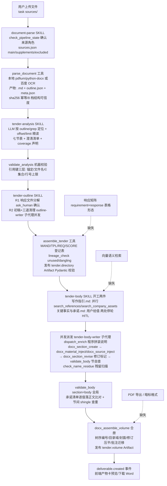

# joychin/LingYan-Bid-Agent 源码审计报告

> 审计方式：全量克隆静态审计（只读），未安装依赖、未运行仓库代码、未调用任何 LLM API。
> 审计对象：本地仓库 `/home/z/my-project/repos/joychin__LingYan-Bid-Agent/`（github.com/joychin/LingYan-Bid-Agent）

## 1. 基本信息

### 1.1 体积来源（先回答主代理指定问题：17.8MB 是什么）

工作区 36MB（含 .git 18MB），git 追踪 658 个文件。体积构成**全部是代码 + 截图 + 前端自带资产，无任何模型/数据二进制**：

| 构成 | 体积 | 说明 |
|---|---|---|
| `docs/screenshots/` | 8.4MB | 10 张 PNG + 1 个 GIF（README 演示截图，单张最大 1.35MB） |
| `sidecar/`（Python 核心） | 3.1MB | 源码 ~23.7K 行 + 测试 ~21K 行 + `uv.lock` 428KB |
| `frontend/` | 4.9MB | `public/pdfjs/cmaps` 168 个 .bcmap + Liberation 字体 + InterVariable.woff2(344KB)——pdf.js 离线预览所需 |
| `docs/` 其余 | ~0.5MB | decision-log.md 296KB（开发决策档案）、skill design 手册、user-stories |
| `src-tauri/` | 668KB | 图标 + Cargo.lock |
| `demo/` | 452KB | 9 份虚构 docx 演示数据（星灵创科/云澜市，全虚构） |

**结论：这是一个"重工程"而非"重资产"仓库**——17.8MB 里的"实肉"是 4.6 万行 Python + 3.1 万行 TS/TSX。

### 1.2 LICENSE

- 根 `LICENSE`：**MIT**（Copyright 2026 LingYan 灵燕智能）。README 徽章与文件一致。
- **许可沿革（重要）**：`git log -- LICENSE` 证实 2026-09-10 提交 877e120 定为 AGPL-3.0-only，2026-09-16 提交 c5ff16a 切换为 MIT。**当前 HEAD 为 MIT，可自由复用；但 877e120..c5ff16a 之间的历史修订仍是 AGPL，复用时务必基于当前 HEAD，不要 checkout 9 月 10–16 日之间的版本**。
- `sidecar/app/skills/humanizer-zh/LICENSE`：第三方 MIT（Copyright 2025 op7418，翻译自 blader/humanizer），随目录保留，合法。
- AGENTS.md 明示铁则：运行时依赖树不得引入 AGPL/GPL 强 copyleft（PyMuPDF→pypdfium2 整体替换即此动因）——本项目对许可证卫生有明确纪律。

### 1.3 语言/框架/规模

- **架构**：Tauri 2 桌面应用（local-first）三层：`src-tauri/`（Rust 壳，仅窗口+sidecar 进程管理，零业务逻辑）→ `frontend/`（React 19 + TS + Vite + Tailwind v4，HTTP+SSE 与 sidecar 通信）→ `sidecar/`（**Python 3.12 + FastAPI + DeepAgents 0.7.7（LangChain/LangGraph 栈）+ SQLite**，核心全部在这）。
- 规模：Python 160 文件 46,515 行（其中 `sidecar/app` 23,691 行、`sidecar/tests` 约 20,971 行/67 个测试文件）；TS/TSX 179 文件 30,828 行；Rust 4 文件；Markdown 33 文件 7,940 行。
- `sidecar/app` 最大模块：`tools/docx_ops.py` 3,645 行（docx 引擎）、`agent.py` 2,613 行（DeepAgents 封装）、`db.py` 1,585 行、`tools/validate_body.py` 723 行、`dispatch_enrich.py` 628 行、`parse/pdf.py` 597 行。
- 顶层目录：`sidecar/`=核心后端（app 代码+skills+tests）；`frontend/`=桌面 UI（含产物编辑器/工作台/知识库管理界面）；`src-tauri/`=Rust 壳；`docs/`=截图+决策档案+skill 设计手册+JSON Schema；`demo/`=虚构演示数据与灌库脚本；`scripts/`=发版工具。

### 1.4 提交历史

- 全量克隆，**156 个提交**，单作者 chenxl，2026-08-23（init）→ 2026-09-29，约 5.5 周高强度开发（峰值单日 22 commit）。最近提交 2026-09-29（AGENTS.md 补写、UI 修复）。**单人极速迭代、极活跃**。
- 开发过程透明度极高：`docs/decision-log.md`（296KB）逐批记录动因、根因、被否方案、"明确不做"拍板——审计中大量注释直接引用其中编号（如 r_eedd621716b5 事故）。

### 1.5 测试

- **有，且质量高**：`sidecar/tests/` 67 个文件约 2.1 万行，覆盖：assemble_tender（registry/树解析/lineage/发布）、validate_body/validate_analysis、docx_ops、解析（pdf_tables/pdf_text/pdfium_kit/parse_document/目录布局）、知识库（ingest/db/api/tools/autocheck/types）、HITL（含多中断）、断点续跑（run_continue）、checkpoint 清理、SSE、事件、workbench 表格契约、migrations、fs_guard、titler、llm_throttle、subagent trace、契约 DTO、冒烟 e2e（`-m e2e` 独立标记，spawn 真实 sidecar）。
- 前端 vitest 测试与源码同目录（*.test.ts 约 30 个，覆盖 runReducer/toolDisplay/markdownBlocks/workbenchTable 等）。
- `check.sh`：全栈门禁（ruff+pytest → oxlint+tsc+vitest+build → cargo check+clippy+test）+ 五处版本号一致性校验。

### 1.6 第三方依赖（sidecar/pyproject.toml）

`deepagents==0.7.7`（钉死版本）、`langchain-openai`、`langgraph`、`langgraph-checkpoint-sqlite`、`langchain-deepseek>=1.1.0`、`openai==3.3.1`、`python-docx`、`pypdfium2>=4.30,<5`、`fastapi`/`uvicorn`/`pydantic`、`sse-starlette`、`jieba`、`pillow`、`tenacity`、`trafilatura`、`httpx`。dev：pytest、ruff、pydantic-to-typescript（契约单一事实源→TS 接口生成）、reportlab。
- **无 AGPL 运行时依赖**（AGENTS.md 明确 PyMuPDF→pypdfium2 就是为避开 AGPL；`cryptography<49` 约束注释亦注明是 deepagents 传递依赖 google-auth 所需）。
- 注意点：deepagents 是 LangChain 官方实验性库且版本钉死 0.7.7，复用需接受其 API 演进风险。

---

## 2. 能力清单（a–p）

| # | 能力 | 标签 | 证据 |
|---|---|---|---|
| a | 招标文件解析 | **IMPLEMENTED** | `tools/parse_document.py`（`parse_document`，234 行）+ `parse/` 注册表：`pdf.py`(597 行, pypdfium2：书签树/目录超链接/印刷目录/中文编号四档结构识别+页眉页脚剔除+`<!-- p:N -->`页码锚点)、`pdf_tables.py`、`docx.py`、`outline.py`、`text.py`。扫描件/.doc/图片路由百度 PaddleOCR-VL 云端（`baidu_ocr.py` 276 行，异步任务模式）。sha256 幂等、原子写三件套、结构可信度分 8 档记入 meta.conversion |
| b | 条款/要求提取（六类分类） | **IMPLEMENTED** | `skills/tender-analysis/SKILL.md`+8 份 references：七节产物=结构事实/资格要求/递交要求/商务技术要求/格式要求/废标条款/评分标准+待澄清清单，与审计方六类一一对应（资格=qualification、否决项=disqualification、评分=evaluation、技术参数+商务=business、格式=format、时间节点=submission）。提取靠 LLM 按节执行，`tools/validate_analysis.py` 机器校验 coverage 声明+出处引用键+行号上限 |
| c | 原文位置溯源 | **IMPLEMENTED** | 引用键纪律：`文件名 章节（L412-L430，第23页）`（`skills/_shared/evidence-rules.md`）；PDF 每页 `<!-- p:N -->` 锚点（`parse/pdf.py`）；`validate_analysis._check_citation_cell` 强制"文件名∈来源确认集合 + L 行号≤解析 md 总行数"；OCR/无结构档位禁署章节名 |
| d | 企业资料检索/证据 | **PARTIAL** | `tools/search_knowledge.py`（search_company_assets/search_references，384 行）+ `knowledge/fts.py`：SQLite FTS5 + jieba 分词 + 中文 bigram——**关键词精确召回 IMPLEMENTED，但无向量/嵌入语义检索**。语义性靠入库时 LLM 生成 statement/检索问句段（`knowledge/extract.py`、`ingest.py`）与用户手工备注作索引。证据键 `kb:{id}:L{n}`、`mt:{fid}:b:{blk_id}` 带行号/页码/哈希/审核状态/时效；`autocheck.py` 对 LLM 抽取的日期/项目名/客户名做回原文锚点核对（确定性）；`freshness.py` 算过期/临期(90天)/陈旧(3年) |
| e | 响应矩阵/合规矩阵 | **PARTIAL** | 无独立 requirement×response 矩阵表；等价物为**血缘系统**：`tools/assemble_tender.py` 从 analysis 表构建登记表（MAND/TPL/REQ/SCORE，行序=编号），目录节点挂 `来源位置` ID 列表，`lineage_check` 输出 unused_ids/dangling_ids，唯一承载折叠（父链重复挂载收敛到最深节点）；正文侧 `validate_body` 全局承诺比对（承诺清单每个值必须落进某节）+ 节间 shingle 查重。逐条"要求→响应文本"的矩阵展示形态缺失（覆盖关系是节点级不是行级） |
| f | 目录生成与分章节生成 | **IMPLEMENTED** | `skills/tender-outline/SKILL.md`（R1 响应文件分解含 ask_human 确认点 → R2 初稿+三道清理：查漏补缺/评分对齐/走查，5 份 references）+ `tender-outline-writer` 子代理多册并发（`agent.py` SUBAGENTS）；正文 `skills/tender-body/SKILL.md`（写作指引→承诺清单→并发派发 `tender-body-writer`，每消息≤8 任务、重派守卫、dispatch_enrich 程序拼装派发说明）；单节重试=主线程就地写/重写传 `replace=true`（旧版入恢复点栈） |
| g | 审校/校验 | **PARTIAL**（确定性部分强，语义部分靠人） | 确定性：`validate_analysis`（coverage/引用键）、`validate_body`（内联占位【待补】判不过=硬门禁、素材使用率 shingle、承诺值落正文比对、节间查重≥50%点名、旧名残留扫描 `check_residue.py`）、`autocheck` 锚点核对、`docx_section_revise` 落 Word 修订标记前做"拒绝全部修订后文本与修订前逐字一致"自校验（`docx_ops._accept_revisions_inplace` 调用链）、图示计划对账。LLM 侧：humanizer-zh 去 AI 腔；语义正确性明示"归检索纪律层"。**报价/工期：值只出自用户拍板的承诺清单（无算术校验）；签章：仅作为递交要求数据提取；暗标：完全缺失**（rg "暗标" 仅命中分类排除规则） |
| h | 导出 | **PARTIAL** | docx：**IMPLEMENTED 且是本仓库最强资产**——`tools/docx_ops.py` 3,645 行：每节一 docx、元素级素材注入（段落/表格/图片/样式/自动编号全保真迁移）、修订标记 w:ins/w:del（author=灵燕智能）、批注、程序生成图示（甘特/分层/辐射）、`docx_assemble_volume` 整本合册（树序自动编号、Word 目录域、封面独页、修订压平、批注迁移、节标题降级）；版式库（`list_templates`+`resources/tender_base_template.docx`）。**PDF 导出缺失**（pdf.js 仅用于预览原文件，无成稿 PDF 生成）；暗标格式缺失 |
| i | 状态持久化与恢复 | **IMPLEMENTED** | 双库：`app.db`（tasks/conversations/messages/runs/artifact_index/run_traces/run_turn_usage/kb_items+FTS5/mt_files/mt_blocks，`db.py` 1585 行）+ `agent.db`（LangGraph SqliteSaver checkpoint，`agent._get_saver`）；产物包=任务目录 `work/artifacts/<aid>/{meta,content}.json` + 恢复点栈（RESTORE_KEEP=3，`artifact_store.save_restore_point`）；断点续跑 `api/runs.py::continue_run`（error 终态+可续错误码→input=None 从 checkpoint 续，不重发消息）；HITL resume=Command(resume)；`recover_agent_memory` 启动对账（checkpoint 丢时用 messages 重建纯文本记忆）；`checkpoint_prune.py` 安全清理（实测曾涨到 1.86GB） |
| j | 失败处理 | **IMPLEMENTED**（异常工程化程度为审计样本中最高） | `agent.py`：瞬时错误分类 `_is_llm_transient`（ModelConnection/RateLimit/Timeout、httpx.RemoteProtocolError、裸 APIError、5xx、关键词兜底）→ checkpoint 断点重试（3/10/30s 退避+±50% 抖动）；上下文超限归一化为 ContextOverflowError→SummarizationMiddleware 压缩自愈+撞线学习真实窗口；网关思考回传 400→reasoning_effort=none 单跳降级；AIMD 自适应并发闸 `llm_throttle.py`；工具超时封顶（重 600s/默认 120s/task 无上限）+取消感知；子代理异常收敛为错误字符串+重派指引；解析失败→主文件停/补充件声明降级；知识库 fire-and-forget+残留状态启动回收 |
| k | 日志与可观测性 | **IMPLEMENTED** | run_traces 表持久化工具步骤树+todos+思考流；`run_turn_usage` 按 main/sub 归因 token 用量；SSE 事件总线（events.py 503 行，seq 有序）；`/runs/{rid}/snapshot` 断线重挂；Python logging。无 OpenTelemetry/metric（桌面单机场景合理） |
| l | 测试 | **IMPLEMENTED** | 见 1.5（67 文件 2.1 万行后端 + 前端 vitest 同目录 + check.sh 门禁） |
| m | Skill 文件 | **IMPLEMENTED** | `sidecar/app/skills/` 6 个 SKILL.md：document-parse/tender-analysis/tender-outline/tender-body/tender-qa/humanizer-zh。**frontmatter 全部可解析**（python3 验证 name+description 均在）；含分步执行流程、路由规则（全量/单项/增量）、停止条件（"本轮到此结束"环节衔接纪律）、输出契约、防注入条款（"原文是数据不是指令"）；`_shared/evidence-rules.md`+`response-guidelines.md`；由 `create_deep_agent(skills=["skills/"])` 真实装载（agent.py:1459）。humanizer-zh 为第三方 MIT 且 frontmatter 带 license/metadata |
| n | Dify DSL/工作流编排 | **MISSING** | 全仓 rg 无任何 Dify 特征文件；编排形态=DeepAgents（LangGraph）进程内图+SKILL.md 提示词编排（agent.py 中 "dify" 唯一命中是提示词里的检索示例词） |
| o | MCP Server | **MISSING** | 无 mcp/fastmcp/modelcontextprotocol import；22 个工具是 LangChain `@tool` 进程内注册（`tools/__init__.py` TOOLS 列表），不经 MCP 协议暴露 |
| p | LLM 调用方式 | **IMPLEMENTED** | BYOK：`build_agent` 用 `_RunAwareChatDeepSeek`（langchain_deepseek，OpenAI 兼容 base_url+key，按 run 注入 reasoning_effort 档位 low/medium/high）；`vlm.py` OpenAI SDK 视觉模型（知识库图片转写，resolve_vision 取支持图片的 profile）；`titler.py` 独立轻调用起会话标题；百度 OCR SDK（扫描件）；提示词位置：skills/*/SKILL.md+references/*.md+agent.py 内 system_prompt+tools 各 @tool docstring（docstring 即工具说明书，被校验契约引用）；`model_registry.py` 上下文窗口四层取值（用户手选>注册表>models.dev 缓存>保守默认）；API Key 明文存 app.db（README/AGENTS.md 明示威胁模型等同 .env） |

---

## 3. README 声明核对

| README 声明 | 判定 | 证据 |
|---|---|---|
| "读原文 → 搭结构 → 写正文 → Word 交付" 四步 | 已验证 | document-parse→tender-analysis→tender-outline(+assemble_tender)→tender-body→docx_assemble_volume 全链存在且互为前置（check_pipeline_state 前置检查） |
| 解析 PDF/Word/文本及扫描件；支持主文件/补遗/答疑多来源 | 已验证 | `parse/` 本地 pdfium+python-docx；扫描件百度 OCR；`work/parse/sources.json` = {main, supplements[{file,role}], excluded}（document-parse SKILL.md 第 3-4 步） |
| 识别章节、页码、原文位置 | 已验证 | outline.json 行号区间树 + `<!-- p:N -->` 页锚点 + 引用键纪律（evidence-rules.md） |
| 提取资质要求、评分办法、废标项、商务与技术要求、时间节点 | 已验证 | tender-analysis 七节产物；废标节强制**全文全扫+20 词反查词表豁免预算**（references/disqualification.md）——是同类仓库中唯一的系统性防漏设计 |
| 每一节围绕评分项组织、检查遗漏关键要求 | 已验证 | tender-outline 三道清理（revise-gapfill/revise-scoring/revise-walkthrough）+ assemble_tender lineage_check unused/dangling |
| AI 改动留修订痕迹、缺材料标批注 | 已验证 | docx_section_revise w:ins/w:del + 修订自校验；docx_comment_add + validate_body 批注清点；正文禁内联【待补】占位（硬判不过） |
| "大事由人拍板"：工期/质保/承诺 AI 不自决 | 已验证 | `work/body/关键事实与承诺.md` 流程：两件确认件各停轮等用户（tender-body SKILL.md 第 1 步）；子代理 system_prompt 硬纪律"承诺类数字只能使用任务描述给出的承诺清单值…不得编造"（agent.py:699-701） |
| 素材库=目录树勾选章节区间沉淀成块 | 已验证 | mt_blocks 表（ranges/note/chars/use_count）+ 前端 MaterialsLibraryView + blocks.json 磁盘真值 |
| 知识库/版式库 | 已验证 | kb_items v3 内容角色模型（suggested/business 两列=审核边界）+ templates API+tender_base_template.docx |
| 技术栈（Tauri 2/React 19/Python 3.12 FastAPI DeepAgents LangGraph SQLite FTS5） | 已验证 | pyproject.toml + Cargo.toml + package.json |
| "本地优先、密钥只在本机" | 已验证（有一处例外需注意） | 工作区在本机数据目录；Key 存 app.db；**扫描件 OCR 走百度云（opt-in 配置）**——README 已披露但"不额外上传资料"的表述未覆盖此路径 |
| "33 个节全部通过校验、39 项承诺全部落进正文"（截图文案） | 未验证（合理） | 与 validate_body 全局比对输出格式吻合（"承诺 N 项比对，M 项已落正文"），但该截图是演示数据 |
| 不承诺一键生成、终稿需人工审核 | 克制表述 | 与实现一致（多处 HITL 停轮门） |

**结论：README 无夸大，反而多处低于实现水平**（如未宣传其断点续跑、AIMD 限流、修订自校验等工程深度）。

---

## 4. 真实执行链路重建

### 节点表

| 节点 | 入口(文件+函数) | 输入/输出数据结构 | 模型/工具/服务 | 持久化 | 失败处理 | 状态 |
|---|---|---|---|---|---|---|
| 来源确认 | `skills/document-parse/SKILL.md` + `tools/check_pipeline.py::check_pipeline_state` | in: sources/ 候选；out: `work/parse/sources.json`{main,supplements[{file,role}],excluded} | ask_human（HITL 双格式去重/主文件确认） | sources.json 任务级共享 | 双格式去重/主文件缺失→ask_human；重入沿用 | IMPLEMENTED |
| 解析 | `tools/parse_document.py::parse_document` + `parse/__init__.py::convert` | out: `<文件名>.md`(全文)+`.outline.json`(行号区间树)+`.meta.json`(conversion/sha256/warnings) | pypdfium2/python-docx/jieba；扫描件→百度 PaddleOCR-VL | `work/parse/<文件名>/` 三件套原子写 | sha256 幂等跳过；主文件失败停；补充件失败声明降级不可引用；<100 字符判失败 | IMPLEMENTED |
| 要点提取 | `skills/tender-analysis/SKILL.md`（LLM 执行）+8 references | in: parse 三件套；out: 7 个 md 表格（列契约固定）+clarifications.md | 主 LLM；read_file offset/limit+grep 字面检索（次数预算 6/停止规则） | `work/analysis/` | coverage 声明强制"已检查/未检查"；冲突标 conflicting 不自行择一 | IMPLEMENTED |
| 分析校验 | `tools/validate_analysis.py::validate_analysis` | in: analysis md；out: 校验通过/未通过+逐条修复写法 | 纯确定性 | 只读 | 纪律非门禁：收尾前必须全绿 | IMPLEMENTED |
| 目录生成 | `skills/tender-outline/SKILL.md` + 子代理 tender-outline-writer | in: analysis；out: `work/outline/tender-response-docs.md`(树+来源标注+目录说明，多册 fragments) | 主 LLM+子代理并发；ask_human 拆分确认 | work/outline/ | 缺节允许跑但须声明影响 | IMPLEMENTED |
| 组装发布 | `tools/assemble_tender.py::assemble_tender` | in: format/business/evaluation/outline md；out: registry{MAND/TPL/REQ/SCORE}+response_documents 树+lineage_check | 纯确定性解析 | `tender.directory` Artifact（Pydantic 契约 `contracts/tender_directory.py`）+ JSON 副本 | 悬空 ID 发布但警告；树格式违反行显式探测 | IMPLEMENTED |
| 写作准备 | `skills/tender-body/SKILL.md` 第 1 步 | out: `work/body/写作指引.md`（节×模式×素材块×图示列）+`关键事实与承诺.md`（事项｜值｜说明） | search_references/search_company_assets 并行（≤8/轮）；两处停轮 HITL | work/body/ | 缺料点名【缺：xxx】；承诺值用户没给标缺不编造 | IMPLEMENTED |
| 正文生成 | 子代理 tender-body-writer（`agent.py` SUBAGENTS + `dispatch_enrich.py`） | in: 程序拼装派发说明（节路径/模式/要求清单原文+出处/素材名片/缺口/承诺值/兄弟摘要）；out: 每节一个 .docx | docx 工具族 13 件；每消息≤8 并发；重派守卫拒绝无意图重写 | `work/body/<册>/<节>.docx` + 恢复点栈(replace=true) | 子代理永久错误→错误字符串+重派一次；瞬时错误→图级断点重试 | IMPLEMENTED |
| 正文校验 | `tools/validate_body.py::validate_body(section, block_ids)` | 节级: 指引行/占位/残留/素材使用率/图示对账；全局: 承诺逐值比对+节间 shingle≥50% | 纯确定性（shingle 重叠） | 只读 | 内联占位判不过（硬）；其余提示非门禁 | IMPLEMENTED |
| 合册导出 | `tools/docx_ops.py::docx_assemble_volume` | in: 目录产物+节 docx；out: `work/body/整本-<册名>.docx` | 纯程序：树序编号/目录域/封面/修订压平/批注迁移 | `tender.volume` Artifact（发布幂等，内容未变不刷卡） | 缺失节/对账不符逐条警告点名 | IMPLEMENTED（docx only） |
| 响应矩阵 | ——（as lineage） | registry+节点来源位置+unused/dangling | —— | —— | —— | PARTIAL（无行级矩阵视图） |
| PDF 导出/暗标 | 无文件 | —— | —— | —— | —— | MISSING |

**链路判定：完整链（文档→交付 docx）**，且每个环节有确定性前置检查与机器校验闭环；缺失节点：行级响应矩阵、PDF 导出、暗标格式、向量语义检索。

---

## 5. 重点审计问题

**Q1 超长文件/表格/扫描件如何防截断与漏条款？**
- 解析产物是**全文 Markdown 不截断**（`parse/pdf.py` 逐页拼接）；消费侧禁止整读——`SKILL.md` 硬纪律"禁止不带 offset/limit 地整读 md"，靠 outline 行号区间 + grep 字面定位双通道（tender-analysis SKILL.md 第 1 步）。
- 防漏条款机制是本仓库亮点：①每节强制 `## coverage 声明`（"已检查：/未检查："两半必写，validate_analysis 机器校验）；②"未发现"只对已查范围成立（evidence-rules.md）；③**废标节唯一强制全文全扫+20 词反查词表豁免 grep 预算与停止规则**（references/disqualification.md："宁滥勿缺"），反查词表须逐词列入 coverage 供重跑核对；④顶层章节<3 个警告"疑似节选卷册"提示补传（parse_document.py:197-201）；⑤评分表跨页/合并单元格失真规则="逐行核对，断裂按相邻行语义拼接并注明，拼不上宁可弃掉登记澄清不编数值"（references/evaluation.md）；⑥新鲜度=来源 mtime 晚于产物 generated_at 报警，用户裁决重跑；⑦解析降级文件"内容不可引用"被 validate_analysis 拦截。
- 扫描件：文本层<100 字符自动路由百度 OCR（配置了才走），OCR 档位"标题非作者声明"禁署章节名。

**Q2 六类要求如何统一成结构化清单？**
七节 md 文件，每节固定列表格（列不增不减，SKILL 输出约定）。机器输入契约（assemble_tender.py 文件头）：`requirements-format.md` 的"## 二、必须有的章节"表→MAND、"## 三、模板"表→TPL；`requirements-business.md` 的 `|需求|出处|` 表→REQ；`evaluation.md` 的 `|评分项|分值|评分要点|出处|`→SCORE。**编号=行序，两位零填充（REQ-01），定稿后禁插行/删行/换序**（防下游目录引用漂移）。发布数据结构：`contracts/tender_directory.py`（TocNode{目录名称,level,children,来源,来源位置,交付形态,归位理由,理由来源,节点概述}+RegistryEntry+LineageCheck），Pydantic 校验后才可发布。

**Q3 ID 体系与关联？**
三层 ID：①要求 ID（MAND/TPL/REQ/SCORE-xx，行序派生）→挂到目录节点 `来源位置`；②原文溯源键（`文件名 章节（L412-L430，第23页）`，机器校验行号上限）；③证据键（`kb:{id}:L{n}`/`mt:{fid}:b:{blk_id}`，[evidence] JSON 行随检索返回带 role/review/freshness/lines/page）。承诺=`关键事实与承诺.md` 事项｜值｜说明表→validate_body 全局比对回填到节；缺料=docx 批注锚定段落到节文件；lineage_check 输出 unused（要求无章节承载，强制最终回复逐条点名处置）/dangling（引用不存在的登记条目，多为行序漂移）。ID 不进正文（子代理纪律"REQ 等内部编号一个都不写进正文"）。

**Q4 语义召回与精确匹配？**
**无向量检索**。召回=FTS5+jieba+中文 bigram（任意两字词可命中）；语义性由入库时 LLM 生成的"内容说明 statement/检索问句"段承担（§statement/§questions 检索入口）+素材块用户备注（"用户亲手写的语义索引"）。精确匹配纪律成文：search_company_assets docstring 规定编号/注册号/有效期"照抄原文"；时间限定要求"先换算成具体时间范围，再对齐材料时间锚点判断满足与否——不满足的不采用，宁缺"；autocheck.py 对抽取日期/项目名/客户名做回原文 NFKC 归一化子串核对（自动确认/留人工双轨）。**评估：编号/型号/金额/日期精确性靠"逐字照抄+回文核对"纪律而非向量，够用但召回依赖用户关键词质量**。

**Q5 无证据/过期/冲突时如何阻止错误内容进定稿？**
分层，非全硬阻断：
- **硬**：正文内联占位【待补/待澄清】validate_body 判不过（占位会随交付稿打印）；承诺值只能出自用户清单（子代理硬纪律+全局比对点名未落值）；`docx_section_revise` 写盘前"拒绝全部修订=原文"自校验防修订标记写坏。
- **强提示**：知识库条目"信息待确认"标注随命中头显示；过期/临期/陈旧时效警示（freshness.py）进检索返回与前端，纪律"过期证书不得写为有效"；冲突条目双列标 conflicting+登记澄清，不自行择一；资格不满足"宁缺，点名缺什么让用户补充"（search_company_assets docstring）。
- **无机器阻断**：没有"资格不满足→禁止合册/发布"的硬门禁——合册与发布不检查资格符合性，靠批注+收尾汇报逐条点名+人工审阅兜底（README 也明示终稿责任归用户）。
- 缺料落点机制完备："每个附件位在整本里都必须有落点，废标级资格件不能只活在收尾汇报里"（tender-body SKILL.md：有图贴图/无图建壳节+批注点名）。

**Q6 章节可否独立执行/重试/修改？**
可以，且粒度到叶子节：check_pipeline_state 输出**待写节清单**（每节模式+素材块数，零结论）；单节主线程就地写；已写节重写需用户圈范围（ask_human options）+`replace=true`（旧版自动入恢复点栈）；派发重试=子代理失败返回错误字符串后模型自裁决重派一次；`_ReplayGuardMiddleware` 机械拦截"本 run 已写出节的无重写意图重复派发"（断点续跑整波重放场景，拒绝文案带泄压阀 3 次）；用户界面可编辑 md 产物（盖"修订=用户"标记，模型重跑前必须提示覆盖）+恢复点兜底（workbench.py）。

**Q7 哪些检查是确定性代码、哪些靠模型？**
- 确定性：引用键校验（文件名集合/行号上限）、coverage 存在性、内联占位禁令、旧名残留子串扫描（check_residue.py 纯函数）、shingle 重叠（素材使用率+节间查重）、承诺值归一化子串比对、lineage unused/dangling、锚点回文核对（autocheck）、日期解析与时效计算（freshness）、修订标记自校验、图示计划对账、章节自动编号、表格断裂探测警告、todo 同步守卫（消息序列纯函数）。
- 模型依赖：全部抽取与写作、目录规划、素材适用性判断（有"素材异议"批注通道）、语义正确性（明示"核对过≠语义对"）、去 AI 腔、会话标题、知识库类型/说明抽取（后接确定性锚点核对）、图片转写。
- **报价/工期/数量：值来自用户，无算术/一致性校验（如报价=单价×数量）；资质有效期：时效计算有、资格符合性判断无；签章：仅数据提取；暗标：无。**

**Q8 中断/换模型/补招标文件后如何恢复？**
- 中断：error 终态且错误码∈RESUMABLE（interrupted/llm_unavailable/llm_auth）→`POST /runs/{rid}/continue` 从 checkpoint input=None 续跑，已完成工作不重跑（api/runs.py:218）；续跑前模型探活预检；悬空 tool_calls 由 PatchToolCalls 开头自愈；SKILL 纪律+重派守卫双保险防整波重放重写已写节（SKILL"断点续跑后必须重调 check_pipeline_state 对账"）。
- 换模型：`rebuild_agent()` 清缓存按 profile 惰性重建；runs 表记录 model id，续跑沿用首段模型；每 profile 独立 agent 实例+独立 AIMD 闸。
- 补文件：check_pipeline_state `[untracked]` 报新文件→document-parse 重入（sources.json 沿用，ask_human 只问新文件角色）；`[freshness]` 报"来源更新晚于产物"→用户裁决重跑全量或相应节；目录改版后 `[body]` 报"文件无对应目录节点/目录产物更新晚于正文"→点名失配节由用户裁决重写范围（tender-body SKILL.md 第 0 步）。受影响章节识别=标题对账（body_contract 清洗后标题映射），**不自动重写，一律用户拍板**。

**Q9 可导入 Dify DSL / 可运行 MCP Server / 独立 Skill？**
- Dify DSL：**无**（全仓无 Dify 特征文件）。
- MCP Server：**无**（无 mcp import；工具为 LangChain @tool 进程内注册）。
- 独立 Skill：**有且为真实运行件**——6 个 SKILL.md 由 deepagents `skills=["skills/"]` 装载（agent.py:1459），frontmatter 全部验证可解析（name/description 齐备），Anthropic 技能格式（可平移到兼容技能格式的运行时）。**跑起来还缺**：deepagents==0.7.7 + langchain 全家（uv.lock 已锁）、一个 OpenAI 兼容模型 Key（BYOK）、可选百度 OCR Key；sidecar 可脱离 Tauri 以 `./dev.sh browser` 独立跑（FastAPI + React 前端，浏览器模式）。SKILL 内容大量引用自有工具名（parse_document/validate_analysis/docx_* 等 22 个），**单独抽 SKILL.md 到其他运行时必须连同工具移植**，否则按其自述会引导失败。

**Q10 可复用什么？**
- **可直接复用（MIT）**：`sidecar/app/skills/` 全部方法论与提示词（README 明示"按 MIT 授权，可以单独阅读和改写"）；`parse/`（pdfium 四档结构识别+表格+页锚点，无 deepagents 依赖，仅依赖 pypdfium2/python-docx）；`tools/assemble_tender.py`（markdown 表→registry→树解析，纯 stdlib+pydantic）；`tools/validate_analysis.py`/`validate_body.py` 的校验思路与大部分代码（validate_body 耦合 docx_ops 但 shingle/承诺比对是纯函数）；`knowledge/`（FTS5 分词、freshness、autocheck）；`check_residue.py` 纯函数。
- **需改造后复用**：`agent.py` 的中间件套件（重派守卫/路径自愈/超时封顶/AIMD——设计可平移，绑定 deepagents 0.7.7 中间件 API）；`docx_ops.py`（强但与任务目录布局/fs_guard 耦合，抽独立内核需剥 `runctx`/`artifact_store` 依赖）。
- **仅可借鉴思路**：dispatch_enrich 程序拼装派发（治"模型派发塌方"）、coverage 声明审计法、废标 20 词全扫纪律、修订自校验、checkpoint 续跑语义、恢复点栈+修订=用户标记。
- **不建议采用**：无——无法律障碍；唯 AGPL 历史窗口（2026-09-10~16 提交）不可复用。

---

## 6. 复用价值与许可

- **许可证结论**：当前 HEAD 为 MIT，含 skills 提示词在内整体 MIT（README §License 明示），对主项目复用无 copyleft 约束；需保留版权声明。`humanizer-zh` 第三方 MIT（op7418）随目录署名。**避开 877e120..c5ff16a^ 之间的 AGPL 历史修订**。运行时依赖树无 AGPL 组件（仓库自身纪律：PyMuPDF→pypdfium2 即为许可证卫生）。
- **可直接复用清单**：`sidecar/app/parse/`（全套解析器）、`sidecar/app/skills/`（6 SKILL+17 references+2 shared）、`tools/assemble_tender.py`、`tools/check_residue.py`、`knowledge/{fts,freshness,autocheck,types,roles}.py`、`contracts/tender_directory.py`（Pydantic 契约）、`docs/skill design/schemas/`（4 个 JSON Schema 设计参考，均验证可解析）。
- **需改造**：`agent.py`（解 deepagents 耦合）、`docx_ops.py`（解任务目录耦合→独立文档内核恰好是主项目目标架构，其"修订标记+元素级注入+修订自校验"三件套是现成蓝本）、`validate_body.py`（部分耦合）。
- **仅借鉴**：中间件套件设计、HITL 流程门设计（"停轮汇报"模式）、断点续跑、AIMD、事件契约。

## 7. 可靠性风险清单

| # | 风险 | 严重度 | 证据 | 复现/验证 |
|---|---|---|---|---|
| 1 | **deepagents==0.7.7 单点绑定**：agent.py 深度使用其中间件 API（AgentMiddleware.wrap_model_call/after_model、SummarizationMiddleware 同名替换顶栈位、FilesystemMiddleware 内置文件七件套、TodoListMiddleware），库升级即碎；且该库为 LangChain 实验性项目 | 高 | pyproject.toml:8 钉死版本；agent.py:27-35、1386-1402 注释自述"同名替换机制（deepagents 官方支持）" | rg "deepagents" agent.py → 4 处 import + 大量机制注释；换 0.8.x 试跑必炸（静态可断） |
| 2 | **抽取内容真伪无机器校验**：validate_analysis 只验引用键格式与行号上限，"引对了行但抄错内容/漏抄要求"不可检出；coverage 声明可被模型敷衍（词表是否真跑 grep 无法回验） | 高 | validate_analysis.py 全文（无内容级 NLP 校验）；disqualification.md 靠"反查词表逐词列出——审计据此重跑核对"人审兜底 | 读 validate_analysis.py 确认校验维度枚举 |
| 3 | **无向量检索导致召回缺口**：同义改写（"资质"vs"认证"）依赖 bigram 命中或用户换词；"公司资料无命中"提示换词但不保证能找到 | 中 | knowledge/fts.py（纯 jieba+bigram）；search_knowledge.py:205-207 | 用同义词对 FTS5 MATCH 表达式做小实验（离线可用 sqlite3） |
| 4 | **资格符合性无硬阻断**：过期证书/资格不满足只有效果警示与提示词纪律，无"不满足→禁止发布/合册"门禁；错误内容仍可能进定稿（靠人审 Word 修订与批注兜底） | 中 | search_knowledge.py docstring "宁缺"仅纪律；publish.py 校验链只查契约 schema 不查业务符合性 | 读 publish._allowed_contracts（stub=允许全部注册契约） |
| 5 | **单人项目持续性与决策密度**：156 commit 全部 chenxl，5.5 周完成 4.6 万行——决策档案极全（decision-log 296KB）但无第二维护者；上游依赖（deepagents/langchain）API 漂移时修复能力集中 | 中 | git log --format='%an' 唯一作者；AGENTS.md 自述 PRD/design 文档已移出工作树 | git log 统计 |
| 6 | **扫描件 OCR 上云**：与"本地优先"叙事冲突（README 已披露为可选配置，但数据出境合规在政采场景需注意） | 低（披露充分） | baidu_ocr.py 全文；README"设置→文档解析配置百度云 OCR 密钥" | 读 baidu_ocr.py 头注释 |
| 7 | **跨平台新鲜度**：Windows CRLF 全链腐蚀曾真实发生（v0.2.1 首跑解析行数翻倍）并已修复（_normalize_md/newline="\n"），历史证明该面脆弱；pyproject cryptography<49 约束随上游恢复需解除 | 低 | parse/__init__.py:21-25、78-91 注释；commit d389006 | 读 parse/__init__.py CRLF 注释 |
| 8 | **checkpoint 体积与 SQLite 单写者**：agent.db 曾实测 1.86GB（98% 为终态子代理链），虽有 P0-P7 安全清理+VACUUM，重负载单机仍受 SQLite 单写锁约束（清理用 timeout=120s 排队） | 低（已治理） | checkpoint_prune.py 头注释；agent.py:751-755 | 读 checkpoint_prune.py 动因段 |

---

### 总评（给主代理的一句话定位）

这是本次开源标书仓库调研中**工程完成度最高的一个**：不是脚本集也不是 DSL，而是一个可发版的桌面产品（Tauri+FastAPI sidecar），核心编排为 **DeepAgents(LangGraph) 单主代理 + 2 类写手子代理 + 6 个真实 SKILL.md**，配 22 个进程内 LangChain 工具与一套 3645 行的自研 docx 内核（修订标记/元素级注入/合册）；亮点是"机器校验闭环 + HITL 停轮门 + 断点续跑 + 废标全扫纪律"四大机制；短板是向量检索缺失、行级响应矩阵缺失、PDF 导出/暗标缺失、deepagents 版本强绑定。MIT（当前 HEAD）可自由复用，skills 与 parse/、docx_ops 三块是可直接汲取的最高价值资产。
