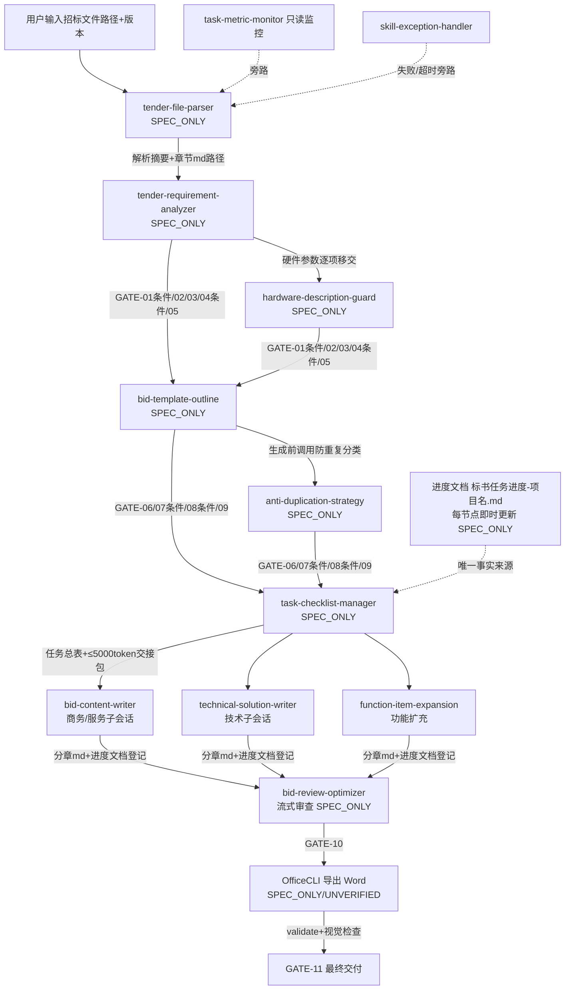

# kcaaaa/bid-writing-agent 源码审计报告

> 审计性质：**纯提示词级 Skill 体系**（Trae IDE 技能包），仓库 0 代码、32 个文件全部为 Markdown。对主项目而言这是 Skill 设计的"金本位"参照，审计重点在提示词结构、门禁/熔断/断点恢复设计与可借鉴模式，而非可执行性。
> 审计方式：逐文件全文深读（32/32）+ git 历史考古（含已删除的改造指导方案）+ python3 校验全部 frontmatter YAML。全程只读，未运行任何代码。

## 1. 基本信息

- **LICENSE：无许可证**。`git ls-files` 32 个文件中无 LICENSE/LICENSE.md/任何许可声明（已用 rg 验证）。法律含义：默认版权全保留（作者 kcaaaa， commits 邮箱 2473994475@qq.com），**任何文本复制/改写分发均有侵权风险，仅可借鉴机制与思路**。另有附带注记：已删除的《Trae投标智能体全维度优化指导方案.md》末尾自注">（注：部分内容可能由 AI 生成）"。
- **语言/框架/规模**：零代码。32 个 .md 文件，共约 775 行 / 55,961 字节。构成：根 SKILL.md（总调度，27 行）+ skills/ 12 个子技能目录（每个 = 轻量 SKILL.md 18–20 行 + 按需加载 `<name>-rules.md` 7–75 行）+ schemas/ 3（state-schema 81 行 / input-output-contract 83 行 / human-review-gates 35 行）+ workflows/ 2（bid-writing-workflow 29 行 / workflow-rules 25 行）+ README.md 39 行 + 使用场景介绍.md 43 行。
- **顶层目录**（每目录一句话）：
  - `skills/`（24 文件）：12 个子 Skill，两级文件结构——SKILL.md 常驻上下文（含触发条件）+ rules.md 按需加载细则；
  - `schemas/`（3 文件）：状态字段约定（扁平 ≤2 层嵌套）、统一输入输出契约、11 门禁定义；
  - `workflows/`（2 文件）：三阶段会话工作流 + 调度/熔断/缓存/篇幅详细规则；
  - 根：总调度 SKILL.md、README、使用场景介绍。
- **提交历史**：4 次提交（浅克隆 depth 20，4 即全量）。2026-08-05 初始化（5036 行，14 个子 Skill，含 3 个监控 Skill：skill-call-monitor / skill-execution-logger / skill-performance-metrics）→ 08-10 "优化投标智能体流程与篇幅控制"（强化门禁/条件调用/并行缓存/Word 审查，并"清理对外文档中的本地路径"）→ 08-12 大重构：**-5060 行 +841 行**，14 Skill 合并 3 监控为 task-metric-monitor（=12 个）、全部 SKILL.md 拆分为"轻 SKILL.md + rules.md"两级、同一提交加入《Trae投标智能体全维度优化指导方案.md》→ 08-12 删除该指导方案。**仓库自身演化即是对"上下文预算"的迭代实证：5036 行 → 775 行（-85%）**。
- **测试**：无（0 个测试文件）。
- **第三方依赖**：无 requirements/pyproject/package.json。唯一外部依赖为 **OfficeCLI**（Word 导出命令行工具）：9 个文件共 13 处提及，全部要求"先 `help` 核验、以实际支持命令为准"；初始提交根 SKILL.md 第 7 条曾引用本地 Windows 私有路径 `d:\桌面\投标书工作流\OfficeCLI-main - 副本`（后被清理），说明其从未在仓库内提供，导出能力 UNVERIFIED。运行载体（仅 git 历史披露）：Trae 客户端 + LM Studio 本地 Qwen3.6-27B q4Km、40960 上下文、单卡 3090Ti 24G——**整套阈值是为小参数本地模型定制的**。

## 2. 能力清单

先给出体系结构结论，再逐项标注。

### 2.0 十二个子 Skill 清单、职责与调用关系（深挖方向 1）

| # | Skill | 四阶段分组 | 职责（一句话） | 上游依赖 | 下游输出 |
|---|---|---|---|---|---|
| 1 | tender-file-parser | ①解析前置 | 逐章解析招标文件（PDF/Word/Excel/扫描件/澄清答疑），保留页码/表格/模板原文，>2000字落盘只回摘要+游标；含"格式自拟"近义表达专项扫描 | 用户提供文件路径+版本 | 解析摘要+`投标书/过程文件/招标解析/章节编号-章节名.md` |
| 2 | tender-requirement-analyzer | ① | 分类提取资质/商务/技术/服务/硬件/评分/格式/废标要求，每项附原文定位、强制性、响应方式、风险等级 | 解析摘要（缺失则返回解析阶段） | 需求摘要+分析报告路径 |
| 3 | hardware-description-guard | ① | 硬件双来源约束（S1招标原文/S2用户资料），逐条溯源，提取S1清单并与S2对照 | 招标原文路径；写硬件正文需GATE-04 | S1清单、S2对照表、溯源状态 |
| 4 | bid-template-outline | ②大纲规划 | 沿用招标固定格式生成模板；生成三/四级大纲（含招标映射、配额、阈值），受GATE-01/02/05/06控制 | 解析+需求分析可用 | 模板/大纲路径+配额摘要 |
| 5 | anti-duplication-strategy | ② | 写前防重复：为每章定义唯一类别/边界/角度/禁止项，持久化全局缓存；重叠>30%换角度 | 需求摘要；正文阶段需已确认大纲 | 边界缓存路径+重叠风险 |
| 6 | bid-content-writer | ③正文撰写 | 单轮单章、段内单次≤4000字生成、立即落盘、90%精简/100%停止 | GATE-02/03/05/06/09（+技术07/08、硬件04）、交接包 | `投标书/初稿/分章节/章节编号-章节名-目标字数.md` |
| 7 | technical-solution-writer | ③ | 技术方案：选型→架构→功能→实现→验证；架构图占位格式；质量权重20/25/30/15/10 | 大纲确认+GATE-07/08 | 选型/架构路径+一致性摘要 |
| 8 | function-item-expansion | ③ | 有招标依据才拆2–4子项，六维(D1原理–D6交互)至少选3维，每项200–500字，≤章节60% | 选型/架构确认+章节配额 | 功能项路径+质量摘要 |
| 9 | task-checklist-manager | ③ | **状态唯一写入者**：进度文档任务总表、会话占用、交接包、断点/恢复协议 | 大纲+参数确认（GATE-09后强制调用拆分） | 进度文档+任务清单+≤5000 token交接包 |
| 10 | bid-review-optimizer | ④审查收尾 | 流式逐章审查（跨章查重/招标响应/硬件溯源/架构一致/篇幅），报告分章落盘；修改先留历史版本 | 全部分章路径+审查依据 | 分块报告+结论(通过/有条件通过/不通过)+问题数 |
| 11 | task-metric-monitor | ④ | 只读监控：每5轮摘要、成功率/JSON失败/字数/token；**禁止修改业务状态** | 调用事件+progress_path（只读） | 指标摘要+脱敏日志jsonl |
| 12 | skill-exception-handler | 旁路（仅失败/超时触发） | 最多3次指数退避(1/2/4s)、超时120s；可降级/不可降级清单 | 错误摘要+重试数+当前门禁 | 重试/降级结果+恢复建议 |

**调用关系**（从提示词原文重建）：parser→analyzer（"缺失则返回解析阶段"，tender-requirement-analyzer/SKILL.md）；analyzer→hardware-guard（"硬件参数逐项移交`hardware-description-guard`形成唯一招标硬件清单"，analyzer-rules）；template-outline↔anti-duplication（"生成前调用防重复分类，生成后检查主题、角度、表格和案例重复"，bid-template-outline-rules）；大纲确认→task-checklist-manager（"大纲和参数确认后必须由`task-checklist-manager`拆分子会话"，根SKILL.md）；checklist→交接包→content-writer/tech-writer/function-expansion（子会话只载≤5000 token交接包）；content-writer↔anti-duplication 缓存读写；全部分章完成→review-optimizer→GATE-10→OfficeCLI→GATE-11。监控与异常处理在门禁阻断时可旁路运行但"不得推进业务"。

### 2.1 逐项能力标签

| 项 | 标签 | 证据 |
|---|---|---|
| a. 招标文件解析 | **SPEC_ONLY** | skills/tender-file-parser/tender-file-parser-rules.md：逐章扫描、页码/表格/模板原文保留、"OCR标记可疑字符…解析失败不得默认为不存在"、>2000字返回"结构化摘要、文件路径、下一段游标"。无任何解析代码 |
| b. 条款/要求提取 | **SPEC_ONLY** | tender-requirement-analyzer-rules.md：覆盖资质、商务/报价付款、技术、服务、硬件、评分、格式、废标风险八类；每项输出"要求项、原文定位/摘录、强制性、响应方式、材料需求和风险等级"；区分必须响应/建议强化/可选响应。**无统一结构化数据结构与条款 ID** |
| c. 原文位置溯源 | **SPEC_ONLY** | analyzer SKILL.md："关键结论必须附原文位置；未明确即标'招标文件未明确'"；hardware-guard-rules：每条硬件记录含"来源类型、来源路径、定位和确认状态"。仅提示词约定，无锚点数据结构 |
| d. 企业资料检索/证据 | **MISSING** | 全仓库无任何检索/召回机制。企业资料完全依赖用户提供+GATE-03确认；无语义召回、无精确匹配。证据：rg 检索 RAG/向量/检索关键词零命中 |
| e. 响应矩阵/合规矩阵 | **MISSING**（弱缓解） | 无 requirement×response 结构化矩阵。仅有：大纲节点记录"招标映射"（bid-template-outline-rules）+ 审查阶段"招标响应"覆盖检查（bid-review-optimizer-rules），均为模型自由判断 |
| f. 目录生成与分章节生成 | **SPEC_ONLY** | bid-template-outline-rules：大纲细化到三/四级、配额±3页；task-checklist-manager：任务总表+单任务会话占用+四组(商务/技术/硬件/服务)拆分；bid-content-writer：单轮单章、落盘、历史版本。单章可重试（门禁"重新生成"指令） |
| g. 审校/校验 | **SPEC_ONLY** | bid-review-optimizer-rules：流式审查、量化阈值（连续100字重复、模板词>20、精确重复段落>5）、结论三档、问题六要素(章节/类型/风险/依据/建议/必改)。**全部为模型判断，0 确定性代码检查** |
| h. 导出 | **SPEC_ONLY / UNVERIFIED** | 9文件13处 OfficeCLI 约定："先help核验、不假设一键Markdown转docx、批量生成后执行实际支持的issues、outline、text、validate及视觉检查"。工具不在仓库内，命令集从未固定（初始提交引用本地路径 `d:\桌面\...OfficeCLI-main - 副本`） |
| i. 状态持久化与恢复 | **SPEC_ONLY（全仓库最强设计）** | 见 2.2 节深读。schemas/state-schema.md + task-checklist-manager-rules.md：进度文档状态机、6状态、24细粒度阶段、version/updated_at 乐观锁、session_id 占用、8字段中断快照、恢复协议。无代码强制 |
| j. 失败处理 | **SPEC_ONLY** | 三重熔断（根SKILL.md规则2）+ skill-exception-handler-rules：3次退避1/2/4s、120s超时、不可重试类（输入缺失/门禁/真实性）、可降级（模板/Word失败保Markdown、长正文拆章）vs 不可降级跳过（11门禁、招标依据、硬件双来源、篇幅、废标、审查） |
| k. 日志与可观测性 | **SPEC_ONLY** | task-metric-monitor-rules：`投标书/日志/skill-call-events.jsonl`+当前任务日志+exception-records.md；指标含调用率/成功率/JSON失败/缓存命中/字数水位；每5轮≤2000字摘要；PII脱敏规则（手机号前三后四、身份证前六后四、金额默认脱敏等） |
| l. 测试 | **MISSING** | 0 测试文件 |
| m. Skill 文件 | **IMPLEMENTED**（文档层） | 13 个 SKILL.md（1 总调度+12 子）frontmatter YAML 全部经 python3 yaml.safe_load 校验通过；name/description 齐全且 description 均 ≤44 字符（≤80 字上限的自证）；两级加载（SKILL.md 常驻 + rules.md 按需）结构完整自洽。**运行时有效性 UNVERIFIED**（无运行记录） |
| n. Dify DSL | **MISSING** | 无 YAML 工作流文件。初始提交根 SKILL.md 自述"不接入 Dify，不创建数据库，不提供 API 服务" |
| o. MCP Server | **MISSING** | 无任何协议实现/工具注册代码 |
| p. LLM 调用方式 | **SPEC_ONLY / UNVERIFIED** | 无 SDK/代码/模型配置文件。执行模型：Trae IDE 按文本加载 SKILL.md；目标模型仅在 git 历史《全维度优化指导方案》披露（LM Studio Qwen3.6-27B q4Km、40960 上下文、单 3090Ti 24G），当前对外文档已不含模型信息 |

### 2.2 进度文档状态机与断点续写设计（深挖方向 4——全仓库核心资产）

**状态如何记录**：每项目唯一进度文档 `投标书/任务清单/标书任务进度-项目名称.md`（task-checklist-manager-rules.md"唯一事实来源"节），文档结构为 Markdown 表格+字段清单（规则文件第 9–49 行给出完整模板）：项目摘要/version/总体进度 → 任务总表（task_id、任务名、类型/组、依赖、task_status、session_id、session占用、输入/输出路径、更新时间）→ 进行中与中断接续信息（8 字段）→ 已完成成果 → 会话接续说明 → 变更记录 → 最终汇总（仅全部非取消任务完成后填）。配套 schemas/state-schema.md 定义 ~70 个扁平字段（嵌套≤2层），含 `interrupt_time / interrupt_work_node / interrupt_completed / interrupt_remaining / interrupt_dependency_paths / interrupt_next_steps / suggested_resume_skill` 七个断点字段 + `session_occupied / session_occupier / version / updated_at` 并发控制字段。

**状态机**：任务级 6 状态 `待开始/进行中/进行中-已中断/已完成/阻塞/已取消`；显式迁移表（task-checklist-manager-rules"状态迁移"节）：`进行中→进行中-已中断→进行中→已完成`，`待开始/进行中/进行中-已中断/阻塞→已取消`；**禁止 待开始→已完成 直跳**；已完成/已取消为终态不得回退。项目级另有 24 个细粒度阶段链（state-schema.md 第 79 行）：`not_started → file_parsed → requirements_analyzed → hardware_extracted → template_generated → free_format_confirmed → template_confirmed → company_info_received → hardware_info_confirmed → outline_type_selected → outline_generated → anti_duplication_checked → outline_confirmed → technical_selection_confirmed → technical_architecture_confirmed → document_params_configured → task_checklist_initialized → draft_generated → parallel_writing_completed → function_items_expanded → docx_generated → auto_reviewed → human_reviewed → completed`，条件阶段"可不适用但不得伪造确认"。

**恢复时如何读取**：新会话第一步只读 progress_path（"按文档现状恢复，不重复认领已占用任务"），校验 version/updated_at 判陈旧→重读→登记接续会话→清除旧占用冲突→按断点 8 字段续作，并指定 `suggested_resume_skill`；总原则"恢复以进度文档、任务清单和文件路径为准，不依赖对话记忆"。写入协议：任务开始/认领/完成/中断/恢复/阻塞/取消/依赖变化 8 类事件**必须立即**写文档+变更记录，"历史记录不得删除"，重要修改先复制为 `章节编号-章节名-目标字数-v版本-时间.md` 历史版本再改。

**评价**：这是把"数据库乐观锁+任务队列+断点快照"完整翻译成提示词协议的罕见范本；弱点和一切不变量相同——**零代码强制**，两个并行会话同时写文档仍可能互相覆盖（version 校验依赖模型自觉执行"不得用覆盖写"）。

## 3. README 声明核对

| README 声称 | 判定 | 证据 |
|---|---|---|
| 1 个总调度、12 个子 Skill、11 个人工门禁、三阶段超长文档工作流 | **已验证（结构层）** | 12 个 skill 目录、GATE-01..11（schemas/human-review-gates.md）、三阶段会话（workflows/bid-writing-workflow.md）逐一对应 |
| 支持稳定生成 100000–150000 字标书 | **未验证（且有反向证据）** | 无运行产物/样例标书；git 历史已删除文档承认改造前存在"Skill 调用失败、token 超限、显存爆炸、死循环四大故障"，"稳定"是改造目标而非实证 |
| 四阶段懒加载（解析前置/大纲规划/正文撰写/审查收尾） | **已验证（提示词设计）** | 根 SKILL.md 规则 1；workflow-rules.md"调度与熔断"节 |
| 熔断：同 Skill 连续 3 次、总调用 8 轮、token≥28000 | **已验证（提示词设计）** | 根 SKILL.md 规则 2；task-metric-monitor-rules"轻量摘要与熔断"节 |
| 单轮仅 1 Skill、暴露工具≤6 | **已验证（提示词设计）** | 根 SKILL.md 规则 1；为小模型 JSON 稳定性定制 |
| 进度文档唯一事实来源：version/updated_at/session_id 占用校验、断点续写 | **已验证（设计层）** | task-checklist-manager-rules.md（详见 2.2） |
| OfficeCLI 批量 Word 导出 + validate/视觉检查 | **未验证** | 工具外部私有（初始提交含本地路径），当前文档自注"以实际支持命令为准" |
| 不编造企业事实；硬件仅 S1/S2 逐项溯源 | **已验证（提示词设计）** | hardware-description-guard-rules"双来源与溯源"节 |
| 已确认文件和重要修改保留历史版本 | **已验证（提示词设计）** | bid-content-writer-rules 第 3 条；bid-review-optimizer-rules"修改与历史保护"节 |
| 工具返回≤2000字、正文单次≤4000字、单章≤30000字、90%精简/100%停止 | **已验证（提示词设计）** | 根 SKILL.md 规则 3/7；schema、各 rules 一致复述，无内部矛盾 |

## 4. 真实执行链路重建

**链路性质判定：全链均为 SPEC_ONLY 的"提示词声明链"，无可执行代码。** 执行主体是 Trae IDE 中的 LLM（目标 Qwen3.6-27B 本地模型）按 SKILL.md 文本自觉执行；无任何节点有代码/工具强制。初始提交根 SKILL.md 自述："本 Skill 是纯文档型 Skill，不实现后端系统，不接入 Dify，不创建数据库，不提供 API 服务"——与仓库实际完全一致，无夸大。

| 节点 | 入口(文件) | 输入输出数据结构 | 调用工具/模型 | 持久化 | 失败处理 | 状态 |
|---|---|---|---|---|---|---|
| 解析 | skills/tender-file-parser/SKILL.md+rules | 入：路径+版本；出：≤2000字摘要+`投标书/过程文件/招标解析/章节编号-章节名.md`+下一段游标 | LLM 自身（无解析器） | 过程文件/ | "解析失败不得默认为不存在"；OCR疑点标记复核；缓存随源变化失效 | SPEC_ONLY |
| 需求分析 | skills/tender-requirement-analyzer/SKILL.md+rules | 出：要求项/原文定位/强制性/响应方式/风险等级（Markdown 报告，无 ID 结构） | LLM | `投标书/过程文件/需求分析/` | 缺解析则返回解析阶段 | SPEC_ONLY |
| 硬件约束 | skills/hardware-description-guard/SKILL.md+rules | 出：S1清单+S2对照表，每条含来源类型/路径/定位/确认状态 | LLM | 缓存+对照表 | 无来源→删除或【待用户补充】；缺失/偏差触发GATE-04 | SPEC_ONLY |
| 模板/大纲 | skills/bid-template-outline/SKILL.md+rules | 出：三/四级大纲（编号/标题/边界/招标映射/配额/最大页/90%阈值） | LLM+GATE-01/02/05/06 | `投标书/大纲/` | 格式自拟不得擅补，只可补框架+【待填写】 | SPEC_ONLY |
| 防重复 | skills/anti-duplication-strategy/SKILL.md+rules | 出：每章类别/边界/角度/禁止项+全局关键词缓存 | LLM | 防重复缓存（持久化，按依赖局部失效） | 重叠>30%强制换角度 | SPEC_ONLY |
| 任务拆分 | skills/task-checklist-manager/SKILL.md+rules | 出：任务总表（task_id×10字段）+进度文档+交接包 | LLM | `投标书/任务清单/标书任务进度-项目名.md` | version陈旧重读；占用冲突禁重复认领 | SPEC_ONLY |
| 正文撰写 | skills/bid-content-writer/SKILL.md+rules | 入：交接包+本章路径；出：单次≤4000字分段落盘，返回≤2000字摘要 | LLM（单轮仅1 Skill） | `投标书/初稿/分章节/章节编号-章节名-目标字数.md`+历史版本 | 90%精简/100%停止；异常交 skill-exception-handler | SPEC_ONLY |
| 审查 | skills/bid-review-optimizer/SKILL.md+rules | 出：每章≤2000字审查块+结论三档+问题六要素 | LLM（流式，不把十万字放入对话） | 分块报告落盘 | 未汇总完不得通过；修改先留历史版本 | SPEC_ONLY |
| 导出 | workflows/bid-writing-workflow.md 阶段三 + workflow-rules.md"质量与OfficeCLI" | 入：合并后完整 Markdown；出：docx | **OfficeCLI（外部，未在仓库，命令未定）** | `投标书/完整版/` | OfficeCLI不可用→仅输出Markdown路径（降级保留） | SPEC_ONLY/UNVERIFIED |

**证据/交接的流动方式**：长内容一律落盘、对话只留"摘要+路径"；跨会话仅靠 ≤5000 token 公共交接包（招标摘要+企业资料摘要+大纲目录）+ 进度文档；完整正文、完整用户回复、硬件清单、问题明细均禁止塞入返回对象（input-output-contract.md 尾行）。

## 5. 重点审计问题

**Q1 超长文件/表格/扫描件如何处理？** 提示词层："逐章扫描而非只扫目录"，按章节编号切片落盘；单次工具返回≤2000字，超出只回"结构化摘要、文件路径、下一段游标"；固定模板/投标函/报价表/偏离表必须完整提取并保留原文定位；OCR 疑点"不得视为不存在"、解析失败"不得默认为不存在"（tender-file-parser-rules）。防丢失设计是"游标+落盘+疑点保守标记"，但无任何真实分块/OCR 代码，截断与否完全取决于模型遵从。**源码未体现任何确定性防截断机制。**

**Q2 六类要求如何统一成结构化条款清单？** 未真正统一。analyzer-rules 覆盖资质/商务/技术/服务/硬件/评分/格式/废标八类，每项五要素，但产出是 Markdown 报告而非结构化数据；**无条款 ID、无统一 schema**；state-schema.md 仅存 `analysis_report_path`。硬件例外：经 hardware-description-guard 形成"唯一招标硬件清单"（含逐条来源字段），是八类中唯一半结构化的。

**Q3 条款↔证据↔章节↔审校如何关联？有无 ID 体系？** 有局部 ID 体系：task_id（如 TASK-TECH-03）、chapter_id、gate_id、cache_key/fingerprint/dependency_keys（state-schema `cache_records`）。**条款级 ID 缺失**——要求到大纲的映射靠大纲节点"招标映射"字段（文本级），到审校靠 review 时重新对读原文，无 requirement→response→evidence 的可查询关联。

**Q4 语义召回+精确匹配检索？** 完全缺失（MISSING）。无向量库、无关键词引擎；企业资料靠用户主动提供，硬件靠 S2 对照表逐项人工比对。这是该体系与主项目目标架构差距最大的一环。

**Q5 无证据/证据缺失时如何阻止错误进入定稿？** 有成体系的**提示词级硬阻断**，是本仓库最值得学习的部分之一：①硬件"答不出来源即删除或【待用户补充】"，GATE-04 未逐项明确前"不得写具体硬件"；②审查阶段"无来源硬件为严重问题，删除并退上一阶段"；③企业事实禁编清单（资质/业绩/人员/证号/金额/客户/案例/承诺）；④"不得把行业常识写成招标要求，不得把'不明确'写成'符合'"；⑤篇幅门禁具同等阻断力："汇总超目标5页禁止Word"；⑥门禁只认 5 条标准指令（确认/修改/重新生成/补充/暂不补充），"不得把'继续、可以、看看、没问题吧'、沉默或AI判断当确认"，模糊回复仅提示一次后暂停。**但全部阻断是模型自律，无代码兜底。**

**Q6 章节能否拆成独立执行/重试/修改/验证的任务？** 能（设计层）。task-checklist-manager 把章节任务拆为任务总表行，独立认领（单 session_id 占用）、独立落盘文件、独立重试（门禁"重新生成"指令）、独立审查块；中断/恢复/取消/阻塞均有登记与迁移规则；"禁止直接从待开始跳到已完成"。

**Q7 报价/工期/签章/暗标等检查哪些是确定性代码？哪些依赖模型？** **确定性代码：零。** 全部检查（报价、工期、资质有效期、签章、格式、废标风险）依赖模型按固定阈值判断；仅阈值本身是"伪确定性"（100字重复、模板词>20、重复段落>5、重叠>30%、90%/100%、±3页、超5页）。字数/页数/token 亦由模型自估，1716字/页为经验常数。**暗标：源码未体现。**

**Q8 中断/换模型/补充招标文件后如何恢复？** 恢复协议完整（见 2.2）：进度文档=唯一事实来源，断点 8 字段+suggested_resume_skill，"不依赖对话记忆"，模型无关（协议不绑定模型）。补充文件/版本变化走**缓存依赖失效级联**（workflow-rules"文件、版本、进度与缓存"节）：源内容/路径/版本变化→解析及下游全失效；用户材料变化→需求/硬件及下游失效；大纲/参数变化→边界/任务/正文审查失效；正文变化→仅该章摘要及相关跨章审查失效。受影响章节识别靠任务表"依赖"列+失效规则推理，同为提示词约定。

**Q9 可导入 Dify DSL / 可运行 MCP / 独立 Skill？** Dify DSL：无。MCP Server：无。独立 Skill：**存在且自洽**——13 个 SKILL.md frontmatter YAML 全部经 python3 校验可解析、字段规范（name+description≤80字）；跑起来需要：①支持 Skill 加载约定的 IDE（Trae 或同类）；②外部 OfficeCLI（Word 导出，命令集未验证，缺它则只能交付 Markdown）；③一个 LLM。无需任何安装/依赖即可作为提示词加载，这是它对主项目的最大便利。

**Q10 哪些可合法复用？** 无 LICENSE → 默认版权全保留，**全部文本（含全部提示词措辞、门禁命名、阈值数字组合作为整体表达）不可复制**。可借鉴的只有不受版权保护的机制与思路：门禁协议结构、熔断阈值设定逻辑、状态机字段设计、防重复策略、双来源证据规则等。注意其措辞高度凝练（"OCR疑点不得视为不存在"这类表达具原创性），改写仿写仍建议保持距离，只提炼为中性机制描述。

## 6. 复用价值与许可

- **可直接复用：无**（法律禁止文本复制；无任何可复用代码，因为根本没有代码）。
- **需改造后复用：无**（同上）。
- **仅可借鉴思路（对 docs/bid-skill-design.md 直接相关的模式清单，深挖方向 8）**：
  1. **两级 Skill 文件结构**：SKILL.md 常驻（≤500字：场景/前置/IO/强制规则）+ rules.md 按需加载（完整表格/检查清单/流程）。仓库自身 -85% 行数的重构实证了该结构对上下文预算的价值；description ≤80 字并"仅写触发条件+核心作用"。
  2. **固定枚举门禁协议**：gate_id 不可改名/复用/动态生成；5 条标准指令白名单；模糊回复只提示一次不循环；条件门禁"记录不适用，不得伪造 review_pass:true"；驳回只退上一阶段不重置全流程；对话只留 gate_id/review_pass/简短结论，完整回复落日志。
  3. **三重熔断+预防性中断**：同 Skill 连续≥3 次→终止分支转人工；单任务≥8 轮→强制转审查；会话 token≥28000→停止加载长文拆会话；并在"达到15轮或28000 token**前**"主动登记中断（预防性交接而非事后崩溃）。
  4. **进度文档状态机**（见 2.2）：6 状态+8 事件即时更新+version 乐观锁+session 占用+断点 8 字段+suggested_resume_skill+"恢复不依赖对话记忆"+历史不可删。我们应把这套字段翻译为后端 DB 表结构，而非 Markdown。
  5. **缓存依赖失效级联**：cache_records 的 `cache_key/path/fingerprint/dependency_keys/valid/invalid_reason` 五元组+四层失效规则（源→解析→需求→大纲→正文→审查），是"输入变化→受影响章节识别"的最简表达。
  6. **防重复前置化**：写前建边界（类别/角度/禁止项）、写中>30% 重叠换角度、写后登记关键词/维度/案例/表格结构入全局缓存供并行会话读；禁止"事后集中清理"。量化审查阈值可参数化。
  7. **双来源证据约束**：S1 原文/S2 用户提供之外无第三来源；逐条"来源类型/来源路径/定位/确认状态"；缺证即【待用户补充】占位而非编造；"答不出来源即删除"。
  8. **反幻觉措辞模式**："不得把'不明确'写成'符合'""OCR疑点不得视为不存在""解析失败不得默认为不存在""不得制造隐含功能""D5时序只在有来源时写精确耗时"——保守缺省+禁止推导的表述方式值得化为我们的检查项清单。
  9. **扁平 IO 契约**：入参/返回≤2层嵌套、长列表写文件只传路径、统一 status(success|blocked|failed|partial)——为小模型 JSON 稳定性设计，对 MCP 工具 schema 设计同样适用。
  10. **职责分离**：task-metric-monitor 只读 progress_path、禁止推进业务；task-checklist-manager 是业务状态唯一写入者；异常处理旁路不常驻。单写入者+只读观察者模式。
  11. **可降级/不可降级清单**：明确哪些失败可降级（导出失败保 Markdown、长文拆章、日志失败保摘要）哪些不可跳过（门禁/依据/篇幅/审查），失败处理不再是空白话术。
  12. **PII 脱敏规则**：日志侧手机号前三后四、身份证前六后四、金额默认脱敏——可直接化为我们的日志规范条目。
  13. **篇幅预算体系**：目标/建议/最大/90%预警/100%停止/±3页/超5页禁Word——把"字数"变成带阻断的预算科目。
  14. **演进即文档**：作者用一份"AI 可执行的改造指令文档"驱动提示词重构并保留在 git 历史——过程资产本身有参考价值。
- **不建议采用**：①用提示词承载所有不变量（门禁/熔断/计数/锁）——我们架构下应代码化（后端守门、确定性检查、DB 事务锁）；②1716字/页等魔法常数直接照搬；③字数/token 由模型自估；④把 Markdown 进度文档当生产级并发状态存储（乐观锁无强制力）。
- **许可证结论**：无 LICENSE → 默认全版权保留。**只能机制级借鉴，禁止任何文本复制/近改写**。若主项目需引用，只能以"匿名化机制描述+自行重写"方式转述。

## 7. 可靠性风险清单

| 风险 | 严重程度 | 证据 | 复现/验证方式 |
|---|---|---|---|
| 无 LICENSE，默认全版权保留，任何提示词文本复制均侵权 | 高 | git ls-files 32 文件无许可声明；作者信息仅见于 commit 邮箱 | `git ls-files \| grep -i license` 为空 |
| 全部"硬约束"（门禁/熔断/乐观锁/字数统计/token 估算）仅靠 LLM 自觉执行，零代码强制，可被模型静默绕过 | 高 | 全仓库 0 行代码；且作者自认目标模型 Qwen3.6-27B q4 存在"JSON 解析失败、漏调用"故障（git show 151179c:Trae投标智能体全维度优化指导方案.md） | 逐项检查任一不变量均无对应工具调用，只有文字规则 |
| "稳定生成10-15万字"效果不可验证，历史存在四大故障模式（token超限/显存爆炸/死循环/调用失败） | 高（对效果声称） | 已删除的优化指导方案"输出目标"节列明四故障与验收标准，仓库无任何运行产物、样例标书或截图 | git 历史考古即可复现 |
| 企业资料检索与响应矩阵完全缺失，响应遗漏风险只靠审查阶段模型兜底 | 中高 | d/e 两项 MISSING（见 2.1）；大纲"招标映射"为文本字段 | rg 检索召回/矩阵/向量零命中 |
| OfficeCLI 外部依赖未定（命令集"以实际支持命令为准"，原始引用为本地私有路径），导出链路 UNVERIFIED | 中 | 初始提交根 SKILL.md 第 7 条 `d:\桌面\...OfficeCLI-main - 副本`；9 文件 13 处 help-first 约定 | git show b3d7944:SKILL.md |
| 并发写冲突防护薄弱：version/updated_at 校验是提示词约定，无文件锁，并行子会话仍可能覆盖进度文档 | 中 | task-checklist-manager-rules"会话与并发"节——"不得用覆盖写"本身即是给模型的请求 | 多会话并发写同一 md 的思想实验即证伪 |
| 字数/页数/token 全部模型自估，90%/100%/±3页等精算阈值建立在不可靠计数上 | 中 | bid-content-writer-rules"每小节统计字数"；1716字/页为经验常数（根 SKILL.md 规则 7） | 无任何 wc/工具调用 |
| OCR/扫描件仅约定"标记疑点"，无真实 OCR 工具链 | 中 | tender-file-parser-rules 第 4 条 | 同上，无工具绑定 |
| 内部小不一致：已删文档称"总 Skill 数量降至 11 个"实为 12；细粒度阶段机 docx_generated 先于 auto_reviewed 与"先审后导出"的文字顺序存在歧义 | 低 | 151179c 指导方案 vs README"12个子Skill"；state-schema.md 第 79 行 vs bid-review-optimizer-rules 末段 | 直接比对 |
| 无测试、无版本号、无 CHANGELOG，提示词变更无法回归 | 低-中 | 4 次提交均无测试文件 | git ls-files |

## 附：11 个人工门禁与熔断速查（深挖方向 2、3，供设计文档直接引用机制）

**11 门禁**（schemas/human-review-gates.md，含固定全名）：GATE-01-FREE-FORMAT（条件：解析检出"格式自拟/格式自行拟定/投标人自拟…"等近义表达时必需，展示位置/原文/前后文/影响）→ 02-TEMPLATE（初始模板确认）→ 03-COMPANY-INFO（企业资料：已提供/缺失/不适用/真实性来源）→ 04-HARDWARE-INFO（条件：涉及硬件时必需；S1/S2 对照后缺失/偏差触发，逐项确认/补充/暂不补充）→ 05-OUTLINE-TYPE（商务资质/技术服务/硬件参数三选一，"AI不得代选"）→ 06-OUTLINE（结构/映射/边界/配额）→ 07-TECH-SELECTION（条件：技术项目）→ 08-TECH-ARCH（条件：技术项目）→ 09-DOC-PARAMS（总目标/章节配额/表图/格式）→ 10-AUTO-REVIEW（审查结论/问题/风险/修改路径）→ 11-FINAL-WORD（企业事实/报价/签章/附件/格式）。另有**同效非编号门禁**：篇幅门禁（90%精简/100%停止/超5页禁Word）、真实性门禁（硬件双来源）、自动审查门禁——"同样具有阻断效力"。

**熔断/停止设计**：三重熔断（同 Skill 连续≥3 次→终止分支请人工调整；单任务≥8 轮→强制转审查；会话 token≥28000→停止加载长文并拆会话）+ 预防性中断（15 轮/28000 token 前主动登记断点）+ 异常旁路（3 次退避重试、120s 超时、可降级/不可降级清单、门禁阻断时可诊断但不得推进业务）+ 监控告警（成功率<95%、JSON 失败、重复调用、篇幅超限）。
