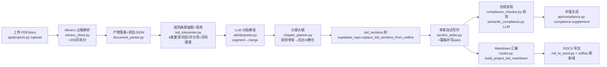

# sunShineLoveMe/ai_bidding_power_grid 源码审计报告

> 审计方式：只读静态审计（git log/ls-files、rg、逐文件精读）。未安装依赖、未运行仓库代码、未调用任何 LLM API。
> 报告路径：research/audit-notes/sunShineLoveMe__ai_bidding_power_grid.md | Task ID: 4-10

## 1. 基本信息

- **LICENSE**：MIT（`LICENSE`，版权行 "Copyright (c) 2026 清江峡能精密制造 AI 标书系统"）。MIT 对本项目复用友好，仅需保留版权声明。
- **主要语言/框架/规模**：Python 后端（Flask 3.1.2 单体）+ React 18/TS/Vite/antd/Tiptap 前端。
  - git 追踪文件 422 个；Python 79 文件 ≈20,387 行，TS/TSX 44 文件 ≈9,804 行；测试 16 文件。
  - 工作区 223MB，大头是数据而非代码：`rag_seed/` 52M（招标文件 PDF/法规/标准/企业画像）、`assets/` 56M（脱敏证书/产品样张图片）、`test_samples/` 18M（水利招标示范文本 .doc/.pdf）。
- **顶层目录**：`backend/`（api/ai/rag/parsing/export/db/core 六个子包）｜`frontend/`（工作台 UI）｜`tests/`（16 个 unittest）｜`rag_seed/`（电力+水利两套行业 RAG 种子数据及入库脚本）｜`assets/`（脱敏样张）｜`docs/`（架构/功能/部署/研究文档，中文）｜`migrations/postgres/`+`sql/`（DDL 与 RPC）｜`scripts/`（初始化/迁移脚本）｜`test_samples/`（测试招标文件）。
- **提交历史**：浅克隆仅 20 条（上限），最近 2026-10-22（docs: clarify project purpose…），2026-10 系列提交涉及百炼 rerank 适配、pgvector 统一、SQLite 下线、Docker 化——持续维护中的活项目。
- **测试**：有，16 文件（unittest，mock 外部服务，无真机 E2E）。覆盖：DOCX 导出格式/TOC/域刷新、合规覆盖与分册范围、语义复核兜底、rerank 双端点、pgvector 纯度（ChromaDB 已删）、MinerU 状态机/断点续传、存储 Provider、模型分档配置、分段解读合并、资产打分/插图策略、API 章节持久化、安全脱敏。
- **第三方依赖**（requirements.txt，均宽松许可，无 AGPL）：flask、flask-cors、gunicorn、gevent、PyJWT、requests、mammoth、PyPDF2、Pillow、openai(1.108)、Markdown、python-docx、supabase(2.28)、psycopg[binary]、oss2、python-dotenv、Unidecode。前端 antd/Tiptap（MIT 系）。

## 2. 能力清单（a–p）

| # | 能力 | 标签 | 证据 |
|---|------|------|------|
| a | 招标文件解析 | **IMPLEMENTED** | `backend/parsing/document_parser.py: parse_and_index_tender_file()`：PDF 默认 MinerU 优先（`_should_use_mineru_first`），>200 页按 `MINERU_MAX_PDF_PAGES` 用 PyPDF2 拆分（`_split_pdf_for_mineru`）逐段提交再合并（`_merge_split_artifacts` 对 content_list 的 page_idx 加回偏移）；MinerU 失败回退原生文本抽取（`ensure_extractable_text`，扫描件抛 `EmptyDocumentContentError` → 路由 OCR）；支持手动导入结果 zip（`import_mineru_result_zip`）。`backend/parsing/mineru_client.py`：batch API、轮询（`wait_for_batch_file_result`，8s 间隔/1800s 超时）、下载带 Range 断点续传 + curl --resolve 兜底。 |
| b | 条款/要求提取 | **IMPLEMENTED（规则）** | `backend/parsing/bid_interpreter.py`：`KEYWORD_GROUPS` 4 组（资格/商务/技术/文件要求）、`RISK_KEYWORDS=["否决","无效","不予受理","废标","不得","不接受","逾期","未按","视为"]`、`SCORING_KEYWORDS`。纯**子串匹配**（非正则、非 LLM）：`extract_requirements()`（≤80 条）、`extract_risks()`（≤60，命中 否决/无效/废标/不予受理 判 high）、`extract_scoring_items()`（≤80，`re.search(r"(\d+(?:\.\d+)?)\s*分")` 抽分值）、`extract_chapter_suggestions()`。报告自述"规则抽取生成的第一版业务解读"。LLM 侧另有分段解读 `backend/ai/interpreter.py: _generate_segmented_report()`（≥12 chunks 或 >80k 字符触发 map-reduce，`_build_segment_prompt`/`_build_merge_prompt`）。六类中缺独立"格式要求"（并入"文件要求"），评分项独立成表。 |
| c | 原文位置溯源 | **IMPLEMENTED（弱锚点）** | `bid_interpreter.py: _source_page_by_snippet()`——段落前 40 字（去空白）在 content_list 文本中子串匹配 → `page_idx+1`；`_heading_before()` 取段落前最后一个 markdown 标题。每条 requirement/risk/scoring 均写 `source_section/source_page/source_text` 三字段（DB 表同名列）；分册章节带 `source_pages`。拆分合并后页码经偏移校正（`_merge_split_artifacts`）。 |
| d | 企业资料检索/证据 | **PARTIAL** | 语义侧完整：`backend/rag/vector_store.py: get_embeddings()`（DashScope text-embedding-v4，1024 维，OpenAI 兼容口）→ `migrations/postgres/001_schema.sql: match_knowledge_chunks()/match_knowledge_assets()`（pgvector cosine + ivfflat(lists=100)）→ `backend/ai/rerank_client.py: rerank_documents()`（qwen3-rerank 双端点，**fail-open**）。关键词兜底：`backend/rag/retrieval.py: _keyword_search_knowledge_assets()`（拉最近 200 条 indexed 资产做 token 包含+同义词+类型加分）。**无编号/型号/金额/日期的结构化精确匹配**——specs 值被 `_asset_search_text()` 拼进小写长串做子串。 |
| e | 响应/合规矩阵 | **IMPLEMENTED（覆盖矩阵）** | `backend/ai/compliance_checker.py: build_compliance_report()`：requirement/scoring/risk 三源 × 章节四路匹配（mapped_* 字段、标题、原文前 40 字、关键词重叠 `_content_response_matched`：scoring ≥3 词或 ratio≥0.16，risk ≥4 词且 ratio≥0.2）→ 行 `{id:"requirement-<uuid>", category, status: covered/partial/missing, matchedChapter(Id), suggestedChapter(Id), sourcePage, volumeType…}` + 分册汇总 `_summary_from_rows`。是"条款×章节覆盖矩阵"，非逐条应答文本矩阵。 |
| f | 目录与分章节生成 | **IMPLEMENTED** | `backend/ai/chapter_planner.py`：规则骨架 `_build_rule_outline()`（投标函/资格审查/商务/技术/报价/其他 6 大树）秒级先出 + 后台线程 `_refine_bid_outline_in_background()` AI 精细化（章节数少于规则版则拒绝替换防退化）；`_normalize_outline_structure()`/`_outline_chapters_from_volumes()` 展平并全局重排（修复各册交叉 bug）。写作计划 `bid_writing_plan.py: build_chapter_writing_plan()`（分册定 min/max/target words、needs_table/image）。分册体系 `backend/core/bid_volumes.py`：6 分册 + 中英别名 + 每册 focus/constraints/retrieval_hint/image_policy。单章流式生成 `backend/ai/section_writer.py: stream_bid_section()`（流式→同步兜底；低于目标 75% 触发补写 pass `build_section_supplement_prompt`）；批量任务 `api/sections.py: section-generation-tasks`（items 状态 PATCH、cancel、latest 查询续跑）；篇幅分配 `ai/length_settings.py: allocate_chapter_length_targets()`。 |
| g | 审校/校验（双轨） | **PARTIAL（双轨属实，但无硬阻断）** | 确定性轨：compliance_checker 关键词重叠（见 e）；长度统计 `estimate_bid_content_words()`；插图策略 `_supporting_asset_score()`/`asset_matches_volume()`；导出格式清洗 `clean_formal_bid_text()`（去 emoji/装饰符/AI 生成备注）。LLM 轨：`backend/ai/semantic_compliance.py: build_semantic_compliance_report()`——`select_semantic_review_rows()` 按风险 80/评分 60/missing 45 加权选 top-12 → `_call_llm_review()` 输出 status/evidence(≤120字)/confidence/suggestion，失败回退 `_heuristic_review()`（置信度上限 0.82、llmReviewed:false）；`api/compliance.py: compliance-supplement` 生成 300–600 字补强段。报价/工期/签章/资质有效期**无确定性数值校验**——仅靠分册 constraints 提示词（"金额必须【待补充】占位"）。暗标=缺失。 |
| h | 导出 | **IMPLEMENTED** | `backend/export/md_to_word.py: convert_md_to_word()`：python-docx；公文样式（正文仿宋 12pt、固定行距 28pt、首行缩进 2 字符；标题黑体 18/16/15/12pt）；正式目录页 `_add_toc_page()`（书签+PAGEREF 域+点线 tab）；页眉项目名、页脚 PAGE/NUMPAGES 域；`w:updateFields` 打开时刷新 + `refresh_docx_fields_with_soffice()`（LibreOffice 无头刷新，可禁用）；分册标题换页 `FORMAL_VOLUME_HEADING_RE`；表格 Table Grid；图片限额 24 张/PIL 降采样/远程图默认禁用+SSRF 防护 `_is_safe_remote_image_url()`（私网 IP 黑名单）；mermaid 走本地 `mmdc` CLI。导出异步任务 `api/export.py: _run_bid_docx_export_task()`（progress 10/55/75/100，bid_export_tasks 表）；范围 full/volume/section，支持编辑器快照优先导出。**暗标/匿名导出缺失**。 |
| i | 状态持久化与恢复 | **IMPLEMENTED** | PostgreSQL+pgvector（`migrations/postgres/001_schema.sql`：bid_projects/bid_files/bid_analysis(JSONB)/bid_requirements/bid_scoring_items/bid_risks/bid_chapter_suggestions/bid_sections(树)/knowledge_documents/document_chunks/knowledge_assets/ai_usage_logs/bid_generation_tasks/bid_export_tasks/onlyoffice_documents/ai_model_prices + 汇总视图）；解析状态双写：`parsed_outputs/<parse_id>/mineru_status.json` + `bid_files.parse_status`；断点：zip 下载 Range 续传 + `.part` 保留 + `retry_mineru_result_download()`；失败状态带 `retryable`/`user_message`。AI 解读报告写入 `bid_analysis.project_meta.ai_report` 且**幂等缓存**（已存在直接返回）。 |
| j | 失败处理 | **IMPLEMENTED** | 全链降级：MinerU→原生文本；流式→同步；LLM 复核→启发式；rerank→向量序（fail-open）；AI 大纲→规则大纲；后台精细化失败保留规则版；DB 写入重试 3 次（`_with_supabase_write_retry`/`_write_chunks_with_retry`）；下载重试带 `download_retry_count`。人工兜底：手动导入 zip、历史记录重试、`【待补充：...】`占位贯穿所有写作提示词。 |
| k | 日志与可观测性 | **IMPLEMENTED** | `backend/core/logging_config.py`；每次 LLM/embedding/rerank 调用写 `ai_usage_logs`（tokens、延迟、stage、request_id、CNY 成本、raw_usage），SQL 视图 ai_usage_project_summary / stage_summary / daily_summary；`api/settings.py: /ai-usage` 展示；安全日志脱敏有测试佐证（tests/test_smoke.py: test_security_sanitizer_redacts_common_secret_patterns）。 |
| l | 测试 | **IMPLEMENTED** | 16 文件（见第 1 节）。核心链路各环均有断言；全部 unittest + mock（Supabase 客户端 mock、requests mock），未发现 CI 配置文件。 |
| m | Skill 文件 | **MISSING（业务向）** | 根目录 `skills-lock.json` 是 nexu-io/open-design 第三方设计技能锁文件（含 computedHash），与本仓库业务无关，属误提交的开发者工具痕迹。仓库内无 SKILL.md。 |
| n | Dify DSL | **MISSING** | 无任何 Dify YAML（rg 全库无 app:/nodes:/edges: 特征文件）。 |
| o | MCP Server | **MISSING** | 无 mcp/FastMCP/stdio JSON-RPC 实现；onlyoffice.py 为 ONLYOFFICE 文档服务集成，非 MCP。 |
| p | LLM 调用 | **IMPLEMENTED** | `backend/ai/qwen_client.py: call_dashscope_api/stream_dashscope_api`——函数名保留 dashscope 兼容，按 `AI_PROVIDER`（默认 deepseek）路由 DeepSeek 或 DashScope；分档模型 `backend/core/config.py: DEFAULT_SETTINGS`（interpretation/outline/compliance=v4-pro 推理档、section_writing/supplement/knowledge=v4-flash），`get_stage_model()` 按阶段取模型；超时分档（推理阶段 300s）；重试 429/5xx 指数退避；JSON 清洗 `core/llm_json_utils.strip_llm_json`。提示词全部内置于 ai/*.py（无独立 prompt 文件），另有 docs/产品库AI生图Prompt.md、企业资信库AI生图Prompt.md。 |

## 3. README 声明核对

| README 声称 | 判定 | 证据 |
|---|---|---|
| ① 上传招标文件，提取要求、评分项与风险；可选 MinerU OCR | **已验证** | bid_interpreter.py 三类抽取 + document_parser.py MinerU 可选路径（MINERU_PARSE_PDF_FIRST 默认 true，token 未配置时自动走原生文本） |
| ② 知识库：向量召回、Rerank 与关键词兜底 | **已验证** | retrieval.py search_knowledge_base（RPC→rerank）/ search_knowledge_assets（向量→0.28 阈值强过滤→关键词兜底合并去重）；tests/test_rag_retrieval.py 4 用例 |
| ③ 分册规划大纲，流式生成和编辑章节 | **已验证** | chapter_planner volumes 分册 + stream_bid_outline SSE（快速版先出、后台 AI 精化）+ section stream SSE + Tiptap 编辑器（frontend/src/pages/BidEditor） |
| ④ 规则检查与 LLM 语义复核，定位响应缺失并给补强建议 | **已验证（措辞准确）** | compliance_checker（规则）+ semantic_compliance（LLM top-12，失败规则兜底）+ compliance-supplement 接口；docs/features/compliance.md 明确"不等同于最终 Word 合规结论"，未夸大 |
| ⑤ DOCX 导出、任务记录、模型用量与成本记录 | **已验证** | bid_export_tasks/bid_generation_tasks 异步任务表 + ai_usage_logs（含 ai_model_prices CNY 计价）+ /settings/ai-usage |
| "本地运行 STORAGE_PROVIDER=local" | **已验证** | supabase_repo 存储抽象 + tests/test_storage_provider.py（local 默认、oss 可选） |
| README 未提但存在：暗标处理 | 不适用 | 全库无"暗标/匿名导出"实现（rg 无命中）——README 亦未声称，无虚标 |
| README 未提但存在风险：deepseek-v4-flash/pro 等模型名 | 备注 | .env.example 默认模型名（deepseek-v4-flash/pro）与 config.py 默认一致，但外部不可考证；DASHSCOPE_MODEL=qwen-turbo-latest 为知识库备用配置 |

README 整体诚实：未发现夸大声明，多处主动声明"辅助编制，不替代人工终审"。

## 4. 真实执行链路重建

节点明细（入口/数据结构/模型/持久化/失败处理/状态）：

| 节点 | 入口 | 输入→输出数据结构 | 模型/服务 | 持久化 | 失败处理 | 标签 |
|---|---|---|---|---|---|---|
| 解析 | `parse_and_index_tender_file(file_path, filename, parse_id)` | 文件 → full.md + content_list.json（块级 page_idx/text_level）| MinerU API（VLM OCR）| `parsed_outputs/<id>/mineru_status.json`、`bid_files.parse_status` | 拆分重试/手动 zip/原生文本兜底/断点续传 | IMPLEMENTED |
| 条款抽取 | `ingest_mineru_artifacts_to_supabase(parse_id, artifacts)` | markdown+content_list → `bid_requirements/bid_risks/bid_scoring_items/bid_chapter_suggestions` 行（含 source_* 三元组）+ `document_chunks`（1800 字块） | 无（纯规则） | replace_* 全量替换 | 解析 JSON 失败仅日志 | IMPLEMENTED |
| AI 解读 | `generate_ai_interpretation_report(project_id)` | 结构化行+chunks → ai_report JSON（executive_summary/qualification_review/scoring_strategy/risk_warnings/document_plan/material_checklist） | interpretation 阶段模型（pro）+ segment 阶段（flash） | `bid_analysis.project_meta.ai_report`（幂等缓存） | 分段全失败→整体回退；分段部分失败继续 merge 并记录 failures | IMPLEMENTED |
| 分册大纲 | `stream_bid_outline(project_id)` SSE + `generate_bid_outline` | ai_report+三源行+知识库上下文 → volumes[6].chapters[] 树（order/order_index/level/purpose/response_points/mapped_*/source_pages）+ 扁平 chapters | outline 模型（pro）+ 规则版兜底 | `bid_analysis.project_meta.bid_outline` + `bid_sections` 行 | AI 失败→rule-v1-fallback；后台精化章节数退化则保留规则版 | IMPLEMENTED |
| 章节写作 | `api/sections.py: /sections/stream` → `stream_bid_section(project_id, chapter)` | chapter 行 → markdown 正文（含【待补充】占位） | section_writing（flash）+ supplement（flash） | `update_bid_section_content`（actual_words/length_completion_ratio 写 metadata） | 流式→同步；补写失败保留首轮；全失败输出占位文案 | IMPLEMENTED |
| 合规双轨 | `/compliance-check`（GET）、`/semantic-compliance-check`（POST） | 三源行 × sections → rows[]（status/evidence/confidence/suggestion/targetSection*） | compliance 模型（pro，仅 top-12 行） | 无（实时计算返回前端） | LLM 失败→_heuristic_review（规则兜底） | IMPLEMENTED |
| 补强 | `/compliance-supplement` | row+section → 300–600 字 markdown 片段 | compliance 模型 | 无（前端追加进编辑器后随章节保存） | 空内容报错 | IMPLEMENTED |
| 导出 | `/download-docx` → 后台线程 | sections_snapshot/DB sections → 项目 md → docx（TOC/页眉页脚域） | soffice（可选刷新） | `bid_export_tasks`（progress/file_path/download_url） | 任务表记 failed+error_message；soffice 可禁用 | IMPLEMENTED |

**判定：完整链**——从上传到 DOCX 的 9 环全部有可执行实现且互为衔接（前后端 API 均已接线，前端页面 BidEditor/Interpretation/KnowledgeBase 与 40 条路由对应）。缺失环节仅：暗标导出、数值类确定性校验、MCP/Dify/Skill 编排。

## 5. 重点审计问题

**Q1 超长文件/表格/扫描件如何处理？条款丢失风险？**
- >200 页 PDF：`_split_pdf_for_mineru` 拆段提交，`_merge_split_artifacts` 合并 markdown 并给 content_list 的 page_idx 加 `start_page-1` 偏移（页码溯源因此不断裂）；markdown 合并处插入 `<!-- MinerU split part N, pages X-Y -->` 注释。
- 扫描件：`ensure_extractable_text` 抛 `EmptyDocumentContentError` → 状态 `ocr_required`，配 MinerU token 后重试或手动导入。
- 质量自检：`build_mineru_quality_report` 给出 quality_score（空文本 -50、块<20 -20、可疑块 -25、缺页 -15）、missing_pages、疑似乱码块清单。
- **丢失风险（源码可见）**：① 条款抽取有硬上限（要求 80/风险 60/评分 80/章节 30），超限静默截断；② 段落匹配只看前 500/600 字（`compact=paragraph[:500]`），跨段长条款被切；③ 关键词子串匹配，不含任何关键词组的实质条款整段漏抽；④ `_source_page_by_snippet` 用前 40 字子串在 content_list 逐块找，跨块段落或重复开头段会失配返回 None；⑤ `markdown.find(paragraph[:30])` 定位偏移，重复开头文本可能错配 source_section。

**Q2 六类要求如何统一成结构化条款清单？**
数据结构 = 4 张 Postgres 行表 + 1 张 JSONB 汇总：`bid_requirements(requirement_type/title/content/priority/source_section/source_page/source_text)`、`bid_scoring_items(category/item/score numeric/requirement/response_suggestion/target_chapter/source_*)`、`bid_risks(risk_level/risk_type/content/action/source_*)`、`bid_chapter_suggestions`，以及 `bid_analysis`（project_meta JSONB 汇总 interpretation_report+mineru_quality）。分类枚举只有 4 类 requirement_type（资格/商务/技术/文件）——**格式要求并入"文件要求"，评分项独立成表，"六类"未严格成立**；风险表单列并标 high/medium。

**Q3 条款如何关联原文/证据/章节/审校结果？有无 ID 体系？**
- ID：DB 主键 UUID；合规行 id 为 `f"{category}-{item_id}"` 组合（如 `requirement-<uuid>`）。
- 原文：每行 `source_section + source_page + source_text` 三元组；章节行 `source_pages[]`。
- 条款↔章节：`bid_sections.mapped_requirements/mapped_scoring_items/mapped_risks`——**存的是条款文本拷贝而非条款 ID**（`_section_payload` 直接写值）。后果：条款重新抽取后 mapped_* 不随 ID 更新，compliance 的 mapped 匹配用 `_normalize` 后子串比对，易因措辞微调失配。
- 证据：无独立证据表；语义复核的 evidence 只是章节正文摘录（≤160 字）；资产与条款间无外键关联（只有 applicable_sections 文本标签）。

**Q4 企业资料检索是否同时支持语义与精确匹配？**
语义：是（pgvector 1024 维 + cosine RPC + qwen3-rerank + 0.28 强相关阈值 + 关键词兜底）。精确匹配：**否**——无编号/型号/金额/日期的字段化查询；`_keyword_search_knowledge_assets` 仅对最近 200 条资产做小写 token 包含（同义词表扩展），`_asset_search_text` 把 specs/编号拼接为字符串。金额区间、日期有效期、证号全等这类投标人核心查询能力缺失。

**Q5 无证据/资格不满足时如何阻止错误内容进入定稿？**
**无服务端硬阻断**。防线：① 写作提示词强制"缺失信息用【待补充：...】，不得编造证书编号/人员/金额/日期"（section_writer.py 写作要求 3/7/9、bid_volumes 分册 constraints）；② 语义复核标注 missing+置信度；③ **前端下载前弹窗**：BidEditor 检查 `highRiskMissing>0` 显示"高风险未响应"红色标签与风险提示，用户可选择继续或返回补强（docs/features/compliance.md 明示此设计，且声明"不等同于最终合规结论"）。即：最终放行权在用户，无代码级 gate。生成后也无确定性扫描验证"文中确实没有伪造编号/金额"。

**Q6 章节可否拆成单独执行/重试/修改的任务？**
可以，粒度完整：单章 SSE 生成（POST sections/stream，body 只需章节 JSON）、单章保存/重排/删除（upsert_bid_section/reorder/delete）、单章重置（reset-generation，可选清正文）、批量任务表 bid_generation_tasks（items 每项独立状态、PATCH 单项、POST cancel、GET latest 供断点续跑）、篇幅补写独立 pass、compliance-supplement 针对单检查项生成补强。导出可按 section/volume/full 三种范围。

**Q7 报价/工期/数量/资质有效期/签章/暗标，哪些是确定性代码、哪些依赖模型？**
- 确定性代码：覆盖状态判定（关键词重叠阈值）、分册推断（infer_volume_type 关键词）、资产插图准入（asset_matches_volume+image_policy 分册门控：price 默认禁图、business 默认谨慎）、正文长度估算与补写触发、emoji/装饰符清洗、图片数量/尺寸限额、导出格式（字体/缩进/分页/域）。
- 依赖模型：解读、大纲精化、章节正文、补写、语义复核、补强段。
- **报价/工期/资质有效期/签章/数量：无任何确定性校验**（无数值比对、日期有效性检查、签章存在性检查）——全靠提示词约束+人工复核提示。**暗标：完全没有**（无匿名化、无企业信息脱敏导出）。

**Q8 中断/换模型/补文件后如何恢复？**
- 中断：解析有状态机+retryable+手动导入+下载断点续传；生成/导出任务表可查 latest 续跑；AI 解读幂等缓存。
- 换模型：`get_stage_model` 每次调用实时读 settings（系统设置页可改），已生成章节不失效、可 reset 后重生成。
- 重新解析/补充招标文件：`replace_bid_analysis`+`replace_project_rows` **全量替换**三源行与 document_chunks，bid_sections 及其正文保留。**没有"受影响章节识别/失效"机制**——旧章节与新条款的错配只能靠再跑合规检查发现；`ai_report` 缓存无失效逻辑（project_meta.ai_report 已存在则直接返回旧报告，即使重新解析了文件）。

**Q9 可导入 Dify DSL / 可运行 MCP Server / 独立 Skill？**
**均不存在**（全库 rg 验证）。存在的编排形态是：Flask 单体 HTTP API（`/api/bidding/*`、`/api/knowledge/*`、`/api/users/*` 约 40 路由）+ 前端驱动。若要跑起来：Docker compose 起 Postgres+pgvector（15432）→ `scripts/init_postgres_schema.sh` 建表 → 配 DASHSCOPE_API_KEY（embedding+rerank 必需）与 DEEPSEEK_API_KEY（写作）→ 前端 `npm run build` → `python main.py`（3012）。MinerU token、soffice、ONLYOFFICE、OSS 均可选。SQL/迁移/验证脚本（scripts/verify_postgres_migration.py）齐备，部署文档完整——**可作为独立系统被 Agent 经 HTTP 调用，但不是 MCP 形态**。

**Q10 哪些可合法复用？哪些仅借鉴？**
MIT 全仓可复用（保留版权声明）。**可直接复用**：`bid_volumes.py`（分册分类法+别名+每册策略，纯数据+纯函数）、`md_to_word.py`（公文导出全套）、`bid_interpreter.py` 的关键词表与溯源思路、`compliance_checker.py` 覆盖矩阵逻辑、`bid_writing_plan.py` 篇幅规划、mineru_client 下载健壮性、migrations SQL 表设计、16 个测试的断言模式、全部内联提示词。
**需改造**：mapped_* 文本拷贝改 ID 外键；条款抽取上限/截断；资产精确匹配字段化；导出前置硬门禁。
**仅借鉴思路**：分段 map-reduce 解读、规则先出+后台 AI 精化防退化、fail-open rerank、双轨复核选行权重。
**不可直接复用的数据**：`test_samples/`（北京水利示范文本，官方版权）、`rag_seed/` 中下载的法规 PDF/国网标准（README 自述版权边界；但 `04_standard_phrases/` 为项目自建话术，MIT 仓内可用）、`assets/` 脱敏样张（脱敏材料，用途受限）。

## 6. 复用价值与许可

- **可直接复用（MIT，具体清单）**：
  1. `backend/core/bid_volumes.py` —— 6 分册体系+生成策略+插图策略+标题推断，是本仓库最有业务含金量的"知识资产"，可整体搬进我们的条款/章节模型。
  2. `backend/export/md_to_word.py`（1061 行）—— 公文字体/行距/缩进、TOC 书签+PAGEREF、页脚 PAGE/NUMPAGES、updateFields、soffice 刷新、emoji 清洗、SSRF 图片防护、图片限额——直接填补我们"文档内核导出格式控制"参考位。
  3. `migrations/postgres/001_schema.sql` —— 15 表+3 视图+2 向量 RPC 的完整 DDL，条款/章节/任务/用量表设计可直接映射到我们的状态持久层。
  4. `backend/ai/bid_writing_plan.py` + `length_settings.py` —— 章节篇幅规划/分配/可行性校验。
  5. `backend/ai/compliance_checker.py` + `semantic_compliance.py` —— 双轨复核骨架（选行权重、LLM 失败回退启发式、覆盖/部分/缺失三分）。
  6. `backend/parsing/bid_interpreter.py` —— 废标关键词表（否决/无效/不予受理/废标/不得/不接受/逾期/未按/视为）+ 4 类分组 + page 溯源函数。
  7. `mineru_client.py`/`document_parser.py` —— MinerU 集成状态机与 200 页拆分合并。
  8. `rag_seed/**/04_standard_phrases/*.md` + `rag_seed/water_enterprise_mock/` —— 自建行业话术库与合成企业画像，做合成测试集的样板格式（title/category/doc_type/tags/sha256 的 index.csv+jsonl 双索引形态值得沿用）。
- **需改造后复用**：条款↔章节 ID 关联、资产精确匹配、服务端导出门禁、Flask 线程任务改队列。
- **仅借鉴思路**：分册先规则后 AI 双阶段大纲、防退化替换、fail-open rerank、章节篇幅补写 pass。
- **不建议采用**：Flask 后台 daemon 线程承载长任务（生产不可靠）；`skills-lock.json`（无关遗留）；对 supabase-py 的强依赖（可直连 psycopg）。
- **许可结论**：MIT，代码级复用无法律障碍，需在分发物中保留 LICENSE 版权声明；注意仓内数据集多数非 MIT 授权（官方示范文本/法规 PDF 有自身版权），复用代码、不复用数据。

## 7. 可靠性风险清单

| 风险 | 严重度 | 证据 | 复现/验证 |
|---|---|---|---|
| R1 条款抽取静默截断：要求≤80/风险≤60/评分≤80、段落截 500/600 字，长标书后半部分实质条款直接丢失且无告警 | **高** | bid_interpreter.py `extract_requirements` L234 `if len(rows)>=80: break`、L216 `compact=paragraph[:500]` | 构造 >80 条含关键词段落的 md 跑 `extract_requirements`，断言全部条目返回（当前必失败） |
| R2 废标/否决识别是纯子串关键词，"视为放弃/自动失效"等变体、不含关键词的否决条款全漏；且 4 组分类互斥 break，同一"资格+技术"复合条款只记一类 | **高** | bid_interpreter.py L10-19 关键词表、L217-233 `for ... break` | 用不含"否决/无效/废标"措辞的否决条款（如"其投标文件将不被接受"）测试 extract_risks 输出为空 |
| R3 无服务端定稿门禁 + 无确定性数值校验：高风险未响应仅前端弹窗可跳过；金额/工期/证号/签章全靠提示词自律，生成后无扫描复核 | **高** | api/export.py 无任何校验调用；docs/features/compliance.md"由用户决定继续下载"；clean_formal_bid_text 只删 emoji | 走 /download-docx 并校验响应，确认不经过 compliance；生成含编造金额的正文后导出成功 |
| R4 mapped_* 以文本拷贝关联条款，条款重抽后失配；ai_report 幂等缓存无失效钩子，重新解析后仍返回旧报告 | **中** | supabase_repo.py `_section_payload` L760-786；ai/interpreter.py L350-352 `existing_report ... return` | 重新解析同一项目后 GET /ai-report 观察返回旧缓存；微调 requirement 措辞后 compliance mapped 匹配率下降 |
| R5 Flask 内置线程承载大纲精化/导出/批量生成（daemon=True），gunicorn 多 worker/重启下任务丢失、无队列重试 | **中** | chapter_planner.py L881 threading.Thread；api/export.py L60-65；api/sections.py | kill 进程后查 bid_export_tasks 停留 running，无恢复路径 |
| R6 资产关键词兜底只拉最近 200 条 indexed 资产、_asset_search_text 全是小写拼接子串，无分词——企业资料规模上去后精确查证（某证书编号）基本失效 | **中** | retrieval.py `_keyword_search_knowledge_assets` L98-104 `.limit(200)` | 插入 300 条资产后检索最老一条按精确标题查询，观察兜底失配 |
| R7 页码溯源 40 字子串匹配 + `markdown.find(paragraph[:30])` 定位，跨块/重复段落场景 source_page/source_section 错或 None | **中** | bid_interpreter.py `_source_page_by_snippet` L43-52、L223 | 构造两个同开头 30 字的段落验证 find 偏移错位 |
| R8 重解析全量替换三源表+chunks 但章节不失效、无受影响章节识别，用户极易在旧正文上叠加新要求 | **中** | document_parser.py `ingest_artifacts`→`replace_project_rows` 全删全插 | 修改招标文件重新上传后核对 bid_sections 无任何标记 |
| R9 `_debug_project_state.py` 硬编码真实项目 UUID 的调试脚本入库（信息残留/工程卫生） | **低** | 仓库根 `_debug_project_state.py` L10 | 直接查看文件 |
| R10 RAG 知识分块 split_text 固定 8000 字符长块，与招标文件 1800 字块两套粒度并存，检索粒度不一致 | **低** | vector_store.py L61 `split_text(text, max_length=8000)` vs bid_interpreter.py `build_document_chunks(max_chars=1800)` | 对比 document_chunks 两来源 chunk 长度分布 |

---

### 附：对主项目的核心启示（面向目标架构 Agent+MCP+Skill+文档内核）
1. **该仓库证明了"完整链"可以纯工程方式落地**（无 Agent 框架、无 LangGraph），其 API 划分（interpret/outline/sections/compliance/export/knowledge）可直接映射为我们的 MCP 工具清单。
2. 六分册 taxonomy + 每册 constraints/image_policy 是可以直接吸收的领域知识；"规则先行+后台 AI 精化+防退化"适合我们的章节规划 Skill。
3. 它的短板正是我们的设计要点：条款↔章节必须 ID 关联、导出前服务端硬门禁、数值/日期/签章确定性校验、暗标导出、精确字段检索——审计建议我们的系统把这 5 点作为差异项实现。
4. rag_seed 的"index.csv+jsonl+ingestion_report"三元结构和 04_standard_phrases 话术分类，是我们做合成测试集的最直接模板。
