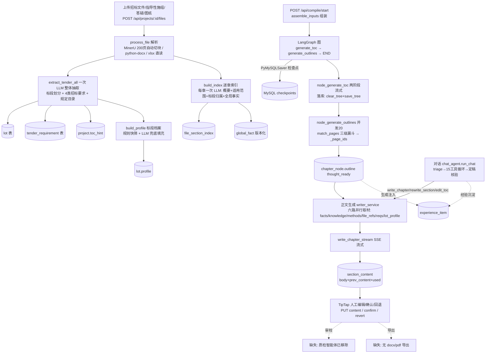

# zeronezer/bidcraft（标书匠 BidCraft）源码审计报告

> 审计对象：本地仓库 /home/z/my-project/repos/zeronezer__bidcraft/（github.com/zeronezer/bidcraft）
> 审计方式：只读静态审计（git log / rg / 通读源码 / AST 静态校验），未运行任何仓库代码、未调 LLM
> Task ID: 4-11 ｜ 深挖方向：LangGraph 检查点/恢复、PyMySQLSaver、LLM-Wiki 替代 RAG、无 RAG 防幻觉、测试真实性

---

## 1. 基本信息

- **LICENSE**：Apache-2.0（`LICENSE` 文件，标准全文；`NOTICE` + `ATTRIBUTION.md` 提供 Apache-2.0 第 4 条 NOTICE 保留的中文说明与署名模板）。法律上可商用/修改/闭源分发，唯一实质要求是保留 LICENSE/NOTICE 并显著标注来源。前端依赖（Vue/Element Plus/Tiptap/Mermaid）与后端依赖（FastAPI/LangGraph/PyMySQL/httpx/python-docx/openpyxl 等）均 MIT/BSD 系，**无 AGPL 组件**（见 `NOTICE` 第三方清单）。
- **语言/框架/规模**：Python(FastAPI+pymysql 直连 MySQL，无 ORM) + Vue3(Vite/TipTap/Mermaid)。`git ls-files` 121 个文件；后端 Python ≈11.7k 行（agents 13 个 / services 20 个 / api 9 个 / core 3 个），scripts+tests+tools ≈1.2k 行，前端 Vue/JS ≈6.2k 行，设计文档 `思路/` 8 篇 ≈1.4k 行。
- **顶层目录**：
  - `backend/app/agents/`：13 个智能体（prompt 内嵌为常量，无独立模板目录）——parser/tender/lot/requirement/orchestrate/heading/knowledge/fact/method/experience/writer/chat + `compile_graph.py`（LangGraph 状态机）
  - `backend/app/services/`：20 个服务（mineru/docx_parser/spreadsheet/file_index/matching/knowledge_service/fact_service/lot_* 三件套/writer_service/compile_service/section_service/requirement_service/experience_service/method_index/llm/storage/parse_cache/task_runner/doc_convert/content_migrate）
  - `backend/app/api/`：9 个路由（projects/files/chat/compile/knowledge/experience/facts/sections + main.py 注册）
  - `frontend/src/`：6 视图 + 6 组件（WorkspaceView 2940 行三栏工作台、TiptapEditor、FactDrawer、MermaidView）
  - `思路/`：8 篇设计决策复盘（01 LLM-Wiki vs RAG / 02 三级漏斗 / 03 上下文取舍 / 04 对话式编制 / 05 MinerU / 06 降幻觉 / 07 防重复）
  - `tests/`：5 个人工探针/验证脚本 + 2 份手工验证报告（2026-09-02）；`scripts/`：check_env/init_db.sql/seed_demo/启动脚本；`docs/`：截图+MinerU 对接笔记+前端设计书
- **提交历史**：浅克隆仅 **2 条**——`e55abe0` 2026-09-17 "feat: BidCraft 标书匠——开源对话式工程标书编制智能体"（初始整体上传）、`fe9fc82` 2026-10-09 "Add files via upload"。**一次性上传式仓库，无演进历史**；但源码注释中密集内嵌日期化决策（2026-09-02/04/07/08/09/10/11 多处"用户拍板"），可佐证真实迭代过程存在于开源投放之前。
- **测试**：**无自动化测试**（0 pytest、0 CI）。`tests/` 为需真实 API Key/MySQL 的人工探针：
  - `verify_compile_flow.py` / `verify_async_compile.py`：验证旧版 interrupt 流程，**与现行代码已不兼容**（见 §7-l 及风险 4）
  - `probe_docx_mineru.py` / `probe_outline_ai.py` / `verify_knowledge_page.py`：一次性解析/提炼探针
  - `验证报告-编排状态机.md`、`验证报告-知识页提炼.md`：2026-09-02 手工验证记录（结论"通过"，验证的是旧版 interrupt 图）
- **第三方依赖**（`backend/requirements.txt`）：fastapi/uvicorn/pydantic-settings/pymysql/langgraph>=1.0/**langgraph-checkpoint-mysql>=3.0**（PyMySQLSaver）/python-docx/pypdf/pdfplumber/httpx/openpyxl/xlrd；docx2pdf/pywin32 注释掉（仅 Windows 兜底分支）。外部服务：MinerU 云端 API（PDF/扫描件 OCR）+ 阿里百炼 OpenAI 兼容端点（默认 qwen3.8-flash）。许可均为宽松协议，无传染性风险。

---

## 2. 能力清单（a–p）

| # | 能力 | 标签 | 证据（文件 + 函数/常量） |
|---|------|------|------|
| a | 招标文件解析 | **IMPLEMENTED** | 入口 `api/files.py: upload_file()` → `fact_service.process_file()` → `parser_agent.parse_document()`。分流：PDF/图片→MinerU（`mineru.py: parse_pdf/split_page_ranges`，单任务 200 页上限、>200 页自动切块合并 full.md+content_list.json 带 page_idx）；docx→python-docx 原生（`docx_parser.py: parse_docx/chapters_from_docx`，对象级切章，放弃页码）；xlsx/xls→openpyxl/xlrd 直读（`spreadsheet.py`）。中间结构：full.md（markdown）+ content_list.json（页码定位用）+ `file_section_index` 表（sec_path/summary/applies_to/content 自包含）|
| b | 条款/要求提取 | **PARTIAL** | `tender_agent.py: extract_tender_all()` 一次 LLM 调用抽"标段划分+招标要求+施组目录"三类；要求仅 **4 类**：评分办法/技术要求/编制要求/废标风险（`EXTRACT_SYSTEM`、`requirement_agent.TASKS`），**缺"资格条件"与"商务要求"两类**。落库 `tender_requirement` 表（title/content/weight/suggested_chapter/source_location/status，`requirement_service.replace_requirements()` 按 source_file 整体替换）。旧多任务路径 `requirement_agent.extract_requirements()`（关键词窗口采样 16 窗）保留备用。程序自检仅"评分分值合计"文本提示（`check_note`） |
| c | 原文位置溯源 | **PARTIAL** | 事实：`source_location` = "文件名 · 章节路径"或 PDF 页码"P12"（`file_index._summarize` 沿用 content_list 的 page_idx，`knowledge_service._locate_pages`）；招标要求 source_location 由 LLM 自报章节名/条款号（无页码锚）；知识页 source_location 有 P 页码。**缺**：生成正文段落 ↔ 原文片段的双向锚点（只有落库的 `used` 取材摘要：experiences/knowledge/files/methods/facts_n，`writer_service._used_summary` + `api/sections.py: used-detail`） |
| d | 企业资料检索/证据 | **PARTIAL** | 刻意无向量检索。知识页三级漏斗 `matching.py: match_pages()`（专业标签过滤→bigram Dice≥0.80 直中→模糊带 LLM 终判 `_llm_judge`）；项目文件 "skill 式" `file_index.py: _select_relevant()`（AI 看章节目录概要选章→`load_sections()` 取**完整原文**不切片）；工法 `method_index.py: match_methods()`（概况索引→整篇注入）。精确匹配能力=标段代码正则（**硬编码 CGJXZQ 前缀**，`lot_scope_service.judge_text`）、里程桩号正则 `_extract_miles`、事实键值 fact_key/value；**无编号/型号/金额/日期专用精确匹配器**，无语义召回兜底（`matching._vector_fallback()` 恒返回空） |
| e | 响应矩阵/合规矩阵 | **PARTIAL**（无矩阵本体） | 仅有 requirement→`suggested_chapter` 单向建议 + 按章注入（`requirement_service.requirements_for_chapter_text()`：suggested_chapter 命中→类别回退规则，confirmed 优先）+ 评分分值合计文本核对。**无 requirement×response 覆盖矩阵产物、无覆盖度 % 审计**；质检智能体 2026-09-10 已移除（`main.py:36-38` 注释"qc/charts 后端接口一并删除"），README 又把它放回"规划中" |
| f | 目录生成与分章节生成 | **IMPLEMENTED** | `compile_graph.py: build_compile_graph()`（START→generate_toc→generate_outlines→END）；招标规定目录最高优先（`orchestrate_agent.TOC_SYSTEM` 规则 2 + project.toc_hint）；目录两阶段流式"长出来"（`generate_toc_titles`→并发 `generate_toc_children`，`compile_service.save_partial_toc` 轮询渲染）；单章重生成思路（`compile_service.regenerate_node_outline` / chat 工具）、批量补思路（`generate_pending_outlines`）、单章正文 SSE（`writer_service.generate_chapter_events`）、批量可停（`start_batch/stop_batch`）、对话重写（`write_chapter_once/rewrite_section`）、目录编辑（`section_service.add_node/rename/delete_node_tree` + chat `edit_toc` + `sections.py toc/preview→toc/apply` 文本化目录 diff 替换）。章节状态机 unwritten→thought_ready→generated→confirmed（`section_service.NODE_STATUSES`） |
| g | 审校/校验 | **MISSING** | 质检智能体/进度图表 2026-09-10 移除（`main.py:36`）。现存确定性检查仅：评分分值合计 check_note（文本）、标段过滤/行级裁剪、事实去重版本管理、父子章节去重；对话链路"定稿核验"只防**谎称完成**不审内容。报价/工期/数量/资质有效期/签章/暗标检查**全部缺失**，正文质量审校完全依赖人工通读 + `[待补充]` 标记定位 |
| h | 导出 | **MISSING** | 无 docx/pdf 成品导出（README"规划中"诚实标注）；编辑器是唯一内容载体；`doc_convert.py` 仅是解析链路的 docx→pdf（Windows COM）；`spreadsheet.py` 是 xlsx 解析不是导出 |
| i | 状态持久化与恢复 | **IMPLEMENTED**（带默认关闭缺陷） | LangGraph `PyMySQLSaver`（`compile_graph._invoke()`：每次 invoke 新建 pymysql 连接 + `graph.compile(checkpointer=saver)`，thread_id=`project-{pid}-{ms}`）；业务侧 `compile_session` 表（stage/progress/partial_json/interrupt_json，`compile_service._save`）。**进程重启续跑**：`main.py _startup()` → `compile_service.auto_resume()`（仅 stage∈generating_* 的会话）→ `resume_interrupted(thread_id)`=`graph.invoke(None, thread_id)` 从最近检查点续跑——但受 `COMPILE_AUTO_RESUME` 开关控制，**`.env.example` 默认 false**（默认部署下重启即把 running 会话复位为 failed，不续跑）。task 表任务重启标记失败；chat 消息/章节/事实全落 MySQL；批量生成停止标记在进程内（重启不续，注释明示"重新发起即可"） |
| j | 失败处理 | **IMPLEMENTED** | LLM 指数退避重试 5 次+抖动（`llm.py _post_with_retry/_is_retryable`：429/5xx/断连）；批量单章失败不中断（`writer_service.start_batch._write` try/except）；单路取材失败回退空（`_parallel_take`）；SSE 客户端断开 GeneratorExit 落库半成品（`generate_chapter_events`）；解析中止标记 `fact_service.cancel_parse`；僵尸会话复位（`chat_agent._tool_start_compile` + main.py 启动清理）；JSON 解析统一 `_extract_json` 剥围栏取花括号。代价：大量 `except: print` **静默降级无告警** |
| k | 日志与可观测性 | **PARTIAL** | 全库 `print()` 控制台日志为主；仅 chat 工具有 logging（`chat_agent._exec_tool` 的 `chat_tools` logger 计时）；task 表进度 + tool_trace 落 `chat_message.trace` + used 取材摘要可查。**无日志文件/级别配置/指标/trace 系统** |
| l | 测试 | **PARTIAL**（人工探针，且已失效） | 5 个探针脚本 + 2 份手工验证报告（2026-09-02，验证的是**旧版 interrupt 流程**）。`verify_compile_flow.py` 调 `new_compile(project_id=..., knowledge_pages={})` —— 与现行签名 `new_compile(thread_id, project_id, ...)` 不匹配（缺 thread_id、多 knowledge_pages），**跑起来直接 TypeError**；`verify_async_compile.py` 等待 confirm_toc/confirm_outline 阶段，而现行图无人审中断、直达 outlines_ready，**必然超时**。probe 脚本需真实 Key。结论：测试对当前代码零保护 |
| m | Skill 文件 | **MISSING** | 无 SKILL.md。根目录 `AGENTS.md` 是给 AI 编程助手的"把项目跑起来"环境引导（装依赖/填配置/启动），**非业务技能**，frontmatter/阶段规则/停止条件均无 |
| n | Dify DSL | **MISSING** | 全仓库无 Dify 特征 YAML（无 app:/nodes:/edges:），无任何 workflow DSL 文件 |
| o | MCP Server | **MISSING** | 无 mcp/modelcontextprotocol 依赖或 import。对话智能体是**进程内 OpenAI function-calling 循环**（`chat_agent.TOOLS` 15 个工具 + `_exec_tool` 分发）；README 明说扩展方式=改 chat_agent.py 加 schema/分支 |
| p | LLM 调用方式 | **IMPLEMENTED** | `llm.py LLMClient`：httpx 直连 OpenAI 兼容 `/chat/completions`（trust_env=False 绕代理），配置全在 `.env`（LLM_BASE_URL/KEY/TEXT_MODEL 默认 qwen3.8-flash + 独立对话模型 CHAT_*）；能力：chat / chat_stream / chat_with_tools / **chat_stream_with_tools**（SSE 分片拼 tool_calls）/ chat_with_image（视觉）；qwen 专属 `enable_thinking` 开关（第三方端点可关）。提示词全部内嵌 `agents/*.py` 常量（README 如实声明"无独立模板目录"），低温度抽取 0.1 / 正文 0.4 |

补充（重点深挖 5：知识库提炼与学习）——两套知识管线均 **IMPLEMENTED**：
- 历史施组→知识页：`knowledge_service.process_doc()`（解析→`heading_agent.split_chapters_v2()` 纯规则切章（# 深度建树/编号降级/封面目录剔除/60 字阈值，2026-09-09 去 AI 判父子）→并发 20 路 `knowledge_agent.extract_knowledge_page()` 提炼 method/key_points/tables/images/numbers(fact_role=reference)/usage + ref_text 完整原文回填）→`knowledge_page` 表；页码定位 `_locate_pages`。
- 经验学习三触发点：`experience_agent.distill_from_edit/reject/chat`（"宁缺毋滥、只沉淀写法不沉淀数字"），由 `api/sections.py put_content`（改稿 diff）、`revert_content`（否决）、`api/chat.py stream`（CORRECTION_RE 纠偏指令）异步触发入库，生成时 `experience_service.match_experiences()`（全局条目恒入+标题 Dice≥0.35）以最高优先级注入。

---

## 3. README 声明核对

| README 声称 | 判定 | 证据 |
|---|---|---|
| 招标文件解析：PDF/扫描件/图片走 MinerU OCR+版面还原；Word/Excel 各自通道；标段/评分办法/技术要求/编制要求/规定目录全部结构化落库 | **已验证** | `parser_agent.parse_document` 分流；`tender_agent.extract_tender_all`→`lot_service.replace_lots`/`requirement_service.replace_requirements`/`project.toc_hint` 落库（`fact_service.process_file` L186-206） |
| 标段隔离：事实/文件片段/知识素材按标段过滤，不串标段 | **已验证** | `fact_service.confirmed_facts`（unknown 保守放行/background 标注警示/mine 精确匹配）、`lot_scope_service.filter_catalog_by_lot/clip_text_by_terms`（multi 整表按白名单行级裁剪）、`lot_profile_service` 白名单注入 prompt 硬边界、requirement `_lot_filter`。**但规则快筛硬编码 CGJXZQ 前缀**（judge_text L80），换项目需改代码 |
| 知识库：历史施组→章节树→知识页（编制方式/要点/典型表图/适用范围） | **已验证** | `knowledge_service.process_doc` + `knowledge_agent.SYSTEM_PROMPT`（提炼"怎么写"而非摘抄） |
| 工艺工法库：一篇一条概况索引，整篇注入 | **已验证** | `method_index.build/match_methods`（2026-09-04 重构注释） |
| 目录生成：招标规定目录优先；逐级展开流式"长出来" | **已验证** | TOC_TITLES_SYSTEM 规则 2 最高优先级；`save_partial_toc` + update_progress 前端轮询 |
| 逐章编写思路：先思路后正文，可人工审阅调整 | **已验证**（有缺陷） | `generate_outline` + 思路条 UI；但"保存思路"按钮后端 `sections.py:693 update_outline_by_id(0,...)` 恒 404（见风险 2） |
| 正文流式生成：单章/批量/对话指定重写，流式写入编辑器 | **已验证** | `generate_chapter_events`（SSE chapter_delta）、`start_batch`、`write_chapter_once(extra_requirements)`、`_rewrite_section` |
| 对话式编制：15 工具作用于真实数据，"声称已生成→核验无记录→否决重做" | **已验证** | `TOOLS` 恰 15 项；`VERIFY_SYSTEM` + `_verify_needs_action`（不带历史、只认本轮 executed_tools 成功记录）→ 否决时 `step_text(rejected=True)` 留档 + `draft_discard` 清屏 + 强制补做；`_strip_fake_trace_tag` 剥伪造痕迹（README 防伪造三层全部落实） |
| 全局事实表：数字单独管理、标出处、可编辑可追溯、"杜绝同一数字三种写法" | **已验证**（机制存在，杜绝效果靠 prompt 硬规则） | `global_fact` 表 + `upsert_facts`（值变 expired+version+1）+ `FactDrawer.vue` + `WRITER_SYSTEM` 规则 2"数字必须来自事实表或文件原文否则 [待补充]" |
| 经验学习：改稿/否决/对话纠偏三触发点沉淀偏好 | **已验证** | `experience_agent` 三函数 + 三处 API 触发（2026-09-08 起经验直接 confirmed 免确认） |
| Mermaid 关系图编辑器内实时渲染 | **已验证** | `MermaidView.vue` + mermaid@11 依赖 |
| "编制周期从数周压到数天" | **夸大/未验证** | 无任何量化证据；营销话术 |
| 技术架构图与"关键技术选择"表 | **已验证** | LLM-wiki（思路/01+matching/file_index/method_index）、章节索引按需加载（file_index 头注释 2026-09-04 决策）、编辑器唯一载体（section_content 单表单 content 字段）、标段基本单位、稳定前缀组织上下文（`writer_agent._build_context` 注释）全部与源码一致 |
| "已实现"清单 9 项 / "规划中"清单（导出 Word/PDF、质检智能体、进度图表、图文并茂等） | **已验证/诚实** | 已实现 9 项逐一对应源码；规划中标注诚实——但注意质检/进度图表是**曾实现后被移除**（main.py:36 "2026-09-10 按需求移除"），README 未提删除史 |
| "100% 免费、数据在本机、不锁定（换 LLM_BASE_URL 即换模型）" | **已验证** | 无付费墙代码；uploads 本地 + MySQL；LLM 客户端纯 OpenAI 兼容无 SDK 锁定 |

---

## 4. 真实执行链路重建

### 节点表格

| 链条节点 | 入口(文件+函数) | 输入→输出数据结构 | 模型/工具 | 持久化 | 失败处理 | 状态 |
|---|---|---|---|---|---|---|
| 上传 | `api/files.py: upload_file` | UploadFile→project_file 行(status=pending) | — | uploads/ + MySQL | 后缀白名单校验 | IMPLEMENTED |
| 解析 | `fact_service.process_file` → `parser_agent.parse_document` | 文件→full.md+content_list.json | MinerU 云端 API | uploads/parsed/ + parsed_path | MD5 复用跳过 MinerU；失败 status=failed；删除可中止 | IMPLEMENTED |
| 招标整体抽取 | `tender_agent.extract_tender_all` | markdown[:400k 硬截断]→{has_lots, lots[4字段], requirements[category/title/content/weight/suggested_chapter/source_location], toc{found,chapters}} | 1 次 LLM(24k 输出) | lot / tender_requirement / project.toc_hint | 抽取失败不影响后续建索引（print 降级） | IMPLEMENTED（**超长文件尾部截断风险**） |
| 章节索引+逐章事实 | `file_index.build_index` | full.md 按标题树切节→每章{summary,applies_to,applies_lots,facts≤20} | 每章 1 次 LLM(并发20) | file_section_index（content 自包含）+ global_fact | 单章失败跳过；取消标记 should_stop | IMPLEMENTED |
| 标段档案 | `lot_profile_service.build_profile` | 项目文件批次→profile{mileage_ranges/major_structures/temp_facilities/...} | 规则+LLM 兜底 | lot.profile | 档案缺失降级空（不阻塞） | IMPLEMENTED |
| 目录/思路编排 | `api/compile.py: start` → `compile_graph` | CompileState{project_info,professions,tender_requirements,tender_toc,facts}→toc{chapters}+outlines[{thinking,key_points,_page_ids}] | generate_toc_titles/children、generate_outline（并发 20） | PyMySQLSaver 检查点 + compile_session(partial_json 流式) + chapter_node(save_tree/save_outline) | 节点内落库失败 print 不阻断；auto_resume 默认关 | IMPLEMENTED |
| 正文生成 | `api/sections.py: generate_content`(SSE) / `writer_service.generate_chapter_events` / 批量 `start_batch` | outline+六路素材→markdown 正文 | qwen3.8-flash 流式（max_tokens 50000） | section_content{body,prev_content,used} + 状态 generated | GeneratorExit 落库半成品；单章失败跳过；stop_batch 可停 | IMPLEMENTED |
| 对话改稿 | `api/chat.py: stream` → `chat_agent.run_chat` | message+refs+6条历史→SSE 事件流(delta/tool_trace/final_answer) | triage LLM + 主模型工具循环 + 定稿核验 LLM | chat_message(content+trace) | 核验失败放行；步数上限 10 兜底收尾 | IMPLEMENTED |
| 审校/质检 | **缺失**（main.py:36 已移除 qc/charts 接口） | — | — | — | — | **MISSING** |
| 导出 | **缺失**（README 列"规划中"） | — | — | — | — | **MISSING** |

执行链路判定：**部分链**——「解析→抽取→事实/要求/标段→目录→思路→逐章正文→人工编辑/对话改稿」闭环完整且工程质量高于同规模仓库；链尾「审校→导出」两节点缺失，属编辑器内工作台而非交付物生成系统。

---

## 5. 重点审计问题（Q1–Q10）

**Q1 超长招标文件/表格/扫描件如何处理？条款会不会丢？**
- PDF>200 页：MinerU 按 `split_page_ranges` 自动切块（361页→'1-200','201-361'），逐块轮询合并 full.md + content_list（`mineru._run_batch`）。扫描件/图片走 MinerU 内置 OCR；xlsx 直读防 OCR 数字失真（思路/05 明确"1,234.56→l,234.56 在报价场景致命"）。
- **但整体抽取有硬截断**：`tender_agent.extract_tender_all` L150 `body = text[:MAX_INPUT]`（400,000 字符）——超过 40 万字的招标文件**尾部内容直接丢弃且无任何告警**；旧多任务路径（requirement_agent）反而有"头部+关键词均匀采样 16 窗"机制（保底含最后一个命中），现行主路径没有。输出侧 MAX_TOKENS=24,000，超多标段+大评分表时 JSON 可能截断→`_extract_json` 抛 ValueError→整次抽取失败（print 降级，要求表为空）。
- 知识页提炼：单章 10 万字内不分块，超长分块（100k+2k 重叠）再 LLM 合并（`knowledge_agent._chunk_text/MERGE_PROMPT`）。
- 注入侧：章节原文"永不截断"是设计口号，实际有 `INJECT_MAX_CHARS_PER_SECTION=200000`（超长章节**整章静默跳过不注入**）与 `MAX_TOTAL_CHARS=400k` 总量上限（`file_index.load_sections` L415-419）。跨页大表被 MinerU 页块边界切断的风险设计文档承认但无防护代码。

**Q2 六类要求如何统一成结构化条款清单？**
未统一成六类。现行为 **4 类**：评分办法/技术要求/编制要求/废标风险（`tender_agent._clean_requirements` 类别白名单外一律丢弃；`requirement_agent.TASKS` 四任务）。**资格条件、商务要求两类未建模**（代码注释明示"商务报价/合同条款与施组正文无关，不纳入"——符合其"只做技术标施组"定位，但对通用标书系统是覆盖缺口）。数据结构：`tender_requirement` 表（init_db.sql L238-253）+ `_sanitize`（title≤300/content≤2000/weight 数字化/source_location≤200）+ `_dedup`（同 category+相似 title 取内容长者）+ 归类规则"带分值一律归评分办法"。

**Q3 要求↔原文位置↔证据↔响应章节↔审校结果如何关联？有无 ID 体系？**
- ID 体系：`tender_requirement.id`、`global_fact.id`（+version）、`knowledge_page.id`、`file_section_index.id`、`chapter_node.id`（章节树主键，对话工具用它防模型编造章节——`find_chapters` 返回真实 ID、错误时返回"当前项目实际节点如下"供自愈）。
- 关联是**单向、松散**的：要求→`suggested_chapter`（LLM 从 11 类骨架章名中选）；章节生成时 `requirements_for_chapter_text` 按 suggested_chapter 命中注入（未命中按标题关键词回退类别）；正文落库 `used` 记录素材 id 清单（知识页/文件片段/工法/经验/事实条数）。
- **缺**：正文段落级 → 要求 id/原文锚点的双向引用（无 citation id 体系）；审校结果维度不存在（质检已移除）。事实与原文位置关联最强：source_file + source_location("文件·章节"或 P页码)。

**Q4 企业资料检索是否同时支持语义召回与精确匹配？**
否（设计选择）。语义召回位置被三套"索引+AI 选择"替代（知识页三级漏斗 / 文件章节索引选章 / 工法概况选篇），向量库已物理移除（`llm.embed()` raise NotImplementedError("本项目已移除向量库")；`matching._vector_fallback` 恒 []，注释"保留接口签名以兼容调用方"）。精确匹配：Dice bigram 标题相似度、专业标签交集、标段代码正则（**硬编码 CGJXZQ**）、里程桩号区间正则、事实 fact_key/value 键值精确存储；**编号/型号/金额/日期没有专用精确匹配器**（金额数字仅作为事实键值存在）。

**Q5 无证据/证据过期/证据冲突/资格不满足时，如何阻止错误内容进入定稿？有无硬阻断？**
- **无定稿前硬阻断机制**。防线全是 prompt 软约束+人工：`WRITER_SYSTEM` 硬规则（数字必须来自事实表/文件原文，否则 `[待补充]`；冲突裁决链 文件原文>事实表>历史页；历史数字 fact_role=reference 严禁照搬）；冲突裁决与"[待补充] 把幻觉转化为待办"是核心设计（思路/06 第三、四节）。
- 证据过期：`upsert_facts` 值变化时旧行 expired+version+1（新值随即生效注入）——过期**不阻断**，仅版本可溯；人工改过（edited=1）保留。schema 有 edited 字段但 upsert 未写 edited（人工保护逻辑声称在思路/06，`upsert_facts` 实际未实现 edited 保护——README"改动不会被覆盖"**部分未兑现**，重抽同 key 值仍会插新版本）。
- 资格不满足：不处理（资格条件根本不抽取）。
- 唯一"硬"否决在对话链路：定稿核验无工具成功记录→否决重做（防谎称，不防内容错误）。
- 事实风险缓解：正文引用文件原文数字须括号标出处文件名（prompt 规则 2）；`gen_debug_context` 开关可回放全上下文排查。

**Q6 章节能否拆成可单独执行/重试/修改/验证的任务？**
可以（这是本仓库强项）。粒度=chapter_node.id：单章生成/重写（write_chapter_once、rewrite_section，旧稿进 prev_content 单级回退）、单章重生成思路（regenerate_node_outline 后台任务+task 表进度+刷新恢复轮询 outline_tasks）、批量生成可停（stop Event，进行中写完即停）、目录增删改（edit_toc 不碰正文）、toc/preview→apply 文本目录 diff 替换（同名保留思路正文）。重试：LLM 层 5 次指数退避；章节级失败不自动重试（批量跳过、对话如实报错）。**验证**：无程序化验证，靠人工。

**Q7 报价/工期/数量/资质有效期/签章/暗标等检查，哪些是确定性代码、哪些依赖模型？**
- 确定性代码：评分分值合计核对（`requirement_agent` L217-221——但只生成 check_note **文本提示**，不阻断）、标段过滤（applicable_lots 精确匹配 + multi 整表行级裁剪）、事实归并去重/版本管理（`fact_agent._key_merge`、`upsert_facts`）、父子章节同选去重（load_sections）、评标/须知类章节正则剔除（`file_index._NON_CONTENT_RE`）、封面目录页正则剔除（heading_agent）、序号→真实 ID 映射防编造。
- 依赖模型：工期/数量等数字的正文正确性（prompt 硬规则+人工）、暗标/格式要求的识别抽取（编制要求类）与遵守——**报价、签章、资质有效期无任何检查**（报价明确声明不纳入；签章仅作为"编制要求"条目存在）。

**Q8 中断/换模型/补充招标文件后如何恢复状态、识别受影响章节并重新执行？**
- 中断恢复：`compile_session.stage∈generating_*` + `auto_resume()`（main.py 启动钩子，`COMPILE_AUTO_RESUME` **默认 false**）→ `resume_interrupted(thread_id)`=`graph.invoke(None, thread_id)` 从最近检查点续跑。粒度=节点：generate_toc 崩溃→从初始状态重跑整节点（其内部 LLM 全部重烧；save_partial_toc 的 DB 写是幂等覆盖）；generate_outlines 崩溃→从 generate_toc 完成点续跑。开关关闭时启动钩子直接把 running 会话复位 failed（"会话已复位，可重新发起"）。
- 换模型：改 .env 即生效，无缓存失效/影响分析/重跑编排（无 embedding 索引所以无向量重建问题——这是无 RAG 架构的实际红利）。
- 补充招标文件：reparse→`replace_requirements` 按 source_file 整体替换要求；事实按 (category,fact_key) 值变化 expired+新版本；`lot-relabel`/`lot-profile/rebuild`/`facts/reextract`（按标段定向重提取，拿着选定标段让 LLM 重新抽）可手动刷新归属。**受影响章节识别：无**——没有"哪些已生成章节引用了变化事实"的反查（used 摘要只有事实条数 facts_n，无事实 id 列表），需人工判断重写。`writer_service.rewrite_chapters`（按指定 node_ids 批量重写）是为"越标正文重写"准备的，但 `start_rewrite_task` **无任何调用方**（死代码），且其内部 `execute` 未导入（NameError 隐患）。

**Q9 可导入 Dify DSL / 可运行 MCP Server / 独立 Skill？**
**三者皆无。** ①无 Dify YAML（rg 全库无 app:/nodes: 特征）。②无 MCP：无 mcp 依赖、无 stdio/JSON-RPC；`chat_agent.TOOLS` 是 OpenAI tools 协议的 15 个 JSON schema（含参数定义），**结构上可低成本改写为 FastMCP 工具**（每个 `_tool_*` 均为纯函数+DB 调用），但缺传输层/会话管理。③无 SKILL.md；AGENTS.md 是开发环境引导非业务技能。跑起来还缺：`.env` 三项必填（MySQL/百炼 Key/MinerU Token）+ `check_env.py --init-db` 建表 + Node 18 前端构建；无 Docker Compose（README 列规划）。

**Q10 哪些可合法复用？哪些仅可借鉴思路？**
Apache-2.0 + NOTICE/ATTRIBUTION：**代码级复用合法**（保留 LICENSE/NOTICE + 标注来源即可，可闭源商用）。依赖全 MIT/BSD 无传染。可直接复用清单见 §6。仅借鉴思路：interrupt 人审门语义（已从代码中移除，只在文档/测试里）、经验提炼触发点设计。不建议采用：见 §6 末。

---

## 6. 复用价值与许可

**可直接复用（Apache-2.0，注明来源 + 保留 LICENSE/NOTICE）：**
- `backend/app/services/matching.py` —— 三级漏斗（标签→Dice→LLM 终判）完整独立，零向量依赖，含工法匹配变体；`_dice/normalize_title` 可直接抄
- `backend/app/services/file_index.py` —— "章节索引+AI 选章+完整原文注入"的 no-RAG 检索模式（含稳定序号防 ID 编造、父子去重、评标类章节过滤、图片引用 URL 改写）
- `backend/app/agents/writer_agent.py` —— `WRITER_SYSTEM` 硬规则集（数字出处强制、冲突裁决链、历史数据隔离、篇幅约束）与 `_build_context` 稳定前缀组装法，是**本仓库最有价值的 prompt 工程**
- `backend/app/agents/chat_agent.py` —— 定稿核验（`VERIFY_SYSTEM`+`_verify_needs_action`）、伪造痕迹剥除、被否决草稿留档、错误自愈（返回真实节点列表）整套对话防伪造机制
- `backend/app/services/fact_service.py`（upsert_facts 版本化）+ `fact_agent._sanitize/_key_merge` + global_fact 表设计（init_db.sql）
- `backend/app/services/heading_agent.py` —— 纯规则切章建树（# 深度/编号降级/封面目录剔除），可整体移植
- `backend/app/services/mineru.py` —— MinerU v4 客户端（200 页切块/轮询/合并/CDN DNS 污染兜底），独立可复用
- `backend/app/agents/compile_graph.py` —— PyMySQLSaver 检查点接线模式（每 invoke 独立连接解决 pymysql 线程安全）+ `resume_interrupted`=invoke(None) 重启续跑范式
- `scripts/init_db.sql` —— 13 张表 schema（中文 COMMENT 质量高，尤其 applicable_lots 四态语义 all/background/multi/[] 与 compile_session）
- `思路/01~08` —— 设计决策文档（-license 随仓库 Apache-2.0 覆盖），可直接作为方案论证素材引用

**需改造后复用**：`lot_scope_service`（标段规则快筛硬编码 CGJXZQ 前缀须泛化）；`tender_agent`（4 类要求需扩六类；400k 截断需改滑动分块）；`task_runner`（线程池→Celery 替换点已留）；对话工具循环（若走 MCP 需加传输层）。

**仅可借鉴思路**：interrupt 人审门（v0.2 已自动确认化，语义只在文档）；"目录/思路自动落库+用户在树上自行调整"的产品判断；MD5 解析缓存跨表复用；SSE 半成品落库（GeneratorExit persist）。

**不建议采用**：`requirement_service` / `writer_service.rewrite_chapters` 现状（含 NameError bug）；以 print 代日志的观测方式；auto_resume 默认关闭的"可恢复"默认配置。

**许可证结论**：Apache-2.0，无 AGPL/传染组件，代码与 schema 可合法商用闭源复用，义务仅为保留 LICENSE/NOTICE 文件并在成果物显著位置标注来源（ATTRIBUTION.md 提供中英模板）。

---

## 7. 可靠性风险清单

| # | 风险 | 严重度 | 证据（文件+位置） | 复现/验证 |
|---|---|---|---|---|
| 1 | `requirement_service.py` 使用 `query_one` 但只 import 了 `execute, query`（L9）→ `update_requirement`(L63)/`delete_requirement`(L74)/`set_status`(L107) 三个函数运行时 **NameError**；对应 API `PATCH/DELETE /api/projects/requirements/*` 必 500 | **高** | `requirement_service.py:7-9,63,74,107`（AST 静态验证确认 query_one 未定义）；调用方 `api/projects.py:267-301` | 起服务后调 `PATCH /api/projects/requirements/1/status` → 500 NameError；`python3 -c "import ast..."` 静态可证 |
| 2 | `api/sections.py:693` `update_outline_by_id(0, node_id, ...)` 把 project_id 硬编码 0 → `WHERE project_id=0` 永无命中，**前端"保存编写思路"按钮（api/index.js:183 putNodeOutline）恒 404** | **高** | `sections.py:688-695` + `section_service.update_outline_by_id:270-282` | 前端编辑思路点保存必报"章节不存在"；对比 chat_agent:1079 正确传了 project_id |
| 3 | 招标文件整体抽取 `text[:400_000]` 硬截断 + 24k 输出上限：超长招标文件尾部条款静默丢失；大输出 JSON 截断→整次抽取失败（仅 print，要求表空） | **高** | `tender_agent.py:21-22,150,160` | 构造 >40 万字 markdown 单测 `_extract_json` 抛 ValueError 路径；对比旧路径 `_build_input` 的均匀采样 |
| 4 | 测试与现行代码完全脱节：`verify_compile_flow.py` 调用签名不匹配（new_compile 缺 thread_id 位置参数、多传 knowledge_pages）直接 TypeError；`verify_async_compile.py` 等待已不存在的 confirm_* 阶段必然超时；验证报告验证的是已移除的 interrupt 机制 | **中** | `tests/verify_compile_flow.py:26-32` vs `compile_graph.py:217`；`tests/验证报告-编排状态机.md`（2026-09-02，验证旧图） | 对照两处签名即可证；运行（需 Key）会在第一步崩溃 |
| 5 | "断点续跑"默认不生效：`COMPILE_AUTO_RESUME=false`（.env.example/config.py:49 默认 False）→ 进程重启时启动钩子把 running 编制会话**复位为 failed** 而非续跑；批量生成停止标记在进程内、重启不续 | **中** | `main.py:71-91`（else 分支复位僵尸会话）；`writer_service.py:25-27` 注释"进程重启后批量不自动续" | 默认配置重启即见"会话已复位"日志 |
| 6 | `writer_service.rewrite_chapters`（L435）内部用 `execute` 但未 import（L19 只导入 close_thread_conn/query/query_one）；`start_rewrite_task`(L519) 无任何调用方——死代码+潜在 NameError（传 task_id 时崩溃） | **中低** | `writer_service.py:19,469,502,509`（AST 验证）；rg 全库无 start_rewrite_task 调用 | 当前无入口可触发；一旦接线即炸 |
| 7 | 标段规则快筛硬编码 `CGJXZQ-\d+` 前缀：换任何非 CGJXZQ 编号体系的项目，规则判定 ①② 步全部失效，退化为构造物/里程匹配或 AI 兜底 | **中** | `lot_scope_service.py:77-84`（judge_text 正则）；`fact_service.py:318-325` 注释承认"换项目即失效" | 换 lot_code 前缀构造用例可证 |
| 8 | 广泛的静默降级：索引失败/事实落库失败/招标抽取失败/单路取材失败均 `except: print` 后继续（如 `fact_service.py:204-205,268-269,284-285`、`writer_service._parallel_take`），用户界面无任何失败迹象，条款可能整批缺失 | **中** | 上述位置 + `file_index.load_sections` L415-417（超长章节静默跳过注入） | 上传 MinerU 失败文件观察：status=parsed 但索引/事实为空 |
| 9 | CORS `allow_origin_regex=r".*"` + `allow_credentials=True` 全开放（自认"开发期"），生产部署有 CSRF/凭证泄露面 | **低中** | `main.py:13-26` | 检查任意跨域带凭证请求被回显放行 |
| 10 | 事实"人工改过不被覆盖"承诺未实现：schema 有 `edited` 字段（init_db.sql:207"重抽取时保留"），但 `upsert_facts` 从不写/查 edited，同 key 值再变仍会插新版本覆盖使用口径 | **低中** | `fact_service.upsert_facts:47-81`（无 edited 逻辑）vs `思路/06`"改动不会被覆盖" | 改事实→重传同源文件→观察新版本插入 |
| 11 | PyMySQLSaver `_saver_ready` 全局无锁：首次并发 invoke 存在 setup() 竞态；检查点表与业务表双写冗余（outlines 全量存 checkpoint 又存 chapter_node.outline） | **低** | `compile_graph.py:180-203` | 代码审读；MySQL checkpoints 表结构（saver.setup() CREATE IF NOT EXISTS） |
| 12 | 回退仅单级：prev_content 每次覆盖写，revert 后 prev 即丢（无历史栈）；revert 同时把 used 摘要一并丢弃 | **低** | `section_service.persist_one:130-151`、`api/sections.py:328-363` | 连续两次 AI 重写后仅能回退一步 |

---

## 8. 专项结论（对应深挖方向）

1. **compile_graph.py 图拓扑**：现行图为**线性两节点**（START→generate_toc→generate_outlines→END），**无条件边、无 interrupt() 调用**。初筛报告所称"interrupt() 人工把关"是 **2026-09-10 之前**的 v0.1 语义——v0.2 决策移除人审中断，改为生成后自动落库、用户在目录树/对话中自行调整（compile_graph.py:164、compile_service.py:198-230"移除人工确认/自动确认"）。interrupt 相关代码（`_extract_interrupt`/`resume_compile`/`_auto_confirm`）成为**保留但永不触发的死路径**；模块 docstring 与 api 注释仍描述旧机制（文档滞后）。真正保留价值：PyMySQLSaver 接线方式与 `resume_interrupted`=invoke(None) 的重启续跑实现。
2. **PyMySQLSaver 检查点**：存整个 CompileState（project_info/professions/tender_requirements/tender_toc/facts/toc/toc_confirmed/outlines/outline_confirmed），按 thread_id 键控、每 invoke 新建连接（规避 pymysql 非线程安全）、`saver.setup()` 每进程一次建 checkpoints 表；恢复粒度=LangGraph 超步（节点级），节点内部崩溃则该节点整体重跑；auto_resume 默认关闭。
3. **LLM-Wiki vs RAG 取舍评估**：论证质量高（思路/01 三个反 RAG 论点：施组是"照章办事"非问答、切片边界恰好切在结构上、"怎么写">"写什么"）。实现自洽：三级漏斗+AI 选章+完整原文注入，向量痕迹已物理清除（embed 抛错、_vector_fallback 恒空）。**代价如实承认**（解析期数百次 LLM、知识扩容延迟、放弃模糊联想）。对本项目启示：其"检索单位=结构化条目而非文本块"与"出处可审计"论证可直接引用；但泛化到非强结构文档场景需保留向量兜底可选项。
4. **入口与数据流**：招标解析入口=文件上传自动触发（非独立按钮，招标解析 API 已移除）；标段选择= lots/list→select；章节编写=单章 SSE/批量/对话三入口；对话改稿=chat_agent 工具循环+核验。全链数据结构见 §4 表。
5. **知识库提炼与学习**：双管线（知识页/工法概况）+经验三触发点，均 IMPLEMENTED 且质量上乘；2026-09-09 移除 120 章提炼上限（整册完整）。
6. **无 RAG 防幻觉**：六层软防线（事实表单管+冲突裁决链+[待补充]硬规则+历史数据隔离+取材摘要可查+对话定稿核验）+确定性代码兜底（分值合计/标段过滤/去重），设计文档诚实标注能力边界（"模型理解错误只能人工审"）。**无定稿硬阻断**，是"降人工核对量"哲学而非"保证正确"哲学。
7. **测试**：人工探针确认，且两份 verify 脚本对现行代码已失效（签名不匹配/阶段不存在）——测试为零保护，初筛"人工探针"判断准确并进一步恶化。
8. **Apache-2.0 可复用清单**：见 §6（matching/file_index/writer_agent prompts/chat_agent 核验/fact 版本化/heading_agent/mineru 客户端/compile_graph 检查点范式/init_db.sql/思路文集）。
