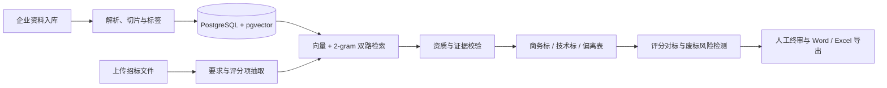

# 方舟 AI 招标助手

<p align="center">
  
</p>

<p align="center">
  面向工程、后勤及软硬件服务商的企业私有知识库与 AI 标书生成系统。
</p>

<p align="center">
  <a href="https://nuoya-ai-bid-agent.vchenlinux.chatgpt.site/"></a>
  
  
</p>

<p align="center">
  
  
  
  
  
</p>

## 在线体验

> [打开方舟 AI 在线演示](https://nuoya-ai-bid-agent.vchenlinux.chatgpt.site/)

当前演示站需要登录授权，主要用于体验产品界面与工作流。请勿向在线演示环境上传真实资质、合同、报价等敏感企业资料；真实资料建议使用本地私有化部署。

## 项目解决什么问题

传统标书编制需要人工反复查找资质、案例、参数和历史方案，再逐条核对招标要求、评分项与偏离风险。方舟 AI 将这些工作组织为一条可审计的 Agent 工作流：



## 核心亮点

- **企业私有知识库**：资质、案例、技术方案、设备参数和商务模板统一入库，企业资料默认留在本机。
- **双路 RAG 检索**：向量语义检索负责召回相似案例和方案，2-gram 关键词检索负责命中证书编号、设备型号和硬性条款。
- **招投标专用解析**：自动提取项目编号、预算、截止时间、保证金、资格条件、技术参数及评分办法。
- **评分与风险双审查**：既检查“会不会废标”，也检查“能不能拿高分”，对证据不足采取保守判断。
- **可追溯生成**：商务标、技术标、偏离表和报价清单保留知识来源，缺失能力不由模型虚构。
- **人工闭环**：支持项目恢复、分模块生成、风险修正、版本快照及 Word/Excel 审核稿导出。

## 当前功能

| 模块 | 已实现能力 | 状态 |
| --- | --- | --- |
| 文档接入 | PDF、DOCX、XLSX、CSV、TXT 解析；招标文件误传隔离 | ✅ 可用 |
| 知识库 | 300–500 字切片、表格独立切片、业务标签、有效期 | ✅ 可用 |
| 检索 | pgvector 向量检索、2-gram 关键词检索、交替合并去重 | ✅ 可用 |
| 招标解析 | 关键字段、硬性要求、评分表与证明材料抽取 | ✅ 可用 |
| 标书生成 | 商务标、技术标、偏离表、报价清单初稿 | ✅ 可用 |
| 审核风控 | 资格判断、负偏离、评分缺口、废标风险报告 | ✅ 可用 |
| 文件导出 | Excel 响应矩阵、Word 标书审核稿 | ✅ 可用 |
| 企业后台 | 新手引导、项目工作区、历史恢复、系统设置 | ✅ 可用 |
| OCR | 扫描件和图片文字识别 | 🧭 规划中 |
| 无损回填 | 原始 Word/Excel 招标模板精准回填 | 🧭 规划中 |
| 企业级治理 | RBAC、多租户、审计日志、任务队列 | 🧭 规划中 |

旧版 `.xls` 文件请先另存为 `.xlsx` 后上传。

## 技术架构

| 层级 | 技术 |
| --- | --- |
| Web 与工作台 | Next.js 16、React 19、TypeScript、Vinext |
| RAG API | Node.js、Fastify |
| 文档处理 | pdf-parse、Mammoth、ExcelJS、docx |
| 数据存储 | PostgreSQL、pgvector、Redis |
| 本地模型 | Ollama、`bge-small-zh`、`qwen2.5` |
| 基础设施 | Docker Compose |

## 本地启动

### 1. 环境要求

- Docker Desktop
- Node.js 22+
- Ollama
- 本机模型：`bge-small-zh`、`qwen2.5`

### 2. 启动数据库与 RAG 服务

```bash
cp .env.example .env
npm install
npm run infra:up
npm --prefix services/rag-api install
npm run rag:dev
```

### 3. 启动网站

另开一个终端：

```bash
npm run dev
```

打开终端显示的本地地址。工作台右上角出现“本地 RAG 已连接”后，即可上传企业资料并创建投标项目。

## 推荐使用流程

1. 在“企业知识库”上传资质、案例、产品参数和技术方案。
2. 在“投标项目”上传招标文件，检查结构化项目信息。
3. 核对招标要求和评分细则，处理缺失或识别错误的条目。
4. 启动双路检索与标书生成，检查每项内容引用的企业证据。
5. 在“评分对标”和“风险检测”中处理失分缺口与废标隐患。
6. 人工终审后下载 Excel 响应矩阵和 Word 标书审核稿。

## 可复用 Skill

仓库内提供独立的 [`ark-bid-review`](./skills/ark-bid-review) Skill，可在 Codex 等支持 `SKILL.md` 的 Agent 环境中复用方舟 AI 的核心方法：

- 招标要求结构化抽取与资格闸门；
- 向量语义 + 2-gram/精确关键词双路检索；
- 企业证据矩阵、评分项对标和偏离分析；
- 废标风险分级与证据化标书草稿；
- 确定性 JSON 校验，阻止“无证据却标满足”等结果流入定稿。

安装到本机 Codex：

```bash
cp -R skills/ark-bid-review ~/.codex/skills/
```

重启 Codex 后可直接说：

```text
使用 $ark-bid-review 审查这份招标文件，并输出投标资格、证据矩阵、评分差距和废标风险。
```

Skill 是一套可复用工作流和质量护栏，不包含企业私有资料，也不会替企业自动签章或提交投标。

## Docker 隔离与数据安全

本项目使用独立 Compose 项目、端口和数据卷：

- PostgreSQL：`127.0.0.1:54329`
- Redis：`127.0.0.1:63799`
- RAG API：`http://127.0.0.1:8787`
- 数据卷：`nuoya-ai_nuoya_pg_data`、`nuoya-ai_nuoya_redis_data`

不会主动连接或修改其他项目的 PostgreSQL、Redis 或数据卷。停止服务请使用 `docker compose down`，不要附加 `-v`，即可保留数据。

`.env.example` 只包含本地演示配置。正式使用前请在 `.env` 中修改数据库密码；`.env`、本地上传资料、模型数据和运行时数据库均已被 Git 忽略。

## Roadmap

- [ ] 扫描件 OCR 与版面识别
- [ ] 招标原始 Word/Excel 模板无损回填
- [ ] 多角色权限、租户隔离与审计日志
- [ ] 后台任务队列、取消、重试与实时进度
- [ ] 企业风险规则库管理与离线评测集
- [ ] 全网招标公告采集与投前资格初筛
- [ ] 浏览器 Agent 辅助报名、填报与投递

## 项目状态

当前版本定位为可运行的本地 MVP 与产品验证项目，已覆盖“知识入库 → 招标解析 → 双路检索 → 标书生成 → 评分/风险审核 → 文件导出”主链路。正式生产部署仍需补齐身份认证、权限隔离、审计、备份和密钥管理。
